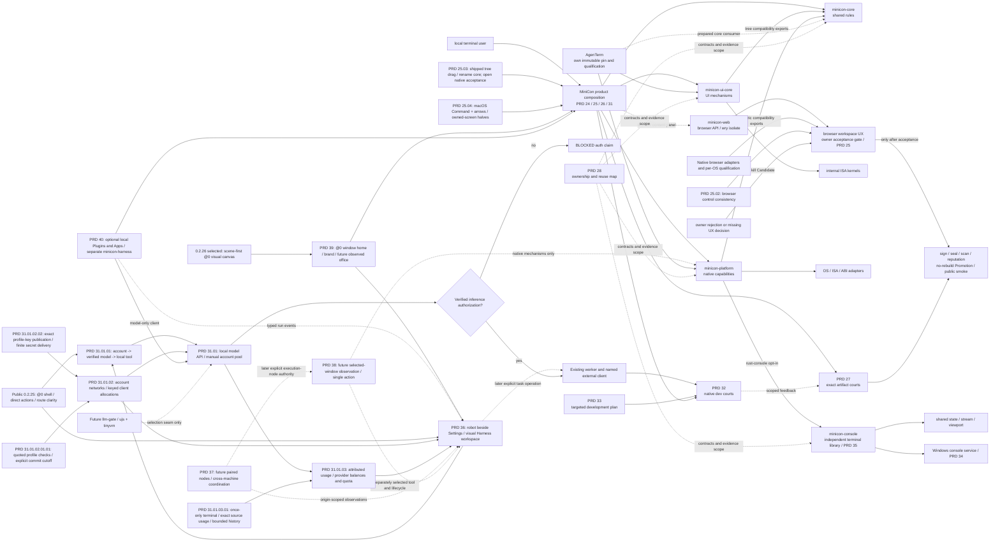

# MiniCon product requirements

MiniCon is a terminal that is one file: no required installer or bundled runtime.
Its authority is limited to local hosting and explicitly scoped extensions.
This compact index links each
capability to its owning PRD. Machine alignment is `alignment-contract.json`,
public evidence identities are in `evidence-registry.json`, and artifact
selection and signing requirements are in `release-policy.json`.

Legend: `[v]` delivered with evidence, `[-]` partial/open, `[_]` planned,
`[no]` explicit non-goal. A design can be complete while its implementation
remains planned; the frontier below distinguishes them.

## Product outcome

Launch one small executable, organize independent local terminals, type through
a dedicated input area, and automate the visible GUI through a bounded local
CLI. Failure in one child, tab, parser, callback or request must stay local.
MiniCon has no AgenTerm workbench server, Fleet, MCP, in-process general plugin
runtime or Agent permission policy. Its control endpoint belongs to the GUI
process lifetime. The owner-selected optional local Plugins and Apps layer is
bounded by [PRD 40](prd/PRD_02_40_plugins_apps.md).
The bounded `mux`/`harness` subcommands have their own scope in PRD 02.31;
the planned explicit local model listener is owned by PRD 02.31.01.
Settings and notes persistence belong to the workspace owner.
The owner's planned visual Harness direction is owned by PRD 36: a robot entry
and operational workspace become a core product track while Console/Web
foundations continue improvement and bug fixing. Its staged scope does not
grant the AgenTerm/Fleet server authorities excluded above.

## Markdown-tree DAG PRD

```text
MiniCon — one-file local terminal
├── Charter and authority → prd/PRD_02_23_minicon.md
│   ├── local hosting, bounded resources and explicit failure
│   └── [no] AgenTerm/Fleet server, remote execution, MCP or permission policy
├── Product composition — binary-private modules
│   ├── PTY lifecycle, VT/rendering and native presentation
│   │   └── prd/PRD_02_24_con_terminal.md
│   │       └── [-] modern TUI compatibility → prd/PRD_02_24_01_tui_compatibility.md
│   ├── [-] owned Rust Windows console backend: minicon-console
│   │   └── prd/PRD_02_34_windows_console_backend.md
│   ├── tab tree, content panels, composer, IME, selection, notes, settings and manual update
│   │   └── prd/PRD_02_25_con_workspace.md
│   │       ├── [v] Browser proxy preferences / Console-Web routes → prd/PRD_02_25_01_browser_preferences.md
│   │       ├── [-] Consistent browser controls → prd/PRD_02_25_02_browser_controls.md
│   │       ├── [-] Tab-tree drag / reliable inline editing (0.2.24) → prd/PRD_02_25_03_tab_tree_interactions.md
│   │       └── [-] macOS owned-window half shortcuts → prd/PRD_02_25_04_window_shortcuts.md
│   ├── local CLI, waits, structured snapshots and screenshots
│   │   └── prd/PRD_02_26_con_control_cli.md
│   ├── [-] Robot entry / visual Harness operation and monitoring → prd/PRD_02_36_harness_workspace.md
│   ├── [-] Fixed @0 home / future observed agent office → prd/PRD_02_39_home_dashboard.md
│   │   └── [_] 0.2.26 visual home canvas → prd/PRD_02_39_01_home_canvas.md
│   ├── [-] Optional Plugins and Apps layer / minicon-harness extraction → prd/PRD_02_40_plugins_apps.md
│   ├── [_] Future cluster / cross-machine coordination → prd/PRD_02_37_cluster_horizon.md
│   ├── [_] Future selected-window computer use → prd/PRD_02_38_computer_use.md
│   └── bounded mux/harness composition → prd/PRD_02_31_v0_2_horizon.md
│       └── [-] Harness settings / provider-pool / model API → prd/PRD_02_31_01_provider_gateway.md
│           ├── [-] Guided connection experience and recovery → prd/PRD_02_31_01_01_harness_experience.md
│           ├── [_] Independently versioned ujs / WASM logic → prd/PRD_02_31_01_04_dynamic_logic.md
│           ├── [-] Multi-account pool / account networks / client allocation → prd/PRD_02_31_01_02_provider_pool.md
│           │   ├── [-] Applied-profile private keys → prd/PRD_02_31_01_02_02_profile_keys.md
│           │   └── [-] Account catalogues / drafts / verified atomic apply → prd/PRD_02_31_01_02_01_connection_selection.md
│           │       └── [-] Whole-profile Verify and apply → prd/PRD_02_31_01_02_01_01_profile_verification.md
│           └── [-] Usage statistics / balance and allowance monitoring → prd/PRD_02_31_01_03_usage_monitoring.md
│               ├── [-] Exact request accounting / private retention → prd/PRD_02_31_01_03_01_request_accounting.md
│               ├── [-] Account balances / allowance / opted-in monitoring → prd/PRD_02_31_01_03_02_account_monitoring.md
│               └── [-] Usage reports / Monitoring presentation → prd/PRD_02_31_01_03_03_usage_reports.md
├── Reusable foundations → prd/PRD_02_28_shared_core.md
│   ├── [-] Commit-aware private publication → prd/PRD_02_28_02_private_publication.md
│   ├── minicon-core — shared rules; not a complete terminal engine
│   ├── minicon-ui-core — host-neutral UI mechanisms with internal ISA kernels
│   ├── minicon-platform — capability contracts and native OS/ISA/ABI adapters
│   ├── [-] minicon-console — independent terminal library and native service
│   │   └── prd/PRD_02_35_terminal_library.md
│   └── [-] minicon-web — browser content-panel API; native adapter ownership → PRD 28
│       ├── [-] Native context release and reuse → prd/PRD_02_28_01_browser_context_lifecycle.md
│       └── product face: Tab / content panel (PRD_02_25); renderer: PRD_02_31
│           · plan/plan-browser-tabs.md
├── Qualification and delivery
│   ├── native developer feedback → prd/PRD_02_32_dev_loop_crosscheck.md
│   ├── [-] targeted profiles and staged composition
│   │   └── prd/PRD_02_33_test_orchestration.md
│   └── exact-source artifacts, signing, scan and no-rebuild Promotion
│       └── prd/PRD_02_27_con_delivery.md
│           └── [_] deferred native command-line installation → prd/PRD_02_27_01_install.md
└── Current delivery
    ├── [v] public v0.2.22 → prd/archive/v0.2.22-release-history.md
    ├── [v] public v0.2.23 → prd/archive/v0.2.23-release-history.md
    ├── [v] public v0.2.24 tree interactions and clipboard status → prd/archive/v0.2.24-release-history.md
    ├── [v] public v0.2.25 fixed @0 / direct creation / scrollbars / route clarity → prd/archive/v0.2.25-release-history.md
    ├── [_] 0.2.26 @0 visual canvas → plan/plan-v0.2.26.md
    ├── current independent tracks → plan/plan-v0.2.x-product-roadmap.md
    └── historical outcomes and receipts → prd/archive/README.md
```

The reuse map distinguishes public contracts, actual consumers, required
features, OS adaptation, internal ISA selection and the scope of evidence.
A common API does not certify every optional capability on every host. The
owned `vt100`/`softbuffer` forks and their consumer requirements are mapped
there; they are not interchangeable with an arbitrary upstream resolution.

## Memory palace



## Governing invariants

- Child exit retains its tab, final screen and exit status until explicit close.
- Closing a parent promotes direct children; parent cycles are rejected.
- One tab cannot corrupt, indefinitely block or terminate another tab or host.
- Composer editing and terminal input have exactly one focus owner.
- Structured state, pixels, pointer ownership and screenshots describe the
  same presented frame.
- PTY traffic, parsing, control, waits, queues, dimensions, screenshots,
  allocations and shutdown are bounded and fail locally.
- MiniCon host process RSS is scarce. Idle one-tab intent is 10 MiB; child
  shells are outside that budget. Measurement and regression ceilings name
  their actual target and profile.
- Native callbacks never unwind across FFI.
- A public claim names its source, features, target/profile and exact evidence;
  compilation, a neighboring ISA or another product's pass cannot replace it.
- Release promotes sealed bytes with the policy-required Windows/macOS
  signatures and Defender evidence. Missing evidence blocks its claim.

## Capability ownership

| User problem / boundary | Owner | Observable evidence / safe failure |
|---|---|---|
| Product scope and authority | [Charter](prd/PRD_02_23_minicon.md) | explicit local-hosting boundary; reject expansion into Agent policy |
| Run and render real local shells | [Terminal](prd/PRD_02_24_con_terminal.md) | real-child/rendering journeys; fail only the affected session |
| Keep modern agent TUIs readable | [TUI compatibility](prd/PRD_02_24_01_tui_compatibility.md) | versioned real agents, bounded source/wire/state/pixel traces and provider-specific claims |
| Own the Windows console implementation | [Windows backend](prd/PRD_02_34_windows_console_backend.md) | planned API/bootstrap/lifecycle proofs; source research does not certify a replacement |
| Organize and type without corrupting drafts | [Workspace](prd/PRD_02_25_con_workspace.md) | composer, IME, tabs, content vs chrome panels, notes/settings and input journeys; no stale targeting |
| Return to @0 without creating a fake tab | [Home](prd/PRD_02_39_home_dashboard.md) | fixed destination, slogan shell, session preservation and future event-backed office |
| Read the @0 visual scene and its truthful local status | [Home canvas](prd/PRD_02_39_01_home_canvas.md) | 0.2.26 scene hierarchy, source/freshness, reversible actions and responsive evidence |
| Browser proxy preferences | [Preferences](prd/PRD_02_25_01_browser_preferences.md) | Active override, saved candidates and Console/Web settings routes |
| Consistent browser controls | [Controls](prd/PRD_02_25_02_browser_controls.md) | Development shared editing, keyboard menus, compact geometry and scoped native focus; final qualification open |
| Built-in browser surface (not tray) | [Workspace](prd/PRD_02_25_con_workspace.md) + [horizon / minicon-web](prd/PRD_02_31_v0_2_horizon.md) | Tab / content panel; open/load via minicon-web; wry isolated; proxy hook; staged OAuth/dashboard/preview/wasm |
| Automate what the GUI presents | [Control](prd/PRD_02_26_con_control_cli.md) | catalog, wait, snapshot and PNG black boxes; bounded typed errors |
| Bounded mux/harness subcommands | [0.2.x horizon](prd/PRD_02_31_v0_2_horizon.md) | explicit provider/session contracts; no workbench authority inherited |
| Connect model accounts to local harnesses | [Provider gateway](prd/PRD_02_31_01_provider_gateway.md), [connection experience](prd/PRD_02_31_01_01_harness_experience.md) | Development manual pool and model API; guided experience redesign specified after owner feedback, implementation and final qualification open; gateway cannot execute tools |
| Operate and monitor local Harness work | [Harness workspace](prd/PRD_02_36_harness_workspace.md) | Development robot entry/cached overview and later bounded app-backed task operation; stages and native evidence open |
| Manage an optional local agent application | [Plugins and Apps](prd/PRD_02_40_plugins_apps.md) | Independent minicon-harness artifact, versioned host/app seam, future Settings management and exact-pair evidence; absent app leaves host usable |
| Inspect and explicitly operate a selected application in future versions | [Computer use](prd/PRD_02_38_computer_use.md) | Planned same-repo product crate; observation before actions/Harness; native target/effect evidence remains open |
| Coordinate personal machines in future versions | [Cluster horizon](prd/PRD_02_37_cluster_horizon.md) | Planned explicit pairing/observation, later deliberate task handoff; origin, trust, stale state and two-machine evidence remain open |
| Embed a reusable terminal library | [Terminal library](prd/PRD_02_35_terminal_library.md) | common state/stream facade; OS/ISA runtime and session composition remain explicit |
| Abstract and reuse existing mechanisms | [Module/reuse map](prd/PRD_02_28_shared_core.md) | feature graphs, type identity, source boundaries and kernel oracles; keep product policy local |
| Native developer feedback | [Dev court](prd/PRD_02_32_dev_loop_crosscheck.md) | observed native suite execution; unavailable courts stay BLOCKED |
| Select and compose tests efficiently | [Test orchestration](prd/PRD_02_33_test_orchestration.md) | planned versus observed obligations; unknown impact expands coverage |
| Ship portable exact artifacts and control RSS/build cost | [Delivery](prd/PRD_02_27_con_delivery.md) | native artifacts, signatures, scan, Promotion and scoped measurements; no silent weakening |
| Install native MiniCon from a command line (deferred) | [Native installation](prd/PRD_02_27_01_install.md) | published OS-appropriate bootstrap scripts, verified native bytes and matching README/site instructions |
| Deferred portable logic / foundry directions | [qjswasm](prd/PRD_02_29_qjswasm_horizon.md), [foundry](prd/PRD_02_30_foundry_horizon.md) | independent complete-product decisions; no current-version implementation claim |

## Current frontier

- [v] **Public v0.2.25: fixed @0 Home, direct creation, scrollbars and account
  route clarity.** [Release history](prd/archive/v0.2.25-release-history.md)
  owns the exact source, signed Candidate, Defender, Promotion and downloaded
  asset evidence. The [archived plan](plan/archive/plan-v0.2.25.md) retains the
  release cut and open real-provider, client and native acceptance. Behavior
  stays with [experience](prd/PRD_02_31_01_01_harness_experience.md),
  [pool](prd/PRD_02_31_01_02_provider_pool.md),
  [dashboard](prd/PRD_02_36_harness_workspace.md),
  [Home](prd/PRD_02_39_home_dashboard.md) and
  [Web preferences](prd/PRD_02_25_01_browser_preferences.md).
- [_] **v0.2.26 is the selected design frontier.**
  [The plan](plan/plan-v0.2.26.md) and
  [@0 visual canvas owner](prd/PRD_02_39_01_home_canvas.md) prioritize a
  scene-first daily Home with truthful status and one clear next action.
  Observed task characters wait for the typed app-run event seam.

- [_] **Computer use is a future product track.** [PRD 38](prd/PRD_02_38_computer_use.md)
  owns target-bound observation/action and the same-repo crate decision;
  [its plan](plan/plan-minicon-cu.md) owns candidate version placement. This
  design does not expand the current release or worker tool authority.

- [-] **Visual Harness becomes a core product track.** The owner's 2026-10-25
  direction selects a robot entry/overview reservation with the current work,
  then staged visual operation/monitoring. [PRD 36](prd/PRD_02_36_harness_workspace.md)
  owns the design and [its plan](plan/plan-harness-workspace.md) owns sequencing.
  Settings forms, the provider pool and monitoring retain their existing owners;
  Console/Web maintenance and qualification continue.
- [-] **`minicon-harness` moves to an optional application.** The owner's
  2026-10-27 direction selects an independent repository and a future
  **Plugins and Apps** Settings route. [PRD 40](prd/PRD_02_40_plugins_apps.md)
  owns the host/app boundary and [its plan](plan/plan-minicon-harness-extraction.md)
  gates migration against released worker behavior. This changes the earlier
  AgenTerm-only placement rule only for the explicitly bounded MiniCon layer.
- [v] **Public v0.2.24: tab-tree drag, reliable inline rename and clipboard type.**
  [Release history](prd/archive/v0.2.24-release-history.md) owns the exact
  source, signed Candidate, Defender and public Promotion evidence.
  [PRD 25.03](prd/PRD_02_25_03_tab_tree_interactions.md) retains native
  pointer/IME/scroll/capture acceptance, while [PRD 25](prd/PRD_02_25_con_workspace.md)
  retains public clipboard-pixel and IME/status co-layout acceptance. Shipped
  core behavior does not close those wider cases.
- [v] **Public v0.2.22: terminal-to-browser preview and proxy preferences.**
  [Release history](prd/archive/v0.2.22-release-history.md) owns final source,
  signed/Candidate/Defender/public qualification, retained failures and scope.
  [Workspace](prd/PRD_02_25_con_workspace.md) and
  [preferences](prd/PRD_02_25_01_browser_preferences.md) own behavior.
- [v] **Public v0.2.23: browser controls and experimental first Harness connection.**
  [Release history](prd/archive/v0.2.23-release-history.md) owns the exact
  source, public chain and deferred acceptance record.
  [Controls](prd/PRD_02_25_02_browser_controls.md) and
  [provider gateway](prd/PRD_02_31_01_provider_gateway.md) own shipped
  behavior. The [connection experience](prd/PRD_02_31_01_01_harness_experience.md),
  [provider pool](prd/PRD_02_31_01_02_provider_pool.md) and
  [monitoring](prd/PRD_02_31_01_03_usage_monitoring.md) retain real-account,
  client and native acceptance still open after the owner's experimental
  release decision. Installation remains
  [deferred for coordinated AgenTerm planning](prd/PRD_02_27_01_install.md).
- [-] **Modern-agent and terminal-library qualification.** Owned Rust console
  is the Windows default from 0.2.20; classic remains the explicit rollback.
  G4/G6 and versioned agent/provider/OS/ISA/session acceptance stay open in
  [TUI compatibility](prd/PRD_02_24_01_tui_compatibility.md),
  [Windows backend](prd/PRD_02_34_windows_console_backend.md),
  [terminal library](prd/PRD_02_35_terminal_library.md), and
  [carried debt](plan/plan-carried-debt.md).
- [-] **Developer feedback remains scoped.** Explicit profiles work;
  complete inventory, automatic dependency closure and comparable measurement
  remain with [test orchestration](prd/PRD_02_33_test_orchestration.md).
  Hosted, local, translated-userspace and optional VM courts retain separate
  evidence in [native development](prd/PRD_02_32_dev_loop_crosscheck.md) and
  [delivery](prd/PRD_02_27_con_delivery.md).
- [-] **Browser horizon and host readability.** One Browser root is the current
  product; broader keyboard/IME/DPI, provider OAuth, dashboard/preview/wasm and
  1:N content panels are independently scoped in
  [workspace](prd/PRD_02_25_con_workspace.md),
  [browser horizon](plan/plan-browser-tabs.md), and
  [0.2.x horizon](prd/PRD_02_31_v0_2_horizon.md).
- [-] **Resource and rendering debt.** The 10 MiB host-RSS intent is unachieved.
  RSS/transient-host cost, artifact size, pack latency and retained TUI/resize
  findings remain with [delivery](prd/PRD_02_27_con_delivery.md),
  [terminal](prd/PRD_02_24_con_terminal.md), and
  [carried debt](plan/plan-carried-debt.md).
- [_] Ordinary push/PR CI remains parked; qjswasm awaits its own complete-product
  decision. [Current roadmap](plan/plan-v0.2.x-product-roadmap.md) and
  [hygiene sequence](plan/plan-repo-hygiene.md) point to open owners; archiving
  obsolete version proposals neither completes nor abandons their obligations.

## 未来构想

- [_] **Selected-window computer use.** [PRD 38](prd/PRD_02_38_computer_use.md)
  owns this planned product branch; [the CU plan](plan/plan-minicon-cu.md)
  owns candidate versions and selection gates. No current desktop/tool
  authority follows from this reservation.
- [_] **MiniCon 群集与跨机联动。** The owner selected this as an important
  subsequent-version direction on 2026-10-25. [PRD 37](prd/PRD_02_37_cluster_horizon.md#未来构想)
  owns identity/pairing, cross-node observation, deliberate task handoff and
  later model/capacity coordination. [Its plan](plan/plan-cluster-horizon.md)
  makes the concrete node/observation design the next planning milestone;
  public 0.2.24 does not claim or silently require cluster implementation.
  The [Harness dashboard](prd/PRD_02_36_harness_workspace.md) is its future
  operating surface; unsupported remote actions remain unavailable.

## History and evidence

[Release-history archive](prd/archive/README.md) owns historical outcomes.
The previous index is preserved in the
[v0.2.18 source tag](https://github.com/partnernetsoftware/minicon/blob/v0.2.18/PRD.md);
its intermediate planning statements are not the current frontier. Detailed
behavior, experiment diaries and per-version gate scope stay in their owners.

## How product work advances

1. Select one owning leaf and state its problem, invariant, evidence, safe
   failure, dependency and non-goal.
2. Consult the module/reuse map before new scope. Update responsibility, public
   reuse paths, features, OS/ISA boundaries and evidence scope in the same change.
3. Implement at the narrowest shared/native/product boundary; an identified
   consumer and contract precede another extraction.
4. Add public black-box evidence and register public capabilities/commands.
5. Qualify the actual source/artifact; upsert the owner before archiving a plan.
   Keep this root an index rather than a second behavior specification.
