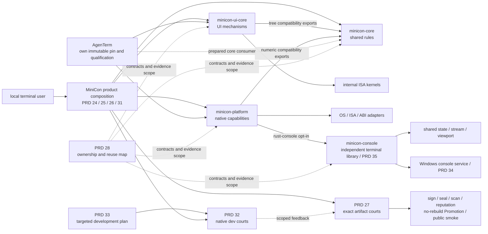

# MiniCon product requirements

MiniCon is a terminal that is one file: no installer, no bundled runtime, and
no authority beyond local terminal hosting. This compact index links each
capability to its owning PRD. Machine alignment is `alignment-contract.json`,
public evidence identities are in `evidence-registry.json`, and artifact
selection and signing requirements are in `release-policy.json`.

Legend: `[v]` delivered with evidence, `[-]` partial/open, `[_]` planned,
`[no]` explicit non-goal. A design can be complete while its implementation
remains planned; the frontier below distinguishes them.

## Product outcome

Launch one small executable, organize independent local terminals, type through
a dedicated input area, and automate the visible GUI through a bounded local
CLI. Failure in one child, tab, parser, callback or request must stay local.
MiniCon has no AgenTerm workbench server, Fleet, MCP, plugin host or Agent
permission policy. Its control endpoint belongs to the GUI process lifetime.
The bounded `mux`/`harness` subcommands have their own scope in PRD 02.31;
settings and notes persistence belong to the workspace owner.

## Markdown-tree DAG PRD

```text
MiniCon — one-file local terminal
├── Charter and authority → prd/PRD_02_23_minicon.md
│   ├── local hosting, bounded resources and explicit failure
│   └── [no] Agent workbench/server, Fleet, MCP or permission policy
├── Product composition — binary-private modules
│   ├── PTY lifecycle, VT/rendering and native presentation
│   │   └── prd/PRD_02_24_con_terminal.md
│   │       └── [-] modern TUI compatibility → prd/PRD_02_24_01_tui_compatibility.md
│   ├── [-] owned Rust Windows console backend: minicon-console
│   │   └── prd/PRD_02_34_windows_console_backend.md
│   ├── tab tree, composer, IME, selection, notes, settings and manual update
│   │   └── prd/PRD_02_25_con_workspace.md
│   ├── local CLI, waits, structured snapshots and screenshots
│   │   └── prd/PRD_02_26_con_control_cli.md
│   └── bounded mux/harness composition → prd/PRD_02_31_v0_2_horizon.md
├── Reusable foundations → prd/PRD_02_28_shared_core.md
│   ├── minicon-core — shared rules; not a complete terminal engine
│   ├── minicon-ui-core — host-neutral UI mechanisms with internal ISA kernels
│   ├── minicon-platform — capability contracts and native OS/ISA/ABI adapters
│   └── [-] minicon-console — independent terminal library and native service
│       └── prd/PRD_02_35_terminal_library.md
├── Qualification and delivery
│   ├── native developer feedback → prd/PRD_02_32_dev_loop_crosscheck.md
│   ├── [-] targeted profiles and staged composition
│   │   └── prd/PRD_02_33_test_orchestration.md · plan/plan-v0.2.16.md
│   └── exact-source artifacts, signing, scan and no-rebuild Promotion
│       └── prd/PRD_02_27_con_delivery.md
└── Current delivery
    ├── [v] v0.2.18 → prd/archive/v0.2.18-release-history.md
    ├── [-] v0.2.16 test-selection work → plan/plan-v0.2.16.md
    ├── [-] v0.2.17 modern-agent gate → plan/plan-v0.2.17.md
    └── [_] 0.2.x product sequence / release decisions → plan/plan-v0.2.x-product-roadmap.md
```

The reuse map distinguishes public contracts, actual consumers, required
features, OS adaptation, internal ISA selection and the scope of evidence.
A common API does not certify every optional capability on every host. The
owned `vt100`/`softbuffer` forks and their consumer requirements are mapped
there; they are not interchangeable with an arbitrary upstream resolution.

## Memory palace



## Governing invariants

- Child exit retains its tab, final screen and exit status until explicit close.
- Closing a parent promotes direct children; parent cycles are rejected.
- One tab cannot corrupt, indefinitely block or terminate another tab or host.
- Composer editing and terminal input have exactly one focus owner.
- Structured state, pixels, pointer ownership and screenshots describe the
  same presented frame.
- PTY traffic, parsing, control, waits, queues, dimensions, screenshots,
  allocations and shutdown are bounded and fail locally.
- MiniCon host process RSS is scarce. Idle one-tab intent is 10 MiB; child
  shells are outside that budget. Measurement and regression ceilings name
  their actual target and profile.
- Native callbacks never unwind across FFI.
- A public claim names its source, features, target/profile and exact evidence;
  compilation, a neighboring ISA or another product's pass cannot replace it.
- Release promotes sealed bytes with the policy-required Windows/macOS
  signatures and Defender evidence. Missing evidence blocks its claim.

## Capability ownership

| User problem / boundary | Owner | Observable evidence / safe failure |
|---|---|---|
| Product scope and authority | [Charter](prd/PRD_02_23_minicon.md) | explicit local-hosting boundary; reject expansion into Agent policy |
| Run and render real local shells | [Terminal](prd/PRD_02_24_con_terminal.md) | real-child/rendering journeys; fail only the affected session |
| Keep modern agent TUIs readable | [TUI compatibility](prd/PRD_02_24_01_tui_compatibility.md) | versioned real agents, bounded source/wire/state/pixel traces and provider-specific claims |
| Own the Windows console implementation | [Windows backend](prd/PRD_02_34_windows_console_backend.md) | planned API/bootstrap/lifecycle proofs; source research does not certify a replacement |
| Organize and type without corrupting drafts | [Workspace](prd/PRD_02_25_con_workspace.md) | composer, IME, tabs, notes/settings and input journeys; no stale targeting |
| Automate what the GUI presents | [Control](prd/PRD_02_26_con_control_cli.md) | catalog, wait, snapshot and PNG black boxes; bounded typed errors |
| Bounded mux/harness subcommands | [0.2.x horizon](prd/PRD_02_31_v0_2_horizon.md) | explicit provider/session contracts; no workbench authority inherited |
| Embed a reusable terminal library | [Terminal library](prd/PRD_02_35_terminal_library.md) | common state/stream facade; OS/ISA runtime and session composition remain explicit |
| Abstract and reuse existing mechanisms | [Module/reuse map](prd/PRD_02_28_shared_core.md) | feature graphs, type identity, source boundaries and kernel oracles; keep product policy local |
| Native developer feedback | [Dev court](prd/PRD_02_32_dev_loop_crosscheck.md) | observed native suite execution; unavailable courts stay BLOCKED |
| Select and compose tests efficiently | [Test orchestration](prd/PRD_02_33_test_orchestration.md) | planned versus observed obligations; unknown impact expands coverage |
| Ship portable exact artifacts and control RSS/build cost | [Delivery](prd/PRD_02_27_con_delivery.md) | native artifacts, signatures, scan, Promotion and scoped measurements; no silent weakening |
| Deferred portable logic / foundry directions | [qjswasm](prd/PRD_02_29_qjswasm_horizon.md), [foundry](prd/PRD_02_30_foundry_horizon.md) | independent complete-product decisions; no current-version implementation claim |

## Current frontier

- [-] **Owned Rust Windows console backend: minicon-console.** Native ConDrv,
  limited Win32 I/O/records and job cleanup are implemented. The explicit
  experimental PTY and GUI choice is packaged in v0.2.18; scoped PowerShell/Node
  and Ctrl+C evidence exists. Broader API/runtime compatibility, especially
  Windows ARM64 Rust-provider execution and a visible exact-Candidate agent
  matrix, remain open. The classic Windows provider is still the default.
  [Owner](prd/PRD_02_34_windows_console_backend.md) and
  [sequence](plan/plan-windows-console-backend.md).
- [v] **v0.2.18 published**, `2026-10-21T06:56:59Z`, source
  `9a25ee4b55809c9118d67ab9c1904a8e800b956d`. The signed packages include
  the explicit Rust-console choice and display the correct version; child-tab
  targeting, bounded screenshot replies and initial staged developer profiles
  also ship. [Release history](prd/archive/v0.2.18-release-history.md) owns the
  exact receipts and limits. The full three-agent TUI gate was not claimed.
- [-] **Test selection remains partial.** Explicit edit/integration profiles,
  task deduplication and plan-only conservative path selection now work;
  complete inventory, automatic dependency closure and comparable cost/coverage
  measurement remain open. [Plan](plan/plan-v0.2.16.md) and
  [owner](prd/PRD_02_33_test_orchestration.md) retain the work.
- [-] **Modern agent and portable-session quality remain open.** The
  [TUI plan](plan/plan-v0.2.17.md) and
  [0.2.x roadmap](plan/plan-v0.2.x-product-roadmap.md) retain the unqualified
  three-agent, native API, OS/ISA and default-provider decisions.
- [-] **RSS and transient-host cost**, including carried `{AMPLIFIER-T}`, remain
  open. The 10 MiB intent is not achieved by this release. Measurements and
  retained-frame/native-host investigations belong to
  [delivery](prd/PRD_02_27_con_delivery.md).
- [-] **macOS host-UI readability** remains open, including tab/header and
  composer-button text. [Workspace](prd/PRD_02_25_con_workspace.md) owns the
  zoom/text/padding follow-up.
- [-] **Pack latency and artifact size** remain separate measurements. Retain
  Linux dual-desktop support and the reputation-qualified Windows profile;
  compacting/compiler changes need their own evidence. Owner:
  [delivery](prd/PRD_02_27_con_delivery.md).
- [-] **Court baselines remain independent.** Hosted native, local UTM,
  provisional translated userspace and optional Lima results do not inherit
  each other's verdicts. Local baselines and unavailable evidence remain with
  [delivery](prd/PRD_02_27_con_delivery.md).
- [-] **Windows alternate-screen resize and retained TUI findings** remain
  scoped follow-ups. [Terminal](prd/PRD_02_24_con_terminal.md) and the
  [resize record](plan/plan-alt-screen-resize.md) retain their evidence; the
  0.2.15 mirror correction does not close every TUI rendering report.
- [_] Ordinary push/PR CI remains parked. qjswasm portable logic still waits
  for a stable AgenTerm engine and a decisive complete-product experiment.
- Other carried work remains in [carried debt](plan/plan-carried-debt.md) and
  [repository hygiene](plan/plan-repo-hygiene.md), not implicitly completed by
  the new release.

## History and evidence

[Release-history archive](prd/archive/README.md) owns historical outcomes.
The previous index is preserved in the
[v0.2.18 source tag](https://github.com/partnernetsoftware/minicon/blob/v0.2.18/PRD.md);
its intermediate planning statements are not the current frontier. Detailed
behavior, experiment diaries and per-version gate scope stay in their owners.

## How product work advances

1. Select one owning leaf and state its problem, invariant, evidence, safe
   failure, dependency and non-goal.
2. Consult the module/reuse map before new scope. Update responsibility, public
   reuse paths, features, OS/ISA boundaries and evidence scope in the same change.
3. Implement at the narrowest shared/native/product boundary; an identified
   consumer and contract precede another extraction.
4. Add public black-box evidence and register public capabilities/commands.
5. Qualify the actual source/artifact; upsert the owner before archiving a plan.
   Keep this root an index rather than a second behavior specification.
