# MiniCon product requirements

MiniCon is a terminal that is one file: no installer, no bundled runtime, and
no authority beyond local terminal hosting. This compact root is the product
index and decision map. Details and history live in the owning `prd/PRD_*.md`;
machine alignment is `alignment-contract.json`, and public evidence identities
are in `evidence-registry.json`.

Legend: `[v]` shipped, `[-]` partial, `[_]` planned, `[no]` explicit non-goal.

## Product outcome

A user can launch one small executable, organize independent local terminals,
type through a dedicated input area, and automate the visible GUI through a
bounded local CLI. Failure in one child, tab, callback, parser or request does
not destroy unrelated sessions or the host.

MiniCon remains useful precisely because it is not AgenTerm: it has no
workbench server, persistent workspace, Fleet, mux, MCP, script runtime,
plugin host, or Agent permission policy. AgenTerm is the Agent-era workbench
on the same platform layer. MiniCon `--control` is a GUI-lifetime local
socket/pipe inside that process, not AgenTerm's server. Details:
`prd/PRD_02_23_minicon.md`, `prd/PRD_02_26_con_control_cli.md`.

## Markdown-tree DAG PRD

The root tree records outcomes, owners and current decisions only. Follow the
linked module for behavior, evidence, delivery mechanics and history.

```text
MiniCon — one-file local terminal
├── Charter and authority
│   ├── local terminal host; one executable; operating-system libraries only
│   ├── host process RSS is scarce; idle one-tab intent is 10 MiB; child shells excluded
│   ├── [no] no server, persistence, Fleet, mux, MCP, scripts or Agent policy
│   └── prd/PRD_02_23_minicon.md
├── User capabilities
│   ├── Terminal runtime and rendering
│   │   ├── PTY lifecycle, bounded VT/rendering, CJK and native presentation
│   │   └── prd/PRD_02_24_con_terminal.md
│   ├── Workspace and human input
│   │   ├── stable tab tree, composer, IME, selection, clipboard and scrollback
│   │   └── prd/PRD_02_25_con_workspace.md
│   └── Scriptable observation and control
│       ├── GUI-lifetime endpoint, bounded protocol, waits, snapshots and PNG
│       └── prd/PRD_02_26_con_control_cli.md
├── Delivery and portability
│   ├── [v] v0.2.10 released — ordinary output stops re-rasterising the whole
│   │   window (root cause: GDI StretchDIBits sub-rect blit; fixed 9892242)
│   │      flashing resolved: scroll band damage + Windows full-frame upgrade
│   │      removed + the GDI present defect it masked, all evidenced by the
│   │      registered black-box journey red→green
│   │   ├── plan/plan-v0.2.10.md
│   │   ├── plan/plan-scroll-damage.md
│   │   └── prd/archive/v0.2.10-release-history.md
│   │   ├── plan/plan-v0.2.10.md
│   │   └── plan/plan-scroll-damage.md
│   ├── [v] v0.2.9 released — settings that survive a restart (first write path) +
│   │   restart cost + history label and scroll
│   │   ├── plan/archive/plan-v0.2.9.md
│   │   ├── prd/archive/v0.2.9-release-history.md
│   │   └── plan/plan-scroll-damage.md
│   ├── [v] v0.2.8 released — an update can no longer brick an install + clipboard image paste + scrollbar scale
│   │   ├── plan/archive/plan-v0.2.8.md
│   │   └── prd/archive/v0.2.8-release-history.md
│   ├── [v] v0.2.7 released — manual check-for-updates (#4) + window-icon parity on Windows/X11
│   │   └── prd/archive/v0.2.7-release-history.md
│   ├── [v] v0.2.6 released — right-side collapsible sent-history panel (#3) + paired header toggles
│   │   └── prd/archive/v0.2.6-release-history.md
│   ├── [v] v0.2.5 released — inline tab rename + OSC-title row; the platform layer moves into MiniCon
│   │   └── prd/archive/v0.2.5-release-history.md
│   ├── [v] v0.2.4 released — composer Send timing (held Enter), Ctrl+V paste review, content preview counts
│   │   └── prd/archive/v0.2.4-release-history.md
│   ├── [v] v0.2.3 released — multi-line composer editing, settings panel, three themes, crosshair + status bar
│   │   └── prd/archive/v0.2.3-release-history.md
│   ├── [v] v0.2.2 released — 0.2.1's remaining leaves (mux `list-panes` gap, one macOS fix); no separate release-history doc
│   │   └── prd/PRD_02_31_v0_2_horizon.md · plan/archive/plan-v0.2.2.md
│   ├── [v] v0.2.1 released — harness statefulness/containment and macOS exec fix; dual-signed
│   │   └── prd/archive/v0.2.1-release-history.md
│   ├── six cells: {win,lnx,osx} × {x86_64,aarch64}
│   ├── build once; runtime courts execute exact artifacts without compiling
│   ├── independent evidence lanes
│   │   ├── GitHub native runners — fast regression and real ISA
│   │   └── local UTM — partnernetsoftware/utm-court; MiniCon calls it at test time
│   ├── [v] agent dev-test loop — push a fix, native build+test per cell,
│   │   `contents: read` only, no release/GHCR/tag needed
│   │   └── prd/PRD_02_32_dev_loop_crosscheck.md
│   ├── [v] v0.1.2 stable — 3 archives covering 4/6 cells + SHA-256 sidecars
│   ├── [v] v0.1.3 released — 5 native archives cover all 6 cells
│   │   ├── 5 archives: win/lnx × {x86_64,arm64} + macOS Universal
│   │   ├── unsigned by explicit release-policy.json configuration
│   │   ├── exact Candidate bytes + Defender on both Windows executables
│   │   └── exact Candidate promoted without rebuild after gates + human authority
│   ├── [v] v0.1.4 released — unsigned native six-cell + Linux X11 runtime fix
│   │   ├── 5 archives: win/lnx × {x86_64,arm64} + macOS Universal
│   │   ├── SignPath not configured; signing.mode remained off
│   │   ├── minicon.com remained excluded by policy
│   │   └── prd/archive/v0.1.4-release-history.md
│   ├── [v] v0.1.5 released — unsigned minicon.com + native six-cell set
│   │   ├── one build; six APE execute-only courts; exact three-PE Defender court
│   │   ├── exact Candidate promoted without rebuild; public bytes re-executed
│   │   └── prd/archive/v0.1.5-release-history.md
│   ├── [v] v0.1.6 released — multiline paste + unsigned six-cell + minicon.com
│   │   └── prd/archive/v0.1.6-release-history.md
│   ├── [v] v0.1.7 released — UI groundwork; last unsigned line
│   │   └── prd/archive/v0.1.7-release-history.md
│   ├── [v] v0.1.9 released — FIRST dual-signed (Windows Authenticode + macOS notarized)
│   │   ├── both signing switches required; PARTNERNET SOFTWARE PTY LTD
│   │   └── prd/archive/v0.1.9-release-history.md
│   ├── [v] v0.1.10 released — complete UI (settings panel, themes, crosshair); dual-signed + signed .dmg
│   │   └── prd/archive/v0.1.10-release-history.md
│   ├── [v] v0.1.11 released — per-theme terminal colors; dual-signed
│   │   └── prd/archive/v0.1.11-release-history.md
│   ├── [v] v0.1.12 released — finish & polish (composer selection, UI); dual-signed
│   │   └── prd/archive/v0.1.12-release-history.md
│   ├── [v] v0.1.13 released — legacy-Windows CJK console rendering fix; dual-signed
│   │   └── prd/archive/v0.1.13-release-history.md
│   ├── [v] v0.1.14 released — Windows per-monitor DPI awareness + mouse-wheel; dual-signed
│   │   └── prd/archive/v0.1.14-release-history.md
│   ├── [v] v0.1.15 released — Windows terminal/composer overlap + bottom-row click fix; dual-signed
│   │   └── prd/archive/v0.1.15-release-history.md
│   ├── [v] v0.1.16 released — macOS MiniCon.app bundle + install-cli; dual-signed
│   │   └── prd/archive/v0.1.16-release-history.md
│   ├── [v] v0.1.17 released — real Enter after Send; --file/--output cross-tab I/O; dual-signed
│   │   └── prd/archive/v0.1.17-release-history.md
│   ├── [v] v0.1.18 released — opt-in Windows console agent for mouse; greeting-page Quit; dual-signed
│   │   └── prd/archive/v0.1.18-release-history.md
│   ├── [v] v0.1.19 released — non-ASCII paste fix; classic console by default + --feature; dual-signed
│   │   └── prd/archive/v0.1.19-release-history.md
│   ├── [v] v0.1.26 released — composer caret history/motion + word motion + Home/End unified in minicon_core::keymap; Windows zoom-to-blank root-caused; dual-signed
│   │   └── prd/archive/v0.1.26-release-history.md
│   ├── [v] v0.1.23 released — Windows: scrollback restored, Ctrl+V pastes, collapsed rail selects, --status names the real console; dual-signed
│   │   └── prd/archive/v0.1.23-release-history.md
│   ├── [v] v0.1.22 released — clarity release: attic archived, ConTerminal module, release tooling out of research/, shared scrollbar; dual-signed
│   │   └── prd/archive/v0.1.22-release-history.md
│   ├── [v] v0.1.21 released — Windows Latin face + DirectWrite-style text; copy-on-select in mouse apps; clipboard length; dual-signed
│   │   └── prd/archive/v0.1.21-release-history.md
│   ├── [v] v0.1.20 released — detachable/headless GUI; collapsible tab rail; MiniCon.app icon; dual-signed
│   │   └── prd/archive/v0.1.20-release-history.md
│   ├── release chain — one command `scripts/release.sh <version>`: six-cell
│   │   pack, dual signing, Candidate, Defender court, reputation, no-rebuild
│   │   Promotion (CI-native throughout; no local credentials)
│   │   └── prd/PRD_02_27_con_delivery.md · "Driving the chain"
│   └── prd/PRD_02_27_con_delivery.md
├── Reuse boundaries
│   ├── module owners and reuse entries: core / UI-core / platform / product
│   ├── portable contracts vs internal OS / ISA / ABI selection
│   ├── source inventory vs per-cell build and runtime evidence
│   └── prd/PRD_02_28_shared_core.md
├── Capability vs plugin boundary (with agenterm)
│   ├── capabilities sink into MiniCon; plugins/apps gather in agenterm;
│   │   the only seam is the versioned capability contract
│   └── prd/PRD_02_23_minicon.md · "Capability and plugin boundary"
├── Future experiments — not current-version scope
│   ├── qjswasm + TinyVM portable logic; six native OS shells remain
│   │   └── prd/PRD_02_29_qjswasm_horizon.md
│   ├── foundry software production line (cross-product; not MiniCon scope)
│   │   └── prd/PRD_02_30_foundry_horizon.md
│   ├── dedicated OS/HarmonyOS feasibility belongs to portfolio horizon
│   └── [-] 0.2.x: mux (tmux-shaped tab control) + harness (file+exec-only
│       agent, DeepSeek flash first) — narrows AGENTS.md's product boundary,
│       owner decision 2026-09-24; 0.2.x stays mux+harness hardening plus
│       existing UI/UX and platform-foundation stability, no new features;
│       `harness` split 2026-09-26 into two owners: `harness` (worker, this
│       node, unchanged) and `harness-manage` (manager/orchestration role,
│       new, parked in an unassigned — likely 0.3.x — horizon, BLOCKED on
│       undesigned context/workflow concepts); GUI workbench over harness
│       also moved to 0.3.x (renderer = reuse agenterm-platform webview when
│       it starts, not CDP/Electron/minicon-surf; real blocker there is now
│       only streaming, not the renderer or the rest of statefulness) —
│       neither started; v0.2.1 plan's `HS` (harness statefulness) and `MH`
│       (mux hardening) closed 2026-09-26 with named evidence; `HB`
│       (v0.2.0's own named BLOCKED debt) half-closed (contained-process-spawn
│       done, native-tls arm still BLOCKED — needs an Apple Silicon macOS
│       host this session's Linux cloud container does not have); `UI`
│       (terminal/platform stabilization) BLOCKED for the same reason (no
│       display/GPU here to verify a rendering or memory change); release/
│       signing completed with owner authority on 2026-09-26: v0.2.1
│       published; exact Candidate, signatures, Defender and public-download
│       checks PASS. See prd/archive/v0.2.1-release-history.md. Earlier cloud
│       environment gaps above remain separate from the new release receipts.
│       └── prd/PRD_02_31_v0_2_horizon.md · plan/archive/plan-v0.2.1.md ·
│             plan/archive/plan-v0.2.0.md
└── Executable truth
    ├── alignment-contract.json — capability → owner → command → evidence
    ├── evidence-registry.json — evidence identity → public test target
    ├── tests/ — black-box journeys
    └── .github/workflows/ — qualification and release automation
```

## Mermaid flowchart memory palace

Read left to right: user value enters a capability room, crosses the product/
platform boundary, is judged by exact-artifact evidence, and only then reaches
a release decision. Dashed paths are optional or future work.

```mermaid
flowchart LR
    U["User value<br/>one file · real terminals<br/>human + script control"]

    subgraph UX["Capability rooms"]
        T["Terminal<br/>PTY · VT · rendering"]
        W["Workspace<br/>tabs · composer · IME"]
        C["Control<br/>CLI · waits · snapshots"]
    end
    subgraph B["Authority boundary"]
        H["MiniCon host<br/>local product policy"]
        P["Platform adapters<br/>window · PTY · input · IPC"]
        K["minicon-core<br/>host-neutral rules"]
        UI["minicon-ui-core<br/>shared UI mechanisms<br/>internal ISA kernels"]
        N["Explicitly absent<br/>server · persistence · mux · scripts"]
    end
    subgraph E["Exact-artifact evidence"]
        X["Build owner<br/>six artifacts · source identity"]
        GH["GitHub native six-grid<br/>fast regression · real ISA"]
        VM["utm-court CLI<br/>controlled images · permissions"]
        R["Lane-labelled receipts<br/>same contracts · independent verdicts"]
    end
    subgraph REL["Release evolution"]
        V12["v0.1.2 stable<br/>three packages"]
        C13["v0.1.3 released<br/>5 native archives · 6 cells · unsigned"]
        G13["qualified exact bytes<br/>runtime · control · Defender"]
        V13["public immutable Release<br/>no rebuild"]
        C14["v0.1.4 released<br/>unsigned native six-cell · X11 fix"]
        C15["v0.1.5 released<br/>native six-cell + unsigned minicon.com"]
        C16["v0.1.6 released<br/>multiline paste + unsigned six-cell"]
        C17["v0.1.7 released<br/>UI groundwork · last unsigned"]
        SR9["v0.1.9 released<br/>FIRST dual-signed · Win Authenticode + macOS notarized"]
        R110["v0.1.10 released<br/>complete UI · dual-signed · signed .dmg"]
        R111["v0.1.11 released<br/>per-theme terminal colors · dual-signed"]
        R112["v0.1.12 released<br/>finish & polish · composer selection · dual-signed"]
        R113["v0.1.13 released<br/>legacy-Windows CJK console fix · dual-signed"]
        R114["v0.1.14 released<br/>Windows DPI awareness + mouse-wheel · dual-signed"]
        R115["v0.1.15 released<br/>Windows terminal/composer overlap + click fix · dual-signed"]
        R116["v0.1.16 released<br/>macOS MiniCon.app bundle + install-cli · dual-signed"]
        R117["v0.1.17 released<br/>real Enter after Send · --file/--output · dual-signed"]
        R118["v0.1.18 released<br/>Windows mouse via console agent · greeting Quit · dual-signed"]
        R119["v0.1.19 released<br/>non-ASCII paste fix · classic console default · --feature · dual-signed"]
        R120["v0.1.20 released<br/>detachable + headless GUI · collapsible tab rail · app icon · dual-signed"]
        R121["v0.1.21 released<br/>Windows Latin face · DirectWrite-style text · copy-on-select in mouse apps · clipboard length · dual-signed"]
        R122["v0.1.22 released<br/>clarity release · shared scrollbar with agenterm · dual-signed"]
        R123["v0.1.23 released<br/>Windows scrollback · Ctrl+V paste · collapsed rail · honest --status · dual-signed"]
        R126["v0.1.26 released<br/>composer caret/word motion · keymap unified · Windows zoom-to-blank root-caused · dual-signed"]
        R020["v0.2.0 released<br/>mux + harness · dual-signed"]
        R021["v0.2.1 released<br/>harness statefulness/containment · macOS exec fix · dual-signed"]
        R022["v0.2.2 released<br/>0.2.1's remaining leaves · mux list-panes gap"]
        R023["v0.2.3 released<br/>multi-line composer · settings panel · three themes · crosshair + status bar"]
        R024["v0.2.4 released<br/>composer Send timing · Ctrl+V paste review · preview counts"]
        R025["v0.2.5 released<br/>inline tab rename · OSC-title row · platform layer moves into MiniCon"]
        R026["v0.2.6 released<br/>right-side collapsible sent-history panel + header toggles"]
        R027["v0.2.7 released<br/>manual check-for-updates (#4) · window-icon parity on Windows/X11"]
        R028["v0.2.8 released<br/>update path can no longer brick an install · clipboard image paste · scrollbar scale"]
        R029["v0.2.9 released<br/>settings that survive a restart (first write path) · restart cost · history label+scroll · flashing fix spec'd, deferred"]
        R030["v0.2.10 released<br/>flashing root-caused to GDI StretchDIBits sub-rect blit · scroll band damage + guard removal + present fix · journey red→green"]
        KEEP["rejected Linux Candidate<br/>repair transitive runtime"]
    end
    subgraph F["Future, dependency-gated"]
        SP["SignPath Foundation<br/>declined 2026-09 · path closed"]
        SI["company Artifact Signing<br/>account · OIDC signer identity"]
        SV["Public Organization validation<br/>Completed 2026-09-03"]
        SC["MiniCon Public Trust profile<br/>Active · company-signing.yml wired"]
        QE["agenterm qjswasm + TinyVM ready"]
        QX["portable-logic experiment<br/>one body + six native shells"]
        QG{"total size + startup + memory<br/>six-cell parity pass?"}
    end

    U --> T & W & C
    K & UI & P --> H
    N -. constrains .-> H
    H --> T & W & C
    T & W & C --> X
    X --> GH & VM
    GH & VM --> R
    R --> V12 --> C13
    C13 --> G13 --> V13 --> C14 --> C15 --> C16
    C15 -. rejected precursor .-> KEEP
    C16 --> C17 --> SR9 --> R110 --> R111 --> R112 --> R113 --> R114 --> R115 --> R116 --> R117 --> R118 --> R119
    R119 --> R120 --> R121 --> R122 --> R123 --> R126 --> R020 --> R021 --> R022 --> R023 --> R024 --> R025 --> R026 --> R027 --> R028
    R028 --> R029
    R029 -. planned .-> R030
    SP -. declined .-> SI
    SI --> SV -->|Completed| SC
    SC -->|first exact signed run| SR9
    SP -. path closed; company path shipped .-> SR9
    QE -. later .-> QX
    X -. native baseline .-> QX
    QX --> QG
    QG -->|fail| KEEP
```



## Governing invariants

- Child exit retains its tab, final screen and exit status until explicit close.
- Closing a parent promotes direct children; parent cycles are rejected.
- One tab cannot corrupt, indefinitely block or terminate another tab or host.
- Composer editing and terminal input have exactly one focus owner.
- Structured state, pixels, pointer ownership and screenshots describe the
  same presented frame.
- PTY traffic, parsing, control, waits, queues, dimensions, screenshots,
  allocations and shutdown are bounded and fail locally.
- MiniCon host process RSS is scarce and named by profile and target. Idle
  one-tab intent is 10 MiB. Child shells are outside that budget.
- Native callbacks never unwind across FFI.
- A public claim names its target/profile and exact evidence; one platform's
  measurement never silently becomes universal.

## Capability ownership

| User problem | Owner | Observable success | Safe failure |
|---|---|---|---|
| Run real local shells | [Terminal](prd/PRD_02_24_con_terminal.md) | real-child and sustained-output journeys | reject or close only the affected session |
| Organize and type without output corrupting drafts | [Workspace](prd/PRD_02_25_con_workspace.md) | multitab, composer, IME and interaction journeys | cancel unfinished interaction; never target a stale tab |
| Automate what the GUI really shows | [Control](prd/PRD_02_26_con_control_cli.md) | catalog, wait, snapshot and PNG black boxes | bounded typed error; cancel waits with their owner |
| Ship portable exact artifacts | [Delivery](prd/PRD_02_27_con_delivery.md) | six-cell runtime and release receipts | block the artifact or claim; never weaken it silently |
| Stay small in RAM | [Delivery](prd/PRD_02_27_con_delivery.md) | idle host RSS court; named regression ceiling | fail the claim; do not kill user sessions |
| Agent-driven cross-arch dev/test loop | [Dev-loop crosscheck](prd/PRD_02_32_dev_loop_crosscheck.md) | native per-cell build+test on request, real logs | cell BLOCKED, never a silent skip; never a release/publish path |
| Module ownership, abstraction and reuse | [Module and reuse map](prd/PRD_02_28_shared_core.md) | dependency/source boundaries, kernel oracles and scoped per-cell receipts | keep product policy local; unavailable runtime evidence is BLOCKED |

## Current frontier

- [-] **v0.2.15 preparation: module abstraction and reuse.** Preserve public
  crate names and behavior; strengthen core portability checks, enable minimal
  core consumers, and unify tree/numeric ownership behind compatible exports.
  Scope owner: [module and reuse map](prd/PRD_02_28_shared_core.md).
  Sequence and scoped evidence: [0.2.15 plan](plan/plan-v0.2.15.md).
- [-] **v0.2.12 in planning.** Anchor: the user-notes scratchpad (GitHub #5
  phase 1 — session-scoped, global-first, never sent to the PTY, no
  persistence) plus the carried {AMPLIFIER-T} transient-host debt from
  0.2.10. Plan: `plan/plan-v0.2.12.md`. Issues #3 and #4 verified shipped
  and closed (0.2.6 / 0.2.7 respectively).
- [v] **v0.2.11 released (2026-10-15, 06:56:25 UTC).** Hotfix: 0.2.10's
  band present read past the pixel buffer (bit pointer offset included the
  column component while biWidth stayed full-stride), crashing GDI32 with
  0xc0000005 on busy-TUI bottom-band presents — the mycodex.bat (codex TUI)
  crash the owner reported. Fix `c0214e8`: the read window is derived by
  `band_present_read_window()` (whole-row offset, full-stride band, DC
  clips), pinned by a regression test that also proves the 0.2.10 form out
  of bounds; a debug_assert guards the call site. Chain eight steps green
  (Defender on attempt 3 through the known RPC window; one dispatcher
  incident: signing first dispatched without `qualification_only=false`).
  History: `prd/archive/v0.2.11-release-history.md`.
- [v] **v0.2.10 released (2026-10-14, superseded by v0.2.11 hotfix).** Ordinary output stops
  re-rasterising the whole window — the reported flashing (总是感觉闪屏) is
  root-caused and fixed. Four code commits: {GATE-FORK} (`e566635`) gates the
  vendored fork's damage oracle; {SCROLL-DAMAGE} (`7f21e48`) narrows a scroll
  to its provable region band plus a `scrollback_changed` flag; {AMPLIFIER-W}
  (`ad00f39`) removes the Windows blanket full-frame upgrade; `9892242` fixes
  the GDI `StretchDIBits` sub-rect defect the upgrade had been masking (every
  partial present with a nonzero source top blitted DIB-origin rows, failed
  validation, and forced a full-frame repair — the flashing itself; measured
  345/345 and 441/441 where the old form returned 0 and 561, zero Failed
  outcomes). The proof is the workflow's own black-box journey, red without
  the guard before the fix and green after it, repeatedly. Chain: all eight
  steps green in ~21 minutes (Defender first attempt); one hand-retry on
  reputation (dispatcher passed a file path instead of its base64 contents —
  recorded). {AMPLIFIER-T} deferred to 0.2.11 with its design note.
  History: `prd/archive/v0.2.10-release-history.md`.
- [v] **v0.2.7 released (2026-10-13).** Manual
  check-for-updates (GitHub #4) — the product's first outbound network call and
  first self-modifying behaviour — plus window-icon parity on Windows and X11.
  macOS keeps the icon its `.app` carries; the runtime path for the bare CLI
  binary needs `objc2` as a direct platform dependency and is a named gap, not
  a claim. Also landed: `Shift+Enter` sends alongside `Ctrl+O`, and the
  `--help`/README shortcut gate 0.2.6 had left broken. Source `f52662a`, chain
  run ids in `prd/archive/v0.2.7-release-history.md`. Behaviour
  `prd/PRD_02_25_con_workspace.md`, boundary amendment
  `prd/PRD_02_23_minicon.md`.
- [v] **v0.2.8 was the previous public release (2026-10-14).** It closes the four
  defects an independent security review found **inside the 0.2.7 update path
  already shipped to users** — a Unix in-place update installing a
  non-executable binary (`{EXECBIT}`), the failed-launch rollback deleting the
  last good copy (`{ROLLBACK}`, reachable on Linux only because of the first),
  an archive decode unbounded on its output (`{BOMB}`), and `http://` accepted
  for the download (`{SCHEME}`) — and with them the two leaves that make a
  failure survivable rather than silent: `{RECOVER}` (a typed failure state and
  a localised sentence naming the retained backup and the next step) and
  `{SLOGAN}` (the README sentence now names that backup file). Also in the
  release, both user-reported: a clipboard image pastes as a temp-file path on
  **both** paste surfaces, not only the composer; and the scrollbar scales
  against the scrollback that exists rather than the parser's configured
  capacity. Source `dd5ddff`, chain run ids in
  `prd/archive/v0.2.8-release-history.md`. Behaviour
  `prd/PRD_02_25_con_workspace.md`, budget record
  `prd/PRD_02_27_con_delivery.md` "Artifact budget".
- [v] **v0.2.9 is the latest public release (2026-10-14).** Its
  outcome: a choice made in the settings panel (theme, language, text size) is
  still in force at the next launch, kept in the same hand-editable
  `minicon.json` the product already reads — `{PREF}`, the first write path the
  product has ever had. **Also in the release: `{RESTART}` (the panel states
  the tab count a Restart costs, in three languages, published as
  `update.restart_cost`) and `{HIST}` (each history row carries the tab it was
  sent to, and the list scrolls past its own height).** Source `e7b36a7`,
  chain run ids (including the Defender court's four-attempt Microsoft-side
  signature-update outage and its recovery) in
  `prd/archive/v0.2.9-release-history.md`, plan
  `plan/archive/plan-v0.2.9.md`. The reported "flashing"
  is filed as `{SCROLL-DAMAGE}`, and its spec —
  `plan/plan-scroll-damage.md`, written 2026-10-14 — found that the leaf as
  scoped **cannot** deliver the reported outcome: the vendored `vt100`'s damage
  oracle is not executed by any gate, and the Windows host and the Unix
  transient host each upgrade every frame to a full one regardless. The spec
  decides the primitive (a scroll damages its own row band plus a new
  `scrollback_changed` flag for the scrollbar) and returns two questions to the
  owner; the code is not written. The version also carries a second,
  deliberately behaviour-preserving consolidation track
  (`{SPLIT}`/`{SEAM}`/`{ENCAP}`/`{FEAT}`/`{NAME}`/`{DOC-OWNER}`) so the
  engineering debt this repo's hygiene ledger has been deferring has a home with
  evidence and an order; **none of it has been started**. Still blocked, still
  not started: `{SIGV}`
  (a PRD_02_27 size decision; the `.sha256` sidecar proves integrity, not
  origin) and `{FIND}` (blocked on C1 in `plan/plan-carried-debt.md`).
  Separately, **R1 is closed (2026-10-14)**: every floating `-latest` runner
  label is pinned (`plan/plan-repo-hygiene.md` "Fourth pass"), so GitHub's
  2026-10-19 migration of `ubuntu-latest` to Ubuntu 26 changes nothing here.
- [v] v0.2.6 released (2026-10-13): the first cut of the
  right-side collapsible sent-history panel (GitHub #3) — newest sent lines,
  click a row to refill the composer through the recall path, a reserved area
  for future `{LOOP}`/goal controls, and a header toggle pair for the sidebar
  and the panel — plus a repo-hygiene documentation pass and a Linux-only test
  compile fix. Source `c8d70a5`, chain run ids in
  `prd/archive/v0.2.6-release-history.md`. Its two deferrals to 0.2.7 are now
  settled: check-for-updates (#4) shipped in v0.2.7; the notes scratchpad (#5)
  is still open (`plan/archive/plan-v0.2.7.md`, "Open decisions"). Owner:
  `prd/PRD_02_25_con_workspace.md`, section "Host UI".
- [v] v0.2.5 released: inline tab rename from a per-row
  pencil affordance, a second tab-row line showing the content terminal's OSC
  title, the Windows console-title gap fixed at the platform layer, and the
  shared platform crates moved into MiniCon (`crates/minicon-platform`,
  `crates/minicon-ui-core`, `third_party/{vt100,softbuffer}`) so `agenterm`
  depends on MiniCon. Source `0326e2a`, published 2026-10-11 (chain run ids in
  `prd/archive/v0.2.5-release-history.md`; record `plan/archive/plan-v0.2.5.md`).
- [v] v0.2.0 released: `mux` and `harness`, published as
  `v0.2.0` (2026-09-26; release.yml run `36230348611`, Candidate run
  `36223506557`, source SHA `c0b5ed7a2289cbe18c25f92dcae3769101424f7a`). The
  test gate was green under a display server and six-cell qualified
  FAIL 0 / PASS 23 / BLOCKED 18 on the repinned `agenterm`, Apple cells
  included from a Linux host with a macOS 15.5 SDK. Still BLOCKED and not
  claimed by this release: no runtime execution of the Windows/macOS bytes
  (cross-compile and static-signing/scan evidence only), and the TLS
  provider's Windows/macOS `native-tls` arm, unproven on any court that ran.
  H2-H5 all flipped to `[v]` 2026-09-26. `MINICON_DEEPSEEK_API_KEY` was
  reconfigured in this environment and the real DeepSeek endpoint accepts it;
  two live black-box tests in `tests/minicon_harness.rs`
  (`deepseek_backend_runs_a_real_bounded_task_and_writes_the_file` for the
  file tool, `deepseek_backend_runs_a_real_bounded_task_through_the_exec_tool`
  for the exec tool) each drive one real bounded task end to end. H5
  (opencode-go backend) closed the same day: independent web/API research
  (not invented) established that opencode-go, for the hosted key this
  environment carries, is a **subscription service**
  (`https://opencode.ai/zen/go`), not a local server — HTTPS-only, requiring
  a mandatory `x-opencode-session` header and a real catalog model name (no
  model is literally named `"opencode"`). The adapter and the shared
  `Transport` seam were corrected to match, and
  `opencode_backend_runs_a_real_bounded_task_and_writes_the_file` drives the
  same live-write proof against the real endpoint. Both branches (`mux` and
  `harness`) are now all `[v]`; its accepted scope and status were upserted
  here and into `prd/PRD_02_31_v0_2_horizon.md`, then the plan itself was
  archived to `plan/archive/plan-v0.2.0.md`, per that plan's own "upsert once,
  after both branches close" rule. Owner:
  [0.2.x horizon](prd/PRD_02_31_v0_2_horizon.md), section "0.2.0 — what the
  version number stands for, and what it does not".
- [v] v0.1.26 released: composer multi-line caret
  history/motion, word motion and Home/End, unified in
  `minicon_core::keymap`; Windows zoom-to-blank root-caused in AgenTerm's
  `console_agent.rs`. No product behavior changed from what "v0.1.24"/
  "v0.1.25" would have shipped — those two numbers were opened and
  abandoned for CI-only bugs (see the history doc), which motivated
  `scripts/product-source-hash.sh` so a workflow/doc-only fix no longer
  forces a version bump mid-chain.
  History: `prd/archive/v0.1.26-release-history.md`.
- [v] v0.1.23. On Windows, scrolling back
  through shell output works again (the classic console path kept no
  history), `Ctrl+V` pastes in the terminal, a collapsed tab rail selects
  instead of closing, and `--status` names the console a run will really use.
  History: `prd/archive/v0.1.23-release-history.md`.
- [v] v0.1.22. No user-facing change is meant:
  finished research, labs and plans are archived, `ConTerminal` lives in its
  own module, the release tooling left `research/`, and the scrollbar geometry
  comes from `agenterm-ui-core` instead of a local copy. History:
  `prd/archive/v0.1.22-release-history.md`.
- [v] v0.1.21. Windows text is drawn in a Latin
  terminal face (Consolas or Cascadia Mono) instead of NSimSun, blended the way
  DirectWrite blends it, with GDI or DirectWrite chosen per size by measuring
  against the outline; CJK still spans exactly two cells. Selecting inside a
  program that owns the mouse copies the dragged span, and the status bar shows
  the clipboard's length. History: `prd/archive/v0.1.21-release-history.md`.
- [v] v0.1.20. The window became something the
  process can put down: `detach-gui` releases it while the sessions and the
  control endpoint keep running, `attach-gui` builds one again, and
  `--headless` starts with none at all. The product boundary was amended to
  match — the endpoint's lifetime is the process, not the window — while server,
  daemon, persistence, sharing and auto-start stay excluded. The tab sidebar
  collapses to a rail of `@ID` handles, and `MiniCon.app` has an icon. The
  memory saving that partly motivated detaching was measured and withdrawn: it
  frees nothing on macOS. History: `prd/archive/v0.1.20-release-history.md`.
- [v] v0.1.19. Pasting any non-ASCII text on macOS
  failed outright — `pbpaste` encodes in the locale's text encoding and an app
  launched from Finder inherits almost no environment, so on a non-English
  system the bytes arrived in a legacy encoding; the helpers now pin a UTF-8
  locale. The Windows mouse works with no configuration: the classic console is
  the default host and ConPTY is selected with the new `--feature conpty`.
  Windows has two ways a program can ask for the mouse and no terminal serves
  both: the default carries it to programs that ask through the console API
  (agent CLIs), `--feature conpty` to programs that ask with escape sequences
  (Vim). Both halves are structural — see the 0.1.19 history, which also records
  why two earlier explanations were withdrawn.
  History: `prd/archive/v0.1.19-release-history.md`.
- [v] v0.1.18. Mouse input first reached Windows terminal programs, by making
  the classic console-agent path reachable from the product as an opt-in
  `minicon.json` key. 0.1.19 removed that key and made the path the default;
  the mechanism this release gave for why ConPTY failed was withdrawn twice and
  is not evidence — the settled account is the 0.1.19 entry above. The greeting
  page gained `[Quit MiniCon]` and its window close button
  works again — with no tabs the window previously could not be closed at all.
  The Linux binary dropped an AT-SPI stack MiniCon never consumed (6.0 MB →
  4.5 MB). History: `prd/archive/v0.1.18-release-history.md`.
- [v] v0.1.17. The composer's Send (`Ctrl+O`) now
  delivers the Enter as its own key press: the paste and its committing CR used
  to reach the child in a single `read()`, so a TUI that applies pastes
  asynchronously handled the CR first — against an empty input box — and left
  the text unsent. Splitting the writes was not enough (the kernel merged them);
  the Enter is held 12 ms and encoded through the shared key encoder rather than
  as a hardcoded CR. Cross-tab read/write gained file endpoints
  (`send-text`/`send-paste --file`, `capture-pane --output`) so payloads no
  longer have to survive shell quoting, with paths staying client-side. The
  Windows startup diagnostic moved out of every archive into its own Release
  asset. History: `prd/archive/v0.1.17-release-history.md`.
- [v] v0.1.16: the macOS download is a real
  application bundle. A bare Mach-O cannot be stapled and Gatekeeper's
  GUI-launch path rejects it (`spctl -t exec` says "does not seem to be an
  app"), so a double-click warned that Apple could not verify it even though the
  binary was signed and notarized. The `.dmg` now carries a signed, notarized
  and stapled `MiniCon.app`; asset names were left unchanged so the release
  chain itself needed no edits. `minicon install-cli` links the bundle's
  executable onto `PATH`, refusing to touch anything that is not a symlink it
  owns. History: `prd/archive/v0.1.16-release-history.md`.
- [v] v0.1.15 was a Windows bug-fix release on the
  dual-signed line. It fixes the terminal's bottom row overlapping the composer
  input, and clicks on a full-screen program's bottom input line being captured
  by the composer instead of forwarded — one root cause (`content_bottom_px`
  reserved only the composer, not the status bar beneath it), exposed once
  v0.1.14's per-monitor DPI awareness made rendering happen at the real scale.
  Fixed via `ui::bottom_inset` and locked with a cross-scale layout/hit-test
  invariant suite plus a machine-verifiable `geometry` object in `ui-snapshot`.
  History: `prd/archive/v0.1.15-release-history.md`.
- [v] v0.1.14: Windows per-monitor DPI awareness (crisp text on scaled displays,
  with `GetProcAddress`-resolved modern APIs so it still loads on Server 2016 /
  1607) and mouse-wheel scrolling in Windows terminal programs (the wheel report
  now carries the hovered cell). History:
  `prd/archive/v0.1.14-release-history.md`.
- [v] v0.1.13 was a bug-fix release on the dual-signed
  line. It fixes garbled CJK rendering on **legacy Windows without ConPTY**
  (build < 17763, e.g. Server 2016 / 14393): the pre-ConPTY console agent
  identified a double-width glyph's trailing cell only by the console's
  `COMMON_LVB_TRAILING_BYTE`, which is unreliable there, so it emitted a stray
  space/ASCII between CJK characters and drifted mixed CJK+ASCII lines. The fix
  (in `agenterm-platform`, pinned rev bumped) derives wide-char continuation from
  the character's display width — the same oracle the vt100 parser uses — so
  console cells consumed equals parser columns advanced by construction. History:
  `prd/archive/v0.1.13-release-history.md`.
- [v] v0.1.12: finish-and-polish (composer Shift+Arrow selection, theme-consistent
  crosshair/scrollbar, complete shortcut list, tab-title ellipsis, close-button
  exit coloring, header hover, live zoom %, Escape-to-close, macOS/Linux
  paste-review multiline fix). History: `prd/archive/v0.1.12-release-history.md`.
- [v] Every release since **v0.1.9** is dual-signed: Windows executables and
  `minicon.com` are Authenticode-signed via Azure Artifact Signing, and the
  macOS build is Developer ID-signed and Apple-notarized, as PARTNERNET
  SOFTWARE PTY LTD. `release-policy.json` keeps `signing.mode` and
  `signing.macos.mode` at `required`; missing credentials block a release
  rather than fall back to unsigned. Enrollment history:
  `prd/archive/azure-work-tenant-signing-enroll.md`.
- [v] The QVM false-positive experiment selected the current Windows release
  profile; do not reintroduce compacting changes without reputation evidence.
  Decision record: `plan/archive/design-qvm-false-positive-experiment.md`.
- [v] Native window title is `<title> — MiniCon <version>` (empty workspace:
  `MiniCon <version>`). Owner: `prd/PRD_02_25_con_workspace.md`.
- [-] Host process RSS intent is 10 MiB idle. Font leakage, duplicate Retina
  canvas, old-frame retention and post-screenshot malloc caches are repaired.
  Named macOS aarch64 release
  idle observations are now about 78–87 MiB; the 10 MiB gap remains open.
  Native Hello/input/menu and terminal-increment investigations are recorded
  under `prd/PRD_02_27_con_delivery.md`.
- [-] Host-UI readability is reopened: tab/header and composer-button
  text remains too small on macOS. Make `z / 0 / Z` affect those roles, enlarge
  their nominal text, and reclaim padding/gaps/margins instead of growing empty
  toolbar space. Owner: `prd/PRD_02_25_con_workspace.md`.
- [-] Run `33263135546` localized the remaining cloud pack latency: macOS cells
  compiled in about 4s, Windows cells in 2.65s/1.27s, but Linux dual-LTO took
  about 2m51s and cargo-xwin re-downloaded the MSVC CRT for 1m56s because the
  workflow cached Linux's `~/.cache/cargo-xwin` path on a macOS builder. Cache
  the actual `~/Library/Caches/cargo-xwin` path, then remeasure before changing
  compilation semantics. The approximately one-minute target remains open.
  Owner: `prd/PRD_02_27_con_delivery.md`.
- [-] Linux LTO already spent the remaining **linker** size knob. Linux
  dual desktop (winit Wayland+X11 + `x11rb`) is **retained** — not a size
  cut. Further APE shrink is still a product ruling (optional AT-SPI,
  Darwin native pixel host, or Darwin/Win LTO), not strip/RELR/
  `panic=abort`/ceiling raise. Owner: `prd/PRD_02_27_con_delivery.md`.
- [-] GitHub-native and local-UTM lanes are independent. Neither inherits the
  other's verdict; unavailable runtime evidence is `BLOCKED`. Local UTM
  lifecycle is `partnernetsoftware/utm-court`; MiniCon keeps product runners
  only. Owner: `prd/PRD_02_27_con_delivery.md`,
  `plan/archive/plan-utm-court-extract.md`.
- [-] Local courts are automation-capable but not sealed release baselines.
  Lima is optional acceleration; Rosetta is a provisional OSX x86_64 userspace
  court; real native runners retain claims translation cannot make.
- [-] A hosted full-screen TUI that uses the alternate screen does not follow a
  window resize on Windows (measured on build 20348): after a resize the child
  keeps drawing at its old size while the host grid has changed, so the frame is
  misplaced. The in-box console cannot change the child's visible size while the
  alternate screen is active, and the in-box ConPTY backend behaves the same, so
  it is the console host rather than this repo. Verified workaround: run the
  program off the alternate screen (e.g. `grok --no-alt-screen`). Record:
  `plan/plan-alt-screen-resize.md`. Owner:
  `prd/PRD_02_24_con_terminal.md`.
- [v] An agent session with no osx/win host of its own can still develop and
  prove a cross-arch fix: push to `main`, dispatch
  `dev-loop-crosscheck.yml`, read real per-cell logs — `contents: read`
  only, decoupled from the release/GHCR path. Validated 2026-09-27 on real
  hosted `lnx-x86_64`/`lnx-aarch64` runners (run `36313213803`), which also
  closed the `minicon_core` process-group-teardown hang fix's real-CI
  evidence. Owner: `prd/PRD_02_32_dev_loop_crosscheck.md`.
- [_] Ordinary push/PR CI remains parked.
- [_] qjswasm portable logic waits for a stable AgenTerm engine and a decisive
  complete-product experiment; it is not current-version scope.

Details and historical run records stay in the owning modules.

## How product work advances

1. Select one owning leaf and state its problem, invariant, evidence, safe
   failure and non-goal.
2. Update the owning module; keep this root an index, not a duplicate.
   Check the [module and reuse map](prd/PRD_02_28_shared_core.md) before new
   scope: identify existing reusable mechanisms, remaining duplication, and
   public-contract versus internal OS/ISA differences. Update it when ownership
   or portability changes; qualify claims with their actual evidence scope.
3. Implement at the narrowest shared/native/product boundary.
4. Add public black-box evidence and register public capabilities/commands.
5. Qualify one exact source state; a failed cell narrows or blocks the claim.
