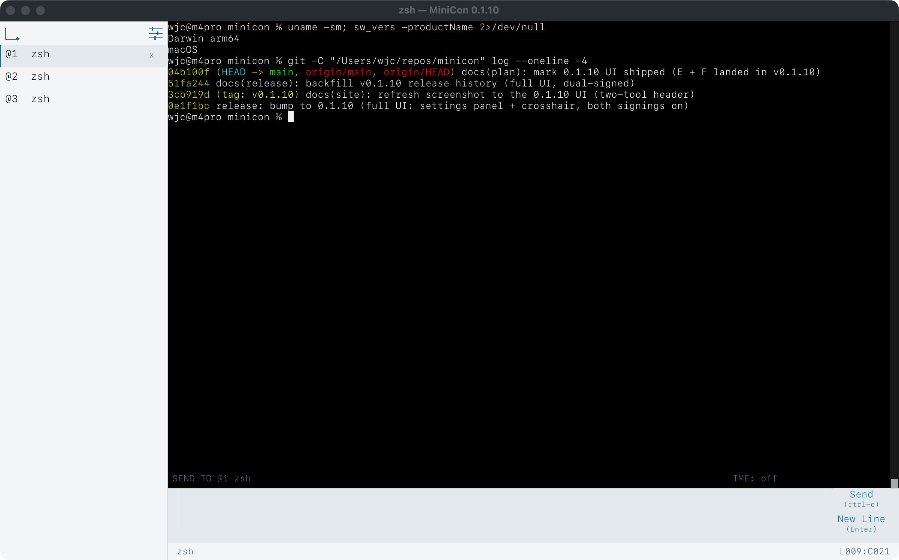

**English** · [简体中文](README.zh.md)

# MiniCon™

`one file · no install · nothing left behind`

**One file is the whole terminal.** Copy one file and run it — a fast terminal
for Windows, macOS and Linux, with an input line of its own and a control
command your scripts can read. No installer, no bundled runtime, nothing left
behind.



| | |
| --- | --- |
| Runs on | Windows, Linux, macOS — x86_64 and aarch64 (Windows back to Server 2016) |
| Size | one file: ~660 KB (Windows), 1.4 MB (macOS), 5 MB (Linux) — measured |
| Memory | one idle tab, host RSS (measured): ~12 MB (Linux), ~21 MB (Windows) — the budget we hold is 10 MB |
| Depends on | operating-system libraries only |
| Licence | MIT OR Apache-2.0 |

## Your input has its own line.

Most terminals make you type where the program is printing, so a command and a
burst of output tangle together. MiniCon gives input a line of its own.

- **Write while output scrolls.** Nothing you type interleaves with what a
  program prints.
- **Recall what you sent.** Up and Down walk your sent lines; half-typed text is
  kept while you browse.
- **It names the target tab.** In a tree of tabs you always know where a command
  is headed.

`Enter` makes a new line; `Ctrl+O` sends the draft.

## Your scripts can see into it.

Sending a keystroke is easy — but blind. The control command reads back what the
window actually shows — text, screenshots, focus, tabs — so automation waits for
a real result instead of guessing with a sleep. All local: no server, no network.

```
# start a session with a local control endpoint
minicon --control unix:/tmp/minicon-build/control.sock
# Windows: minicon --control pipe:\\.\pipe\build

# run something, then wait for it — no sleeps
minicon cli --control unix:/tmp/minicon-build/control.sock send-text "cargo test\r"
minicon cli --control unix:/tmp/minicon-build/control.sock wait-text --timeout-ms 600000 "test result"

# read the result as text, or as a picture
minicon cli --control unix:/tmp/minicon-build/control.sock capture-pane
minicon cli --control unix:/tmp/minicon-build/control.sock screenshot-pane --output run.png
```

`ui-snapshot` returns focus, input-method state, pending work and layout as JSON;
`wait-text` and `wait-tab-exit` block until a condition holds or times out;
`send-keys`, `send-mouse`, `send-wheel` and `send-ui-ime` type, click, scroll and
compose CJK through the same paths a person's input takes.
→ [docs/control-cli.html](docs/control-cli.html)

## Small, open, signed — on purpose.

- **Genuinely mini.** ~660 KB on Windows, 1.4 MB on macOS, 5 MB on Linux —
  measured, not estimated. No installer, no bundled runtime.
- **Permanently open source.** MIT OR Apache-2.0. No telemetry, no account, no
  auto-updater — the source is the product.
- **Signed and notarized.** Windows and macOS, as PARTNERNET SOFTWARE PTY LTD.
  It uses only the libraries your OS already ships.
- **Low on purpose.** One process, no background service; close the window and
  nothing keeps running. Low memory is a target, not a side effect: one idle tab
  is budgeted 10 MB of host memory, and measures about 12 MB on Linux and 21 MB
  on Windows. (macOS carries a higher floor from the OS's own window stack.)

Three built-in themes — Neutral, Docs Ink and Paper Ink — recolour chrome and
terminal together; cycle with `Ctrl+Shift+P`.

## Runs on older Windows, too.

Newer terminals need a recent Windows build and will not start on older
machines. MiniCon resolves the pseudoconsole at run time and falls back to a
hidden console, so it runs back to Windows Server 2016.
→ [docs/old-windows.html](docs/old-windows.html)

## Install

Download the executable for your platform from
[Releases](https://github.com/partnernetsoftware/minicon/releases) and run it.
Every archive ships a SHA-256 beside it; the macOS `.dmg` is a signed,
notarized universal binary.

```bash
sha256sum -c minicon-<version>-linux-x86_64.tar.gz.sha256
```

macOS only, to put `minicon` on `PATH`:
`/Applications/MiniCon.app/Contents/MacOS/minicon install-cli`.

## Use

```
minicon                          # a terminal, with your default shell
minicon -e cmd.exe /k build.bat  # run one command instead of a shell
minicon --status                 # what this machine gave it
minicon --help                   # everything else
```

| Key | |
| --- | --- |
| `Ctrl+Shift+T` | new terminal |
| `Ctrl+Shift+N` | new terminal below the active tab |
| `Ctrl+Shift+W` | close the active terminal; children are promoted |
| `Ctrl+Shift+B` | collapse the tab sidebar to a rail, or expand it again |
| `Ctrl+Shift+[` / `]` | switch tabs |
| `Ctrl+Shift+I` | focus the input area |
| `Ctrl+Shift+P` | cycle the color theme (Neutral / Docs / Paper) |
| `Ctrl+Shift+,` | open or close the settings panel |
| `Ctrl+Shift+G` | toggle the grid crosshair |
| `Enter` | in the input area, insert a soft newline without sending |
| `Ctrl+O` | send the complete input-area draft |
| `Up` / `Down` | in the input area, move between lines; at the first or last line, recall what you sent before |
| `Alt+Up` / `Down` | in the input area, recall what you sent before from any line |
| `Ctrl+Left` / `Right` | in the input area, move the caret by whole words |
| `Ctrl+Home` / `End` | in the input area, move the caret to the start or end of the draft |
| `Ctrl+Backspace` / `Delete` | in the input area, delete the word before or after the caret |

## Configuration

Optional `minicon.json` in your user config directory: `font_size`, `cols`,
`rows`.

**Windows mouse:** works out of the box for most programs. MiniCon uses the
classic console host by default because the ConPTY copy Windows ships turns a
click into stray keystrokes for console-event readers (most agent CLIs);
`--feature conpty` selects it for Vim-style programs.

## Build

```bash
./scripts/build.sh release     # target/release/minicon
./scripts/build.sh test        # unit + GUI black-box + gates
./scripts/six-cell-qualify.sh  # all six OS/ISA binaries
```

Rust 1.97. Linux needs `libxkbcommon.so.0` and `libwayland-client.so.0` (no
`-dev` packages). See [PRD.md](PRD.md) and the `plan/` notes.

## Repository

| | |
| --- | --- |
| `src/` | the binary: terminal, host UI, control protocol |
| `crates/minicon-core/` | host-neutral logic — no platform or architecture `cfg` |
| `PRD.md` | product tree and module PRDs |
| `docs/` | the website at `minicon.agenterm.work` |

## More

- **AgenTerm.** [AgenTerm](https://github.com/partnernetsoftware/agenterm) is the
  Agent-era workbench on the same platform layer; MiniCon is its one-file local
  terminal. MiniCon began as AgenTerm's console host and became its own product
  in August 2026.
- **Code signing.** Since v0.1.9 every public release is dual-signed — Windows
  Authenticode and macOS Developer ID + notarization, as PARTNERNET SOFTWARE PTY
  LTD, with an RFC 3161 timestamp. Verify a Windows download with
  `scripts/inspect-authenticode.ps1`. Details in
  [CODE_SIGNING_POLICY.md](CODE_SIGNING_POLICY.md).

---

MIT OR Apache-2.0. MiniCon™ is a trademark of PartnerNet Software.
