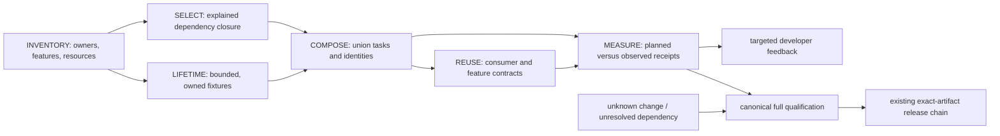

> Archived on 2026-10-24. Incomplete proposal, not a shipped version or a completion claim. Open inventory/selection/composition/measurement/lifetime obligations remain in [PRD 33](../../prd/PRD_02_33_test_orchestration.md).
> The original status and observations below are preserved as history.

# v0.2.16 — targeted feedback with complete release qualification

Design prepared after the 0.2.15 release. Implementation is partial:
fixture-lifetime work and a small explicit-profile selector are in use;
complete inventory, automatic changed-path execution, consumer matrix and
comparable measurement remain planned.
The owning behavior specification is
[test orchestration](../../prd/PRD_02_33_test_orchestration.md). The existing
[reuse map](../../prd/PRD_02_28_shared_core.md),
[native dev court](../../prd/PRD_02_32_dev_loop_crosscheck.md) and
[delivery contract](../../prd/PRD_02_27_con_delivery.md) retain their authority.

## Outcome tree DAG

```text
Outcome: small changes get relevant feedback; releases retain full evidence
├── [-] {INVENTORY} One test-profile inventory and explicit capability ownership
│   ├── classify actual dependencies, features, OS/ISA and shared resources
│   └── reconcile canonical full gate, tier entry and hosted dev court
├── [-] {LIFETIME} Stop paying for fixtures after their assertions finish
│   ├── [v] cancel journey sleeps and terminate only owned processes
│   └── [-] opt-in diagnostic observers; profile wiring and native cells remain
├── [-] {SELECT} Explainable development selection with conservative fallback
│   ├── --plan / --list / --profile / --changed-since
│   └── module dependency closure; unknown or shared changes expand coverage
├── [-] {COMPOSE} Execute profile unions without repeating identical work
│   ├── deduplicate tasks; reuse only identical build identities
│   └── keep isolated minimal consumers outside workspace feature unification
├── {REUSE} Qualify abstractions through their real consumers
│   ├── default/minimal/independent feature tuples and public type contracts
│   └── AgenTerm adoption only with an immutable revision and consumer evidence
└── {MEASURE} Publish comparable time, coverage and defect-detection receipts
    ├── separate queue, cold/warm build, fixture, assertion and teardown time
    └── complete canonical release gate and all required exact-artifact courts
```



## Evidence motivating the sequence

The 0.2.15 release history owns the final source and publication receipts.
Source inspection of its test infrastructure identifies these concrete gaps:

- `scripts/test-tier.sh l1` omits platform library tests. Its "pure/no spawned
  processes" description does not describe every selected test.
- `l2` selects `minicon_control`, which opens GUI hosts; it is not a no-GUI tier.
- The original `l3` omitted platform library and vendored vt100 suites, so its
  old "full release gate" label was broader than its coverage. The tier now
  invokes canonical `scripts/build.sh test`, workspace fmt/Clippy, reuse and
  offline script self-tests; a full Windows x64 local run passed. Native and
  exact-artifact courts retain separate authority.
- `dev-loop-crosscheck.yml` builds all targets but does not execute root binary
  units or the full platform library suite. Compiling those targets is not
  runtime evidence. Its per-suite receipt is more specific than the early
  `job_status` field, which may precede the job's final failure.
- The notes persistence journey has a 120,000 ms driver wait; `ConSession::drop`
  kills its host then joins the sleeping driver. Cancellation can retain all
  persistence assertions while removing teardown delay.
- The Windows zoom journey starts a 60-second window watcher and waits for it.
  The watcher prints diagnostics and never fails the test. It belongs in an
  explicit diagnostic profile; functional zoom assertions remain in regression.
- A previous pack run, `39138311227`, spent about 184 seconds packing,
  66 restoring cache, 83 saving cache and 62 setting up the toolchain. Measure
  current cache transfer costs and hit rates before changing build layouts.
  These are observations of that run, not a promised speedup.
- The final-source pack job `117720714534` (run `39142875325`) instead measures
  75 seconds restoring cache, 71 setting up tooling, 134 packing and one second
  in cache post-processing. Cache hit/miss state matters: the previous 83-second
  save is not a cost incurred by every run. Preserve both observations.
- The existing product-source hash helper launches Git once per tracked path.
  On the Windows preparation host, two observed evaluations take about 64 and
  62 seconds. The 0.2.15 alternate Defender controller runs that unchanged
  neutral guard in Linux preflight, leaving Windows to native scanning. Measure
  metadata/receipt costs too; changing the hash algorithm is not a shortcut for
  changing which source inputs are covered.

## Ordered milestones and acceptance

Scoped fixture work, the `l3` coverage correction and an initial explicit
profile planner are implemented. The manifest covers selected control,
terminal, docs, reuse and script tasks; profile unions deduplicate identical
tasks and refuse zero-test passes. `--changed-since` can explain a conservative
plan but cannot execute a reduced inferred set yet. Complete inventory,
automatic selection and comparable measurements remain open.
Preserve the released behavior while iterating.

| Order / leaf | Invariant and acceptance evidence | Dependencies / failure / explicit non-goal |
|---|---|---|
| 1 — INVENTORY | Inventory every currently executed suite and ignored/manual/real-endpoint court, including root units, platform units, fork damage oracles, script self-tests, source guards, minimal consumers and sustained throughput. Record feature tuple, backend, OS/ISA, resources and measured phase costs. A canonical full expansion matches actual Cargo discovery and script gates. | PRD 28 owners and delivery/development courts; unknown or unavailable coverage is explicit, never a successful zero-test result. No renaming crates or silently replacing release policy. |
| 2 — LIFETIME `[-]` | Journey sleeps are cancellable; a real owned GUI fixture dropped during a 5-second wait in about 0.5 seconds on Windows x64, under the 2-second local budget. Removing the cancellable wait made the regression fail in about 5 seconds. The notes restart still restored saved text in about 2.2 seconds. The 60-second window watcher is opt-in through `MINICON_ZOOM_WINDOW_WATCH=1`; ordinary zoom assertions passed in about 9.2 seconds. Remaining: native-cell validation, diagnostic-profile wiring and bounded cancellation of any in-flight control command. | INVENTORY and owned process handles; timeout captures operation and owned PID without killing unrelated sessions. No lower assertion budgets or ignored regression cases. |
| 3 — SELECT | One profile manifest drives list/plan/run. Changed-path rules compute owner and dependent closure, print reasons, and expand unknown or broad changes to full qualification. Tests cover a missed-dependency mutation and unknown-path fallback. | INVENTORY; a missing dependency produces broader coverage or a clear failure. No claim that a developer profile certifies release. |
| 4 — COMPOSE | The union of selected profiles executes each identical task once. Cargo identifies executables; identical source/toolchain/target/features/profile/rustflags are prerequisites for build reuse. Planned names/counts match observed names/counts. | SELECT and LIFETIME; incompatible identities build separately. Minimal consumer remains a distinct graph. No guessed hashed executable paths or reuse by modification time. |
| 5 — REUSE | Exercise core default, minimal and composer/json/keymap tuples, UI optional terminal-selection, platform minimal and product feature closures. Preserve core/UI tree identity, numeric oracles, recursive portability guards and the documented legacy newline exception. Qualify actual AgenTerm call sites before moving its immutable pin. | Module contracts; consumer OS/ISA claims require consumer receipts. No universal keymap/tree policy or speculative terminal-engine extraction. |
| 6 — MEASURE | Compare at least three like-for-like cold/warm runs, including teardown; report medians and range with unchanged test obligations. Real guard mutations still turn their selected profiles red. Full release expansion passes through canonical workspace/fork and script gates; exact artifact gates remain separately mandatory. | Prior leaves and delivery PRD; missing native courts remain BLOCKED. No floor reduction, blanket retries, signing-policy change or blanket parallel execution. |

## Proposed interfaces and combinations

Use `scripts/test-profiles.json` as the single task/profile inventory and keep
`scripts/test-tier.sh` as the user-facing entry. Design interfaces:

```sh
bash scripts/test-tier.sh --list
bash scripts/test-tier.sh --plan --profile core --profile reuse
bash scripts/test-tier.sh --plan --changed-since origin/main
bash scripts/test-tier.sh --profile terminal --profile control
bash scripts/test-tier.sh l3
```

Implementation allocation belongs to PRD 33: the planned `test-plan.py`
planner/executor under `scripts/`, the compatible tier wrapper, canonical metadata-producing
build entry and internal fixtures reused by real black-box/control callers.
Milestone 1 introduces inventory and plan-only comparison; milestone 4 adds
the canonical `test-build` path and composition. Keep compiler/lint command
definitions in `build.sh`, and keep capability assertions in their test suites.

Retain `l0`/`l1`/`l2`/`l3` and `all` aliases, with descriptions corrected to
their actual obligations. `l3`/`all` must resolve to the complete canonical
qualification, including platform and fork execution and all three dangerous
lint denials. Existing `build.sh test` stays the execution authority; do not
create a second definition of "full" in the profile dispatcher.

Initial profiles: `lint`, `core`, `ui`, `platform`, `reuse`, `terminal`,
`control`, `composition`, `docs`, `scripts`, `throughput`, `diagnostics`, `live-network`
and `full`. Names classify obligations, not whether a file looks like a unit
test. `terminal` and `control` may require GUI and native child processes.
Keep manual IME, live network, optional VM courts and diagnostic sampling
explicitly named; selecting none does not certify those capabilities.

The three phases are edit feedback, integration and release qualification.
`l3`/`all` covers complete local regression and its declared script/consumer/lint
prerequisites. External six-cell and signed-artifact courts retain their own
receipts; neither a local full pass nor `--plan` starts signing or publishing.
Start with plan-only comparisons, then opt-in developer selection, then make
automatic selection the developer default only after omitted-dependency
mutations fail correctly. New/unmapped tests and staged, unstaged or untracked
source files participate in conservative fallback.

| Example edit | Initial selected obligations | Escalation / phase boundary |
|---|---|---|
| Owned PRD/plan prose only | docs links/redaction and relevant alignment; declare any existing-binary prerequisite | Behavior/CLI wording changes add the owning capability contract; unknown ownership expands coverage |
| `crates/minicon-core/src/composer.rs` | composer rules, dependent editor/paste contracts and external consumer API checks | Use proved module-level edges; unknown fanout expands to full local regression; multi-ISA claims still require native evidence |
| `crates/minicon-ui-core/src/pixel.rs` | pixel/scalar oracles and affected rendering contracts | Execute affected ISA kernels on their native courts; compilation alone does not qualify dispatch |
| `src/terminal.rs` or console mirror | terminal, control, sibling-containment and throughput obligations | Keep backend identity explicit; use full local/native release qualification before publication |
| Manifests, feature wiring or build scripts | feature/dependency matrix, isolated consumer and full local expansion | Re-run applicable native/exact-artifact gates for release; no hidden signing transaction during developer feedback |

Tasks may select exact discovered tests within a suite, rather than treating an
entire crate as one indivisible unit. Cargo supplies the executable identities;
baseline libtest supports multiple exact-name filters. Compare planned and
observed names/counts after execution, not only after `--list`. A new test with
no owner must be visible as missing inventory coverage, not silently omitted.

Resource ownership precedes concurrency: isolate configuration directories,
clipboard state, native windows and temporary endpoints; acquire a lease for
resources that cannot be isolated. An in-process mutex does not serialize
separate test executables. Preserve actual clipboard formats when restoring
shared state. Parallelize only independently owned resources.

## Receipts, success and exclusions

Receipts name source/configuration identity, toolchain, target, feature tuple,
backend, build identity, selected obligations and reasons, executed test names
and counts, omitted/manual/unavailable courts, timings and final outcomes.
Zero selected/observed tests is not a pass for a required obligation. A debug
source test and a test bound to `MINICON_TEST_BINARY` are distinct claims.

Sustained throughput keeps its existing floors and distinguishes console-agent
rendered generation from actual drained PTY bytes. Release retains six native
artifact courts, required Windows/macOS signatures, Defender, reputation,
dry-run Promotion and no-rebuild public Promotion, as owned by PRD 27.

Do not implement new OS/ISA support, change compiler/LTO/reputation settings,
redesign the terminal engine or fix every historical TUI debt in this version.
The separate Win+R administrator checkbox belongs to MiniCon WinMgr's Run
dialog specification and does not become a new MiniCon launcher.

The design delivery is complete when the owner index and PRD 33 link here,
every milestone has its invariant/evidence/failure/dependency/non-goal, and
the actual release history establishes the preceding 0.2.15 baseline. No
0.2.16 Cargo version bump or implementation is included in this design step.
