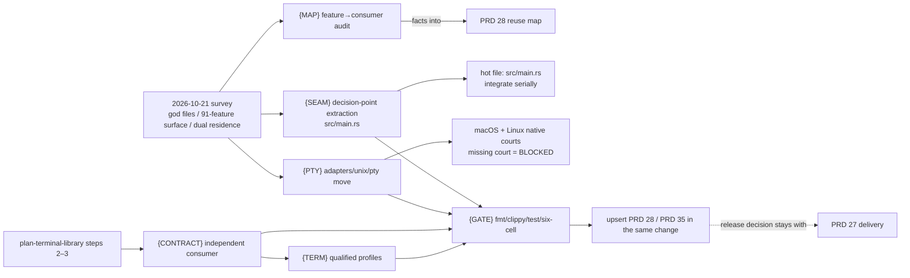

# v0.2.19 — reusable terminal contract and module/reuse consolidation

Status: **shipped 2026-10-21** as
[v0.2.19](../../prd/archive/v0.2.19-release-history.md) (source `7e27648`);
this plan is archived. Open leaves were upserted before archiving: the
portable session trait and TERM runtime probe live with PRD 35/25, the
remaining seam drifts and the two new observations (G4 local control-journey
flake, G5 intel-mac throughput budget) in
[carried debt](../plan-carried-debt.md). Originally drafted 2026-10-21 from a
module/reuse survey of the published v0.2.18 source (`9a25ee4`). The version theme is owned by
[the 0.2.x roadmap](../plan-v0.2.x-product-roadmap.md) ("reusable terminal
contract across OS and ISA"); the library sequence itself is owned by
[PRD 02.35](../../prd/PRD_02_35_terminal_library.md) through
[its standing sequence](../plan-terminal-library.md); module ownership, reuse
entry points and the consumer feature matrix are owned by
[the reuse map](../../prd/PRD_02_28_shared_core.md). This plan sequences what
0.2.19 actually ships and adds the product-side consolidation the survey
surfaced; it does not restate the owners' acceptance contracts.

## Why now (survey findings, 2026-10-21)

- `src/main.rs` is 5298 lines with 188 functions; `terminal.rs`, `control.rs`
  and `ui.rs` each exceed 3100 lines. The F1 clipboard-paste defect
  ([carried debt](../plan-carried-debt.md)) already demonstrated the failure
  mode: two call sites in `main.rs` implementing the same decision drifted
  apart until `src/clipboard_paste.rs` gave the decision one owner. Nobody
  has inventoried how many such multi-site decisions remain.
- `crates/minicon-platform` declares 91 features across 473 source files
  while MiniCon enables roughly 16. The reuse map itself states the broad
  optional feature surface needs consumer-feature evidence, and names
  "a generic utility warehouse" a non-goal; no inventory today says which
  facades have zero current consumers.
- The common terminal facade and `src/terminal.rs` are in a dual-residence
  period: the Windows host consumes `terminal::TerminalStream`, but GUI
  migration, session-discard receipts and portable process lifecycle remain
  open in the reuse map, as does the `adapters/linux/pty.rs` →
  `adapters/unix/pty` move (the macOS adapter still path-imports the Linux
  file).

## Outcome tree

```text
Outcome: the reusable boundaries are consumed, audited and enforced — not merely documented
├── [v] {MAP} Audit minicon-platform's feature surface against actual consumers
│   done 2026-10-21: closure audit upserted into PRD 28 ("Platform
│     feature–consumer audit") — 91 features, consumer-union closure 49,
│     40 zero-verified-consumer facades; AgenTerm read at checkout 2196131f
│     which pins the crates at 0326e2ab
│   invariant: every public facade names its real consumers or is explicitly marked
│   evidence: feature→consumer table upserted into PRD 28; MiniCon side from the
│     minicon_alignment consumer matrix, AgenTerm side read at its pinned revision
│     (0326e2abaf71cb2f8dc22f766de9b410efa4be1e)
│   safe failure: an unverifiable external consumer stays UNKNOWN, never assumed in
│   dependency: PRD 28 maintenance rule; non-goal: deleting or deprecating facades
│     in this pass — the audit produces facts, removal is a separate owner decision
├── [-] {SEAM} Consolidate multi-site product decisions out of src/main.rs
│   state 2026-10-21: full inventory done — 8 multi-site decisions found, 6
│     drifted. Unified onto one owner each: terminal inset widths
│     (terminal_inset_widths; fixes collapsed-sidebar inset after tab switch),
│     Escape-closes-settings (dead modifier-blind copy removed; Ctrl/Alt+Esc
│     no longer dismiss), post-close tree-scroll clamp (now inside
│     close_active_session), composer destination label (band and history both
│     read active_destination_label). {SPLIT} first unit done: control.rs
│     mid-file native_endpoint_tests (335 lines) moved to
│     src/control/native_endpoint_tests.rs, 13 tests pass. Remaining drifts
│     recorded as carried debt S1–S4 (control IME route label is a protocol
│     decision owned by PRD 26; composer geometry, activation effects and
│     paste-review handoff need their own passes)
│   invariant: one owner module per cross-surface decision; observable behavior unchanged
│   evidence: existing suites stay green with the gate's test count not reduced;
│     each extraction names the decision it owns (clipboard_paste.rs precedent);
│     main.rs line/function count measurably down and recorded
│   safe failure: a seam without one clear decision stays in place and is recorded
│     as debt rather than force-extracted
│   dependency: {MAP} not required; hot file src/main.rs — serialize with other work
│   non-goal: new public crates, new exports, or moving product policy into shared crates
├── [v] {PTY} One POSIX PTY mechanism in its own adapter home
│   done 2026-10-21: moved to adapters/unix/pty.rs with thin linux/macos
│     identity wrappers; native runtime evidence dev-loop-crosscheck
│     39624936183 (cells=all) — lnx-x86_64, lnx-aarch64 and osx-aarch64
│     passed every suite; osx-x86_64 passed all but the pre-existing
│     throughput budget (carried debt G5, not a PTY claim)
│   invariant: distinct adapter identities; macOS stops path-importing the Linux file
│   evidence: adapters/linux/pty.rs moved to adapters/unix/pty with both actual
│     platforms' native suites run (macOS court + Linux cells), not one standing for both
│   safe failure: a missing native court is BLOCKED, never a skipped pass
│   dependency: PRD 28's open consolidation leaf; non-goal: behavior change
├── [-] {CONTRACT} Demonstrate the smallest session/input contract with an independent consumer
│   state 2026-10-21: step-2 dependency inventory upserted into PRD 35
│     ("Session/input dependency inventory"); first slice landed — the
│     session contract vocabulary moved to minicon_console::session with
│     platform contract::pty re-exporting (one type identity, pty feature
│     carries the console edge), non-exhaustive enums now refuse unmapped
│     keys/signals as typed errors, and the isolated check-reuse consumer
│     exercises the vocabulary and guards both dependency directions.
│     open: the portable session trait/interface itself (needs both-provider
│     demonstration per PRD 35's integration acceptance contract)
│   invariant: one common state/stream contract with explicit native capabilities
│   evidence: a direct minicon-console consumer (outside workspace feature unification,
│     check-reuse.sh pattern) and MiniCon itself, per plan-terminal-library.md steps 2–3
│   safe failure: typed unsupported capabilities; unproved cells narrow the claim
│   dependency: PRD 35 acceptance contract; non-goal: speculative traits without a
│     working consumer, automatic platform-crate merger, GUI default promotion
├── [-] {TERM} Qualified identity profiles and new-session TERM choice
│   state 2026-10-21: the advanced override shipped — validated `term` key in
│     minicon.json reaches new sessions (initial tab + SessionSeed
│     inheritance), COLORTERM/parser/backend untouched; no profile menu is
│     offered (no second profile has capability evidence), which is the
│     plan's stated safe failure. Owner record: PRD 25 "Configuration".
│     open: an actual child environment probe as runtime evidence
│   invariant: changing TERM describes capabilities to applications; it never switches
│     parser or native backend
│   evidence: a truthful modern VT/xterm-style default profile plus an advanced
│     override for new sessions, each profile backed by qualified capability evidence
│   safe failure: an unqualified profile is not offered; the current default is retained
│   dependency: {CONTRACT}; non-goal: a misleading VT100/VT220/kitty emulation menu
└── [v] {GATE} Qualify the actual source and upsert the owners
    done 2026-10-21: fmt/clippy -D warnings/build.sh test (34 suites, 1355)
      on final source 7e27648; six-cell pack 39630069785; owners PRD
      25/28/35 updated in the same changes; v0.2.19 published — receipts in
      prd/archive/v0.2.19-release-history.md (release decision was PRD 27's,
      supplied by the owner goal)
    invariant: claims name exact source, features, cells and evidence
    evidence: fmt/clippy, build.sh test, six-cell qualification; PRD 28 and PRD 35
      updated in the same change as each module move (maintenance rule)
    safe failure: a failing or unavailable cell blocks its claim, not the paperwork
    dependency: all leaves above; non-goal: release/promotion decisions (PRD 27 owns those)
```



## Ordered work and acceptance

Work {MAP}, {SEAM} and {PTY} are independent in file ownership and may run in
parallel per the planning rule, except that {SEAM} owns the hot file
`src/main.rs` and anything else touching it integrates serially. {CONTRACT}
and {TERM} follow the library sequence and come after the consolidations so
the contract is demonstrated against a cleaner product seam, not through it.

| Order | Work and observable acceptance | Failure boundary |
| --- | --- | --- |
| 1 — MAP | Enumerate all 91 `minicon-platform` features. For each: MiniCon's enablement (from `Cargo.toml` and the `minicon_alignment` consumer matrix), AgenTerm's enablement (read at the pinned revision), and any other consumer. Upsert the result into PRD 28 as a consumer-evidence column or table; mark zero-consumer facades explicitly. | A consumer that cannot be verified at its pin is recorded UNKNOWN. The audit changes documentation only; no facade is removed, renamed or feature-gated differently in this pass. |
| 2 — SEAM | Inventory `src/main.rs` for decisions implemented at more than one call site (the F1 shape). Extract each into an owner module beside `clipboard_paste.rs`, pure file moves plus the single decision function; run `./scripts/build.sh test` before and after and compare test counts. Record the before/after line and function counts in this plan on completion. | Behavior change is out of scope; any extraction that would alter an observable journey stops and records the finding instead. No new `pub` surface beyond `pub(crate)`. |
| 3 — PTY | Move the shared POSIX PTY implementation to `adapters/unix/pty`; keep the Linux and macOS adapter identities distinct and forward existing entry points. Qualify on both actual platforms: Linux cells via six-cell/CI, macOS via its native court. | One platform's pass does not stand for the other. If the macOS court is unavailable, the move's macOS claim is BLOCKED and the change does not ship in the candidate. |
| 4 — CONTRACT | Follow `plan-terminal-library.md` steps 2–3: inventory `platform::contract::pty`/`terminal_input` and both providers, classify dependencies, then demonstrate the smallest session/input contract with a direct library consumer plus MiniCon. Apply PRD 35's integration acceptance before any public commitment. | Speculative traits without a working consumer do not land. Compilation on a cell is not runtime evidence for it; unproved OS/ISA cells narrow the claim. |
| 5 — TERM | Offer the qualified identity profile set for new sessions: a truthful modern default plus an advanced override, per the roadmap's cross-version rule. Each offered profile names its capability evidence. | No profile ships without qualification; TERM selection must not switch parser or backend. If no profile beyond the current default qualifies, 0.2.19 ships without the menu and says so. |
| 6 — GATE | `cargo fmt`, `cargo clippy --all-targets -- -D warnings`, `./scripts/build.sh test`, then six-cell qualification on the actual source. Upsert PRD 28 (responsibility, reuse entries, features, OS/ISA split, evidence scope) and PRD 35 in the same change as the code they describe; update PRD.md's frontier. | Unavailable evidence is BLOCKED, never silently skipped. Release selection, signing and Promotion remain PRD 27's decisions; this plan makes no publish claim. |

## Inherited consolidation leaves

Carried from the archived [plan-v0.2.10](plan-v0.2.10.md)
consolidation track (behaviour-preserving, never gating the leaves above):

- `{SPLIT}` one module at a time, gate after each; first unit remains the
  `mod native_endpoint_tests` block sitting mid-file in `src/control.rs`.
  Fold into {SEAM}'s inventory.
- `{SEAM}`/`{ENCAP}`/`{NAME}` as scoped in
  [plan-v0.2.9](plan-v0.2.9.md); unchanged.
- `{FEAT}`/`{DOC-OWNER}` stay owner-gated: a removal that deletes a route
  another product will want is not consolidation.

## Non-goals

- Renaming public crates (ruled on in PRD 28's 2026-10-18 assessment).
- Extracting product state because a helper is pure; an identified consumer
  and contract precede another extraction.
- Blanket cross-ISA certification or qualifying platform capabilities no
  consumer enables.
- The `minicon-platform`/`minicon-console` merger question (deferred by
  PRD 35) and the 0.2.20 Windows-default decision.
- The E1/E2 click/composer seam with AgenTerm stays `(OWNERS)`-gated in
  [carried debt](../plan-carried-debt.md); this plan does not pick it up.
