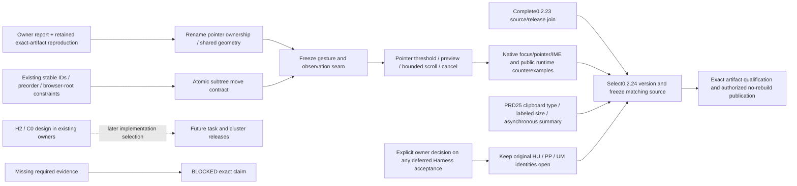

# v0.2.24 — tab-tree interactions and clipboard status

Status: `[v]` public 0.2.24 release, with named evidence in its
[release history](../../prd/archive/v0.2.24-release-history.md). This archived
plan records the shipped cut and its still-open acceptance. Public
[0.2.23](../../prd/archive/v0.2.23-release-history.md) has separate source and
artifact evidence.

Behavior: [tab-tree interaction owner](../../prd/PRD_02_25_03_tab_tree_interactions.md).
Existing hierarchy/naming/focus: [PRD 25](../../prd/PRD_02_25_con_workspace.md).
Reuse: [PRD 28](../../prd/PRD_02_28_shared_core.md). Observation: PRD 26.
Other subsequent-version Harness/cluster work keeps its own staged scope;
it is not automatically promised as complete in this tree-interaction release.

## Product priorities and release boundary

The release outcome is predictable everyday interaction: editing a tab name
works, branches can be arranged without losing live sessions, and clipboard
status tells the user what kind of content is present. Harness remains the
core product direction, with its next task-operation design progressing behind
the existing [workspace plan](../plan-harness-workspace.md).

| Priority | Delivery | Acceptance owner / completion condition |
| --- | --- | --- |
| P0 | Repair the reported rename click regression before adding drag | PRD25.03 TT-01/02; inside click and selection retain edit/IME ownership |
| P0 | Show clipboard type together with clearly labeled size | PRD25 CB-TYPE-01..03; text/image/empty/unknown handling, no clipboard mutation |
| P1 | Tab subtree reorder/reparent, preview and cancellation | PRD25.03 TT-03..07; same live sessions and stable IDs, invalid/cancelled drops leave topology unchanged |
| Carry | Complete deferred real-account and continuous-client Harness acceptance | Owner-approved amendment in PRD31.01; original HU / PP / UM identities stay open |
| Design milestone | Versioned ujs / WASM host contract and first bounded policy experiment | PRD31.01.04; embedding depends on actual unisacc/ujs readiness, not the version date |
| Design milestone | Define H2's first local task journey and cluster C0 boundaries | Existing Harness/cluster plans; task submission, Stop and result ownership designed before implementation selection |
| Later | CU implementation, cross-machine execution and dynamic llm-gate | Existing CU/cluster/engine owners; not required to ship this version |

0.2.23 is public. The owner has accepted
the [experimental-release amendment](../../prd/PRD_02_31_01_provider_gateway.md#0223-experimental-release-amendment-2026-10-26).
Real-account and continuous-client acceptance carries forward without a passed
claim. Signing, Defender and exact-source/no-rebuild release requirements still
apply. [Dynamic logic](../../prd/PRD_02_31_01_04_dynamic_logic.md) owns the future
host/module split, separate logic releases, compatibility and rollback; 0.2.24
starts design/readiness work without promising an immature engine integration.

The H2/C0 design milestone is not a second feature bundle on the release's
critical path. Its output is an agreed first journey, authority boundary and
acceptance cases in the existing owning modules. It does not promise a visual
task runner, remote pairing or computer use in 0.2.24.

## Outcome tree DAG

```text
Outcome: improve daily workspace interaction and clipboard awareness
├── [v] R0 — preserve owner rename regression and version/source baseline
│   invariant: source inspection and injected/physical evidence stay distinct
│   evidence: retained baseline receipt linked in PRD 25.03
│   safe failure: unresolved native scope remains BLOCKED
│   dependency: isolated public GUI control; non-goal: changing the user's login window/clipboard
├── [-] R1 — fix inside-editor pointer ownership first
│   invariant: inside click/selection stays editing, outside blur keeps its policy
│   evidence: TT-01/02 and actual runtime counterexample with guard removed
│   safe failure: draft/focus retained and no terminal input
│   dependency: shared editor geometry; non-goal: renaming authority/schema redesign
├── [-] T1 — atomic product Workspace subtree move
│   invariant: stable identity and complete topology/session preservation
│   evidence: TT-03/04 legal/invalid/no-op move matrix
│   safe failure: invalid move changes nothing
│   dependency: parent invariants and typed topology checks; non-goal: session restart or persistence
├── [-] T2 — pointer state, preview, scrolling and cancellation
│   invariant: one gesture owner and release-only mutation
│   evidence: TT-05/06 public press/move/release and native pointer journeys
│   safe failure: stale/cancelled proposals leave no tree mutation
│   dependency: R1/T1 and frozen observation seam; non-goal: OS file/URL/cross-window drag
├── [-] C1 — clipboard type alongside labeled size
│   invariant/evidence/safe failure/dependency/non-goal: PRD 25, Clipboard status type and size
│   sequence: bounded format summary, generation-safe status, localized native/pixel acceptance
└── [v] Q — integrate and release exact 0.2.24 source
    invariant: two versions' product/artifact/native receipts never substitute for each other
    evidence: public release history names exact source, six-cell, signing, Candidate, Defender and Promotion receipts
    safe failure: an absent release-chain gate prevents Promotion; broader TT/CB acceptance retains open owner IDs
    dependency: shipped R1/T1/T2/C1 core and 0.2.23 release join; non-goal: closing TT-07, cluster or H2 delivery
```

## Memory palace



## Delivery order and shared prerequisites

1. Preserve the reproduced baseline and confirm owner behavior in a public
   regression. This preparation does not mix the repair into 0.2.23.
2. At the 0.2.24 implementation join, fix rename pointer ownership and share its
   paint/hit/IME geometry. Obtain runtime RED -> GREEN and guard-removal RED
   before layering node drag over the same text region.
3. Define product-owned move intent and atomic topology update. The shared typed
   topology algorithm validates mechanisms; node-kind/drop policy stays local.
4. Freeze source/target/phase/reason observations, then integrate pointer capture,
   preview and edge scrolling. Run capture-loss/close-race tests before final UI.
5. Qualify the selected OS/ISA/native input/scales and exact artifacts, then use
   the registered release skills and existing named-version publication authority.
   Upsert owner status/evidence before archiving this plan.

The owner's 2026-10-26 clipboard request adds C1 to this next version.
[PRD25](../../prd/PRD_02_25_con_workspace.md#clipboard-status-type-and-size-shipped-core-in-0224)
owns behavior and CB-TYPE-01..03. Its status/clipboard files can proceed after
their own contract review; they do not need the tree drag implementation.

Hot files: `src/main.rs`, `rename.rs`, `workspace.rs`, `ui.rs`, `host_paint.rs`,
`snapshot.rs`, control dispatch and public/native input fixtures. R1 and T2 share
mouse/focus/geometry ownership and join serially. T1's pure move mechanism can
be independent only after its intent and file ownership are agreed. One controller
owns Cargo/GUI/capture/mutation resources and final integration.

The active goal selects implementation and public release of this version;
product-code changes and the version bump follow the completed 0.2.23 Promotion.

## Development cadence and cut line

- Start with R1. C1 may proceed independently once its platform-summary and UI
  owners are agreed; R1 and T2 cannot edit the shared pointer dispatch at once.
- Build T1 before T2. Review one complete drag journey before expanding to the
  selected native matrix. Keep rename and clipboard fixes reviewable separately.
- C1 development checkpoint: Windows x86_64 synthetic clipboard-status suite
  passed five tests; removing image classification and the stale-generation
  guard each produced the expected failure, then the restored guards passed.
  The bounded platform
  observer and localized status layout are integrated. A Windows x86_64
  narrow/normal pixel-surface test passed and cursor-overlay guard removal
  failed as expected. An opt-in native text/PNG/empty-restoration court is
  wired to the disposable hosted six-cell workflow; the exact-source native
  court passed all six OS/ISA cells in the [release history](../../prd/archive/v0.2.24-release-history.md).
  Public GUI screenshots and native IME/status
  co-layout remain open under PRD 25 CB-TYPE-01..03.
- T1/T2 development checkpoint: Windows x86_64 Workspace branch matrix (17
  tests) and the public GUI drag/cancel/refusal journey passed. Removing the
  parent update and the release-only commit each produced their expected RED
  result before restoration. The public journey now also covers subthreshold
  motion and outside release; removing the movement threshold produced RED,
  then restoration passed. The rename journey now covers Escape restoring
  the committed name. PRD 25.03 retains native pointer, full preview,
  scroll/capture/stale cases and exact-source qualification as open evidence.
- Design checkpoint: PRD 31.01.04 specifies the first candidate-ordering
  ujs/WASM host envelope and marks engine ABI/readiness BLOCKED pending an
  immutable qualified revision. PRD 36 defines H2's first local task and its
  missing typed worker-event seam; PRD 37 defines C0 read-only pairing and
  origin-scoped observation. Their later runtime delivery is not inferred from
  these design contracts.
- Use the existing three-subject daily smoke and requirement-selected tests.
  Each new critical guard needs a real failing counterexample. Archive weak
  duplicate tests only after review; do not add source-string assertions as proof.
- Run cross-platform integration at the completed feature join and required
  exact-source gates at the release boundary, not once per small UI edit.
- The owner authorized this named public release and dynamic PRD/plan
  adjustment. Native pointer/IME/scroll/capture and public clipboard-pixel
  acceptance remain open under their owning PRDs; the shipped core and exact
  release receipts do not substitute for those wider cases.
