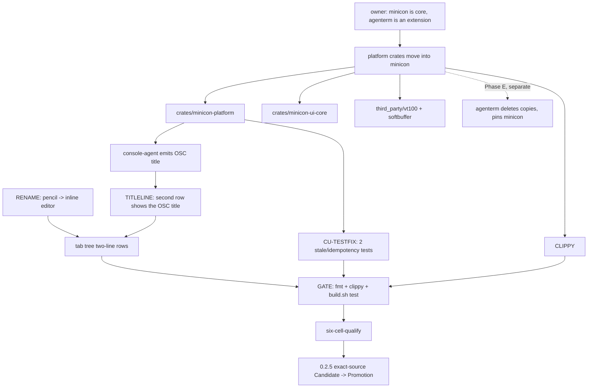

# plan-v0.2.5

## Scope decision

Owner (2026-10-10/11): **minicon stays the core, and the shared platform layer
moves into it.**

Two threads converge this round:

1. The tab-tree work the owner asked for directly: a pencil "edit" affordance on
   each tab row that renames the tab inline, and a second line under each tab
   showing the content area's terminal (OSC) title — a label that is
   deliberately independent of the tab name the user set.
2. An architecture move the owner made after `agenterm` retargeted itself to a
   MiniCon extension (llm/agent/harness plugins, an app market) rather than a
   second terminal product. Since the two products no longer share a "terminal
   engine" by reuse, the owner decided the shared modules should live in
   **MiniCon** and `agenterm` should depend on MiniCon — not the other way
   around. This supersedes `prd/PRD_02_28_shared_core.md`'s staged
   "No mandatory dependency inversion" non-goal (Stage 3, "not scheduled").

The Windows terminal-title gap was root-caused at the platform layer rather
than worked around in the shell UI: the default Windows backend (console-agent)
never read the console's own title, so `title okok` never reached the host
window title. The fix lands in the platform adapter, so the default backend
now synthesizes the OSC title the ConPTY backend already produced.

## Tree DAG

```text
0.2.5: tab rename + title line, minicon owns the platform layer, ship 0.2.5
├── {RENAME} inline tab rename from an edit affordance                    [v] @host=Windows
│      invariant: a per-row pencil left of the close button enters an
│        inline editor seeded with the current label, selected all, that
│        commits on Enter/Ctrl+O and cancels on Esc; an all-whitespace or
│        unchanged entry restores the derived label
│      evidence: `workspace::rename` unit tests + `ui` geometry/hit tests
│        (`the_edit_box_is_left_of_the_close_box_and_does_not_overlap_it`,
│        collapsed-rail edit inert); live GUI on a Windows host — pencil
│        enters edit, first click selects all, Enter renames, Esc restores
│      safe failure: unknown tab id is a typed no-op; rename never mutates a
│        different tab
├── {TITLELINE} second row per tab = the content terminal's OSC title      [v] @host=Windows
│      invariant: `TabNode.custom_title` (user label) and the terminal's own
│        title are two independent facts; the second row shows the OSC title
│        even when it differs from the label
│      evidence: `tree_row_name`/`tree_row_title` unit tests; live GUI
│        (`title okok` in the content `cmd.exe` updates the second row)
│      non-goal: forcing the two to match
├── {TITLEFIX} console-agent backend reports the console title   [v] @host=Windows
│      root cause: the default Windows backend scraped the screen buffer but
│        never called `GetConsoleTitleW`, so no OSC title ever existed in the
│        default path (`--feature conpty` was unaffected)
│      invariant: the default backend emits the same OSC title the ConPTY
│        backend does, as a control-free `\e]0;<title>\e\\` sequence, once
│        per change
│      evidence: new `a_title_becomes_one_control_free_osc_0_sequence` unit
│        test; live end-to-end in the DEFAULT backend — `title => API_TITLE_XYZ`
│        in the host window title, previously `node`
│      safe failure: a control byte in the console title is stripped, never
│        forwarded raw into the escape stream
├── {PLATFORM-MOVE} shared platform crates move into minicon             [v] @host=Windows
│      owner decision (2026-10-10): the shared modules leave `agenterm`,
│        are renamed `minicon-*`, and `agenterm` depends on `minicon`.
│        This is the {HOSTIF}-adjacent "minicon owns the underlying service
│        + interface" direction of `plan/plan-v0.2.4.md`, taken to the
│        platform layer:
│        - `agenterm-platform`  -> `crates/minicon-platform`
│        - `agenterm-ui-core`   -> `crates/minicon-ui-core`
│        - the `vt100` fork     -> `third_party/vt100` (package name kept `vt100`)
│        - the `softbuffer` fork-> `third_party/softbuffer` (package name kept)
│      invariant: minicon builds and tests with the four units as in-repo
│        path members; no `github.com/partnernetsoftware/agenterm` dependency
│        remains anywhere in the manifest, and the two forks stay patched by
│        path
│      evidence: `tests/minicon_alignment.rs` now asserts the path dep, the
│        absence of the agenterm git dep, and the path-patched forks;
│        `minicon-core`'s anti-coupling test names `minicon-platform`/
│        `minicon-ui-core`; the full workspace gate is green (see GATE below)
│      safe failure: none taken silently — see "Not done / carried" below for
│        the internal `AGENTERM_*` identifiers left in the copied source
│      non-goal: renaming internal C macros / env vars this round (huge,
│        risky churn; see carried items)
├── {CU-TESTFIX} two contained_process tests fixed                     [v] @host=Windows
│      surfaced because minicon's `harness` enables `contained-process-spawn`,
│        a feature `agenterm`'s default build never turned on — so these
│        Windows tests had never actually run
│      (a) `raw_abort_is_bounded_and_reports_cleanup` was a stale TEST bug:
│          the probe closed the very handles `cleanup_information` then used,
│          so the abort operated on dead handles (error 6). Fixed by leaving
│          the raw handles owned by the caller.
│      (b) `failed_launch_abort_terminates_and_reaps_the_exact_process`
│          exposed a real PRODUCT idempotency bug: Windows returns
│          `ERROR_ACCESS_DENIED` from `TerminateProcess` on a process the Job
│          already killed, so `abort_failed_launch` reported a spurious
│          cleanup failure on the normal path. Fixed so a terminate error is
│          only surfaced when the process did NOT exit.
│      evidence: both watched fail first (`terminate_process:6,wait_failed:6`
│        and `force_terminate:拒绝访问。 (os error 5)`), then pass
│      safe failure: when the process genuinely does not exit, both the
│        terminate error and the wait timeout are still reported
├── {CLIPPY-WS} workspace clippy clean with all features               [v] @host=none
│      the copied Windows code had never been linted with minicon's feature
│        set (pty + contained-process-spawn); six mechanical lints fixed in
│        `console_agent.rs`, `font.rs`, `pty.rs` (x2), `contained_process.rs`
│      evidence: `cargo clippy --workspace --all-targets -- -D warnings` exits 0
├── {README-SLIM} README and website cut to the essence                [v] @host=none
│      owner: "只为精华和吸引点" — README 436 -> ~155 lines (EN + 中文),
│        full shortcut table kept; `docs/index.html` i18n strings and static
│        meta fallbacks condensed to match
│      evidence: README rendered/reviewed; `minicon_alignment` keeps
│        help<->README shortcut parity green
├── {VERSION} 0.2.5                                                    [v] @host=none
│      `Cargo.toml` version 0.2.5. `release-policy.json` still carries the
│        previous version and is bumped by the release step, not here.
└── {SHIP} exact-source Candidate, no-rebuild Promotion                [ ] @host=none
       see the run-reputation-and-release skill; owner named 0.2.5, which is
       the required publish authority

Not done / carried (recorded, not silently skipped):
- the copied `crates/minicon-platform/native/*.h` and several `AGENTERM_*`
  env var / macro names are still `AGENTERM_*`; renaming them is internal
  churn with no product effect and is carried rather than rushed
- the `agenterm` side of the move (delete its copies, point it at a pinned
  minicon rev) is Phase E, tracked separately; not claimed here
```

## GATE status (this session's host: Windows)

Run with the stale `AGENTERM_FORCE_CONSOLE_AGENT=1` cleared (it forces the
console-agent backend and makes the `direct_conpty_*` platform tests fail for
environment reasons, unrelated to any change here — confirmed identical on
unmodified `agenterm`):

```text
env -u AGENTERM_FORCE_CONSOLE_AGENT ./scripts/build.sh test      -> exit 0
  minicon bin                        386 passed
  minicon_alignment                   15 passed
  minicon_load_portability             3 passed
  minicon_blackbox                    31 passed  (1 ignored)
  minicon_console_agent                8 passed
  minicon_control                      9 passed
  minicon_harness                     13 passed
  minicon_mux                          7 passed
  signing_workflow_policy              7 passed
  authenticode_inspector_policy        3 passed
  minicon_core (lib)                  95 passed
  minicon_platform (lib)             453 passed  (1 ignored)
  minicon_ui_core (lib)               54 passed
  platform integration tests           3 passed
cargo fmt --all -- --check                                       -> clean
cargo clippy --workspace --all-targets -- -D warnings           -> exit 0
```

`./scripts/six-cell-qualify.sh` is the pre-push gate; its result is recorded
with the push, not pre-claimed here.

## Memory palace


