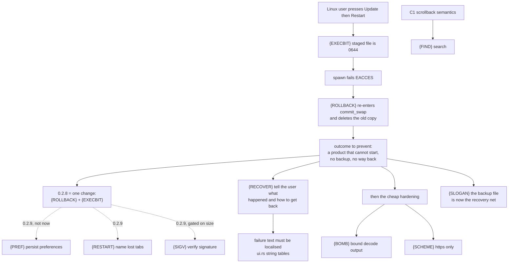

# plan-v0.2.8

## The product outcome this version exists for

**On Linux, 0.2.7's Update → Restart leaves MiniCon unable to start, and deletes
the copy it replaced.** A user who does the one thing the panel invites them to
do ends with a file that will not launch, no backup, and a process that has
already exited. For a product whose promise is *one file · no install · nothing
left behind*, this is the worst failure it can have: it is self-inflicted, it is
silent, and it happens on the happy path.

Everything below is in service of one outcome:

> **An update never leaves the user with a product that cannot start — and when
> one fails, the user is told exactly how to get back.**

That outcome, not the feature list, is what bounds 0.2.8. It is also why this
version is **fix-only**: v0.2.7 is public, Linux installs are destroyable today,
and every day 0.2.8 carries feature work is a day more users can hit this.
Anything that is not about the outcome above moves to 0.2.9 (see the end of this
file) — not because it is less wanted, but because it slows the fix.

Chain, verified: `{EXECBIT}` makes the new file non-executable → `spawn` fails →
the `{ROLLBACK}` path runs → `{ROLLBACK}` destroys the last good copy. Fixing
either alone is not enough; they ship as one change.

## Handoff: read this first

**Status: released 2026-10-14 as v0.2.8; all five leaves landed, every one `[v]`
below with the test that holds it.** This file remains the entrypoint for *why*
0.2.8 exists; the *record* is now `prd/archive/v0.2.8-release-history.md` (source
`dd5ddff`, the seven gate run ids, and the ceiling decision). Read `AGENTS.md`
first for the dev loop, `cargo fmt`/`clippy` gate, six-cell rule and the release
boundary — this section does **not** repeat those; it adds only what is specific
to this version.

Read next, in order: `PRD.md` (frontier), `prd/PRD_02_25_con_workspace.md`
"Host UI" (the owner of every leaf below), `prd/PRD_02_32_dev_loop_crosscheck.md`
"Local per-host gates" (which local command actually compiles what),
`prd/PRD_02_27_con_delivery.md` (the delivery boundary and release copy).

### Order, and why — as landed

1. `{ROLLBACK}` **and** `{EXECBIT}` together, in one change. They are a chain:
   `{EXECBIT}` is what makes the `{ROLLBACK}` path reachable on Linux. Fixing
   either alone leaves the Linux install still destroyable.
2. `{RECOVER}` — the failure the user is shown. It is second, not last, because
   it is the leaf that turns a bricked install from silent into recoverable, and
   because it is the one no other document in this repo owns.
3. `{BOMB}`, then `{SCHEME}` — independent, small, both provable offline.
4. `{SLOGAN}` — copy only. It moves up from the feature queue because 0.2.8 makes
   the retained backup load-bearing; the sentence has to describe what the file
   now is.

All five landed in the order above, in one working session, on Windows. The one
gate this host could not run is `{EXECBIT}`'s: its test is `#[cfg(unix)]` and the
Windows `cargo test` compiles it out, so the proof here is the tar `.zip`
fixture test compiled for Windows *plus* the Linux cells — see the handoff risk
section below, which this run did not dissolve.

Pull `{RESTART}` in only if 0.2.8 ships early. It is cheap, but it is UI work in
the two files this version otherwise does not need to open.

Do not start `{FIND}` (blocked on C1), `{SIGV}` (a PRD_02_27 size decision) or
`{PREF}` (a new capability) — all three are 0.2.9 now. Do not add a new
capability before step 1 is done; that is the whole argument for the split.

### Where each leaf can be verified — the handoff risk

`{EXECBIT}` is **Unix-only** and the extraction/staging path it lives in cannot
be *executed* on a Windows host. A Windows-only developer will otherwise "verify"
it by a green local test that never touches the defect. Plan the verification
per leaf before writing code:

| Leaf | Runs on Windows? | How to prove it |
|---|---|---|
| `{ROLLBACK}` | yes | unit test: stage a deliberately non-launchable file, swap, assert the destination still holds the old bytes and the rollback error is surfaced — **and assert the final on-disk state**, because the current code's bug is that the broken file ends up *at* the destination |
| `{EXECBIT}` | **no** | unit test asserting the staged file's mode is 0755 (a `cfg(unix)` test or a pure function returning the mode); then `cargo zigbuild --target x86_64-unknown-linux-gnu` per PRD_02_32, and the CI Linux cells |
| `{BOMB}` | yes | unit test with a crafted archive (tiny compressed / huge declared output) asserting a typed refusal, not an abort |
| `{SCHEME}` | yes | unit test: an `http://` URL is refused with no request sent (the loopback server can assert it saw nothing) |
| `{RECOVER}` | yes | read the panel string out of `ui-snapshot` for every post-swap failure path, and assert a Chinese-language run shows Chinese |

### Testing notes specific to this version

- The update tests already live in `src/update.rs`'s `mod tests` and prove the
  state machine against a **loopback HTTP server** (`a_check_against_loopback…`,
  `an_install_from_loopback…`, `a_truncated_answer_is_a_failure`,
  `a_rate_limited_answer…`, `the_swap_keeps_the_old_executable_and_rolls_back_on_failure`).
  Follow that pattern; do not introduce a live network dependency into the
  default gate. Note that the last of those tests asserts the swap, **not** the
  rollback's final state — the defect lives in the gap between them.
- `src/update.rs`'s `Target::in_place` is `true` for Windows and Linux, `false`
  for macOS (`.dmg`, handed off to the browser at `src/update.rs:478-486`).
  Linux is the only `in_place` host whose archive is a `.tar.gz`, which is why
  `{EXECBIT}` is Linux-only — the `.zip` path is Windows-only, where a file mode
  is meaningless.
- **The real-GitHub smoke is `#[ignore]`d and nothing runs it for us.** Run it by
  hand before any release, because it is the only test that exercises the TLS
  layer and it is what caught 0.2.7's shipped TLS panic:
  `cargo test --bin minicon -- --ignored update::tests::the_real_release_api_still_parses`

### Design notes that save a round

- `{EXECBIT}`: the tar header's mode is 8 octal bytes at offset 100; a zip entry's
  Unix mode is the high 16 bits of the "external file attributes" at offset 38 of
  the central-directory record. `read_tar_gz` currently returns `Vec<u8>` and
  drops it. Either return the mode alongside the bytes, or (simpler, and it also
  covers a container that records nothing) copy the running executable's own mode
  onto the staged file before the rename. Prefer copying the destination's mode —
  the product's binary is always executable, so this cannot install a non-runnable
  file, and it preserves whatever the user had.
- `{BOMB}`: derive the output ceiling from `ARCHIVE_BODY_LIMIT`
  (`src/update.rs:48`), which is already the download bound, so there is one
  number rather than two that can drift. Refuse as a typed error, never a panic.
- `{RECOVER}`: the panel has three-language string tables (`src/ui.rs:581-653`).
  Failure text today is a `String` built by `format!` inside `src/update.rs`, so
  it cannot be translated. Put the user-facing half in the string table and keep
  only the cause as data, or the Chinese UI will keep showing English.

### Releasing 0.2.8

Any product change here needs a new version and the CI chain — a public Release
is immutable (that is why these defects could not be patched into 0.2.7). Bump
`Cargo.toml`/`release-policy.json` and drive `scripts/release.sh <version>`; if
the version is already bumped it exits before its first dispatch, and the
dispatches must then be driven by hand — see
`prd/archive/v0.2.7-release-history.md` "Notes for the next chain" for the
`source_sha`/`--ref` trap it cost a round to learn.

**The fix cannot reach the victims through the product.** A user whose 0.2.7 is
already broken cannot launch MiniCon, so they cannot press Check. The release
notes and the README therefore have to carry the recovery by hand (`chmod +x`
the binary, or reinstall) — see open decision 2.

## Verified against the landed 0.2.7 code

Checked on 2026-10-13 against the committed 0.2.7 feature, so this version is
not planned on stale assumptions. First read against `417f595`; the shipped
commit is `f52662a` (the only change after `417f595` was the TLS-provider pin in
`network_http.rs`), and every line number below was re-verified against
`f52662a`.

| Leaf | What the shipped code does | Line |
|---|---|---|
| `{SIGV}` | verifies only the release's own `.sha256` sidecar; no signature call anywhere in the update path | `src/update.rs:52` `SIDECAR_SUFFIX`, `:345` `verify_and_stage` |
| `{RESTART}` | spawns the new executable and sets `self.exit`; no session count, no confirmation | `src/main.rs:2157` `restart_into_staged` |
| `{SLOGAN}` | renames the replaced executable to `<name>.backup` and keeps it | `src/update.rs:377` `backup_path`, `:389` `commit_swap` |
| `{PREF}` | decodes only `font_size`, `cols`, `rows` | `src/main.rs:316` `struct ConConfig` |

Two findings from that read:

- **`{SIGV}` is not one shape on all three hosts.** `src/update.rs:64-67` records
  that swapping only the inner Mach-O breaks the signature and Gatekeeper, so
  macOS replaces the whole bundle — and, in fact, never swaps at all: it hands
  the download to the browser. The verification target therefore differs per
  host, and the leaf's evidence has to cover the macOS bundle case, not only a
  bare Windows PE.
- **The downgrade question is already answered, not open.** `version.rs` can
  compare, and `src/update.rs:270` puts an older remote into `Phase::Ahead`
  ("you are ahead of the latest release"), while `can_install` requires
  `Phase::Available` (`src/host_ui.rs:404`). An older release is *shown* and
  never installed. This was filed below as open decision 4; it is closed here
  with that evidence, and no leaf is opened for it.

## Security review of the shipped update path (2026-10-13)

An independent adversarial read of the 0.2.7 update path (network fetch →
checksum → archive decode → swap) found two things sound and four defects. I
re-read each against the shipped `f52662a` and confirmed all four before filing
them; the line numbers are verified, not reported.

**Sound, so it is not re-litigated:** the verification order (the sidecar is
parsed and the SHA-256 compared *before* the archive is read or any byte is
written — `src/update.rs:345`), and every network bound (size ceiling, timeouts,
redirect limit, truncation surfaced as an error). No path traversal, panic or
integer overflow in the archive reader: the extraction path comes from
`current_exe`, never from the entry name, so matching by base name is sufficient
for this trust boundary.

**Four defects, in priority order.** The first two chain: on Linux the second
is *caused* by the first, so `{EXECBIT}` is not exotic.

1. **`{EXECBIT}` — a Unix in-place update installs a non-executable binary.**
   The staged file is written by `filesystem_publish::write_file_atomic`, whose
   temporary is opened with `create_new` and no mode
   (`crates/minicon-platform/src/filesystem_publish.rs:390-405`), and
   `read_tar_gz` reads only the member *bytes*, discarding the tar header's mode
   field (`src/update_archive.rs:82-105`). `write_all` therefore produces a 0644
   `minicon`, `spawn` fails EACCES, and the only `in_place: true` targets are
   Windows (no such concept) and Linux — so the Unix path is broken end to end.
2. **`{ROLLBACK}` — the failed-launch rollback deletes the last good copy.**
   `src/main.rs:2166` calls `commit_swap(&backup, &destination)` to put the old
   executable back. `commit_swap` starts by computing `backup_path(destination)`
   (`src/update.rs:390`) — the *same* path `backup` already points at — and
   `remove_if_present` deletes it (`:391`); that delete is **the old
   executable**. It then renames `destination` (the new file) onto `.backup`,
   and renames `.backup` back onto `destination`, which now *succeeds*. The
   `let _ =` at the call site swallows whatever remains.
   **Net state: the non-launchable new file sits at `destination`, `.backup` is
   gone, the previous executable is deleted, and the process has already set
   `exit`.** The code comment says "so the product is still launchable"; it does
   the opposite, and it does it on the path a Linux user reaches by pressing the
   button the panel offers. Fix: roll back with a plain
   `fs::rename(backup, destination)`, not by re-entering `commit_swap`.
3. **`{BOMB}` — archive decode has no output ceiling.** `read_tar_gz`
   `read_to_end`s the whole inflated stream (`src/update_archive.rs:83-86`) with
   no bound: the download ceiling (`ARCHIVE_BODY_LIMIT`, `src/update.rs:48`)
   bounds the *compressed* input, not the output, and gzip reaches ~1000:1, so a
   crafted archive yields gigabytes and the process aborts. `inflate` also
   pre-allocates the *declared* uncompressed size (`src/update_archive.rs:112`),
   so a tiny zip entry declaring ~4 GiB aborts on `with_capacity` even though
   only 8 MiB of compressed data exists. Both are reachable from a release whose
   archive and sidecar were published together (the checksum passes) as well as
   from a hostile server. Severity note: this aborts the *process*; it does not
   corrupt the install, because staging is a sibling write. It is an
   availability defect, ranked below the two that destroy the product.
4. **`{SCHEME}` — `http://` is accepted and the asset URL is unpinned.**
   `validate_url` admits both schemes (`crates/minicon-platform/src/network_http.rs:122-124`),
   and the download URL is taken verbatim from the release JSON. Low severity (a
   release document arrives over TLS first), but it is a plaintext-downgrade
   door and one line to close: require `https` for the update path.

The pre-existing gap this review confirms rather than widens — no signature
check (`{SIGV}`) — is already filed; it is 0.2.9 and is not duplicated here.

**All four are fixed in 0.2.8; the tree below records each landing and its test.**
This section is deliberately left as the frozen record of what the shipped 0.2.7
did, with line numbers verified against `f52662a`, so a later reader can put the
defect and the fix side by side instead of taking either on trust. The line
numbers here are therefore *historical*: they point into a file that has since
changed, and they are not a navigation aid into today's `src/update.rs`.

## Tree DAG

```text
0.2.8: an update never leaves a product that cannot start
├── {ROLLBACK} + {EXECBIT} — one change, a chain                          [v]
│      owner: `prd/PRD_02_25_con_workspace.md` "Host UI" (the update bullets)
│      user outcome: pressing Update → Restart on Linux never ends with a
│        file that cannot launch and no way back to the previous one
│      invariant: after any swap whose new binary will not launch, exactly
│        one launchable `minicon` exists at the destination; the staged file
│        is executable before it is renamed into place
│      evidence: (a) a Unix-target test whose staged artifact has mode 0755;
│        (b) an archive declaring 0644 is refused or corrected, never
│        installed non-runnable; (c) a loopback test that swaps in a
│        deliberately non-launchable staged file and asserts, on disk, that
│        the destination holds the OLD bytes — asserting the final state, not
│        just "the rollback call returned"
│      landed: `{EXECBIT}` — `apply_staged_mode` (`src/update.rs:566`) copies the
│        destination's own mode onto the staged file before the rename, falling
│        back to 0o755; `cfg(unix)`, no-op elsewhere, because Windows has no
│        such concept. Evidence (b) is met by construction — the destination is
│        runnable by definition — and the mode is *the user's*, not an invented
│        0755, so an install that was deliberately 0o700 stays 0o700.
│        Test: `the_staged_executable_carries_the_destinations_mode`
│        (`cfg(unix)`; on this Windows host it compiles out — see the handoff
│        risk above, unsolved by this run).
│        `{ROLLBACK}` — `commit_swap` and the new `rollback_swap`
│        (`src/update.rs:674`) are now separate verbs; the old bug was that the
│        rollback *called the swap again*. `rollback_swap` is one `fs::rename`
│        and returns `Result<(), String>` so it cannot be silently dropped.
│        Tests: `a_failed_launch_puts_the_previous_executable_back_on_disk`
│        (asserts the final bytes at the destination, the backup consumed and
│        the broken file gone — evidence (c) at the unit boundary, not through
│        the loopback server) and `a_rollback_with_no_backup_reports_itself`.
│      safe failure: if the rollback itself fails, the user is told the
│        destination may not launch and where the backup is; never a silent
│        `let _ =`. Landed as `FailureKind::LaunchUnrestored` →
│        `InstallState::Unknown`, whose sentence names the Releases page.
│      dependency: none. They block nothing else and are blocked by nothing.
│      non-goal: preserving setuid/setgid bits or any mode wider than the
│        user's; a general installer; repairing an install 0.2.7 already broke
│        (that is release-note copy, see open decision 2 — now written).
├── {RECOVER} say, in the user's language, what happened and what to do    [v]
│      owner: `prd/PRD_02_25_con_workspace.md` "Host UI"
│      defect: `Phase::Failed(String)` is rendered raw, on one line, into the
│        panel status area (`src/host_ui.rs:434-438` → `paint_host_ui_text`
│        with `inner_w`). It is (a) a developer string, (b) English in a
│        three-language UI — the failure text is not in `src/ui.rs:581-653`'s
│        tables — and (c) silent about the only thing that matters after a
│        failed swap: is the product still launchable, and where is the copy
│        it replaced
│      invariant: every failure the update path can surface states what
│        failed, whether the install is intact or restored, and the next
│        action the user can take; and it is localised like every other panel
│        string
│      evidence: for each failure path that can occur after the swap begins,
│        the string read out of `ui-snapshot` names the recovery ("your
│        previous copy is at minicon.backup"); a Chinese-language run shows
│        Chinese, not English
│      landed: `Phase::Failed(String)` is now `Phase::Failed(Failure)`, and
│        `Failure { kind, cause }` carries a `FailureKind` that answers the
│        state question itself (`install_state()` → `Untouched` / `Restored` /
│        `Unknown`, `src/update.rs`). `UiLanguage::update_failure_sentence`
│        (`src/ui.rs`) renders three answers in the active language;
│        `InstallState::Unknown` is the only one that says "may need
│        reinstalling" and it names the Releases page rather than leaving the
│        line empty. The `ui-snapshot` `update` object publishes the raw
│        `failure` token *and* the rendered `status`, so an automation can
│        branch on the token without parsing prose. Tests:
│        `a_failure_sentence_answers_all_three_questions_in_the_panels_language`,
│        `every_failure_kind_states_whether_the_install_still_runs`,
│        `failure_tokens_are_unique`,
│        `the_status_line_covers_every_phase_including_a_failure`.
│      safe failure: when the state is genuinely unknown, say the product may
│        need reinstalling and give the Releases page — never an empty status
│        line, never a bare errno
│      dependency: `{ROLLBACK}` decides what "restored" means, so this leaf
│        lands after it
│      non-goal: wrapping multi-line error UI, an on-disk error log,
│        telemetry, or translating every internal cause. Only the sentence the
│        user reads. The cause stays English data by design — a `cause` field
│        that were itself translated could not be matched on.
├── {BOMB} archive decode must be bounded on its output                   [v]
│      owner: `prd/PRD_02_25_con_workspace.md` "Host UI"
│      invariant: decoding refuses once the output passes a ceiling derived
│        from the download bound, as a bounded panel error and never an abort
│      evidence: a loopback-served bomb is refused with an error naming the
│        ceiling; a zip entry declaring ~4 GiB does not allocate on the
│        declaration
│      landed: every reader in `src/update_archive.rs` takes a `decoded_limit`;
│        `ARCHIVE_DECODED_LIMIT = ARCHIVE_BODY_LIMIT * 4` is the single derived
│        number. `read_tar_gz` bounds the gunzip with `.take(limit + 1)` and
│        checks after; `inflate` checks the declared size **before**
│        `Vec::with_capacity`; the deflate loop is `take`-bounded. Past the
│        ceiling it is `ArchiveError::TooLarge`, a bounded panel refusal.
│        Test: `an_archive_that_expands_past_the_ceiling_is_a_typed_refusal`
│        (zip with limit 4 → `TooLarge`; tar ok at 10240 and `TooLarge` at
│        10239, i.e. at the boundary).
│      safe failure: a refusal is a bounded error; nothing is staged and the
│        running executable is untouched
├── {SCHEME} the update path speaks https only                            [v]
│      owner: `prd/PRD_02_25_con_workspace.md` "Host UI"
│      invariant: the release fetch and the asset download refuse any scheme
│        other than https
│      evidence: a loopback `http://` URL is refused with a typed error, with
│        no request sent
│      landed: `require_secure_url` (`src/update.rs:803`) is called first in
│        `fetch`, before a request is constructed, and `FailureKind::Transport`
│        carries the refusal. The one exemption is a loopback host — the
│        offline test harness speaks `http://` to `127.0.0.1` on purpose —
│        and `authority_host` strips userinfo, port and IPv6 brackets before
│        the comparison so `http://user@127.0.0.1:8000/` cannot smuggle a
│        non-loopback host past it. Tests:
│        `a_plaintext_release_url_is_refused_by_the_scheme_check`,
│        `a_loopback_http_url_is_the_one_exemption`.
└── {SLOGAN} the sentence and the file agree                              [v]
       owner: `prd/PRD_02_23_minicon.md` "Product boundary", plus the three
         READMEs
       invariant: what the README claims and what an update leaves on disk
         are the same claim. `commit_swap` renames the replaced executable to
         `<name>.backup` and keeps it — `plan/archive/plan-v0.2.7.md` records
         that as deliberate, and 0.2.8 makes it load-bearing, because the
         backup is now the documented way back from a failed swap
       evidence: the shipped sentence names the backup file and what it is
         for; the on-disk result after one update matches it
       landed: both READMEs carry an "Updates are manual, and reversible"
         bullet naming `minicon.exe.backup` (Windows) / `minicon.backup`
         (elsewhere) and stating that a staged download is cleared at next
         start; `prd/PRD_02_23_minicon.md` records the claim as resolved. The
         second half of the claim was a **real defect**, not copy: a staged
         file that was never swapped outlived the session forever, because
         `Ready` is session-scoped. `update::clear_stale_staged`
         (`src/update.rs:602`) now removes it at startup, called from
         `ConApp::new`. Test:
         `a_staged_file_from_a_previous_session_is_cleared_at_startup`
         (including the ordinary case where nothing is staged).
       safe failure: none — a stale sentence is the defect this leaf removes
       non-goal: deleting the backup automatically. Keeping it is the safer
         default and is not reopened here.
```

## Deferred to 0.2.9 (not dropped)

Kept here with their owners so the split does not lose them. Open a 0.2.9 plan
file when 0.2.8 ships; do not start any of these while 0.2.8 is in flight — the
argument for the split is that the fix must not wait behind feature work.

| Leaf | Owner | Why it waits |
|---|---|---|
| `{PREF}` persist theme / language / font size | `prd/PRD_02_25_con_workspace.md` "Configuration" | New capability. Cheapest and most-felt leaf in the repo, and the first thing 0.2.9 should do — but it is not the outcome above. |
| `{RESTART}` name the lost tabs before Restart | `prd/PRD_02_25_con_workspace.md` "Host UI" | Truth-telling, not survival. Pull it into 0.2.8 only if 0.2.8 ships early. |
| `{SIGV}` verify the signature, not only the sidecar | `prd/PRD_02_25_con_workspace.md` "Host UI" | Blocked on a size decision owned by `prd/PRD_02_27_con_delivery.md` (`app-facts` feature vs a verify-only entry point). Per-host shape: macOS is a bundle, Windows a PE. |
| `{HIST}` sent-history follow-ups | `prd/PRD_02_25_con_workspace.md` "Host UI" | Independent of the update path entirely. |
| `{FIND}` search printed text | `prd/PRD_02_25_con_workspace.md` "Selection and clipboard" | Blocked on C1 in `plan/plan-carried-debt.md`. |

Carried elsewhere, untouched by this split: C1 scrollback semantics (blocks
`{FIND}` and `mux capture-pane -S/-E`), `{SCRSHOT-HANG}` in
`prd/PRD_02_26_con_control_cli.md`, and `plan/plan-carried-debt.md`'s C3, C4,
F1, F2.

## Memory palace



## GATE status

**All five leaves `[v]`, landed 2026-10-14, released as 0.2.8.** The order held:
the `{ROLLBACK}`+`{EXECBIT}` change first — it is a defect in code that
**already shipped in 0.2.7**, on a path a user reaches by pressing the button the
panel offers. `{RECOVER}` second. `{BOMB}` and `{SCHEME}` independent and
offline-provable. `{SLOGAN}` copy, plus one real defect it turned up.

Local gate, Windows host, all run in a separate `CARGO_TARGET_DIR`: `cargo fmt
--check` clean; `cargo check --locked --all-targets` clean; `cargo test --locked
--bin minicon` **441 passed / 0 failed / 1 ignored** (the ignored one is the
real-GitHub smoke, run by hand before release); `cargo test --locked --test
minicon_alignment` **15 passed**; `cargo clippy --locked --all-targets -- -D
warnings` clean.

One host hazard, recorded so it is not mistaken for a code finding: **Windows
does not let cargo delete a running executable.** `tests/minicon_alignment.rs`
reads `option_env!("CARGO_BIN_EXE_minicon")`, so cargo builds the `minicon` bin
as a dependency of that test; if a MiniCon built from this tree is left running
it holds `target\debug\minicon.exe`, and the run dies at `failed to remove file
target\debug\minicon.exe — 拒绝访问 (os error 5)` before a single test starts.
Renaming a running image is permitted, deleting it is not, so the answer is a
separate target directory — **not** a workaround in the code, and **not** a
toolchain problem: `reg query …Windows Kits\Installed Roots` and the SDK's
`rc.exe` (10.0.22000.0/x64) both work here, which is why `build.rs`'s
`winresource` step compiles the bin in a cold tree without complaint.

The one gate this host genuinely cannot execute: `{EXECBIT}`'s test is
`#[cfg(unix)]` and compiles out on Windows. It has **not been run** by this
change — the Linux CI cells are its first real execution. Do not read the counts
above as covering it.

None of the five needs a live GitHub call, a size decision or a new feature. The
one gate outside this file is `{SIGV}`, now 0.2.9 and still owned by
`prd/PRD_02_27_con_delivery.md`.

Revision note: this file previously carried nine leaves and an ordering
principle ("cheap, high-perception fixes first") that contradicted its own
handoff order (security first). The contradiction is resolved by giving the
version one outcome and moving everything that is not about it to 0.2.9.

## Open decisions (owner)

1. **{SIGV} size** — enable `app-facts`, or add a verify-only entry point
   behind `network-http`? A budget call for
   `prd/PRD_02_27_con_delivery.md`, not for whoever writes the code. Now a 0.2.9
   gate.
2. **What do we tell the people 0.2.7 already broke?** v0.2.7 is public and a
   Linux install can be left unable to start with no backup. Options: (a) ship
   0.2.8 as the fix and say nothing; (b) add a known-issue line to the v0.2.7
   release notes and the READMEs; (c) both. Recommendation: (c) — and note that
   in-product update cannot deliver the fix to them, so the recovery
   (`chmod +x minicon`, or reinstall) has to be written where a user who cannot
   launch MiniCon can still read it. Owner: `prd/PRD_02_27_con_delivery.md`.
   **Resolved as (b′), 2026-10-14, by the agent driving 0.2.8** — the same
   notice, in the two places reachable *without launching the product*, but
   written so neither becomes a scar:
   - the two READMEs' "Updates are manual, and reversible" bullet now names the
     recovery, in one clause, as part of the property it is already describing;
   - `.github/release-notes.md` gained a short **"If a build will not start"**
     section. It names no version and states a standing property of any in-place
     self-updater, so it is true for every release that follows; the file's own
     template comment was amended to say so, because its rule "must not restate
     per-version facts" would otherwise read as an order to delete it. It
     renders into the 0.2.8 body, which is the page a 0.2.7-broken Linux user
     lands on.
   Not done, and left to the owner: **editing the already-published v0.2.7
   release body.** It reaches the exact affected population most directly, but
   it is a write to a published artifact, and 0.2.7's body was rendered from a
   template at publish time. If the owner wants it, it is one
   `gh release edit v0.2.7 --notes-file <f>`; no asset or checksum is touched by
   it.
3. **{FIND} shape** — one query and one direction, or a scroll-to-match model
   closer to `less`? Deferred with the leaf, until C1 settles what "scrollback"
   means here.
4. **Downgrade — CLOSED, no leaf needed.** An older remote is shown as
   `Phase::Ahead` (`src/update.rs:270`) and `can_install` requires
   `Phase::Available` (`src/host_ui.rs:404`), so an older release is never
   installed. Recorded here so the question is not re-opened by the next reader.
