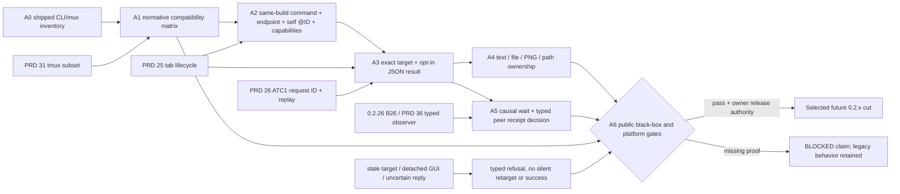

# Agent-facing CLI normalization sequence

Status: `[-]` contract selected 2026-10-28. This plan sequences the
[owning PRD](../prd/PRD_02_26_01_agent_cli_contract.md); it does not claim
that the planned flags, environment values or response envelope exist. The
0.2.26 watch-floor plan owns only the B26 observer/coordination decision and
links here. Release selection remains with PRD 27.

## Outcome tree DAG

```text
Outcome: a local agent can use one predictable CLI to address, observe and drive exact tabs
├── [-] A0 — inventory shipped CLI/mux behavior and concrete divergences
│   invariant: current behavior is labelled current, not rewritten as a future guarantee
│   evidence: src/control.rs, src/mux.rs, src/terminal.rs and PRD 26/31 command matrix
│   safe failure: uncertainty remains an open contract item with a named court
│   dependency: public 0.2.25 baseline; non-goal: claiming full tmux compatibility
├── [_] A1 — finish the compatibility contract and per-command help design
│   invariant: native CLI owns machine semantics and mux remains a documented translation
│   evidence: reviewed syntax/output/target/host-state table and upstream tmux comparison
│   safe failure: unsupported verbs and flags stay explicit errors
│   dependency: A0 and PRD 26.01; non-goal: changing existing CLI output by documentation alone
├── [-] A2 — provide same-instance command, endpoint, self-tab and capability discovery
│   invariant: child command resolves this build/instance; self resolves only to a live @ID in its incarnation
│   evidence: two instances, PATH reset, renamed executable, two same-name tabs, restart and absent endpoint black boxes
│   safe failure: missing binary/endpoint or stale self refuses before a second launch, send or selection
│   dependency: PRD 25 lifecycle and PRD 26 endpoint; non-goal: global PATH changes or agent permission policy
├── [_] A3 — normalize targeting and opt-in JSON results
│   invariant: explicit target resolves once; legacy output stays compatible; one JSON result names the outcome and applicable target
│   evidence: every command family with success, invalid argument, wrong kind, stale ID, timeout and lost-reply replay
│   safe failure: uncertain completion is typed and never retried as a new request silently
│   dependency: A2 and ATC1 replay identity; non-goal: changing the private wire into a public API
├── [_] A4 — settle input, capture and path semantics
│   invariant: PTY write is not agent acknowledgement; text/image output states source, truncation and path owner
│   evidence: UTF-8 file, visible-row/truncated capture, PNG, relative path, screenshot stall and headless courts
│   safe failure: failed output leaves no completed file or false success
│   dependency: A3 and PRD 26 screenshot/headless leaves; non-goal: undocumented scrollback or Browser DOM capture
├── [_] A5 — decide typed peer receipt and causal observation
│   invariant: a run/message receipt has exact sender/recipient @IDs, incarnation, sequence and explicit acknowledgement
│   evidence: one real CLI/TUI adapter, duplicate/lost reply, stale screen, closed receiver and restart negative controls
│   safe failure: unsupported agents remain controllable as PTYs with Unknown task state
│   dependency: 0.2.26 B26 and PRD 36 typed observer owner; non-goal: a general message broker in this slice
└── [_] A6 — qualify and document the public compatibility cut
    invariant: code, per-command help, PRD and public guide agree on the same exact artifact
    evidence: scoped CLI/mux black boxes, fmt/clippy, six-cell and native screenshot/headless claims where applicable
    safe failure: missing native evidence blocks that claim and no release is inferred
    dependency: PRD 27/33 gates and explicit release authority; non-goal: publishing from a design plan
```

## Memory palace



## Sequence and hot files

1. **Freeze a command matrix first.** Record each current native CLI verb,
   tmux adapter verb, flag, output type, target default, required host state,
   tab kind and bound. Use the official
   [tmux Advanced Use guide](https://github.com/tmux/tmux/wiki/Advanced-Use)
   only to check the subset MiniCon claims. In particular, distinguish
   `capture-pane -p` from history-range flags and `send-keys` from an agent
   delivery receipt. The current command evidence remains in PRD 26/31;
   PRD 26.01 owns the normalization decision.
2. **Implement discovery without new authority.** Bind a unique local,
   process-lifetime control endpoint for ordinary GUI launches before the
   first Console child starts; keep explicit `--control` as an override. Do
   not publish a machine-wide default endpoint or choose the last-open GUI.
   Make `minicon` inside a
   Console child resolve the host's own executable: prepend its directory to
   the child `PATH`, export an absolute `MINICON_BIN` fallback, and provide an
   owned launcher if packaging changes the basename. Inject a stable self-tab
   hint and process-incarnation marker, expose endpoint fallback to native
   `cli`, and add per-command help/capability reporting. Define `--control`
   precedence over `MINICON_CONTROL`; do not modify global `PATH`. Cover two simultaneous instances, a login shell that
   rewrites `PATH`, a missing endpoint and a renamed executable. Redact
   endpoint/path values from public snapshots. Resolve `self` against the live
   host on each call. A copied environment block does not grant permission or
   prove sender identity. Bare `minicon` retains its application behavior.
3. **Add the opt-in result envelope before altering capture semantics.** Keep
   legacy stdout/stderr stable. Add consistent error codes and exit mapping
   for parse, target, wrong kind, unavailable, timeout, conflict, transport,
   uncertain completion and internal failure. Reuse existing request-ID
   replay rather than creating a second retry path. Test actual subprocess
   exit codes, stdout/stderr and target state, not only parser helpers.
4. **Close the I/O contract.** Name client/server path ownership in current
   help. Qualify an atomic client-side PNG route and bounded transfer before
   changing screenshot `--output`; no silent reinterpretation of relative
   paths. Expose capture truncation and visible-row scope, and make causal
   waits distinguish old text from post-send evidence. Keep 1 MiB file input
   and capture ceilings unless measured evidence justifies a new bound.
5. **Decide the peer-observer seam separately.** Use an actual Console-hosted
   agent to specify an opt-in sender/recipient/run identity and receipt. A
   PTY write, a visible prompt and a model request are different evidence.
   Harness joins only after it has a real TabId/lifecycle; until then the
   robot workspace remains a separate observation destination.
6. **Integrate serially and gate claims.** `src/control.rs`, `src/mux.rs`,
   `src/control_dispatch.rs`, `src/main.rs`, `src/terminal.rs` and the public
   CLI docs are shared hot files. Finish one slice before another edits their
   command grammar or response shape. Run focused public CLI/mux journeys
   with the smoke profile, then the platform courts needed for screenshot
   and headless claims. PRD 33 selects broad tests; PRD 27 owns release.

## Version boundary

The Console child command/endpoint slice of A2 has Windows public black-box
evidence in `console_child_minicon_command_uses_its_own_control_endpoint`:
an inherited endpoint works, explicit `--control` wins, and a shadow
`minicon` earlier in the inherited `PATH` is bypassed. Removing the child
`PATH` override made this black box fail. The ordinary launch now generates a
unique local process-lifetime endpoint;
`ordinary_launch_gets_a_unique_native_endpoint_and_explicit_binding_wins`
passed, and replacing its entropy result with a constant made it fail.
The Windows public `ordinary_console_child_reaches_its_automatic_control_endpoint`
also passed, and removing the child's endpoint made it fail with a
missing-`MINICON_CONTROL` screen receipt. Its expanded journey now proves
`MINICON_TAB_ID`/`MINICON_INSTANCE_ID` inside the child, native
`--target self`, wrong-instance refusal and closed-tab refusal. Removing the
host incarnation check made this court fail. The Windows
`simultaneous_console_children_bind_to_their_own_minicon_instances` court
passed two ordinary live hosts, distinct child endpoints/incarnations, isolated
tab creation and cross-instance `self` refusal. Replacing fresh incarnation
entropy with a constant made the court fail. Restart at a reused endpoint,
renamed-binary packaging and macOS/Linux native
courts remain open, so A2 is partial. Web has no shell; a future
Harness child receives its own tab identity under the same instance-binding
rule only after Harness tab lifecycle exists.

The 0.2.26 [B26 leaf](archive/plan-v0.2.26.md) decides the identity/observer/message
contract and can deliver small compatible discovery improvements if their
black-box evidence is ready. A3/A4/A5 are independently selectable later
0.2.x slices; they are not hidden gates on the default-list @0 delivery.
Changing legacy output, claiming full tmux, launching a remote endpoint or
publishing a version requires a separate explicit product/release decision.
