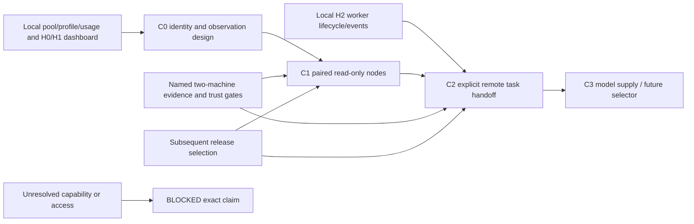

# Cluster and cross-machine coordination sequence

Status: `[_]` future track requested on 2026-10-25. Behavior and open decisions:
[PRD 37 — 未来构想](../prd/PRD_02_37_cluster_horizon.md#未来构想). Dashboard:
[PRD 36](../prd/PRD_02_36_harness_workspace.md). Current local sequence:
[Harness workspace plan](plan-harness-workspace.md).

## Outcome tree DAG

```text
Outcome: introduce cross-machine coordination in reviewable subsequent slices
├── [-] C0 — concrete node/trust/observation design next
│   invariant: identity and authority precede transport implementation
│   evidence: reviewed protocol scenarios and shared-core reuse inventory
│   safe failure: unresolved decisions remain named prerequisites
│   dependency: local account/profile/request/task vocabulary; non-goal: current remote delivery
├── [_] C1 — paired read-only two-node observation
│   invariant: origin/freshness/coverage retained and local work independent
│   evidence: CL-01/02/03 on two real machines
│   safe failure: stale/unknown without fabricated task state
│   dependency: C0; non-goal: remote commands or mesh scheduling
├── [_] C2 — explicit owned-task handoff and cancellation
│   invariant: destination owns admission/execution/result, operation retries reconcile
│   evidence: CL-04/05 with real model/file/exec/disconnect scenarios
│   safe failure: ambiguous outcome requires reconciliation
│   dependency: C1 and local H2; non-goal: arbitrary remote shell or blind replay
└── [_] C3 — later model supply/capacity coordination
    invariant: credentials local, allocation and conversations remain validated
    evidence: CL-06 and separately selected selector scenarios
    safe failure: retain manual/local allocation
    dependency: C2 feedback and llm-gate seam; non-goal: shipping the dynamic engine now
```

## Memory palace



## Near-term planning commitment

Begin C0 as the next concrete design milestone alongside completion of the local
Harness foundation; it need not wait for every H2/H3 feature. Reserve stable
origin-aware observation seams now, without implementing a network listener or
claiming cluster support. C1 is the first intended implementation slice in a
subsequent selected version; assign its version after C0's prerequisites and
two-machine evidence are concrete. C2 waits for local H2 lifecycle qualification;
C3 waits for real coordination feedback. Do not turn this future track into an
unannounced 0.2.23 release requirement.

The 0.2.24 [C0 contract checkpoint](../prd/PRD_02_37_cluster_horizon.md#c0-contract-checkpoint-for-0224)
defines explicit pairing, read-only scope, origin/epoch/sequence semantics and
the review scenarios. Transport, key implementation and two-machine evidence
remain open; the next review resolves them before selecting C1 code.

At each join, update PRD 37 status/evidence, PRD 36's visible actions, the shared
ownership map and exact release scope. Freeze transport and observation contracts
before parallel implementation; one integrator owns runtime/authority joins.
