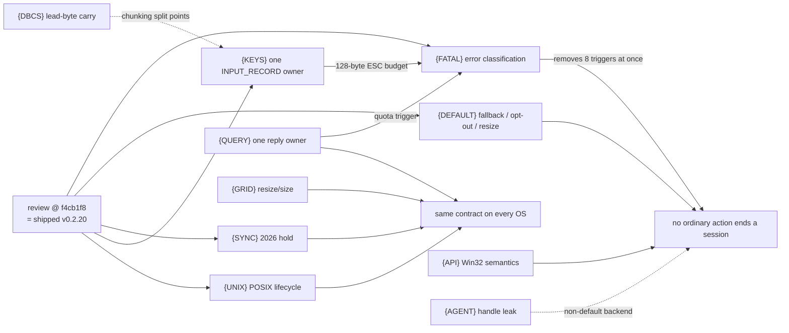

# minicon-console code review findings (2026-10-22)

Status: findings recorded 2026-10-23, not scheduled. A read-only correctness
review of `crates/minicon-console` and its platform adapters ran at
`f4cb1f8`; the reviewed paths are byte-identical through `e1a6e2d`
(v0.2.20 published), so every finding applies to the shipped v0.2.20 with
`rust-console` as the Windows default. Nothing here is fixed. Pull a leaf into
a numbered version plan when it is picked up; the owners stay
[PRD 34](../prd/PRD_02_34_windows_console_backend.md) (Windows service),
[PRD 35](../prd/PRD_02_35_terminal_library.md) (portable library),
[PRD 24](../prd/PRD_02_24_con_terminal.md) (backend selection, PTY) and
[PRD 24.01](../prd/PRD_02_24_01_tui_compatibility.md) (TUI behavior).

Scope honesty: every finding comes from reading code on a macOS host. None
was reproduced at runtime. `checked` means the claim was re-read against the
source by a second pass; `review` means a single reviewer's reading. Each leaf
still needs a failing-first test before a fix counts (AGENTS.md: a test that
passes with its guard removed is not evidence).

## Outcome tree

```text
Outcome: an ordinary user action never ends a whole console session, and every backend/OS keeps the same terminal contract
├── [_] {FATAL} Classify host errors instead of ending the session
│   invariant: only transport loss ends a session; an unsupported state, a budget
│     limit or malformed input completes that one request with a status, drops
│     that input, or beeps — never `serve` -> Err
│   root: rust_console.rs:221 settle_native_result forgives only
│     ERROR_OPERATION_ABORTED with an empty Job; every other `?` is fatal
│   triggers:
│     - resize during a cooked read, then one key: host/input/echo.rs:264 (checked)
│     - invalid UTF-8 from the terminal: rust_console.rs:423 (checked)
│     - ESC [ + >128 bytes with no ASCII final byte (CJK paste): rust_console.rs:468/520,
│       console_input.rs:127 (review)
│     - queued Ctrl+C key record under processed input: host/input.rs:879 (checked)
│     - WriteConsole / SetConsoleTitle over 1 MiB: host.rs:895, host.rs:1245
│       against driver.rs:361 (checked) — the raw-write path was fixed, this one not
│     - one line > 32768 UTF-16 units: host/input/edit.rs:186 (review; the unit
│       test at edit.rs:258 asserts the error as intended)
│     - 65th outstanding CPR query: terminal/responses.rs:40 (review)
│     - completing a deferred request ConDrv already cancelled: host.rs:616/636,
│       host/input.rs:749-755 (review)
│   evidence: one failing-first journey per trigger on rust-console, then the
│     classification table in PRD 34
│   safe failure: an unclassified error stays fatal and is named, not swallowed
│   non-goal: tolerating real driver/transport loss
├── [_] {DEFAULT} Make the rust-console default safe to fall back from
│   - no runtime capability check or fallback: main.rs:345; breakaway opt-in is
│     refused at rust_console.rs:107 (checked); PROC_THREAD_ATTRIBUTE_PSEUDOCONSOLE
│     needs build 17763 while the stated floor is 1607 (review)
│   - `--feature no-rust-console` does not opt out: cli.rs:100 explicit_backend
│     returns None, the default wins again (checked)
│   - resize dropped under output pressure: rust_console.rs:361-368 WouldBlock
│     while output is staged; f4cb1f8 long deferrals keep it true (review);
│     resize after child exit is BrokenPipe where ConPTY is Ok
│   - spawn skips ensure_child_processes_inherit_ctrl_c (pty.rs:1926) (review)
│   - job lacks JOB_OBJECT_LIMIT_BREAKAWAY_OK: client.rs:322 (review)
│   design: one per-session provider enum (rust-console / conpty / agent / auto
│     with fallback) passed to spawn, replacing the process-wide
│     AGENTERM_FORCE_CONSOLE_AGENT channel
│   evidence: spawn-failure fallback journey; a CLI-parse test asserting the
│     resulting backend, not only the flags
├── [_] {SYNC} Synchronized output (DECSET 2026) never sticks
│   - END then BEGIN in one chunk keeps the pre-animation snapshot:
│     terminal/presentation.rs:175 snapshots only at process() start (checked);
│     fix direction: snapshot in synchronized_update(true); affects all OSes
│   - RIS is not forwarded in Windows viewport mode: terminal/viewport.rs:126-185 (review)
│   - queries written to a hidden buffer never answered: viewport.rs:254 (review)
│   evidence: a test with held state + END + BEGIN in one chunk (none exists)
├── [_] {QUERY} Query replies match xterm and are the same on every OS
│   - CPR reports column+1 while a wrap is pending: terminal/query.rs:29 (checked
│     code; behavior per vt100 screen.rs:576)
│   - CPR ignores DECOM origin mode: query.rs:29 (review)
│   - late CPR reply decoded as a null key or Ctrl/Alt+F3: responses.rs:110,
│     console_input.rs decode_csi (review)
│   design: one owner for answering and reply classification; Unix answers every
│     query, Windows has a quota and expiry that can end the session
├── [_] {KEYS} One owner maps terminal bytes to INPUT_RECORD
│   - VT input mode re-encodes only arrows/Home/End, unmodified: host/input.rs:856
│     (breaks ssh.exe / wsl.exe readline)
│   - Alt+x arrives as VK_ESCAPE then x (cooked read clears the line):
│     console_input.rs:66; lone ESC[ / ESC O has no timeout: rust_console.rs:511
│   - modifiers lost on `~` keys (ESC[3;5~): console_input.rs:133
│   - bare Ctrl+letter becomes VK 0 without CTRL: host/input.rs:330
│   - coalescing ignores the virtual key (PgDn,PgUp -> PgDn x2): records.rs:33,
│     scan code 0 for non-arrow keys: rust_console.rs:477
│   - horizontal wheel reported as vertical: console_input.rs:341
│   - Up with empty history wipes the line: host/history.rs:204
│   - Ctrl+Z check reads the low byte of UTF-16: host/input.rs:729
│   evidence: per-key record comparison against the console agent, same court
├── [_] {DBCS} Carry a DBCS lead byte across writes
│   - write_ansi decodes each call alone: host/output.rs:267; the 256 KiB
│     RAW_WRITE_CHUNK split (host.rs:629) adds split points (review)
│   evidence: CP936/932 write split at a lead byte renders the character
├── [_] {API} Win32 console API semantics
│   - SetConsoleWindowInfo resizes/truncates the buffer: host/geometry.rs:111
│   - WriteConsoleOutputW rejects the whole call for flagless wide cells or lone
│     surrogates: host/rectangle.rs:103; FillConsoleOutputCharacterW surrogate:
│     host/screen.rs:72
│   - GetLargestConsoleWindowSize advertises 32766x32766 beyond the 1 Mi-cell budget
│   - 64 deferred writers -> STATUS_INSUFFICIENT_RESOURCES instead of blocking: host.rs:370
│   - control target leaks if complete fails after admit: host.rs:514
│   - WAIT_FAILED with completed I/O loses the request: driver.rs:239
├── [_] {UNIX} POSIX PTY lifecycle
│   - children inherit ignored SIGPIPE (no reset between fork and exec):
│     unix/pty.rs:758-806 (checked: no SIGPIPE handling in the file)
│   - tab close is SIGKILL with no SIGHUP grace: pty.rs:80, unix/pty.rs:225
│   - setsid descendants survive and leak the reader thread + master fd:
│     unix/pty.rs:1303
│   - write timeout measured from start, not last progress (Windows differs)
│   - CLOEXEC set after openpty/pipe, racing a concurrent fork
├── [_] {GRID} Resize and size contract
│   - shrinking deletes bottom rows instead of scrolling top rows into history:
│     third_party/vt100/src/grid.rs:106 (all OSes)
│   - zero size panics in public constructors: viewport.rs:101 (library contract)
└── [_] {AGENT} console-agent handle inheritance (no longer default)
    - both control-pipe ends inheritable, bInheritHandles=1 with no handle list:
      console_agent.rs:188-192, 230-236, 306-311
```



## Suggested order

| Order | Leaves | Why |
| --- | --- | --- |
| 1 | {FATAL}, {DEFAULT}, {SYNC} first bullet, {UNIX} SIGPIPE | user-reachable session loss or wrong default on the shipped build; SIGPIPE is a one-line reset |
| 2 | {KEYS}, {DBCS} | agent/ssh/wsl key fidelity and CJK output |
| 3 | {QUERY}, {API}, {GRID}, rest of {UNIX} | conformance and contract parity |
| 4 | {AGENT} | non-default backend |
