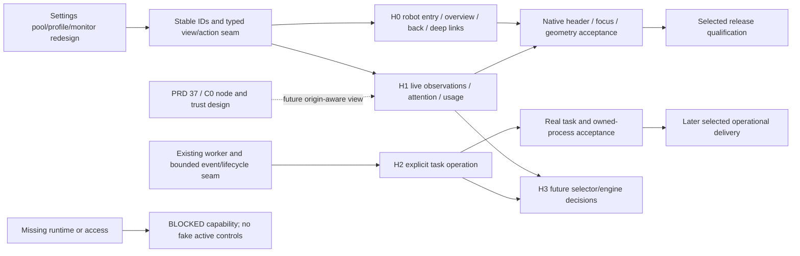

# Harness workspace delivery sequence

Status: `[-]` H0/H1 development integration after owner direction, 2026-10-25.
Behavior: [PRD 36](../prd/PRD_02_36_harness_workspace.md). Settings:
[PRD 31.01.01](../prd/PRD_02_31_01_01_harness_experience.md). The current
[0.2.25 plan](plan-v0.2.25.md) selects truthful H1 operation and configuration
handoff after public 0.2.24; the earlier [0.2.23 plan](plan-v0.2.23.md)
selected H0 and available H1 projections. The full visual
operation/monitoring workspace is a continuing core product track.

## Outcome tree DAG

```text
Outcome: establish a usable Harness destination and grow it without fictional controls
├── [-] H0 — robot entry + real overview/empty state + Settings deep links
│   invariant: reversible navigation; no login/listener/task side effects on entry
│   evidence: HW-01/02/03 and native header geometry/focus regression
│   safe failure: truthful unavailable state and existing workspace preserved
│   dependency: host view seam and stable pool/profile/metric IDs
│   non-goal: claiming full task operation in the entry reservation
├── [-] H1 — account/client/request/usage observation with actionable attention
│   invariant: one runtime source of truth and bounded live updates
│   evidence: PP/UM plus HW-02/06/07 with actual traffic
│   safe failure: stale/unknown with no fake client or task health
│   dependency: H0 and current pool/monitoring product work
│   non-goal: invoice administration or controlling external processes
├── [_] H2 — explicit built-in task operation and scoped lifecycle controls
│   invariant: reuse worker file/exec/session/cleanup authority
│   evidence: HW-04/05 real start/tool/stream/final/cancel/resume journeys
│   safe failure: preserve draft/final state; incomplete cleanup remains visible
│   dependency: bounded typed worker event and owned-run contracts
│   non-goal: another agent engine or arbitrary third-party process manager
└── [_] H3 — later dynamic selection and broader operation decisions
    invariant: future engine cannot widen credential/tool authority
    evidence: separately selected scenarios and host validation
    safe failure: keep manual allocations and existing task ownership
    dependency: H1/H2 feedback and future llm-gate contract
    non-goal: shipping ujs/tinyvm or automatic teams merely to reserve an icon
```

## Memory palace



## Version selection and order

1. Update charter/index/owners to record the new direction while preserving the
   earlier retracted design as history. No implementation claim follows from
   this design change.
2. Freeze the host destination, return-context, settings deep-link and snapshot
   seams. Inventory `main.rs`, `ui.rs`, `host_ui.rs`, `host_paint.rs`, settings,
   native page visibility and input/CLI callers as shared hot files.
3. Deliver H0 with 0.2.23's selected pool/settings work: the robot button remains
   immediately left of Settings; one same-window destination has useful cached
   overview/empty states and exact configuration links. Do not add disabled
   task-launch controls as a substitute for an operational product.
4. Join H1 projections as their PP/UM sources are implemented. Initial metrics
   may be compact lists; charts and detailed activity must not delay truthful
   account/client state. Missing source capabilities remain explicit.
5. Design and implement H2 after a bounded worker event/lifecycle seam exists.
   This is a later selected stage, not an unannounced full-workbench obligation
   added to 0.2.23. Choose its release only when its end-to-end slice is concrete.
   The 0.2.24 [first-journey design](../prd/PRD_02_36_harness_workspace.md#h2-first-local-journey-design-for-0224)
   fixes Start/Stop ownership and names the typed worker-event seam still needed
   before implementation; H2 remains `[_]` runtime delivery.
6. Consider H3 through its existing future owner after real operation feedback.
   Console/Web maintenance and their native/input regressions continue throughout.

One integrator owns the host view/header/focus join. Independent settings forms,
metric projection or prototype work may proceed only after IDs/contracts and
exclusive file ownership are established. Do not run shared Cargo, desktop,
clipboard or guard mutations concurrently. Integrate and qualify serially.

The [H0 development checkpoint](../prd/PRD_02_36_harness_workspace.md#h0-local-implementation-checkpoint)
owns implemented behavior and scoped evidence. Continue from that checkpoint
through native input/scales, resources and exact-source delivery; local host
injection and development smoke do not complete H0's release acceptance.

## Future coordination

Future cluster planning proceeds through [the cluster plan](plan-cluster-horizon.md),
starting its C0 identity/observation design alongside the local foundation.
It is not blocked on all H2/H3 features and does not add remote functionality to
the current entry reservation.

## Product review artifact

A self-contained HTML interaction study may live under ignored
`target-six/v0.2.23-design/`. It is a design preview with labeled demo values,
not product code or provider evidence. Keep behavior decisions in PRD 36 and
PRD 31.01.01; the preview is a visual rendering of those owners. It must use no
real account/key, make no provider requests, write no configuration, and require
no extra runtime in the shipped product. Native renderer, input and delivery
acceptance remain separately mandatory.
