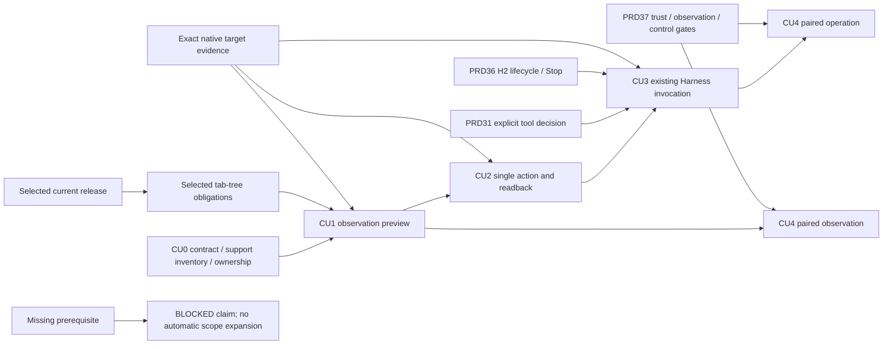

# MiniCon computer-use sequence

Status: `[_]` proposed future sequence following the owner's 2026-10-25 design
request. Behavior and repository decision: [PRD 38](../prd/PRD_02_38_computer_use.md).
This plan owns candidate release placement; candidates are not selected release
scope, deadlines, implementation status or publish authority.

## Outcome tree DAG

```text
Outcome: introduce useful computer use without delaying selected foundation work
├── [_] CU0 — freeze contracts, native support inventory and same-repo ownership
├── [_] CU1 — first observation preview after current release/tree obligations
├── [_] CU2 — explicit single-operation preview after honest target/readback evidence
├── [_] CU3 — existing Harness integration after tool/lifecycle decisions
└── [_] CU4 — later paired-node observation, then separately authorized action
```

Delivery invariants, evidence, safe failures, dependencies and non-goals for
these leaves are owned by the matching CU0..4 rows in PRD 38. This plan adds
sequencing only.

## Memory palace



## Candidate version placement

Recommendation refined 2026-10-26: begin CU0 design now and aim for the first
usable local CU1 preview in 0.2.25. This separates early contract work from
runtime delivery. Select each following stage only after its own gate; CU2
does not wait for the full Harness dashboard, cluster, llm-gate or ujs/tinyvm.
CU3 waits for the specific H2 lifecycle it consumes, not every future H3 feature.

| Candidate | Smallest useful outcome | Selection gate |
| --- | --- | --- |
| Design alongside existing work | CU0 contract and actual platform inventory; no new runtime | Preserve the selected 0.2.23 release and 0.2.24 tab-tree obligations |
| **0.2.25 observation preview** | CU1 optional CLI: select a window, obtain one bounded private PNG/accessibility observation, explain coverage/staleness/permission | CU0 frozen; at least one explicitly named OS/ISA has real end-to-end observation and failure evidence; unsupported targets stay explicit |
| **0.2.26 or later single actions** | CU2 explicit invoke/text, then qualified pointer/key/scroll against the selected observation with actual readback | CU1 target/freshness contract and per-action native evidence; no autonomous loop |
| **0.2.27 or later Harness integration** | CU3 selected scoped tool, bounded events, visible target/budget/disclosure/result and Stop | Explicit worker-tool amendment, CU2 and actual H2 lifecycle; no second model loop |
| Later; version unassigned | CU4 paired observation first, remote operation after its own control gates | PRD 37 node/trust/transport authority and actual two-machine evidence |

The first implementation should qualify a complete narrow journey on available
macOS/Windows native courts, then expand targets from evidence. Do not make
three-OS parity a reason to label an unqualified path supported. If CU1 misses
its gate, keep it planned and reconsider the version rather than dilute the
target or permission contract. CU planning does not add a release requirement
to the current version or postpone ongoing Console/Web fixes.

## CU0 decisions and first-preview selection

Before creating a crate, review these concrete CU0 outputs together. Their
behavioral requirements belong to [PRD 38](../prd/PRD_02_38_computer_use.md);
the checklist here decides whether implementation is ready to start.

| Preparation output | Required decision before CU1 selection |
| --- | --- |
| Native capability inventory | Name the first actual OS/ISA/native runtime, required permission states and synthetic fixture. Record capture, accessibility and input separately as source-only, runtime-observed, unsupported or BLOCKED; no implied parity |
| Versioned request/result sketch | Walk capability discovery, target selection, one observation and artifact disposal through the same contract; resolve cross-invocation identity, limits and expiration |
| Acceptance journey | Name CU-01/02 public tests and intended guard-removal failures for the PRD's selection/observation/resize/close/replacement journey |
| Packaging estimate | Compare optional companion and any proposed default-binary integration against the delivery owner's actual size/startup/resource budgets; measure rather than infer cost from crate size |
| Integration ownership | Identify native versus CU versus host-UI hot files, the release integrator and exact qualification scope; use the existing PRD 28 reuse map |

CU0 also records the CU3 model-route dependency without blocking local CU1:
use PRD 38's modality/disclosure contract to identify the provider adapter and
model capability evidence needed later. Do not put image forwarding into the
observation preview merely because the current Harness has working accounts.

CU0 closes only when those outputs are recorded with the owning contracts and
named evidence. The presence of this checklist is not a completed inventory.
For CU1, prefer one complete qualified Windows or macOS native journey over
several incomplete adapters; select the starting target from available courts
and mechanism readiness. Other targets retain their actual status.

At the candidate-version review, select only the smallest complete product
slice whose prerequisites are ready. If CU1 is not ready for its candidate
version, the already selected tree/Harness/foundation work continues and the CU
candidate moves. Do not attach a partially implemented action or empty GUI tab
to the observation preview to preserve a version number. Local CU observation
and action can proceed while cluster planning continues independently; only
CU4 consumes the cross-machine gates.

### Release review and scope reduction

At each candidate review, retain the complete journey and reduce breadth first:
one named native target, one selected window and one observation before more
adapters, action kinds or presentation surfaces. CU1 may be a separately
qualified optional companion asset from the same source revision; terminal
users must not need to install or start it. The delivery owner selects and
qualifies that asset explicitly rather than treating it as covered by the
terminal executable's receipt.

CU2 action families are selected independently from actual native evidence.
Start with a semantic invoke or text operation if qualified; a capture pass
does not unlock pointer/key/scroll. CU3 selection additionally resolves the
actual model route and the PRD 38 modality/disclosure acceptance journey.
None of these reviews changes the current release's selected requirements.

## Preparation and integration

1. Resolve CU0's schema, target lifecycle, artifact retention/disclosure, actual
   per-OS capability matrix and public CLI fixtures before implementation.
   Validate existing native seams before inventing replacement abstractions.
2. Reserve `crates/minicon-cu` only when the first vertical slice is selected.
   Keep native adapters in platform and CU semantics in the new crate. Decide
   optional CLI packaging and measured size/resource budgets then; no empty
   scaffold, daemon or required extra runtime is needed for this plan.
3. Name shared prerequisites and hot files before assigning independent work:
   workspace Cargo/lock/features, shared platform capture/a11y/input contracts,
   CU request/result schema, root CLI dispatch, Harness worker admission and
   the PRD 36 task-view/Stop join. Freeze shared contracts first. Independent
   native leaves may proceed only with exclusive files and evidence ownership;
   one integrator performs runtime/authority joins and final gates serially.
4. CU1 can ship through its public CLI before a GUI inspector is selected.
   PRD 36 owns any visual integration; Settings remains configuration/guidance.
   A model gateway profile key is never CU authority.
5. Before CU3, upsert the accepted tool change in PRD 31 and select its complete
   event/cancel/disclosure journey with PRD 36. A later local service or external
   harness consumer requires a concrete transport/lifetime need, not a duplicate
   OpenAI/Anthropic execution endpoint.
6. At each selected version, update the owning PRD's status with named evidence,
   then sequence qualification/release under existing delivery policy. Revisit
   repository extraction only against PRD 38's real-consumer/cadence criteria.
