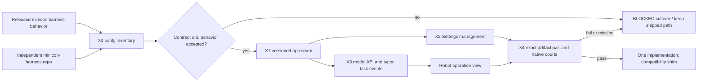

# minicon-harness extraction and Plugins and Apps delivery

Status: `[-]` plan selected 2026-10-27; no MiniCon implementation or
cross-repository qualification is claimed. Behavior and ownership:
[PRD 40](../prd/PRD_02_40_plugins_apps.md). The parallel agent owns the
`partnernetsoftware/minicon-harness` repository. This plan sequences only the
MiniCon side and the joint acceptance gates.

## Outcome tree DAG

```text
Outcome: run an independently released minicon-harness through MiniCon's optional app layer
├── [-] X0 — inventory the shipped worker and agree on migration coverage
│   invariant: every released CLI behavior has an owner or an explicit retirement decision
│   evidence: old/new feature and test matrix with exact source SHAs
│   safe failure: incomplete app work cannot be called parity; dependency: PRD 31 history/new-repo source; non-goal: editing the parallel repo here
├── [_] X1 — freeze host/app contract and local trust boundary
│   invariant: manifest, version handshake, process control and typed events are bounded and independent of Rust ABI
│   evidence: matching/incompatible/malformed app and no-app black boxes
│   safe failure: refuse launch and preserve host tabs/settings; dependency: PRD 26/28; non-goal: general plugin runtime
├── [_] X2 — expose Plugins and Apps in Settings
│   invariant: local registration and explicit enable/start/stop/remove do not mutate gateway accounts or auto-start the app
│   evidence: public GUI navigation, state, recovery and narrow/native input journeys
│   safe failure: missing/stale app remains visible as unavailable; dependency: X1/PRD 25; non-goal: app marketplace
├── [_] X3 — connect the app to the model API and robot operation view
│   invariant: host owns account/API state, app owns tool/task state, robot shows observed source/freshness
│   evidence: real local account/profile request, tool result, final/cancel and crash traces
│   safe failure: no task or credential fallback on disconnect; dependency: X1, PRD 31.01/36; non-goal: orchestration or remote agents
└── [_] X4 — cut over and qualify exact artifacts
    invariant: one worker implementation remains, with intentional compatibility for old CLI callers
    evidence: both repository SHAs/digests, named OS/ISA courts, size/RSS and release receipts
    safe failure: BLOCKED pairing preserves prior released behavior; dependency: X0-X3 and PRD 27; non-goal: declaring the app complete from a source copy
```

## Memory palace



## Sequence and shared-file gates

1. Record the public `minicon harness` matrix from PRD 31 and inspect the
   parallel repo at a named SHA. Ask its owner for missing contracts by issue
   or handoff, without editing that repo in this track. The current early
   standalone crate is a migration input, not parity evidence.
2. Freeze `minicon-harness` app identity, manifest fields, HostIF/protocol
   compatibility, event schema, launch/stop semantics and private key handoff.
   Negotiate this seam before either agent edits shared integration logic.
3. Implement MiniCon's local registration and Settings route. Host hot files are
   `src/main.rs`, `src/ui.rs`, `src/host_ui.rs`, `src/host_paint.rs`, Settings
   routing/snapshot, `src/cli.rs` and native process adapters. One integrator
   owns their join; independent work requires disjoint files/evidence.
4. Join a single real app to the loopback gateway and robot. Keep existing
   Harness settings for provider configuration. Do not turn a connected model
   profile into permission to execute file/exec tools.
5. Run scoped public black boxes first, then selected native/CI and artifact
   gates. Only after both source identities pass may a selected release remove
   the embedded worker. Preserve an intentional CLI compatibility path and
   document any behavior retired by that version.

Read-only inventory on 2026-10-27: the sibling `minicon-harness` workspace has
an early `Cargo.toml`, README and `src/lib.rs`, `src/tools.rs`, `src/wire.rs` and
`src/main.rs`, but has no commit yet. Its README describes a standalone
DeepSeek-compatible file/exec loop. This is a moving parallel worktree, so X0
has no immutable app SHA or accepted parity result. The first joint handoff
should name a committed app SHA and produce the old/new behavior matrix before
MiniCon changes the shipped command path.

Version placement: 0.2.25 records the boundary and may carry preparation that
does not break the shipped worker. The first Settings manager and worker
cutover belong to a later **selected** 0.2.x release once X0/X1 and the
parallel repository are ready; this plan does not guess its number or make it
a hidden 0.2.25 publish dependency. Updating an optional app is a separate
explicit action and cannot silently replace the host artifact.
