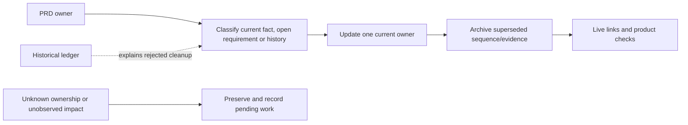

# Current repository hygiene sequence

Start at [PRD](../PRD.md). The completed audit ledger, measurements and rejected
cleanup choices are preserved in the
[2026-10-24 archive](archive/plan-repo-hygiene-2026-10-24.md).
This file sequences maintenance; owning PRDs retain product facts.

## Outcome tree DAG

```text
Outcome: current context stays small while valuable history stays reachable
├── [v] Archive superseded plans and audit/roadmap snapshots
│   invariant: preserve original observations and carry open obligations before retiring entrypoints
│   evidence: archive indexes and live-link check; safe failure: retain unresolved work in its owner
│   dependency: release closeout; non-goal: rewriting frozen historical evidence
├── [v] Separate generated Q1 frame from source
│   invariant: rendering tests write ignored output while the released PNG stays archived
│   evidence: existing frame test and clean source status; safe failure: retain image/assertions
│   dependency: PRD 25; non-goal: deleting research or changing product rendering
└── [_] Review remaining ownership questions in bounded batches
    invariant: one owner per fact and per-site cross-platform code judgment
    evidence: owner pointers, reviewed paths and applicable gates; safe failure: preserve unknown-owned data
    dependency: PRD 28/27/25 ownership map; non-goal: blanket cleanup or inferred remote deletion authority
```



## Still-open bounded work

- Review published reusable-platform API prose against PRD 28; retain what an
  external consumer needs and link product/reuse ownership instead of copying it.
- Review loader/signing/icon operator guidance against PRD 27/25. The public
  code-signing policy remains a tested contract; do not remove it as duplication.
- Judge `allow(dead_code)` sites individually with the relevant six-cell build.
  Per-target adapters are not dead merely because the current Mac does not call them.
- Preserve research JSON, vendor/runtime bytes and unknown-owned remote branches.
  Archive or deletion requires actual ownership/consumer evidence.
- Use the existing bounded build-state cleanup policy, preserving current
  receipts and active work. A blanket `cargo clean` is not the default.
- Assess research-output ignore rules and vendor residue per path. Do not ignore
  tracked evidence or whole dependency/documentation directories.

The [0.2.23 plan](plan-v0.2.23.md) sequences this pass's remaining control work.
Inherited harness edits stay outside cleanup commits. Failed CI/negative-control
experience belongs in its release history or owning module, not private notes.
