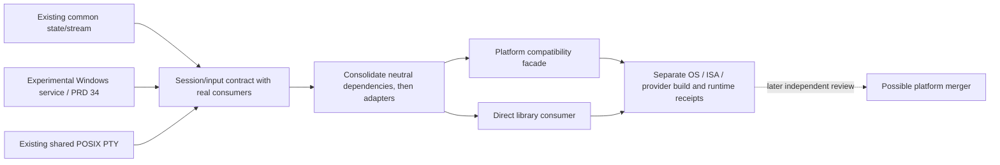

# Independent integrated terminal library sequence

Owner: [PRD 02.35](../prd/PRD_02_35_terminal_library.md). Keep
`minicon-console` independent; a possible `minicon-platform` merger is deferred.
This sequence assigns no release and does not promote the experimental Windows
provider to the GUI default. The owner PRD defines acceptance and evidence scope.

## Delivery tree

```text
Outcome: embed the terminal through minicon-console across OS and ISA targets
├── [-] Reuse existing state/stream, cells, Unicode and viewport mechanisms
│   invariant: one shared implementation; no native handles in common state
│   evidence: owner PRD's public API and actual Windows host fixtures
│   safe failure: bounded/typed errors; dependency: owned vt100/vte
│   non-goal: product UI or a second parser/screen model
├── [_] Define session/input contracts against Windows and POSIX consumers
│   invariant: explicit ownership, capabilities, flow control and completion
│   evidence: direct consumer scenarios plus behavior-changing runtime negatives
│   safe failure: explicit unsupported capability; dependency: both adapter inventories
│   non-goal: pretending native key/control semantics are identical
├── [_] Consolidate adapters behind the demonstrated contracts
│   invariant: one POSIX mechanism and one owner per native session
│   evidence: platform compatibility and direct-library consumer journeys
│   safe failure: retain existing entry points until equivalent behavior is proved
│   dependency: neutral contracts/dependencies first; non-goal: a dependency cycle
└── [_] Qualify independent use per OS × ISA × provider
    invariant: build and runtime claims have distinct exact-source receipts
    evidence: real child I/O, resize, saturation, exit/tail and cleanup journeys
    safe failure: missing native evidence remains unqualified
    dependency: native courts; non-goal: stable ABI or an automatic platform merger
```



## Sequence and gates

1. Preserve the existing common facade and Windows host adoption. Continue
   Windows compatibility work through
   [its backend plan](plan-windows-console-backend.md); extract proven common
   mechanisms when actual consumers justify them.
2. Inventory `platform::contract::pty`, `terminal_input`, the POSIX PTY adapter
   and the Windows providers. Classify each dependency as terminal mechanism,
   general platform facility or product policy before moving code. Hot files
   include those contracts, platform selection/facades and console exports;
   integrate their changes serially.
3. Demonstrate the smallest session/input contract with a direct library
   consumer and existing providers. Apply the owner's integration acceptance
   contract before making it a public commitment; do not add speculative traits
   which have no working consumer.
4. Consolidate the shared POSIX mechanism and Windows integration in bounded
   slices after neutral dependencies permit it. Keep platform entry points as
   compatibility forwarding consumers. Check type identity and enabled feature
   graphs as well as behavior; remove implementation duplication within each slice.
5. Qualify the external consumer and MiniCon integration separately on each
   supported OS/ISA/provider. Use targeted development gates first, then required
   integration gates. Native tests run through `scripts/build.sh test`; each
   new or changed test needs an observed runtime fault before it is evidence.
6. Update the owner PRD and reuse map with actual consumers, entry points,
   internal native/ISA differences and evidence limitations. A platform merger
   remains a later owner decision after independent reuse is demonstrated.
