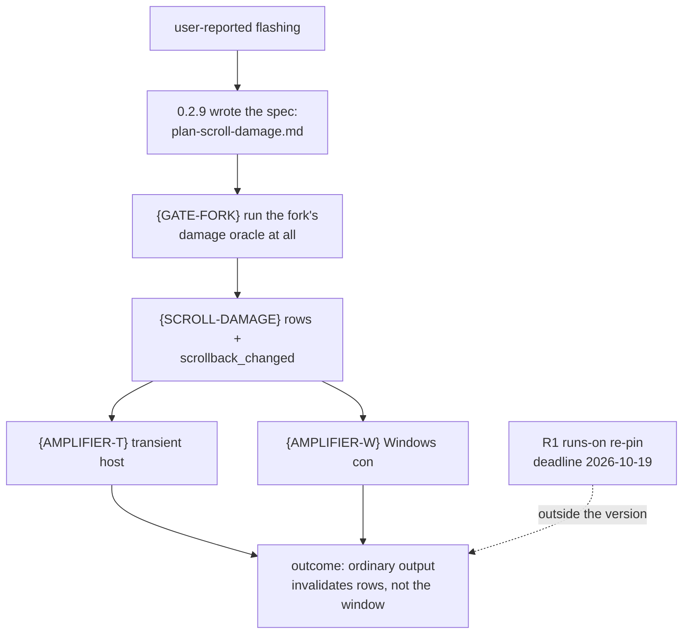

# plan-v0.2.10

> Finalised 2026-10-14 after v0.2.9 published and was verified from the
> owner's view (Release live, assets re-downloaded, hash-matched). The chain's
> incident record, including the Defender-court outage and the mid-chain
> main-move trap, lives in `prd/archive/v0.2.9-release-history.md`.

Read `AGENTS.md` first for the dev loop, the gate and the release boundary.

## The product outcome this version exists for

**Ordinary output stops re-rasterising the whole window.** The user-reported
"flashing" (`总是感觉闪屏`) is the most-felt open defect in the repository, and
0.2.9 did not fix it — deliberately. What 0.2.9 did do is write the spec
(`plan/plan-scroll-damage.md`), which turned an unfixed bug into a *sequenced*
one: it named the primitive, and it proved the fix is three leaves, not one.

> **A line of output at the bottom of a full screen invalidates the rows it
> changed, not the window.**

## Why this is now tractable — and what it is NOT

Two facts the 0.2.9 spec established, both still true:

1. The changed band for a scroll is exactly `[scroll_top, scroll_bottom]`, and
   the one thing `mark_full` was silently covering is the scrollbar thumb,
   which is drawn outside the row band. Hence the primitive: a row range plus a
   `scrollback_changed` flag — the same shape as the existing
   `viewport_changed`.
2. **The parser narrowing alone changes nothing a user sees.** Both shipped
   hosts upgrade every frame to full. So this version's outcome is delivered
   by the *last* leaf below, not the first.

## Tree DAG

```text
0.2.10: ordinary output stops re-rasterising the whole window
├── Product track
│   ├── {GATE-FORK} the vendored fork's damage oracle becomes runnable   [v]
│   │      problem: `third_party/vt100` is a `[patch.crates-io]` path with an
│   │        empty `[workspace]` table (deliberately standalone), so its
│   │        `assert_damage_covers` oracle is executed by no gate; changing
│   │        the damage contract without it would be an unproven claim
│   │      shape: a script the existing gate calls —
│   │        `cargo test --locked --manifest-path third_party/vt100/Cargo.toml`
│   │        — NOT a workspace member (that would change what `--workspace`
│   │        builds for every future change and pull the fork's dev-deps into
│   │        the root lock). The fork's own manifest already declares
│   │        independence; the fork carries its own `Cargo.lock`
│   │      evidence: **measured on the Windows host 2026-10-14** — the fork
│   │        builds and runs standalone from a cold external target dir, its
│   │        lib suite reporting **11 passed / 0 failed**; the only failure is
│   │        the doctest step, which cannot spawn `rustc` inside the agent
│   │        sandbox (os error 231, pipe exhaustion) — an environment limit,
│   │        not a fork defect, so the gate script should scope to `--lib` and
│   │        say so. The path needs no new machinery, only an entry in the
│   │        gate that refuses to be skipped
│   │      this resolves owner question 2 from 0.2.9 with the smaller change
│   ├── {SCROLL-DAMAGE} the parser primitive                            [-]
│   │      problem / invariant / safe failure: as already specified in
│   │        `plan/plan-scroll-damage.md` — do not re-derive it
│   │      shape: `scroll_up`/`scroll_down` mark `[scroll_top, scroll_bottom]`
│   │        instead of `mark_full`; `GridDamage`/`ScreenDamage` gain
│   │        `scrollback_changed` (accessor/merge/is-empty like
│   │        `viewport_changed`); `src/terminal.rs` marks the scrollbar bounds
│   │        when the flag is set; the alternate screen and `viewport_changed`
│   │        paths are not narrowed
│   │      evidence: a cfg-free unit test on the damage a scroll returns, plus
│   │        the fork oracle extended for the scrollbar cases
│   ├── {AMPLIFIER-T} the transient host stops forcing a full frame     [-]
│   │      DEFERRED to 0.2.11 (scoping decision 2026-10-14, recorded for
│   │        the owner): on a Transient-retention host the frame contract
│   │        itself rejects a partial commit (`TransientRequiresFull`), and
│   │        a fresh buffer needs every pixel written — so "narrow the
│   │        invalidation" there means retaining a second canvas and
│   │        blitting it, the exact design `src/main.rs`'s transient comment
│   │        rejected when every frame was full anyway. That is a design
│   │        leaf with its own evidence (the Linux `xvfb-run` journey in
│   │        CI), not a deletion. The reported flashing is a Windows-host
│   │        report, so {AMPLIFIER-W} below delivers this version's outcome;
│   │        Linux transient hosts keep today's full-frame behaviour,
│   │        unchanged by this version.
│   ├── {AMPLIFIER-W} the Windows `con` path stops forcing a full frame [-]
│   │      problem: any non-empty, non-full candidate becomes a whole frame
│   │        (`src/main.rs` Windows path)
│   │      evidence: a real Windows display journey, before/after; this is the
│   │        host the flashing was reported on
│   │      dependency: `{SCROLL-DAMAGE}`
│   └── Blocked, named — not this version
│       ├── {FIND} search what a terminal printed   blocked on C1
│       └── {SIGV} verify the signature             blocked on a size decision
└── Consolidation track — behaviour-preserving, never gates the above
    ├── {SPLIT} one module at a time, gate after each                   [_]
    │      first unit: the 338-line `mod native_endpoint_tests` sitting in
    │      the middle of live code in `src/control.rs`
    ├── {SEAM} / {ENCAP} / {NAME}                                       [_]
    │      as scoped in `plan/archive/plan-v0.2.9.md`; unchanged
    └── {FEAT} / {DOC-OWNER}                                            [_]
           still gated on an owner decision — a removal that deletes a route
           another product will want is not consolidation
```

## Owner decisions this plan asks for

1. **Do the amplifiers belong in 0.2.10?** They are what actually delivers the
   outcome; without them the version ships a faster parser and the same
   flashing. If they are deferred, the honest version name is "the parser
   stops over-reporting damage", not "the flashing is fixed".
2. **`{FEAT}` — which of the 54 unconsumed platform features are future route
   (`a11y-*`, `app-facts`, `desktop-host`, `network-dns`,
   `virtualization-probe`) and which are residue?** Unchanged from
   `plan/archive/plan-v0.2.9.md` open decision 3.
3. **`{DOC-OWNER}` — who owns the sentence** in the four READMEs? Unchanged
   from `plan/archive/plan-v0.2.9.md` open decision 4.

## Outside the version number, but with a date

- **R1 — closed 2026-10-14, before the deadline.** All floating `-latest`
  runner labels are pinned (11 sites: `ubuntu-latest` ×9, `windows-latest` ×1,
  `macos-latest` ×1, across six workflows) so GitHub's 2026-10-19 migration of
  `ubuntu-latest` to Ubuntu 26 changes nothing here; `defender-ci-scan.yml` had
  already moved to `windows-2022` during the 0.2.9 outage. Record:
  `plan/plan-repo-hygiene.md` "Fourth pass". Left as an owner question, not
  touched: the three org-owned `ubuntu-slim` labels
  (`minicon-com.yml`, `company-signing.yml`, `six-grid-runtime.yml`), which ran
  green the same day.
- GitHub #5 (the notes scratchpad) — deferred twice now; give it a leaf or a
  dated owner refusal.

## Memory palace



## GATE status

- **{GATE-FORK} [v]** — landed `e566635`; fork suite 11/0 measured on the
  Windows host from a cold external target dir before any contract change.
- **{SCROLL-DAMAGE} [-]** — code landed `7f21e48` (fork contract + grid
  producers + `src/terminal.rs` consumer + fork tests rewritten for the new
  contract, incl. an extended oracle that captures `scrollback_depth`); fork
  suite **12 passed / 0 failed**. The minicon bin test leg — which contains
  the new consumer test `scroll_damage_marks_rows_and_scrollbar_track_not_full`
  in `src/terminal.rs` — is **written but unrun**: see the handoff below.
- **{AMPLIFIER-W} [-]** — code landed `ad00f39`; acceptance journey not run.
- **{AMPLIFIER-T} [-]** — deferred to 0.2.11, design note above.

## Handoff 2026-10-14

The handing-off agent's session hit a host-environment wall: the WorkBuddy
harness's own Security Center → Command Security → **program blacklist**
blocked `reg.exe` (both the Bash and PowerShell tool channels), which
`winresource`'s resource embed in `build.rs` needs on Windows. Every
`cargo build`/`cargo test` touching the `minicon` bin therefore failed at
the build script. This is a property of that agent session's sandbox, not
of the repository, and it is invisible to CI. A successor agent (or the
owner's own shell) is expected to build normally.

State at handoff:

1. `main` = `ad00f39`, clean tree, **not pushed** — push is the successor's
   first gate decision (local gate first, per AGENTS.md).
2. What has run green, and where:
   - fork suite (standalone, `--manifest-path third_party/vt100/Cargo.toml
     --lib`, cold external `CARGO_TARGET_DIR=D:/tmp/mc-target`): **12/0**
     after the contract change, 11/0 before it.
   - Everything else in the plan's gate table: **not run this session**.
     No fmt, no clippy, no bin/core suites, no alignment, no six-cell.
3. What the successor must run before any release chain (in order):
   `cargo fmt --check`; `cargo clippy --locked --all-targets -- -D warnings`;
   `./scripts/build.sh test` (now includes the fork leg by construction);
   then the six-cell qualification or its CI equivalent (`minicon-com.yml`).
   Watch the bin test count go up (AGENTS.md) — the new consumer test must
   appear and pass.
4. {AMPLIFIER-W}'s acceptance evidence is still owed: before/after frames on
   a real Windows display across pointer and composer updates — the exact
   proof obligation the removed guard named. The old binary for the "before"
   side can be the 0.2.9 Release's `minicon.com`. Any divergence found is a
   painter bug to fix narrowly; the blanket full-frame upgrade stays out.
5. Known unrelated breakage seen this session: `scripts/selftest.sh` fails
   in `publish-six-grid-runtime-selftest.sh` and `six-grid-cloud-selftest.sh`
   with `[safe-delete][SAFE_DELETE_INVALID_PATH] embedded drive prefix is
   not allowed` — a pre-existing Windows-path-policy issue in those
   selftests, untouched by 0.2.10 work. Do not mistake it for new damage;
   it needs its own hygiene leaf.
6. Release steps after the gates: version bump (three places:
   `Cargo.toml`, `Cargo.lock`, `release-policy.json`) → push →
   `scripts/release.sh 0.2.10` → hand-drive steps 5–8 per the
   `run-reputation-and-release` skill (read its `references/` first) →
   owner's-view verification (release view + real download + SHA256
   three-way match). The 0.2.9 chain's incident record
   (`prd/archive/v0.2.9-release-history.md`) carries the two traps that
   will bite again if ignored: **push nothing to `main` mid-chain**, and
   platform-outage failures are recovered by rerunning the frozen-context
   run, never by fresh dispatches.
