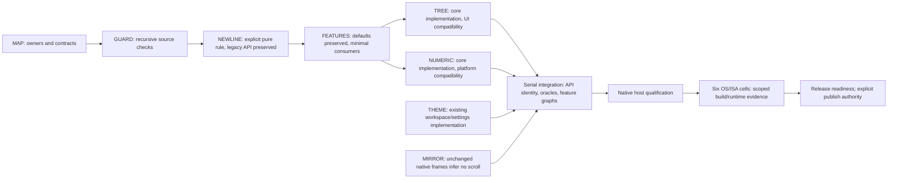

# v0.2.15 — explicit module boundaries and reusable mechanisms

Owner direction (2026-10-18): organize and improve abstraction/reuse before
new features. This authorizes the preparation and behavior-preserving changes
below. The owner subsequently explicitly requested development through public
release of 0.2.15; that supplies named-version publication authority. The behavior
owner is [PRD_02_28](../prd/PRD_02_28_shared_core.md); this file owns sequencing
and evidence only. Existing public crate names and import paths are retained.

## Outcome tree DAG

```text
Outcome: release MiniCon with explicit reuse boundaries and qualified behavior
├── {MAP} Accurate module ownership and naming
│   └── refresh package descriptions and source headers; keep PRD map current
├── {GUARD} Core source portability boundary
│   └── automatically scan every src Rust file, including nested modules
├── {NEWLINE} Explicit paste-review format with legacy compatibility
│   └── preserve old host-sensitive helper; product calls the pure explicit API
├── {FEATURES} Minimal core consumption
│   └── optional composer/json/keymap dependencies; preserve all default APIs
├── {TREE} One tree algorithm and type identity
│   └── core owns; UI-core keeps compatibility re-exports and consumer tests
├── {NUMERIC} One deterministic rounding implementation
│   └── core owns; platform keeps compatibility re-exports and native oracle tests
├── {THEME} Include the implemented Dark theme
│   └── existing workspace/settings owner; preserve existing tags and default
├── {MIRROR} Correct the unchanged-frame contract exposed in qualification
│   └── identical console frames never imply scroll, even for uniform rows
└── {EVIDENCE} Behavior and consumer qualification
    ├── source guard negative control; tree identity/contract; numeric bit oracle
    ├── default and minimal-feature consumer graphs; Windows host build/lint
    └── six-cell compile/runtime receipts before release claims
```



## Delivery contracts

| Leaf | Invariant / observable evidence | Dependencies / safe failure / non-goal |
|---|---|---|
| MAP | Every shared module has an owner, reuse entry and OS/ISA distinction; descriptions match exports | PRD_02_28 and manifests; leave unresolved scope explicit; no cosmetic public rename |
| GUARD | New src files cannot escape direct cfg/cfg_attr/cfg! target checks; nested target selector mutation turns gate red | Core dev-only syntax parser; report offending path/selector; freeze only the historical newline API/test exception; not a proof of runtime equivalence |
| NEWLINE | Both explicit newline formats work on every host; existing host-sensitive API and MiniCon behavior remain unchanged | GUARD exposed old cfg! leakage; caller chooses format; no silent API behavior change |
| FEATURES | Default core exports unchanged; minimal core has no normal third-party dependencies | Optional itoa/unicode-width; explicit keymap→composer dependency; disabled modules absent, not runtime stubs; no new crate |
| TREE | UI and core tree types are identical and existing tree results/errors preserved | FEATURES and source comparison; retain UI import paths; stop on contract difference; no migration of AgenTerm's distinct tree policy |
| NUMERIC | Existing platform numeric API forwards core's bit-level rules; IEEE edge/sample oracles pass | FEATURES and source comparison; preserve native import behavior and inline policy; no math algorithm rewrite |
| THEME | Fourth swatch, cycle and saved `dark` tag agree; historical default/tags remain stable | Workspace PRD owns behavior and native screenshot evidence; no change to explicit application colors |
| MIRROR | Identical blank/repeated frames infer zero scroll; real shifted frames keep existing behavior | Existing Windows mirror; terminal PRD owns contract; expanded old regression rejects old implementation; no new public API |
| EVIDENCE | Name source, feature set, OS/ISA, result and negative control; missing cells BLOCKED | Prior leaves; no inferred pass from compilation or neighboring ISA; no unrelated features |

## Sequence and shared files

1. Write accepted scope into PRD_02_28 and link this plan from PRD.md.
2. Compare tree/numeric executable bodies before replacing copies. Preserve
   compatibility exports and retain existing tests at the consumer boundary.
3. Correct descriptions/headers (and normalize existing Rust formatting for
   the mandatory fmt gate) and replace the incomplete source guard with
   recursive syntax inspection. Prove it rejects a target selector in a newly
   covered source file, then restore clean source. The new guard exposed an
   existing cfg! host branch in composer paste review: add an explicit newline
   API and migrate MiniCon while freezing the legacy helper/test exception.
   Do not redefine the old API's Windows behavior to make the guard pass.
4. Gate only core's dependency-bearing modules behind default-enabled features.
   UI-core/platform depend on core with default features disabled. Do not add
   unicode-width/itoa to UI-core's minimal normal graph merely to share tree.
5. Replace UI tree/platform numeric implementations by core re-exports. Add
   meaningful evidence for shared public type identity; reuse existing
   behavioral/oracle tests rather than restating the implementation.
6. Integrate serially: fmt, scoped test gates, minimal/default feature graphs,
   isolated consumer graph/build (including PTY-only console module isolation)
   and clippy. Run `bash scripts/check-reuse.sh` through l1/l3; its graph must
   reject a default-feature leak. Record actual results below.
7. Six-cell qualification and runtime receipts remain release readiness gates.
   Freeze source and bump version only when preparing that qualification; do
   not publish or dispatch a release merely because the plan names 0.2.15.

Hot files: core lib/manifest and boundary tests; UI-core manifest/tree;
platform manifest/numeric; Cargo.lock; PRD.md; PRD_02_28. One agent owns MiniCon
edits. The separately authorized AgenTerm migration owns only its own checkout
and remains pinned to a published immutable MiniCon revision until adoption is
validated; its result is not evidence for unreleased MiniCon changes.

## Acceptance and exclusions

Post-release owner follow-up (2026-10-18): review suite layering, development
filters, staged combinations, repeated setup/build costs and measured defect
detection. Keep targeted development feedback separate from complete release
qualification. Defer that test-orchestration redesign until after 0.2.15 is
published; current gate portability fixes do not claim to complete it.

Keep terminal rendering, CLI/protocol, key bindings and notes/update behavior
unchanged apart from the implemented Dark theme, its fourth settings swatch and
theme-cycle persistence owned by [workspace](../prd/PRD_02_25_con_workspace.md).
The qualification-exposed unchanged-frame defect is the additional terminal
exception, owned by [terminal/rendering](../prd/PRD_02_24_con_terminal.md).
Release sequencing after the renewed owner instruction includes this already
implemented and locally qualified working-tree change; it does not add a second
theme implementation. Keep the three public crate names. No full terminal-engine
extraction, mass module relocation, speculative plugin API, SIMD retuning,
new OS/ISA support, or unrelated carried debt in this version. Default-features
behavior is compatibility-sensitive; feature unification must not hide a broken
minimal consumer. Additional consolidation needs an identified consumer and
its contract before implementation.

## Status and evidence

Release-gate follow-up: native six-cell dev feedback now includes UI-core and
the isolated minimal consumer. Full local GUI testing exposed the pre-existing
Windows burst-output wheel fixture assumption; seed actual history through
observed shell markers before preserving its exact 5→3 assertions. Offline
self-tests also select an installed Python command, and Python children reuse
`sys.executable`, so Windows does not require an executable named python3.
The offline cleanup self-test then exposed the existing signal-zero Windows
termination bug; the delivery PRD owns the corrected non-signaling liveness
contract. The child-survival assertion rejects the old probe in
`target/v0215-release/negative-process-alive.log`; the fixed full offline gate
returns zero with five PASS results in `selftest-confirmed.log` in that directory.
These are gate portability/correctness repairs, not relaxed release policy.

Local backend qualification follow-up: the shell inherited
`AGENTERM_FORCE_CONSOLE_AGENT=1`. The two `direct_conpty_` tests then exercised
the wrong backend and failed; clearing both force-backend variables for the
test invocation yields two passes (`target/v0215-release/direct-conpty-clean-env.log`).
The corresponding full run stopped at the child-geometry GUI test's initial
PowerShell-output deadline (36 GUI passes, one failure, one manual IME ignore;
`full-test-clean-env.log`). Its isolated rerun passes without a source change
(`resize-child-clean-env.log`). A full rerun using the existing slowdown budget
of two passes that geometry test but exposes the keyboard fixture's baseline
sampling race (`full-test-budget2.log`, also 36/1/1). The observed-baseline
repair passes in isolation (`key-observed-baseline.log`); deliberately delivering
only one ArrowLeft fails (`negative-key-missing-event.log`). The owning dev-loop
PRD explains both fixture contracts. The restored full gate returns zero in
`full-test-observed-fixtures.log`: product units 454 pass / one live-API ignore,
GUI 37 pass / one manual-IME ignore, core 106 pass, UI-core 55 pass, platform
460 pass / one rasteriser-measurement ignore, and vendored vt100 12 pass, with
the remaining process/policy suites also green. Sustained throughput remains
an explicit dedicated qualification, not a default-suite pass. The separately
invoked real GitHub release API test passes in `live-release-api.log`.
Workspace/all-target Clippy denies warnings and passes (`clippy-final.log`),
as does the isolated minimal consumer (`minimal-reuse-final.log`). All paths
in this paragraph are under `target/v0215-release/`; source fingerprints remain
unchanged during the full gate. No assertion is weakened, and failed runs are
retained as evidence rather than counted as passes. These are local working-tree
results, not six-cell or sealed-artifact qualification.

The local Windows x86_64 release build also succeeds (`native-release-build.log`,
1m59s). Its canonical `target/release/minicon.exe` reports 0.2.15 and is 2,046,976
bytes. The dedicated sustained-output test uses that exact local binary through
`MINICON_TEST_BINARY` and passes (`native-release-throughput.log`): 33,439,744
bytes in 5,785 ms, 5,780,086 bytes/second, with the control/sibling responsiveness
assertions intact. This is one local native payload, not the six-payload Candidate
size budget or evidence for the other five OS/ISA cells.
Its SHA-256 is
`ca42732e544189ba238b7acd314c784b7355103f203fd44468817ff8f8438881`.
The release payload's forbidden-symbol/GDI+ import assertions and OS-module
allowlist pass (`native-release-imports.log`, `native-release-loader-modules.log`).

CI follow-up on source `52527f457a7dd799900f7519524a4c0d62e7180e`:
`39137638496` stopped at checkout because a short SHA was interpreted as a branch;
the full-SHA dispatch `39137777772` executes tests. Both Linux ISAs and both macOS
ISAs pass core/UI/minimal-reuse, but the child-geometry GUI test unconditionally
invokes PowerShell and times out. Keep its original narrow/wide assertions and
use a Unix tty probe (`stty size`) on those hosts. This changes the fixture only;
production Rust and dependency files remain identical to the locally qualified
source. Cancel the unsealed pack `39137635531` and qualify a new exact commit;
do not sign or promote the superseded pack. Its component-level passes are
diagnostic evidence, not a green final-source release court.
The revised Windows fixture passes through `build.sh test`
(`resize-native-probe-windows.log`, one pass); workspace/all-target Clippy with
warnings denied also passes (`clippy-native-probe.log`). Unix runtime proof
remains the next exact-source native CI run; no Windows result substitutes for it.

On `cc27200b746dae459c55d004cd31f4ce6d317401`, pack `39138311227` passes all six
unsigned execution cells and dev run `39138314772` passes the four Unix cells.
Windows follow-up reveals fixed-width and timestamp-order fixture assumptions,
plus ARM probe-readiness/history failures. The fixture now uses observed native
geometry, chronological event spans and a shell-readiness rendezvous. Separately,
the mirror's existing unchanged-frame contract fails for identical blank/repeated
rows (`negative-unchanged-console-frame.log`: 1 vs expected 0). Add an equality
guard and retain the existing shifted-frame oracles. These further changes require
a new exact-source pack; do not sign the now-superseded successful pack. Production
mirror correctness and fixture readiness have independent evidence; neither is
claimed to explain every ARM failure before the targeted native rerun.
The expanded unchanged-frame unit fails without the equality guard, and removing
that real guard also fails the new public-CLI blank-console regression
(`negative-idle-blank-console.log`, history grows 0→6). Restoring it passes the
two-second live-child observation (`idle-blank-positive.log`). GUI test discovery
increases 38→39 on Windows. The chronological nudge assertion fails when the real
nudge is deferred (`negative-nudge-chronology.log`) and passes after restoration
(`nudge-chronology-restored.log`). Fixing the real backend resize to 120×40 fails
the stronger host/child geometry assertion (`negative-child-native-geometry.log`).
All temporary production mutations are restored before committing.
The final fixture also waits for the edited shell command before Enter, preserving
an observable frame suffix before sampling the output marker. Its exact wheel
assertions pass locally (`wheel-edited-command.log`). The combined five GUI
regressions and the unchanged-frame unit pass through the canonical wrapper
(`native-courts-final-local.log`); final fmt and workspace/all-target Clippy pass
(`clippy-console-courts-final.log`). Blank-console readiness observes a visible
shell marker before clearing, so an initial blank startup snapshot cannot become
the baseline before the child clear has reached the renderer.

The administrator/UAC checkbox request belongs to the existing Run dialog in
the adjacent `minicon-winmgr/src/run_dialog.rs`. MiniCon has no such entry.
Following the renewed instruction to finish this release, use that existing
owner for the separate implementation rather than adding a duplicate launcher
to MiniCon. Its implementation/evidence remains a separate follow-up; no claim
that this MiniCon artifact delivers the Win+R checkbox is made.

Local preparation is implemented; release qualification is not complete. These
are development logs for the working tree based on `5aa3a8a`, not sealed
exact-artifact receipts. All results below are Windows x86_64 / Rust 1.97.0.

| Leaf / gate | Status and named evidence |
|---|---|
| MAP | [v] Package descriptions, source headers, ownership map and consumer recipe updated; workspace fmt normalized pre-existing Rust formatting; `target/v0215-fmt.log` PASS |
| GUARD | [v] Recursive syntax guard passes; nested cfg(any(target_arch)), cfg_attr and cfg! negative controls each fail for the intended boundary; `target/v0215-boundary.log`, `target/v0215-negative-{nested-arch,nested-cfg-attr,cfg-macro}.log` |
| NEWLINE | [v] Explicit-format and legacy compatibility tests pass; forcing LF for both explicit forms fails the new test; `target/v0215-paste_review.log` (4 pass), `target/v0215-negative-newline-contract.log` |
| FEATURES | [v] Isolated core composer/json/keymap checks pass; minimal consumer graph has no core dependency edges and UI only depends on core; enabling UI's core defaults makes that guard fail; `target/v0215-feature-{composer,json,keymap}.log`, `target/v0215-minimal-reuse.log`, `target/v0215-negative-feature-leak.log` |
| TREE | [v] Production bodies matched before consolidation; root/UI/core/native tree filter passes (30); restoring UI's separate types fails the new identity test; `target/v0215-baseline-tree.log`, `target/v0215-tree.log`, `target/v0215-negative-tree-identity.log` |
| NUMERIC | [v] Production bodies matched before consolidation; retained core/platform IEEE oracle tests pass through shared implementation; `target/v0215-numeric.log` (10 pass) |
| Empty-feature native consumption | [v] PTY-only console row module isolated; restoring unconditional Windows compilation fails dead-code-as-error check; restored minimal consumer passes warning-denying run; `target/v0215-negative-pty-isolation.log`, `target/v0215-minimal-reuse.log` |
| l1 | [v] `bash scripts/test-tier.sh l1`: 453 product + 106 core + 51 default UI + 17 alignment = 627 pass, 0 fail; separate minimal-consumer build/run PASS; `target/v0215-l1.log` |
| Clippy | [v] `cargo clippy --locked --workspace --all-targets -- -D warnings` PASS; `target/v0215-clippy.log` |

The additional tests increase core's default unit count 105→106 and UI's
workspace-feature count 54→55. The source guard replaces an existing test;
its value is actual recursive/syntax coverage, not a claimed count increase.
The l1 default UI count is 51 because terminal-selection is not enabled there;
workspace-filtered gates compile the product's terminal-selection feature too.
The l1 run leaves the live GitHub update-API test ignored; its separate current
Windows invocation is qualified in the later release-gate record above.

- [_] Six-cell build/runtime evidence: **BLOCKED (not run on this host)**.
  Linux/macOS and aarch64 behavior require their own receipts. Six-cell
  release-profile size/import checks, exact-source CI qualification and Candidate
  remain release-readiness work; no six-cell claim is inferred from the local
  gates. The full local workspace gate, its Clippy/minimal-consumer
  constituents and the native release build are now green as recorded above;
  `test-tier.sh l3` itself was not separately repeated.
- [-] Version is now 0.2.15 in Cargo, the lock and release policy. Local gates
  recorded above pass. Freeze this scope for exact-source CI qualification;
  the owner's next requested deliverable is the 0.2.16 design after publication.
  Public promotion
  is authorized by the owner's explicit 0.2.15 release objective; no publish
  has been dispatched yet.
