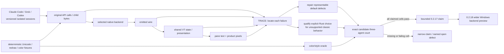

# v0.2.17 — modern agent terminal quality

Status: unfinished modern-agent gate, updated 2026-10-21. A scoped
current-source three-agent Rust-provider interaction passed; v0.2.18 is now
[public](../prd/archive/v0.2.18-release-history.md) with a narrower explicit
preview. The visible exact-Candidate three-agent matrix and source/wire/style
attribution were not completed. The behavior and
evidence owner is
[modern TUI compatibility](../prd/PRD_02_24_01_tui_compatibility.md);
[terminal selection](../prd/PRD_02_24_con_terminal.md#pty-backend-selection)
owns the classic adapter and [the Windows backend](../prd/PRD_02_34_windows_console_backend.md)
owns the Rust service. [The 0.2.x roadmap](plan-v0.2.x-product-roadmap.md)
owns cross-version decisions.

## Outcome tree

```text
Outcome: a MiniCon user can complete a modern agent session with readable, stable output
├── [_] {TRACE} Attribute each observed defect at a real boundary
│   invariant: preserve original output, backend wire, parsed state and presented pixels separately
│   evidence: bounded three-agent captures plus deterministic native/VT fixtures and exact identities
│   safe failure: unknown loss point remains open; private user conversations never enter artifacts
│   dependency: PRD 24.01 and owned control captures; non-goal: assuming all corruption is conhost
├── [_] {REPAIR} Correct the diagnosed default-path behavior that is representable
│   invariant: valid scalars, spacing and style survive; live resize has one coherent geometry
│   evidence: a failing regression before each fix, native readback and paired pane/PNG after it
│   safe failure: retain an explicit limitation when the system API cannot preserve the behavior
│   dependency: TRACE and PRD 24 native ownership; non-goal: speculative parser or agent changes
├── [_] {SELECT} Offer a qualified provider for the modern-TUI journey
│   invariant: the actual opened backend is visible and failure stays local to the selected session
│   evidence: exact candidate feature/build identity and Rust/installed-provider comparison
│   safe failure: unavailable/unsupported selection rejects clearly; classic default remains explicit
│   dependency: PRD 34 native API/lifecycle courts; non-goal: automatic Windows default promotion
├── [_] {STYLE} Verify color and presentation independently of agent theme
│   invariant: indexed/256/RGB attributes and dim emphasis match cells and captured pixels
│   evidence: finite SGR/native color oracle plus visible grayscale agent frames
│   safe failure: a grayscale-only real app yields no hue pass
│   dependency: shared VT state and GUI raster; non-goal: a user-selectable terminal profile
└── [_] {ACCEPT} Qualify repeated real interaction and ship a truthful claim
    invariant: the claimed provider survives output, resize, paste, cancel and teardown
    evidence: versioned Claude Code, Grok Build and Codex CLI sessions on an exact candidate
    safe failure: failed/missing app, OS, ISA or backend cell narrows the claim or blocks the gate
    dependency: TRACE/REPAIR/SELECT/STYLE and complete release qualification
    non-goal: claiming every TUI or replacing the separate 0.2.18 breadth gate
```



## Baseline and product decision

On Windows x64 build 20348, current-source Claude Code 2.1.304, Grok Build
1.0.62 and Codex CLI 0.162.1 sessions expose default `console-agent` Unicode,
spacing, redraw or resize defects. The explicit `rust-console` sessions preserve
the scoped Unicode and layout journeys. [The owning evidence record](../prd/PRD_02_24_01_tui_compatibility.md#report-and-current-evidence)
links the actual panes, product screenshots and source receipts. The owner's
exact 0.2.14 sequence, original application bytes, hue fidelity, broad native
API support, unexplained Grok exit 1 and Claude exit 251 remain open.

The default adapter reads a Windows screen buffer, and the measured system
host cannot resize some alternate-screen clients through the standard API.
Therefore the release cannot define success as an unconditional classic-path
fix. First repair defects for which the adapter has a faithful source; use a
separately qualified, explicitly selected Rust provider for behavior the
classic path cannot represent. An opt-in that exists only in a developer build
does not meet a user-facing release claim: the exact Windows candidate must
include the feature, document invocation and expose the actual opened provider
before any preview claim. The 0.2.20 default decision remains separate.

## Ordered work and acceptance

| Order | Work and observable acceptance | Failure boundary |
| --- | --- | --- |
| 1 — TRACE | Reproduce each reported defect in visible, owned GUI processes at a fixed size and through narrow→wide→narrow cycles. Record app/version, OS/ISA, executable/source hash, opened backend, child lifetime and settled grid. Capture original API/child output where possible without recording the owner's live conversation, emitted PTY wire, shared state, `capture-pane` and `screenshot-pane`. Use bounded independent fixtures for exact Unicode, dense cursor redraw, alternate screen and resize. | Do not assign a merged word, duplicate prompt or exit to a layer from a screenshot alone. A missing raw boundary stays UNKNOWN. Minimized or exited-child frames do not count as live-resize passes. |
| 2 — REPAIR | For a located, representable defect, add a regression that fails a compiling runtime mutation, apply the smallest owner-layer fix, then rerun the native and product journeys. Check valid astral scalars, adjacent spaces, row clearing, scroll and geometry. | A system-host readback or resize limitation remains documented; do not distort shared VT semantics to mask it. |
| 3 — STYLE | Use a controlled SGR/native producer for literal 16-color, 256-color, RGB foreground/background and reset cells. Compare expected attributes with parsed/presented cells and PNG pixels. Inspect agent emphasis/dim text at both sizes. | The current grayscale agent screenshots prove no red/green/blue hue claim. A style pass cannot substitute for text/layout correctness. |
| 4 — SELECT | Qualify the explicit Rust provider with cmd/PowerShell/Node plus the three agents: launch, input, Ctrl+C/Break, resize, exit tail, close-window, owned child-tree cleanup, and bounded unsupported-API errors. Include `experimental-rust-console` in the proposed Windows candidate only if its exact artifact passes this court. Keep provider identity observable and default selection unchanged. | If the feature or a required native case fails, no user-facing Rust preview claim ships. Unknown ISA runtime cells are BLOCKED, not inferred from compilation. |
| 5 — ACCEPT | In two independent interactions per app, check startup, Unicode and Markdown output, repeated narrow/wide resize during and after output, scrolling, paste, cancel, final frame and teardown. Structured pane and PNG must agree with the same presented state. Model-generated wording is judged by stable markers and layout; deterministic fixtures own exact expected bytes/rows. Run the complete source and exact-artifact release gates after focused development profiles. | Claim only the provider/app/OS/ISA cells that pass. Unexplained exit or missing screenshot blocks that cell; no silent switch of the classic Windows default. |

The app journeys must state the selected backend in the receipt. In particular,
Claude Code tests sustained long replies and prompt readiness, Grok tests
alternate-screen table/input anchoring, and Codex tests wrapped Markdown,
spacing and duplicate status rows. A second interaction after each resize
distinguishes a repaint from a usable session. The first candidate also records
input-to-presented-frame latency and total host/helper RSS so correctness does
not hide an unbounded cost. These are measured baselines, not invented global
thresholds.

0.2.17 can ship a narrower diagnosed fix if a named real-app cell remains open,
but its release notes must say which provider is usable for which journey.
If no packaged selectable provider completes the three-agent court, do not
claim that modern agent compatibility is achieved. 0.2.18 then widens the
Rust preview to broader Windows applications, API coverage and native runtime
cells; it does not retroactively turn the 0.2.17 scoped court into default
promotion.
