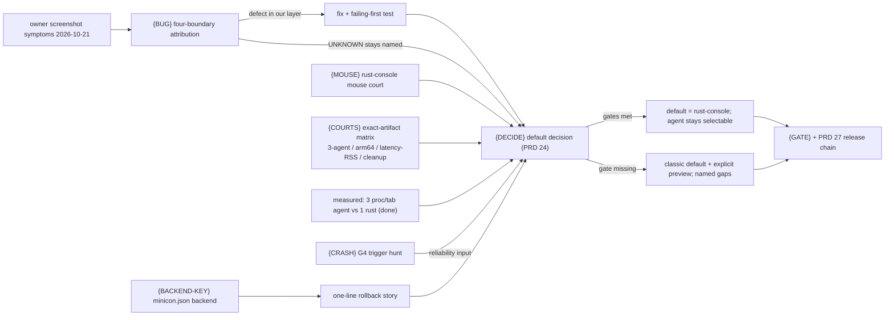

# v0.2.20 — evidence-based Windows default and product-cost decision

Status: planned 2026-10-22, drafted immediately after
[v0.2.19 shipped](../prd/archive/v0.2.19-release-history.md). The version
theme is owned by [the 0.2.x roadmap](plan-v0.2.x-product-roadmap.md)
("evidence-based Windows default and product-cost decision"); TUI-defect
attribution discipline and the open compatibility defects are owned by
[PRD 24.01](../prd/PRD_02_24_01_tui_compatibility.md); backend behavior and
selection by [PRD 24](../prd/PRD_02_24_con_terminal.md#pty-backend-selection);
release gates by [PRD 27](../prd/PRD_02_27_con_delivery.md). This plan
sequences what 0.2.20 fixes and what evidence the default decision consumes;
it does not pre-decide the switch.

## Why these leaves (2026-10-22)

- The owner's product intent is explicit: the `minicon-console` module exists
  so MiniCon does not ride system ConPTY or the legacy console-agent
  compatibility path. The measured cost of staying on the agent default is
  now recorded: **3 processes per tab (shell + agent + hidden conhost) versus
  1 under `rust-console`**, with clean `close-window` reaping on both
  (PRD 24 "measured per-tab process cost", 2026-10-22).
- The owner-reported **file-tool output misalignment** in Claude Code
  sessions (2026-10-21, screenshot-triaged: stale right-column orphan chars,
  mid-line dropped/merged glyphs, mis-indented list row) is recorded in
  PRD 24.01 "Open compatibility contracts" and gates this decision: a default
  candidate that cannot render the owner's main workload correctly is not a
  candidate.
- The historical reason the agent stays default is **mouse input through our
  ConPTY path** (PRD 24 bullet); a default flip to `rust-console` needs its
  own mouse court, not an inherited assumption from the ConPTY comparison.
- The G4 fixture-host crash (0xC0000374) now has consequence evidence: a
  crashed host leaks its agent children (two orphaned cmd.exe found in the
  owner's process audit). Reliability input for the decision, and a real
  defect hunt regardless of it.

## Outcome tree

```text
Outcome: users get the best evidenced Windows backend default, with a named recovery path
├── [v] {BUG} Reproduce and attribute the file-tool output misalignment
│   done 2026-10-22: attributed to the classic-path WIRE — ConPTY/agent
│     repaints resurrect a half-overwritten wide character from its orphaned
│     trailing cell (raw wire capture `#########读取rest` for an app that
│     wrote nine `#` over 读's lead), shifting following columns; the owned
│     parser is faithful at both boundaries (app bytes render correctly,
│     wire bytes render as sent) and rust-console is correct end to end.
│     Evidence: tests/support/wide-overwrite-court/ (fixture, three-backend
│     court, wire probe) + mutation-proven parser pin
│     overwriting_a_wide_lead_blanks_the_orphan_and_keeps_columns
│     (third_party/vt100/src/row.rs); record upserted in PRD 24.01.
│     Scope honesty: distilled proxy of the owner's session; the defect class
│     and boundary are established, the upstream conhost mechanism is not
│     ours to fix — the repair path is backend selection ({DECIDE} evidence)
├── [v] {BACKEND-KEY} Persisted backend preference for new sessions
│   done 2026-10-22: validated `backend` key (conpty/rust-console/agent)
│     decodes through the core scanner, round-trips the document, and feeds
│     one testable decision owner (backend_selection in src/main.rs: CLI >
│     config > classic default; valid-but-unavailable → default + visible
│     status-strip notice). Evidence: the two named unit tests in src/main.rs
│     plus the core codec test; owner records PRD 25 "Configuration" and
│     PRD 24 backend selection. Honest scope: the spawn wiring is exercised
│     through the same initial-session path the proven `term` key uses; no
│     live user-config journey was run (config injection has no test seam)
├── [v] {MOUSE} Qualify mouse input under rust-console
│   done 2026-10-22: the court found a real defect — rust-console delivered
│     zero mouse records while the agent delivered press/release/wheel
│     records (clean ConPTY passes SGR through as VT key characters instead;
│     an earlier ConPTY row was the agent via an inherited forcing variable,
│     corrected); the provider's VT-to-record decoder had no
│     mouse branch. Fixed by moving the SGR decoder + record mapping out of
│     the console agent into the shared console_input module (F1-shaped
│     seam: one decision, two transports). After: agent and rust-console
│     deliver field-identical records. Evidence: tests/support/mouse-court/ before/after
│     runs, rust_console_sgr_mouse_reports_become_native_mouse_records;
│     record in PRD 24 backend selection
├── [-] {COURTS} Exact-artifact decision courts
│   state 2026-10-22: local cost court (processes 4 vs 10, 35 vs 99 MB,
│     echo latency, zero hard-kill orphans), release 32 MiB throughput
│     (rust-console 9.9 s delivering everything vs the agent's scrape),
│     visible three-agent start-and-resize court on current source (PRD
│     24.01), native rust_console_pty suite on win-x86_64 and win-aarch64
│     via dev-loop-crosscheck. open: the same on the exact signed Candidate
│   invariant: every default-decision claim names exact artifact, cell and court
│   evidence: (a) visible three-agent matrix (Claude Code / Grok / Codex) on the
│     exact signed Candidate, classic vs rust-console; (b) win-aarch64 actual
│     rust-console session court; (c) latency / sustained-redraw / total RSS
│     comparison per backend (process-count per tab is already measured and
│     recorded in PRD 24); (d) failure/cleanup comparison incl. kill -9 shapes
│   safe failure: a missing court keeps the stable default and the explicit
│     preview; the gap is named in the release record, never silently skipped
│   dependency: 0.2.19 Candidate chain mechanics (rerun on 0.2.20 source);
│     PRD 27 owns runners and costs; non-goal: re-running courts that exist
│     with matching source/features (inventory receipts first)
├── [-] {CRASH} G4 fixture-host heap-corruption trigger hunt (bounded)
│   state 2026-10-22: one bounded round under parallel load (minicon_control
│     concurrent with minicon_blackbox, 0.2.20 source before the default
│     flip): 3 clean control rounds + 4 clean blackbox rounds, zero
│     0xC0000374 exits, zero failures; later rounds were contaminated by
│     concurrent source edits (mid-run rebuilds) and are excluded, not
│     counted. Not reproduced; G4 stays open with this matrix recorded
│   invariant: the hunt produces either a reproducing trigger or a named
│     narrowed suspect list with negative controls — not a shrug
│   evidence: WER/dump or instrumented rerun of the 2026-10-21 crash shape;
│     the two leaked-orphan PIDs' lineage is already recorded in G4
│   safe failure: if not reproduced within the box's budget, record the
│     attempted matrix and keep G4 open with sharper triggers
│   dependency: carried debt G4; non-goal: rewriting the test harness
├── [-] {DECIDE} The default decision itself
│   state 2026-10-22: decided — rust-console becomes the Windows default
│     (decision section in PRD 24 "Backend default decision (0.2.20)").
│     Flipping the default made every GUI black-box journey run on
│     rust-console and surfaced three real gaps, all fixed with tests:
│     MSYS2 output (GetConsoleWindow pseudo window), resize notification
│     without ENABLE_WINDOW_INPUT, unstartable program as the tab's failure.
│     Rollback: `--feature console-agent` / `"backend": "console-agent"`.
│     open: exact-Candidate visible three-agent matrix and the six-cell
│     Candidate courts on the flipped source
│   invariant: any default change improves the named user journeys without a
│     hidden regression, and the rollback path is a one-line user action
│     ({BACKEND-KEY} or --feature), stated in the release notes
│   evidence: the {BUG}/{MOUSE}/{COURTS} records above, weighed in one decision
│     section upserted into PRD 24; the release claim names what flipped and
│     what did not
│   safe failure: keep classic default + explicit preview; name each missing
│     gate (the roadmap's standing rule — a decision point, not a promise)
│   dependency: all leaves above; PRD 27 owns the release chain
└── [_] {GATE} Qualify and upsert
    invariant: fmt / clippy -D warnings / build.sh test / six-cell on the
      actual source; owners updated in the same change (PRD 24, 24.01, 25, 27)
    safe failure: unavailable evidence is BLOCKED, never skipped
    dependency: all leaves; non-goal: publish authority (owner decision)
```



## Ordered work and acceptance

| Order | Work and observable acceptance | Failure boundary |
| --- | --- | --- |
| 1 — BUG | Build a reproduction fixture from the recorded symptoms (owner uses Claude Code in myclaude; symptoms are incremental-redraw shaped). Capture all four boundaries with `ui-snapshot` naming the backend; run the same court classic vs rust-console; split parser-state from paint-path with capture-pane vs screenshot-pane. Attribute, then fix only in the attributed layer with a failing-first test. | No guess-fix. If the symptom does not reproduce, record the attempted fixtures and negative controls in PRD 24.01 and mark the symptom UNKNOWN — {DECIDE} must then weigh an unattributed defect explicitly. |
| 2 — BACKEND-KEY | Add `backend` to minicon.json (decode via core scanner like `term`; values `conpty` / `rust-console` / `agent`); apply to new sessions at spawn; CLI `--feature` overrides per invocation; unavailable backend (not compiled / not Windows) falls back with the existing selection-refusal notice. Round-trip + validation tests; PRD 25 Configuration upsert. | No product-default change rides this key. A valid-but-unavailable choice must be a visible refusal at tab spawn, never a silent fallback the user cannot see. |
| 3 — MOUSE | Script a mouse journey (click + wheel + drag) against a real mouse-aware TUI under both backends in the same court; compare delivered events end to end. Record the rust-console verdict beside the existing ConPTY mouse record in PRD 24. | A rust-console mouse gap is a named {DECIDE} blocker. Do not normalize a partial pass into "works". |
| 4 — COURTS | Inventory existing receipts first (0.2.18/0.2.19 courts that match source/features are reusable evidence). Then: exact-Candidate three-agent visible matrix classic vs rust; win-aarch64 actual rust session; latency/redraw/RSS per backend; failure/cleanup comparison. | Each missing cell is BLOCKED by name. Shared-runner performance numbers follow the G5 rule — no cross-machine thresholds invented from one host. |
| 5 — CRASH | Bounded trigger hunt for the 0xC0000374 fixture-host crash: enable local dumps for the fixture host, rerun the flaky pair under parallel load N times, record outcomes. | Bounded by a stated budget; an unreproduced crash stays open in G4 with the attempted matrix recorded, and feeds {DECIDE} as "reliability unknown on busy hosts". |
| 6 — DECIDE | Write the decision section in PRD 24: per-gate verdicts, the flip-or-keep call, the rollback story ({BACKEND-KEY}/--feature), and the named non-flipped scope. Owner holds publish authority per AGENTS.md. | A missing gate keeps the stable default. The decision names evidence, not intentions; "likely fine" is not a verdict. |
| 7 — GATE | fmt, clippy -D warnings, build.sh test, six-cell on actual source; upsert PRD 24/24.01/25/27 and the roadmap in the same changes; release follows PRD 27's chain when the owner says so. | Unavailable evidence is BLOCKED. The release claim is exactly as narrow as the passed courts. |

## Carried context (not re-derived here)

- Process-cost measurement (3/tab agent vs 1/tab rust, clean reaping) is done
  and owned by PRD 24 "measured per-tab process cost" (2026-10-22).
- Open compatibility defects beyond the file-tool report (output-side loss,
  live TUI defects) stay owned by PRD 24.01; {BUG} may attribute into them.
- G5 (intel-mac throughput budget) and the v0.2.1 missing-Release-object
  discrepancy are separate owner decisions, not 0.2.20 gates.
- 0.2.16 test-selection and 0.2.17 modern-agent gates remain open on their own
  plans; this version does not claim them.

## Non-goals

- A date-driven default switch (roadmap rule).
- Global conhost removal or deprecating the agent path — it remains the
  selectable fallback and the no-ConPTY host's only option.
- The portable session trait ({CONTRACT} continuation) — PRD 35 owns its
  own sequence; it is not a 0.2.20 gate.
- New TUI compatibility claims beyond what {BUG}'s attribution actually proves.
