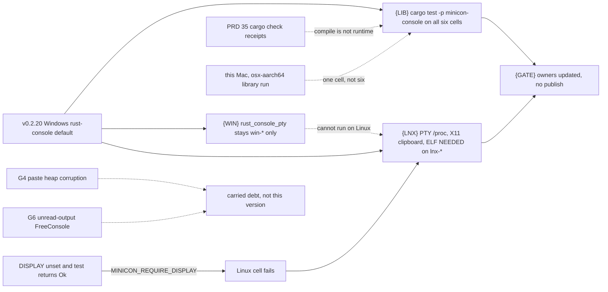
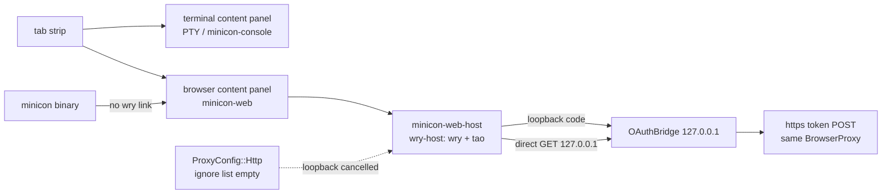

# v0.2.21 — console courts, and the browser content panel beside the terminal

Status: implementation landed; exact-tip six-cell dev-loop qualification is in
progress. Opened 2026-10-23. v0.2.20 shipped
([release history](../prd/archive/v0.2.20-release-history.md)). This version
has two tracks on `main`; implementation commit `960853b` includes both tracks,
and the following court-only liveness-window adjustment awaits its exact-tip
receipts.
G4 and G6 stay in [carried debt](plan-carried-debt.md). Do not publish.

Track A: `minicon-console` runs on every shipped cell, and a Linux-only
path fails the Linux cell even when Windows and macOS are green.

Track B: a browser tab's content panel is `minicon-web` (temporary backend
wry + tao, feature `wry-host`, separate `minicon-web-host` process). A
terminal tab's content panel stays the PTY / `minicon-console` view. Same
tab strip, one content panel per tab. Core `minicon` does not link wry.
Leaf detail that is not a 0.2.21 gate stays in
[plan-browser-tabs.md](plan-browser-tabs.md).

No historical incident is renamed into a fix here. The detection hole is
visible in the current court, and one recorded Linux-only hang
(2026-09-27, carried-debt snapshot) shows the class: the Linux cells hung
after a green Windows result, the job came back `cancelled` rather than
failed, and a passing checkmark was not a Linux receipt.

## Why these leaves

Three claims stay separate. Collapsing them is how a green neighbor becomes
a false portability claim.

- The portable library is `minicon-console`'s `terminal` and `session`
  modules plus the host-neutral integration tests
  `synchronized_presentation` and `presentation_allocations`. Nothing in
  those sources is `cfg`'d on OS or ISA. `cargo check` receipts in
  [PRD 35](../prd/PRD_02_35_terminal_library.md) compile that library; they
  do not run it. `dev-loop-crosscheck.yml` never named
  `cargo test -p minicon-console`, on any cell. A Mac
  `./scripts/build.sh test` runs it only for the Mac's own triple.
- The Windows console service is `cfg(windows)`: `host`, `driver`, `client`,
  `native_input`, and `minicon-platform`'s `rust_console_pty`. It cannot be
  executed on Linux or macOS. Both Windows cells already run
  `rust_console_pty`. That is not a Linux result and not a portable-library
  result.
- Linux product behavior is not the console crate. The POSIX PTY, including
  the `/proc` session walk that macOS replaces with `proc_listpids`, stays
  in `minicon-platform` until PRD 35's portable session contract is
  qualified. X11 clipboard tests return success without touching X11 when
  `DISPLAY` is unset. Six-cell Linux jobs already run `minicon_blackbox` and
  `minicon_control` under Xvfb; they do not run the platform PTY tests or
  those X11 unit tests. A macOS-green run never compiles the Linux arm.
  Many platform tests are `cfg(all(test, target_os = "macos"))` and cannot
  stand in for it.

This Mac (macOS arm64) can execute the portable library and nothing else in
this plan. Linux and Windows receipts stay `BLOCKED` until those cells run.
Do not publish.

## Outcome tree — console

```text
Outcome: the portable console library runs on every shipped cell, and a Linux-only divergence fails the Linux cell even when Windows and macOS are green
├── [-] {LIB} Run the portable minicon-console tests on all six cells
│   invariant: an unfiltered cell executes minicon-console --lib, synchronized_presentation and presentation_allocations, and the log says running N tests with N > 0; cargo check is not this evidence
│   evidence: the dev-loop receipt for lnx-x86_64, lnx-aarch64, win-x86_64, win-aarch64, osx-aarch64 and osx-x86_64, each naming those suites
│   safe failure: a cell that does not run is BLOCKED; this Mac's pass is osx-aarch64 of the library only and does not close the leaf
│   dependency: PRD 35 and dev-loop-crosscheck.yml; non-goal: treating the Windows service or a 0-test binary as a pass
├── [-] {WIN} Keep the Windows service on the two Windows cells only
│   invariant: rust_console_pty and other cfg(windows) service tests are not invoked on lnx-* or osx-*; their green result is not a portable-library result
│   evidence: the existing win-* branch in dev-loop-crosscheck.yml
│   safe failure: a red G6 court stays red in carried debt; this leaf does not edit close_may_publish
│   dependency: PRD 34; non-goal: running the Windows console service on Linux
├── [-] {LNX} Fail the Linux cell when its own path is skipped or diverges
│   invariant: lnx-x86_64 and lnx-aarch64 execute the POSIX PTY session tests (so the /proc walk is the code under test), the two native X11 clipboard tests, and the Linux ELF load-time gate; a missing DISPLAY under MINICON_REQUIRE_DISPLAY is a failure, not a return
│   evidence: those three suite names on both Linux receipts; a macOS or Windows receipt does not satisfy this leaf
│   safe failure: a red Linux court stays red; do not delete the test or skip it because the other four cells passed
│   dependency: {LIB} does not imply this leaf; non-goal: moving the POSIX session into minicon-console, and non-goal: running the entire minicon-platform lib (accessibility and the rest stay out)
└── [v] {GATE} Development version 0.2.21, owners pointed here, no publish
    invariant: Cargo.toml and release-policy.json say 0.2.21; PRD index, PRD 32, PRD 35 and the roadmap link this plan; G4 and G6 are not claimed by it
    evidence: the diff that opens the version and these links
    safe failure: no tag, no Candidate, no six-cell claim from one host
    dependency: the leaves above stay open until their own receipts exist
```



## Outcome tree — browser content panel

Landed on `be99a86`, not a six-cell claim: the page host can load under
`wry-host` (owner Linux host, WebKitGTK, `--probe` 0), the WebView is packed
into tao's default vbox and reparented into the main window, a terminal tab
unmaps that child, and DeepSeek's authorize URL is loaded in that panel.
`be99a86` exchanges the loopback `code` for a bearer. Dashboard, file
preview, wasm, and 1:N panels stay later
([plan-browser-tabs.md](plan-browser-tabs.md)).

```text
Outcome: the one browser content panel stays in the terminal's column and the OAuth code does not leave the loopback
├── [v] {PANEL} One browser tab, column matches the terminal
│   invariant: Ctrl+Shift+O focuses the existing browser tab instead of inserting another; the embed slot is the content column (below the tab header, above the composer, clear of the sidebar and the history chrome)
│   evidence: a_browser_tab_is_a_root_peer_of_a_terminal_tab (second add_browser_root returns None); content_column_is_the_terminal_rectangle. macOS arm64 unit tests only
│   safe failure: a live resize that does not move the already-reparented X window stays open and is BLOCKED (no XMoveResizeWindow); Wayland has no embed_parent and is not called embedded
│   dependency: PRD 25; non-goal: a split layout inside one tab
├── [-] {OAUTH} The token POST uses the same proxy hook as the page, and only https
│   invariant: exchange reads BrowserProxy from config plus MINICON_BROWSER_*, not the raw env alone; MINICON_DEEPSEEK_TOKEN_URL must be https; an http loopback redirect is fetched by the page host on 127.0.0.1 and is not left to the WebView proxy
│   evidence: https_token_url rejects plain http; loopback_oauth_redirect_is_delivered_without_the_webview_proxy
│   safe failure: wry 0.56 ProxyConfig::Http still has an empty ignore list, so the host cancels that navigation instead of asking wry to exempt it; a live WebKit run of the handler is not this Mac
│   dependency: PRD 31; non-goal: a provider registry or composer "Connect AI" button
├── [-] {KEY} Ctrl+Shift letter chords see the physical key
│   invariant: Linux xkb events with logical Unidentified and PhysicalKeyCode::Letter still open the browser tab or start OAuth instead of becoming C0
│   evidence: chord_letter_uses_the_physical_key_when_logical_is_unidentified
│   safe failure: this does not change Ctrl+letter encoding for the terminal
│   dependency: the Linux Ctrl+letter fix in contract/terminal_input.rs
└── [_] {STILL} Named holes not closed by the leaves above
    state: `state` and S256 PKCE are on the current authorize URL and token POST; the listener keeps accepting until that `state` matches. Private bearer publication uses minicon-platform's protected directory + atomic 0600/no-follow seam. The Windows adapter installs a protected current-user ACL, but its native runtime evidence is BLOCKED. `wry-host` names gtk only as a Linux dependency.
    dependency: do not mark the OAuth vertical [v] while these are open
```



## Ordered work

| Order | Work and observable acceptance | Failure boundary |
| --- | --- | --- |
| 1 — LIB | `dev-loop-crosscheck.yml` runs `cargo test --locked --target <triple> -p minicon-console --lib` and the two host-neutral integration tests on every cell. An unfiltered log must contain `running N tests` with N > 0. Let Cargo find the binary; do not stat a hashed path. | This Mac ran that command on 2026-10-23: 19 lib + 8 synchronized_presentation + 1 presentation_allocations, all passed. That is `aarch64-apple-darwin` only. The other five cells are BLOCKED until their receipts exist. |
| 2 — WIN | Leave `rust_console_pty` and `minicon_console_agent` inside `case win-*`. Do not add them to Linux. | G6 stays carried debt. No edit to the unread-output barrier in this version. |
| 3 — LNX | On `lnx-*` only, run the three POSIX PTY session tests with feature `pty`, the two X11 tests with feature `clipboard`, and `minicon_load_portability_linux`. The Linux job exports `MINICON_REQUIRE_DISPLAY=1` after Xvfb is up, and those X11 tests plus the control image-paste test panic instead of returning when `DISPLAY` is missing. | A green `osx-*` or `win-*` cell does not close this. Omitting the features compiles the named tests out and is a failed court, not evidence. Do not move the PTY into `minicon-console`. |
| 4 — GATE | [v] Version is 0.2.21. Index and owners point at this plan. G4/G6 are unclaimed. No publish. | `Cargo.toml`, `Cargo.lock`, `release-policy.json`, this plan and owner links are the named source evidence. Unavailable cell evidence stays BLOCKED. |

## Local evidence — 2026-10-23, macOS arm64

- `cargo test --locked -p minicon-console --lib --test synchronized_presentation --test presentation_allocations`: 19 + 8 + 1 passed. This proves only the local portable-library cell.
- `cargo test --locked -p minicon-web`: 17 passed, including loopback delivery, proxy mapping, authorize URL and state/PKCE checks.
- The physical-letter contract test executed as one test with `minicon-platform` features `input,portable-pixel-window`; a featureless invocation selected zero tests and was rejected as evidence.
- `cargo clippy --all-targets -- -D warnings` passed after the input and Ctrl+click paths were brought through the current lint gate.
- `./scripts/build.sh test` first exposed the bearer implementation's raw `std::os` reach. The final implementation moves private directory protection, atomic private publication and bounded no-follow reads into `minicon-platform::filesystem`; after the new plan files entered the Git index, the complete product gate passed, including 476 product tests, 432 platform tests, 17 web tests, 28 owned vt100 tests and 36 owned VTE tests (with the gate's explicitly named ignored/live-only cases unchanged).
- `cargo fmt --all -- --check`, `cargo clippy --all-targets -- -D warnings`, `python3 scripts/build-feature-forwarding-selftest.py` (three forwarding cases, including no extra arguments), and `./scripts/selftest.sh` passed. The three UTM court self-tests remain explicitly `SKIPPED (needs a court)` rather than being claimed as local evidence.
- `./scripts/six-cell-qualify.sh` produced `target-six/receipt.json` with 31 PASS, 0 FAIL and 14 BLOCKED after the pinned `cargo-xwin 0.23.1` and Windows Rust targets were installed. Both Windows architectures passed all-target, throughput, owned-console, retail and PE artifact checks; both Linux architectures passed all-target, throughput and ELF artifact checks; macOS arm64/x86_64 passed Clippy, tests, throughput and Mach-O checks. The 14 BLOCKED stages are exactly the unconfigured native macOS/Windows/Linux desktop runner courts; the optional Lima accelerator is NOT_REQUESTED.
- The first six-cell pass proved a missing `advapi32` link for the Windows `SystemFunction036` OAuth entropy call; the final pass proves the corrected link on x86_64 and arm64. It also exposed two test-fixture races rather than weakening product safety: adopted-group evidence now spawns a stable group leader directly (50/50 focused passes), and the OAuth loopback fixture consumes its bounded `Content-Length` body before closing (320/320 concurrent passes). The named host-UI PNG was reviewed and updated to the current layout, so source-stability passes with byte-identical regeneration.
- Dev-loop run `39914718322` on exact implementation commit `960853b` passed
  both Linux cells. Windows x86_64 failed two `rust_console_pty` liveness
  observations at their exact 10-second deadline (`disconnect-file` and
  `disconnect`); Windows arm64 failed the asynchronous clipboard observation
  at the same 10-second deadline. These checks prove eventual retirement and
  delivery rather than a 10-second product latency promise, so their finite
  observation windows are 30 seconds without changing product behavior or
  suppressing a failure. The complete local product gate passed after this
  court-only change, and the pre-push six-cell receipt is again 31 PASS,
  0 FAIL, 14 BLOCKED. Exact-tip six-cell dev-loop receipts remain pending.

## Non-goals

- Publishing 0.2.21, or a date-driven patch of 0.2.20.
- Page-heap attribution of G4, or changing `close_may_publish` for G6.
- A portable session trait, or relocating the macOS/Linux PTY into `minicon-console` (PRD 35).
- Running every `minicon-platform` test on Linux. The accessibility tree and the other adapters are not this court.
- Claiming Windows ARM64 console-service behavior from a Linux or macOS run.
- macOS tab/composer readability, the 10 MiB RSS intent, and the intel-mac throughput budget (G5).
