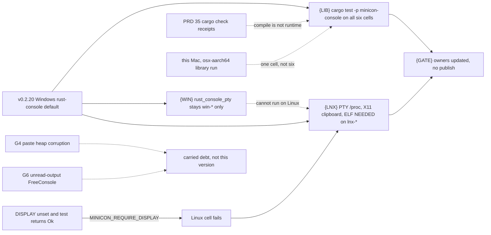
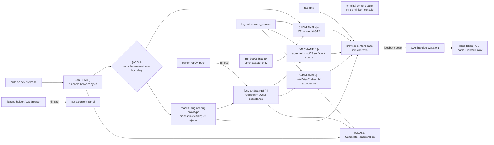

# v0.2.21 — console courts, and the browser content panel beside the terminal

Status: in progress; console scope and the Linux browser adapter are qualified,
and the canonical macOS arm64 dev build visibly hosts WKWebView in the same
content column. Owner use on 2026-10-23 rejected the current browser UI/UX;
the macOS build is an engineering spike, not an accepted product surface.
UX redesign/acceptance, automated/second-ISA macOS, cross-platform artifacts
and Windows remain open. No publish.
Opened 2026-10-23. v0.2.20 shipped
([release history](../prd/archive/v0.2.20-release-history.md)). This version
has two tracks on `main`; implementation commits `960853b` and `ade9a4d`
carry them, run `39917026302` qualifies the six-cell console scope at
`3db5710`, and run `39925651159` qualifies the Linux native browser runtime at
`4577c9c`.
G4 and G6 stay in [carried debt](plan-carried-debt.md). Do not publish.

Track A: `minicon-console` runs on every shipped cell, and a Linux-only
path fails the Linux cell even when Windows and macOS are green.

Track B: a browser tab's content panel is `minicon-web`. The Linux/X11
temporary backend (wry + tao, feature `wry-host`, separate
`minicon-web-host`) is qualified, but it is not yet the cross-platform product
surface. A terminal tab's content panel stays the PTY / `minicon-console`
view. Same tab strip, one content panel per tab.
Leaf detail that is not a 0.2.21 gate stays in
[plan-browser-tabs.md](plan-browser-tabs.md).

**Reopened 2026-10-23 from direct macOS use.** `./scripts/build.sh dev`
produces `target/debug/minicon` but no sibling `minicon-web-host`, so
`page_host_program` returns no configured host. The ordinary helper build also
has `wry-host` disabled. Even a manually feature-built helper cannot satisfy
the product outcome: `PixelWindow::embed_parent()` returns a native parent only
on Linux/X11, while macOS returns `None`, and a standalone WKWebView window is
explicitly not a browser content panel. Run `39925651159` remains valid Linux
adapter evidence; it never proved a macOS-visible product path. The earlier
`[v]` completion claim therefore crossed its evidence boundary and is
withdrawn.

**Repaired locally 2026-10-23.** `{ARCH}` selects platform adapters inside
`minicon-web`: macOS feature-links `native-page-host` into the GUI binary and
builds one WKWebView as a child of the existing NSView; core/headless paths stay
WebView-free and Linux retains its qualified helper. `build.sh dev` creates a
distinct unsigned local-test app wrapper around the same `target/debug/minicon`
bytes. Direct Computer Use proves the bounded home, hide/restore, focus release
and fullscreen resize on this arm64 Mac. This does not close automated/x86_64
macOS or Windows runtime evidence.

**Owner UX rejection, 2026-10-23.** Direct use of that repaired app found the
browser UI/UX poor. The earlier Computer Use receipt proves only native child
creation, geometry and lifecycle; it does not prove that the surface is clear,
coherent or pleasant to use. The current home/shell is retained as a diagnostic
scaffold, not a design baseline. `{UX-BASELINE}` now precedes Windows surface
work so the project does not duplicate a rejected interaction model in
WebView2. The owner rejection is named evidence and keeps Candidate closed.

No historical incident is renamed into a fix here. The detection hole is
visible in the current court, and one recorded Linux-only hang
(2026-09-27, carried-debt snapshot) shows the class: the Linux cells hung
after a green Windows result, the job came back `cancelled` rather than
failed, and a passing checkmark was not a Linux receipt.

## Why these leaves

Three claims stay separate. Collapsing them is how a green neighbor becomes
a false portability claim.

- The portable library is `minicon-console`'s `terminal` and `session`
  modules plus the host-neutral integration tests
  `synchronized_presentation` and `presentation_allocations`. Nothing in
  those sources is `cfg`'d on OS or ISA. `cargo check` receipts in
  [PRD 35](../prd/PRD_02_35_terminal_library.md) compile that library; they
  do not run it. `dev-loop-crosscheck.yml` never named
  `cargo test -p minicon-console`, on any cell. A Mac
  `./scripts/build.sh test` runs it only for the Mac's own triple.
- The Windows console service is `cfg(windows)`: `host`, `driver`, `client`,
  `native_input`, and `minicon-platform`'s `rust_console_pty`. It cannot be
  executed on Linux or macOS. Both Windows cells already run
  `rust_console_pty`. That is not a Linux result and not a portable-library
  result.
- Linux product behavior is not the console crate. The POSIX PTY, including
  the `/proc` session walk that macOS replaces with `proc_listpids`, stays
  in `minicon-platform` until PRD 35's portable session contract is
  qualified. X11 clipboard tests return success without touching X11 when
  `DISPLAY` is unset. Six-cell Linux jobs already run `minicon_blackbox` and
  `minicon_control` under Xvfb; they do not run the platform PTY tests or
  those X11 unit tests. A macOS-green run never compiles the Linux arm.
  Many platform tests are `cfg(all(test, target_os = "macos"))` and cannot
  stand in for it.

This Mac (macOS arm64) can execute the portable library and nothing else in
this plan. Run `39917026302` supplied the other five native receipts. Do not
publish: its Windows x64 job is deliberately still red for the pre-existing G6
FreeConsole/unread-output debt, which this version does not claim to fix.

## Outcome tree — console

```text
Outcome: the portable console library runs on every shipped cell, and a Linux-only divergence fails the Linux cell even when Windows and macOS are green
├── [v] {LIB} Run the portable minicon-console tests on all six cells
│   invariant: an unfiltered cell executes minicon-console --lib, synchronized_presentation and presentation_allocations, and the log says running N tests with N > 0; cargo check is not this evidence
│   evidence: the dev-loop receipt for lnx-x86_64, lnx-aarch64, win-x86_64, win-aarch64, osx-aarch64 and osx-x86_64, each naming those suites
│   safe failure: a cell that does not run is BLOCKED; this Mac's pass is osx-aarch64 of the library only and does not close the leaf
│   dependency: PRD 35 and dev-loop-crosscheck.yml; non-goal: treating the Windows service or a 0-test binary as a pass
├── [v] {WIN} Keep the Windows service on the two Windows cells only
│   invariant: rust_console_pty and other cfg(windows) service tests are not invoked on lnx-* or osx-*; their green result is not a portable-library result
│   evidence: the existing win-* branch in dev-loop-crosscheck.yml
│   safe failure: a red G6 court stays red in carried debt; this leaf does not edit close_may_publish
│   dependency: PRD 34; non-goal: running the Windows console service on Linux
├── [v] {LNX} Fail the Linux cell when its own path is skipped or diverges
│   invariant: lnx-x86_64 and lnx-aarch64 execute the POSIX PTY session tests (so the /proc walk is the code under test), the two native X11 clipboard tests, and the Linux ELF load-time gate; a missing DISPLAY under MINICON_REQUIRE_DISPLAY is a failure, not a return
│   evidence: those three suite names on both Linux receipts; a macOS or Windows receipt does not satisfy this leaf
│   safe failure: a red Linux court stays red; do not delete the test or skip it because the other four cells passed
│   dependency: {LIB} does not imply this leaf; non-goal: moving the POSIX session into minicon-console, and non-goal: running the entire minicon-platform lib (accessibility and the rest stay out)
└── [v] {GATE} Development version 0.2.21, owners pointed here, no publish
    invariant: Cargo.toml and release-policy.json say 0.2.21; PRD index, PRD 32, PRD 35 and the roadmap link this plan; G4 and G6 are not claimed by it
    evidence: the diff that opens the version and these links
    safe failure: no tag, no Candidate, no six-cell claim from one host
    dependency: the leaves above stay open until their own receipts exist
```



## Outcome tree — browser content panel

Landed on `be99a86`, not a six-cell claim: the page host can load under
`wry-host` (owner Linux host, WebKitGTK, `--probe` 0), the WebView is packed
into tao's default vbox and reparented into the main window, a terminal tab
unmaps that child, and DeepSeek's authorize URL is loaded in that panel.
`be99a86` exchanges the loopback `code` for a bearer. Dashboard, file
preview, wasm, and 1:N panels stay later
([plan-browser-tabs.md](plan-browser-tabs.md)).

```text
Outcome: a canonical MiniCon build opens one interactive browser page inside the active tab's content column on every desktop 0.2.21 claims, and OAuth loopback stays local
├── [v] {SHELL} One browser tab, one content-panel rectangle
│   invariant: Ctrl+Shift+O focuses the existing browser tab instead of inserting another; Layout::content_column stays below the header, above the composer and clear of sidebar/history chrome
│   evidence: a_browser_tab_is_a_root_peer_of_a_terminal_tab; content_column_is_the_terminal_rectangle
│   safe failure: shell-only UI says Unavailable and cannot be called a working browser surface
│   dependency: PRD 25; non-goal: a split layout inside one tab
├── [v] {LNX-PANEL} Linux/X11 page, resize and OAuth adapter
│   invariant: the classed WebKitGTK child is reparented, mapped only for the browser tab and resized on window/sidebar/history/tab transitions; loopback navigation bypasses the proxy
│   evidence: run 39925651159 records nonzero minicon-web-x11 plus minicon-web-wry-build and minicon-web-live-oauth ok on both Linux ISAs
│   safe failure: missing DISPLAY/WebKitGTK, zero tests, stale bounds, proxy leakage or timeout fails the Linux cell
│   dependency: X11 + WebKitGTK 4.1; non-goal: treating this as macOS or Windows evidence
├── [v] {ARCH} Choose a portable same-window host boundary
│   invariant: the selected design preserves the visible Tab/content-panel product face on macOS, Windows and Linux; it must name which earlier constraint is relaxed because same-window native views, a separate helper process and never linking a WebView adapter into the GUI cannot all be assumed from the X11 reparent trick
│   evidence: minicon-web native-page-host plus direct macOS use proves create, bounded offline home, hide/show/restore and fullscreen resize as one WKWebView child; the GUI-only adapter is the selected boundary
│   safe failure: reject a floating helper window, OS default browser, screenshot streaming or synthetic input forwarding as substitutes for an interactive content panel
│   dependency: platform adapters stay inside minicon-web while minicon-core/minicon-console and headless paths remain WebView-free; Linux may retain its qualified helper; non-goal: Electron/CDP or a new browser engine
├── [-] {ARTIFACT} Make the canonical dev/release output runnable without hidden setup
│   invariant: ./scripts/build.sh dev and release produce every component/feature the browser path needs; the app does not depend on manual cargo flags or MINICON_BROWSER_BIN
│   evidence: a clean-output black box opens a local test page from the canonical artifact, and release inventory names every shipped byte
│   safe failure: missing helper/feature is typed Unavailable and keeps this leaf open; do not accept a manually feature-built lab binary
│   dependency: {ARCH}; non-goal: selecting a binary by modification time
├── [-] {MAC-PANEL} Make the browser visibly testable inside this macOS MiniCon window
│   invariant: WKWebView occupies Layout::content_column in the active browser tab, follows Retina/window/sidebar/history geometry, hides behind terminal tabs and never appears as an independent window
│   evidence: direct Computer Use observation from canonical `build.sh dev` output proves local page visibility, hide/restore, focus release and fullscreen geometry; owner use rejects the current UI/UX, so these mechanics do not close the leaf
│   safe failure: no helper, exit 69, a blank shell, a floating WKWebView or an owner-rejected surface is failure; unavailable evidence is BLOCKED
│   dependency: {ARCH}, {ARTIFACT}, {UX-BASELINE}; non-goal: production provider credentials
├── [_] {UX-BASELINE} Redesign and accept the browser workspace before copying it to Windows
│   invariant: opening, understanding current state, navigating, switching to a terminal, returning, resizing and closing/reopening form one coherent workflow; browser/terminal hierarchy, focus and status are legible without relying on an undocumented shortcut or diagnostic placeholder
│   evidence: named owner journeys on the canonical macOS app with before/after screenshots or observations for open, real URL navigation, tab switch/return, resize/fullscreen and close/reopen; explicit owner acceptance is required
│   safe failure: “the WebView is visible” is insufficient; awkward pasted-on chrome, unclear state/navigation, wasted or colliding layout, surprising focus, or another owner rejection keeps this leaf open and kills Candidate
│   dependency: {SHELL}, {ARCH} and the current macOS spike as a disposable prototype; non-goal: dashboard/preview/wasm, 1:N panels or a whole-terminal visual rewrite
├── [_] {WIN-PANEL} Close the same user-visible surface on WebView2
│   invariant: the Windows release either provides the same tab/content-panel outcome or 0.2.21 explicitly narrows its browser platform claim before Candidate; silent Unavailable is not parity
│   evidence: visible native x86_64 and arm64 journeys from canonical artifacts
│   safe failure: compile-only or the already-green bearer ACL court cannot substitute for WebView2 runtime evidence
│   dependency: accepted {UX-BASELINE}, {ARCH}, {ARTIFACT}; non-goal: changing the Windows console backend or cloning the rejected macOS prototype
├── [v] {AUTH-CORE} Proxy, PKCE/state, loopback and private bearer mechanisms
│   invariant: authorize and token paths use BrowserProxy; token URL is https; redirect is 127.0.0.1; state/PKCE and bounded private publication remain enforced
│   evidence: minicon-web unit tests, run 39925651159 Linux live navigation and run 39919403513 Windows private-filesystem court
│   safe failure: platform-visible OAuth remains partial until its page surface court runs; core mechanism evidence does not prove a user can see it
│   dependency: minicon-platform filesystem; non-goal: provider registry or composer Connect AI UI
└── [-] {CLOSE} Close 0.2.21 browser scope and authorize Candidate consideration
    invariant: every claimed desktop can exercise the browser from canonical output; Linux-only adapter success is not cross-platform completion
    evidence: {ARTIFACT}, accepted {UX-BASELINE}, {MAC-PANEL}, the explicit {WIN-PANEL} decision/evidence, full gates and owner-visible macOS acceptance
    safe failure: keep PRD/root/plan at [-] and do not dispatch release.sh 0.2.21
    dependency: {SHELL}, {LNX-PANEL}, {ARCH}, {ARTIFACT}, {UX-BASELINE}, {MAC-PANEL}, {WIN-PANEL} decision and {AUTH-CORE}; non-goal: dashboard/preview/wasm, 1:N panels or production provider account
```



## Ordered work

| Order | Work and observable acceptance | Failure boundary |
| --- | --- | --- |
| 1 — LIB | `dev-loop-crosscheck.yml` runs `cargo test --locked --target <triple> -p minicon-console --lib` and the two host-neutral integration tests on every cell. An unfiltered log must contain `running N tests` with N > 0. Let Cargo find the binary; do not stat a hashed path. | Run `39917026302` records all three suites `ok` on all six cells at exact source `3db5710`. |
| 2 — WIN | Leave `rust_console_pty` and `minicon_console_agent` inside `case win-*`. Do not add them to Linux. | G6 stays carried debt. No edit to the unread-output barrier in this version. |
| 3 — LNX | On `lnx-*` only, run the three POSIX PTY session tests with feature `pty`, the two X11 tests with feature `clipboard`, and `minicon_load_portability_linux`. The Linux job exports `MINICON_REQUIRE_DISPLAY=1` after Xvfb is up, and those X11 tests plus the control image-paste test panic instead of returning when `DISPLAY` is missing. | A green `osx-*` or `win-*` cell does not close this. Omitting the features compiles the named tests out and is a failed court, not evidence. Do not move the PTY into `minicon-console`. |
| 4 — RELEASE-GATE | [-] Version is 0.2.21 and owners point here, but Candidate consideration stays closed until the canonical browser surface is visible on every claimed desktop. | No tag, Candidate or `release.sh 0.2.21`; unavailable native evidence stays BLOCKED. The console `{GATE}` remains valid only for its own completed track. |
| 5 — LNX-PANEL | [v] Apply `Layout::content_column` through the X resize seam and drive real WebKitGTK proxy/direct-loopback navigation. | Run `39925651159` records nonzero `minicon-web-x11`, `minicon-web-wry-build` and `minicon-web-live-oauth` `ok` on both Linux ISAs. |
| 6 — ARCH | [v] Use platform adapters inside `minicon-web`: GUI-only same-process child WKWebView/WebView2 where portable reparenting is unavailable, retaining the qualified Linux helper. `minicon-core`, `minicon-console` and headless paths remain WebView-free. | The macOS spike visibly proves the boundary. A floating helper, OS browser, captured pixels or forwarded synthetic input still fails it. |
| 7 — ARTIFACT | [-] `build.sh dev` now links the macOS native page host and emits `target/debug/MiniCon 0.2.21 Dev.app` with a distinct local-test identity; prove release output and close Linux/Windows packaging. | No manual feature or `MINICON_BROWSER_BIN` is needed on macOS. Missing bytes on any claimed platform keep the leaf open. |
| 8 — UX-BASELINE | [_] Treat the current macOS page as a disposable prototype; redesign the browser workspace around the named open/navigate/switch/return/resize/close journeys, then obtain explicit owner acceptance. | Owner use on 2026-10-23 rejected the current UI/UX. Geometry screenshots cannot override that evidence, and Windows work must not clone it. |
| 9 — MAC-PANEL | [-] Rework the WKWebView surface to the accepted UX baseline, then add an automated native journey and x86_64 runtime receipt. | Direct Computer Use proves only visible home, hide/restore, focus release and fullscreen mechanics; it is not product acceptance. |
| 10 — WIN-PANEL | [_] After `{UX-BASELINE}` is accepted, implement and qualify the same interaction model with WebView2 on both Windows ISAs, or explicitly narrow the 0.2.21 browser platform claim before Candidate. | ACL/compile evidence and duplication of the rejected macOS prototype are not page-surface evidence. |
| 11 — CLOSE | [-] Re-run complete gates, record explicit owner macOS UX acceptance and reconcile PRD/root status. | Only then may 0.2.21 enter the release chain; dashboard/preview/wasm/1:N remain later. |

## Local evidence — 2026-10-23, macOS arm64

- Direct owner test after `./scripts/build.sh dev` exposed the missing product
  path: `target/debug/minicon` reports 0.2.21, but no
  `target/debug/minicon-web-host` exists, the browser shell cannot launch a
  page, and the macOS pixel-window backend has no embed parent. This is named
  negative evidence for `{ARTIFACT}` and `{MAC-PANEL}`, not a user mistake and
  not a reason to weaken same-window tabs into a floating helper.
- The repaired canonical dev output now also assembles
  `target/debug/MiniCon 0.2.21 Dev.app` with a distinct development bundle id.
  Direct Computer Use on this macOS arm64 host observed a single browser root
  beside `bash`; its WKWebView exposed `MiniCon Browser` as HTML content inside
  the content column, hid completely on a terminal-tab click, restored through
  `Ctrl+Shift+O` after releasing first-responder focus, and resized in place in
  fullscreen without covering the tab tree or composer band. This closes
  `{ARCH}` and supplies local `{MAC-PANEL}` evidence, not an automated or
  x86_64 court.
- The owner then used that exact macOS app and rejected its browser UI/UX as
  poor. This supersedes any inference that the mechanical Computer Use receipt
  was product acceptance. It opens `{UX-BASELINE}`, keeps `{MAC-PANEL}` partial
  and places Windows page-surface implementation after the redesign.
- `./scripts/build.sh release` links the same macOS adapter without a helper or
  environment override and produces `target/release/minicon` at 3,421,824
  bytes on this arm64 Mac (the debug executable/app payload is 24,499,544
  bytes). That is concrete `{ARTIFACT}` and size evidence for macOS only; the
  prior ~1.4 MiB public size statement must not be reused for 0.2.21, and Linux
  canonical helper plus Windows output remain open.
- On the repaired browser source, `./scripts/build.sh test` passed again
  (476 product tests, 31 black-box tests and 20 `minicon-web` tests among the
  complete gate), and `./scripts/selftest.sh` passed with only its three
  explicitly court-dependent checks skipped. The subsequent local six-cell
  run produced 23 PASS, 8 FAIL and 14 BLOCKED: both macOS architectures and
  both Linux architectures passed their compile/test/artifact stages, while
  every Windows link invocation stopped in crates.io downloads
  (`windows-core`, `windows`, `windows-strings` or WebView2 crates) after the
  low-speed retry limit. No Rust or linker diagnostic was emitted. This is
  named local-network failure evidence, not a Windows product result; the
  exact source must therefore run on GitHub's native Windows court before the
  Windows browser leaf can move.
- Native Windows run `39964649501` then checked out exact commit `d28a1a7` on
  `windows-2025` x86_64 and `windows-11-arm` arm64. Both cells passed the
  workspace all-target build (including the Windows `minicon-web` dependency
  graph) and every ordinary core, console, black-box, control, throughput,
  console-agent and private-filesystem suite. Both jobs remained red only in
  the two already-carried G6 `rust_console_pty` disconnect observations
  (`queued_reads...disconnect-file` and `read_retirement...disconnect`): 94
  passed, 2 failed and 69 ignored in that suite on each ISA. This rules out a
  Windows compile/link regression from the macOS adapter; it is not visible
  WebView2 content-panel evidence, so `{WIN-PANEL}` remains open.
- `cargo test --locked -p minicon-console --lib --test synchronized_presentation --test presentation_allocations`: 19 + 8 + 1 passed. This proves only the local portable-library cell.
- `cargo test --locked -p minicon-web`: 17 passed, including loopback delivery, proxy mapping, authorize URL and state/PKCE checks.
- The physical-letter contract test executed as one test with `minicon-platform` features `input,portable-pixel-window`; a featureless invocation selected zero tests and was rejected as evidence.
- `cargo clippy --all-targets -- -D warnings` passed after the input and Ctrl+click paths were brought through the current lint gate.
- `./scripts/build.sh test` first exposed the bearer implementation's raw `std::os` reach. The final implementation moves private directory protection, atomic private publication and bounded no-follow reads into `minicon-platform::filesystem`; after the new plan files entered the Git index, the complete product gate passed, including 476 product tests, 432 platform tests, 17 web tests, 28 owned vt100 tests and 36 owned VTE tests (with the gate's explicitly named ignored/live-only cases unchanged).
- `cargo fmt --all -- --check`, `cargo clippy --all-targets -- -D warnings`, `python3 scripts/build-feature-forwarding-selftest.py` (three forwarding cases, including no extra arguments), and `./scripts/selftest.sh` passed. The three UTM court self-tests remain explicitly `SKIPPED (needs a court)` rather than being claimed as local evidence.
- `./scripts/six-cell-qualify.sh` produced `target-six/receipt.json` with 31 PASS, 0 FAIL and 14 BLOCKED after the pinned `cargo-xwin 0.23.1` and Windows Rust targets were installed. Both Windows architectures passed all-target, throughput, owned-console, retail and PE artifact checks; both Linux architectures passed all-target, throughput and ELF artifact checks; macOS arm64/x86_64 passed Clippy, tests, throughput and Mach-O checks. The 14 BLOCKED stages are exactly the unconfigured native macOS/Windows/Linux desktop runner courts; the optional Lima accelerator is NOT_REQUESTED.
- The first six-cell pass proved a missing `advapi32` link for the Windows `SystemFunction036` OAuth entropy call; the final pass proves the corrected link on x86_64 and arm64. It also exposed two test-fixture races rather than weakening product safety: adopted-group evidence now spawns a stable group leader directly (50/50 focused passes), and the OAuth loopback fixture consumes its bounded `Content-Length` body before closing (320/320 concurrent passes). The named host-UI PNG was reviewed and updated to the current layout, so source-stability passes with byte-identical regeneration.
- Dev-loop run `39914718322` on exact implementation commit `960853b` passed
  both Linux cells. Windows x86_64 failed two `rust_console_pty` liveness
  observations at their exact 10-second deadline (`disconnect-file` and
  `disconnect`); Windows arm64 failed the asynchronous clipboard observation
  at the same 10-second deadline. A diagnostic 30-second rerun proved the x64
  disconnect cases are the named G6 debt, not scheduler delay, so that
  ineffective G6 timeout edit was removed. The asynchronous clipboard
  observation retains 30 seconds: it passed on Windows arm64 in the next run.
  The complete local product gate passed after the court-only change, and the
  pre-push six-cell receipt was again 31 PASS, 0 FAIL, 14 BLOCKED.
- Six-cell dev-loop run `39917026302` checked out exact source
  `3db57108e568564806dc96371ba25e8667940e98`. Every cell reports `ok` for
  `minicon-console`, `minicon-console-synchronized-presentation`, and
  `minicon-console-presentation-allocations`, closing {LIB}. Both Linux
  receipts additionally report `ok` for `linux-pty`, `linux-x11-clipboard`,
  and `linux-elf-needed`, closing {LNX}. Both Windows receipts keep
  `minicon_console_agent` and `rust_console_pty` out of non-Windows cells,
  closing {WIN}; Windows arm64 passed every suite. Windows x64 passed all
  12 scoped/non-G6 suites but its overall job stayed red because the same two
  unread-output `FreeConsole` disconnect tests failed (94 passed, 2 failed),
  preserving rather than hiding G6 carried debt. The other five cell jobs and
  the matrix plan job passed.
- Windows ACL run `39919403513` checked out exact source
  `c09e999c148e38527d32d0a16621081154feef15`. Its independently named,
  nonzero `windows-private-filesystem` suite passed on x86_64 in 6 seconds and
  arm64 in 8 seconds, closing {ACL}. Both overall jobs stayed red only because
  the same two G6 `rust_console_pty` disconnect tests failed (94 passed,
  2 failed on each ISA); the receipt preserves that debt separately instead
  of hiding it behind the green ACL result.
- A final local six-cell replay exposed one macOS adopted-group fixture race:
  the test retained its direct child's `Child` until after the product waited
  for complete exit, so a killed child could remain observable as a zombie.
  The fixture now starts its owner/reaper concurrently before invoking the
  unchanged product termination path. The focused court passed 100/100, then
  strict Clippy and the complete `./scripts/build.sh test` gate passed. Its
  next replay exposed an independent wheel-fixture race: the last marker could
  precede the shell's trailing prompt, whose real output correctly resets a
  scrolled view to the live tail. The court now waits for that prompt before
  injecting the wheel; the focused black-box journey passed 20/20 without
  changing product scroll behavior.
- Browser native run `39925651159` checked out exact source
  `4577c9c2d446ee43f5af0a4a53699d3ae3c960b5`. Both Linux receipts are
  successful and independently name `minicon-web-x11`,
  `minicon-web-wry-build` and `minicon-web-live-oauth` as `ok`. The workflow's
  nonzero guard proves the exact X11 resize test ran; the WebKit smoke proves
  the initial ordinary page traversed the configured proxy while the later
  OAuth loopback navigation was cancelled in WebKit and delivered directly to
  `127.0.0.1`. The first attempt (`39924034160`) was correctly red: the exact
  filter ran zero X11 tests on both cells, and `*const i8` did not match
  aarch64 Linux `c_char`; the passing rerun uses the module-qualified test name
  and ABI-correct `c_char`.

## Non-goals

- Publishing 0.2.21, or a date-driven patch of 0.2.20.
- Page-heap attribution of G4, or changing `close_may_publish` for G6.
- A portable session trait, or relocating the macOS/Linux PTY into `minicon-console` (PRD 35).
- Running every `minicon-platform` test on Linux. The accessibility tree and the other adapters are not this court.
- Claiming Windows ARM64 console-service behavior from a Linux or macOS run.
- macOS tab/composer readability, the 10 MiB RSS intent, and the intel-mac throughput budget (G5).
