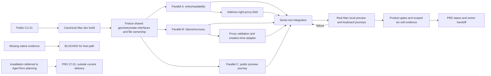

# v0.2.22 — terminal-to-browser preview workflow

Status: `[-]` current-Mac implementation and local validation complete;
cross-target qualification and unrun native courts remain explicit below.
Owner 2026-10-24. Continue from
public 0.2.21 and its closeout on `main`. The owner deferred installation to
later coordinated AgenTerm planning; it is no longer this version's first
delivery. The owner approved a parallel development trial for the complete
visible-entry, readable-chrome and local-preview recovery workflow. Prior
input/navigation repairs remain the baseline, not the whole delivery.
The published baseline and exact evidence belong to the
[0.2.21 release history](../prd/archive/v0.2.21-release-history.md).

## Outcome tree DAG

```text
Outcome: open a local preview from a terminal, understand its state, recover after restarting the service, and resume the terminal draft without memorizing shortcuts
├── [v] ENTRY — current macOS arm64: visible creation and readable shared chrome; PRD 25
│   invariant: the header New menu exposes Terminal and Browser; Browser reuses its single root; terminal row child-creation meaning stays unchanged; text and hit regions remain legible/disjoint
│   evidence: public mouse-only open/reuse journey plus normal/narrow/Retina screenshots and geometry tests
│   safe failure: clipped or overlapping controls fail acceptance; a missing native page never disables terminal creation
│   dependency: shared Layout geometry and the existing tab model; non-goal: multi-browser tabs or a whole-terminal renderer rewrite
├── [v] RECOVERY — current macOS arm64: understandable loading/failure states and explicit recovery; PRD 25/28
│   invariant: pending navigation is visible; failure preserves the attempted URL and offers Retry/Edit address; reasons are classified only from actual evidence and otherwise stay generic
│   evidence: service unavailable -> failure -> start service -> Retry -> ready, followed by a further successful navigation
│   safe failure: bounded timeout, editable URL and immediate terminal access; raw machine reason remains diagnostic data rather than primary user copy
│   dependency: bounded page state and native adapters; non-goal: guessing network causes, installing runtimes or provider sign-in
├── [v] PROXY — current macOS arm64: editable per-browser proxy beside the address; PRD 25.01/28
│   invariant: empty by default; Enter validates and applies an HTTP endpoint to both URL schemes by rebuilding the page; invalid input blocks navigation without direct fallback; Escape discards the edit
│   evidence: local proxy receives a real page request, clearing restores inherited configuration, and invalid input cannot reach the origin
│   safe failure: typed proxy error, preserved URL, editable proxy and usable terminal
│   dependency: shared proxy validation, native creation-time options and shared chrome geometry; non-goal: default proxy, persisted active connection or proxy authentication
├── [v] WEB-SETTINGS — current macOS arm64: Console/Web settings routes and saved proxy choices; PRD 25.01/26
│   invariant: Web adds/removes up to eight validated candidates; the browser combobox applies a saved choice or clears to configured behavior; manual entry remains available; candidates survive restart without becoming an automatic default
│   evidence: settings add -> restart -> dropdown -> real proxy request -> delete -> restart -> empty choices, plus normal/narrow presentation
│   safe failure: invalid/duplicate/full candidates show feedback; an atomic save failure retains the previous list; a missing proxy never disables the terminal
│   dependency: proxy validation, config codec, settings/chrome geometry and overlay authority; non-goal: default proxy, authentication, imported lists or a second settings window
├── [v] PREVIEW — current macOS arm64: terminal/browser/draft continuity; PRD 25/26
│   invariant: Ctrl+click navigates inside the existing Browser; terminal drafts and page input survive switch/return; refresh and close/reopen remain usable
│   evidence: one real local HTTP service journey through public CLI and real Mac window input, recording state and visible pixels
│   safe failure: webpage failure stays local; terminal and its draft remain usable
│   dependency: ENTRY, RECOVERY and completed input/navigation repairs; non-goal: split panels, persistence, downloads, dashboard or wasm
├── [v] MAC-INPUT — observe and repair the selected physical input/focus journeys
│   invariant: page inputs, address editing and terminal drafts each keep their own focus and input; reserved host shortcuts work while WKWebView owns focus
│   evidence: named current-Mac Computer Use observations below; browser_ui regression tests and mac_navigation_keys_are_distinct_from_host_tab_shortcuts
│   safe failure: record the failed journey and keep missing paths BLOCKED
│   dependency: canonical 0.2.21 baseline and PRD 25; non-goal: claiming injected CLI keys prove AppKit interception
├── [v] MAC-NAV — refine observed browser navigation and feedback defects
│   invariant: users can edit an address, navigate, recover from failure, switch tabs and resume without losing drafts or stale page state
│   evidence: native_browser_address_redirect_history_and_failure plus physical first/second-page history, reload and close/reopen observations below
│   safe failure: preserve terminal access and an editable attempted URL
│   dependency: MAC-INPUT and minicon-web adapter boundary; non-goal: dashboard, downloads, provider login or 1:N panels
└── [-] QUALIFY — reconcile owners and qualify the actual development source
    invariant: canonical Dev.app reflects 0.2.22; evidence names actual target/source and separates native keys from host injection
    evidence: formatting/Clippy, public browser journey, full product gate and pre-push six-cell receipt
    safe failure: unavailable courts remain BLOCKED and no release is inferred
    dependency: ENTRY, RECOVERY, PREVIEW, MAC-INPUT and MAC-NAV; non-goal: public 0.2.22 Promotion
```

## Memory palace



## Starting sequence and owners

1. Read `AGENTS.md`, then `PRD.md`. Product priority belongs to
   [PRD 23](../prd/PRD_02_23_minicon.md#distribution-priority): native MiniCon
   is primary, `minicon.com` is the secondary packaging example.
2. Exercise page text input, Cmd/Ctrl+L, address selection/edit/cancel/submit,
   host tab shortcuts, toolbar navigation, resize and terminal switch/return.
   Choose fixes from observed failures, recording before/after evidence.
3. Follow the ownership/parallel contract below. Integrate shared focus/state
   changes and final gates serially. Prove new regression tests by removing
   the behavior they guard before trusting their pass.
4. Use [delivery](../prd/PRD_02_27_con_delivery.md) for budgets and the release
   chain; invoke the registered signing/release skills for operations. Do not
   copy their procedures into this handoff. No 0.2.22 publish decision is implied.
5. If the work touches browser UX or keyboard focus, start at
   [workspace](../prd/PRD_02_25_con_workspace.md); shared/native adapters belong
   to [reuse](../prd/PRD_02_28_shared_core.md) and the
   [horizon](../prd/PRD_02_31_v0_2_horizon.md). CLI/shutdown belongs to
   [control](../prd/PRD_02_26_con_control_cli.md), native evidence to
   [dev courts](../prd/PRD_02_32_dev_loop_crosscheck.md), and resource scheduling
   to [test orchestration](../prd/PRD_02_33_test_orchestration.md).

Native installation and matching README/site commands are deferred to later
owner-led AgenTerm planning ([PRD 27.01](../prd/PRD_02_27_01_install.md)). Size
attribution stays open under PRD 27, outside this browser pass. G4/G6, ARM
proxy/DPI and the remaining browser horizon retain their owners and status.
Current-Mac evidence does not close another platform/ISA. The Mac agent owns
the next version bump and implementation; no release authority is implied.

## Parallel development trial

Start: 2026-10-24 05:08 UTC, baseline `6be7666`. All workers use the existing
`main` checkout, without branches/worktrees or independent commits. Preserve
the unrelated dirty `src/harness_opencode.rs` and `src/harness_wire.rs`.

| Owner | Exclusive write set | Delivery interface |
| --- | --- | --- |
| A — entry/readability | `src/ui.rs`, `src/host_ui.rs`, `src/host_paint.rs` | `Layout::{new_tab_menu,new_terminal_action,new_browser_action,browser_recovery_card,browser_retry,browser_edit_address}(scale)`; paint `ConApp::new_tab_menu_open`; improve role text and state contrast within bounded geometry |
| B — recovery/state | `src/browser_ui.rs`, new `src/browser_feedback.rs`, `crates/minicon-web/src/native_page.rs` if required | `browser_feedback::for_load(&PageLoad, UiLanguage) -> BrowserFeedback {title,detail,failed}` and localized `retry_label`/`edit_label`; `ConApp::retry_browser_page(&PixelWindow)`; native failures only through existing adapter authority |
| C — public journey | `scripts/browser-workspace-smoke.py`, `tests/support/browser_windows.rs` | use published geometry below; prove mouse entry/reuse, unavailable service/retry and draft continuity; no synthetic key receipt may claim native keyboard interception |
| Root — integration and evidence | `src/main.rs`, `src/pointer.rs`, `src/snapshot.rs`, `src/control_dispatch.rs`, proxy editor module, PRD/plan/README/help and any required module declarations | menu lifecycle/routing, recovery button routing, public snapshot geometry, final source review, Computer Use, serial gates and one commit |

Shared prerequisites: retain the single Browser root and existing platform
boundary; add only `new_tab_menu_open: bool` to host state. Snapshot top-level
keys stay fixed. Within `geometry`, publish `new_root`, `new_tab_menu_open`,
`new_terminal_action`, `new_browser_action`; Browser geometry additionally
publishes `browser_retry` and `browser_edit_address`. All rectangles are
physical pixels, converted using `scale_permille` for public UI input.
The root wires menu dismissal before native page hit routing and hides a page
only if an overlay intersects it. Existing settings/history semantics remain.

Workers run only targeted tests in their own files, report mutation red/green,
changed files, dependencies and elapsed work. They do not run workspace fmt,
full gates, package apps, commit, push or edit another owner's files. Root
handles all cross-owner changes after a message-based handoff.

Workflow result must report actual elapsed time, observed overlap, ownership
conflicts/rework and final gate outcomes. There is no comparable serial trial
for this scope, so no speedup percentage may be claimed. Public release still
requires the owner's separate version/publication decision.

## Local observations and regression evidence — 2026-10-24, macOS arm64

- The canonical 0.2.21 baseline lost an unsubmitted address when the owner
  clicked it to place the caret. The 0.2.22 app preserves the draft across
  click/Cmd+L, supports click placement, Shift extension, drag selection and
  composer-style multi-click selection. Actual mouse drag/replacement followed
  by Enter loaded the edited local URL.
- Physical page input -> Cmd+L -> Escape and Ctrl+Shift+[ -> Ctrl+Shift+O
  preserved page text. Baseline Cmd+[ did nothing; the replacement native
  monitor now drives Cmd+[ back and Cmd+] forward between first/second pages.
  Cmd+R caused an independently observed new server request.
- Closing a page-focused Browser tab originally left first responder stranded;
  Ctrl+Shift+O failed until a terminal click. Returning focus before native-page
  destruction fixed the same physical close/reopen sequence without any click.
- Four `browser_ui::tests` passed, then all four failed under deliberate draft
  reset and pointer-selection mutations. The native shortcut test likewise
  failed when Cmd+[ was removed from the native classifier; both controls were
  restored. These are regression evidence, not substitutes for physical events.
- The explicit `native_browser_address_redirect_history_and_failure` public
  CLI court passed with the added unsubmitted-draft click/navigation guard.
  Its log is `target/mac-browser-native-test.log`. This injected court does not
  qualify AppKit interception; that evidence is the physical sequence above.
- Fullscreen kept page/chrome bounds intact; a public HTTPS page loaded with
  matching title/address. Canonical `build.sh dev` now derives app identity and
  version from Cargo and produces `target/debug/MiniCon 0.2.22 Dev.app`.
- The full product gate exposed stale workflow comment links after the 0.2.21
  archive; those three references now point to the archived owner. An inherited
  `RUST_TEST_THREADS=1` also changed the contained-process child probe's stdout
  format. Passing `-- --test-threads=1` to the outer gate avoids contaminating
  that probe's environment; the product's resource limits were unchanged.
- Final product/qualification logs are `target/mac-browser-full-test-final.log`
  and `target-six/receipt.json`. Earlier six-cell work started before the close
  focus repair and cannot be used as final-source evidence. Missing native
  runner courts stay BLOCKED; a passing compile is not a runtime verdict.

## Scope insertion — 2026-10-24

The owner added an optional proxy field to the right of the Browser address.
Proxy defaults remain deferred; candidate-list delivery is accepted in the
settings scope below. The existing three
workers continue with the same exclusive file ownership; root owns editor
routing and page recreation. Empty input uses existing configuration hooks;
a nonempty explicit endpoint overrides both schemes and bypass defaults.
The value is process-local and is never written to settings or public receipts.

## Integration findings and new evidence

- The proxy public journey caught a missing IME ownership guard: a focused
  proxy editor must not require the Browser tab to have a PTY. The failing
  receipt is `target/parallel-proxy-ime-red.log`; `send-ui-ime` now names the
  `browser_proxy` route.
- A true non-loopback HTTP request, entirely served by a loopback proxy,
  exposed macOS ATS rejecting HTTP before any proxy TCP accept. HTTPS produced
  CONNECT immediately. Adding the documented WebView-specific plist policy
  changed the same HTTP court from timeout to `CONNECT ...:80`, `GET /page`
  and pass (`target/parallel-proxy-ats-trace.log`). The embedded executable,
  Dev.app and release app plist carry the same policy. No TLS trust override
  was introduced; shared adapter policy belongs to PRD 28.
- Computer Use exercised New -> Browser, the normal and narrow failure card,
  starting the local HTTP service inside a MiniCon terminal, Retry -> actual
  rendered page, and the retained terminal composer draft. It also exercised
  invalid proxy entry, clearing and recovery. Captures are under
  `target/parallel-preview-ui/`. These are current macOS arm64 observations.
- Visual inspection caught a loaded-but-blank replacement WK child that the
  state-only court could not see. Explicit AppKit subview ordering fixed
  first load and invalid-proxy -> clear -> rendered page without switching
  tabs. The final visible recovery capture is
  `target/parallel-preview-ui/proxy-cleared-final.jpeg`.
- A further negative control removed proxy-error classification. The native
  journey then failed the Edit proxy focus assertion
  (`target/parallel-proxy-edit-red.log`); the classification was restored.

## Settings scope insertion — owner 2026-10-24

The owner moved configurable proxy candidates into this delivery after the
first full product gate passed. Settings exposes Console and Web routes; the
existing Console controls retain their current language/theme/update scope.
Web owns candidate management. The address-right proxy control becomes an
editable combobox: configured behavior is row zero, followed by saved options.
The active proxy remains process-local; only the candidate list is persisted.
Root again owns routing/config integration; A owns its same three UI files;
B owns `crates/minicon-core/src/json.rs` and new `src/web_preferences.rs`;
C owns its same public journey files. Final gates run only after all workers
handoff. Builds and CLI black boxes that share a binary path are serialized.

Additional settings evidence:

- Codec candidates, product normalization and settings/menu geometry passed
  after negative controls failed all 2 + 3 + 2 new unit tests. Logs are
  `target/web-settings-{codec,preferences,ui}-{red,green}.log`.
- Skipping candidate persistence made the real restart journey fail
  (`target/web-settings-persistence-red.log`). A public-path save failure
  (directory at `minicon.json`) retains the old list; removing that rollback
  made its native assertion fail (`target/web-settings-save-failure-red.log`).
- Settings route positions stay fixed across Console/Web and remain usable
  with a collapsed rail. Removing the stable route width failed the geometry
  guard (`target/web-settings-route-position-red.log`).
- Current-Mac Computer Use observed Console/Web, Add via Enter, dropdown
  selection, configured-proxy clearing, deletion and a narrow settings panel.
  Captures are `target/parallel-preview-ui/settings-*.jpeg` and
  `target/parallel-preview-ui/proxy-options.jpeg`. The test candidate was
  removed and the active override cleared after this observation.
- Build/test overlap once replaced `target/debug/minicon` while a native
  fixture spawned the CLI, producing `NotFound`. This was resource interference,
  not a page assertion. Final qualification is fully serial. The durable
  resource contract belongs to PRD 33; workers' independent source ownership
  did not by itself protect the shared build root.

Proxy and settings product facts now have one material-branch owner:
[PRD 25.01](../prd/PRD_02_25_01_browser_preferences.md). PRD 25 remains the
workspace index and native hook history; mechanisms remain in PRD 28.

## Parallel trial result and final qualification

Implementation/local-validation milestone: 2026-10-24 06:02:53 UTC;
54m 2s after the recorded parallel start (05:08:51 UTC).
This includes two owner-requested scope insertions, root integration, physical
Mac inspection and local final gates. Six-cell timings belong to its receipt.

- Three independent source owners overlapped. First-round B handed off at
  05:14:39 UTC and A at 05:15:34 UTC; the settings UI handoff was at
  05:44:48 UTC. The same checkout and ownership contract were reused for the
  proxy and settings insertions. There were no branches, worker commits or
  source-file ownership collisions.
- Integration required waiting for root interfaces, serial guard mutations,
  the CLI IME guard, macOS HTTP policy, native subview ordering and preserving
  omission of an unset config key. A full gate caught that last regression;
  the existing assertion was preserved and the writer fixed. The shared
  executable replacement incident above cost one native run; final runs were
  serialized. Source ownership alone was insufficient resource isolation.
- Full product gate: **1,313 passed**, six intentionally ignored across 37
  suites, versus 1,290 passed and three ignored at the starting local baseline.
  This adds 23 default-executed tests and three explicit native tests. All four
  explicit native browser journeys passed; the final candidate save/delete/
  rollback path was additionally rerun after the config-writer repair.
- Final logs: `target/parallel-final-clippy.log`,
  `target/parallel-final-full-test.log`, `target/parallel-final-native.log`,
  `target/web-settings-native-green.log`, and
  `target/parallel-final-selftest.log`. Seven requested script self-tests passed;
  the three unrequested UTM-court self-tests are **BLOCKED/unrun**, not passes.
- `target/parallel-final-app-smoke/receipt.json` passed all entry, recovery,
  proxy and candidate restart/delete obligations, with seven owned-window
  captures. Its hash matches the canonical Dev.app payload. Injected host keys
  still do not claim physical WKWebView interception; that evidence remains
  the separate Computer Use observations.
- Pre-push six-cell authority is `target-six/receipt.json`: inspect every stage,
  require zero FAIL and source-stability PASS, and retain missing native
  runners as BLOCKED. Compilation never closes the new native preference
  courts on Intel macOS, Windows or Linux.
- The inherited dirty harness files were preserved and excluded from this
  change's commit. Qualification binds the whole recorded working-tree hash,
  including those pre-existing files, and is not clean release-source evidence.
  No signing, Candidate, Promotion or public publication was requested.

There is no equivalent serial trial for this changing scope, so this result
claims neither a speedup percentage nor that all development became parallel.
The durable shared-resource rule is owned by PRD 33.
