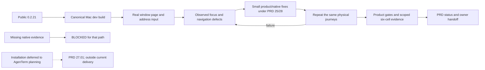

# v0.2.22 — macOS browser daily-use refinement

Status: `[-]` local investigation started, owner 2026-10-24. Continue from
public 0.2.21 and its closeout on `main`. The owner deferred installation to
later coordinated AgenTerm planning; it is no longer this version's first
delivery. Build the current native browser and observe real Mac interactions.
The published baseline and exact evidence belong to the
[0.2.21 release history](../prd/archive/v0.2.21-release-history.md).

## Outcome tree DAG

```text
Outcome: the native browser is comfortable and predictable to use beside terminals on the current Mac
├── [v] MAC-INPUT — observe and repair the selected physical input/focus journeys
│   invariant: page inputs, address editing and terminal drafts each keep their own focus and input; reserved host shortcuts work while WKWebView owns focus
│   evidence: named current-Mac Computer Use observations below; browser_ui regression tests and mac_navigation_keys_are_distinct_from_host_tab_shortcuts
│   safe failure: record the failed journey and keep missing paths BLOCKED
│   dependency: canonical 0.2.21 baseline and PRD 25; non-goal: claiming injected CLI keys prove AppKit interception
├── [v] MAC-NAV — refine observed browser navigation and feedback defects
│   invariant: users can edit an address, navigate, recover from failure, switch tabs and resume without losing drafts or stale page state
│   evidence: native_browser_address_redirect_history_and_failure plus physical first/second-page history, reload and close/reopen observations below
│   safe failure: preserve terminal access and an editable attempted URL
│   dependency: MAC-INPUT and minicon-web adapter boundary; non-goal: dashboard, downloads, provider login or 1:N panels
└── [-] QUALIFY — reconcile owners and qualify the actual development source
    invariant: canonical Dev.app reflects 0.2.22; evidence names actual target/source and separates native keys from host injection
    evidence: formatting/Clippy, public browser journey, full product gate and pre-push six-cell receipt
    safe failure: unavailable courts remain BLOCKED and no release is inferred
    dependency: MAC-INPUT and MAC-NAV; non-goal: public 0.2.22 Promotion
```

## Memory palace



## Starting sequence and owners

1. Read `AGENTS.md`, then `PRD.md`. Product priority belongs to
   [PRD 23](../prd/PRD_02_23_minicon.md#distribution-priority): native MiniCon
   is primary, `minicon.com` is the secondary packaging example.
2. Exercise page text input, Cmd/Ctrl+L, address selection/edit/cancel/submit,
   host tab shortcuts, toolbar navigation, resize and terminal switch/return.
   Choose fixes from observed failures, recording before/after evidence.
3. Hot files are `src/browser_ui.rs`, `src/host_paint.rs`, `src/ui.rs`,
   `crates/minicon-web/src/native_page.rs` and its macOS shortcut monitor.
   Their shared focus and state make integration serial. Prove new regression
   tests by removing the behavior they guard before trusting their pass.
4. Use [delivery](../prd/PRD_02_27_con_delivery.md) for budgets and the release
   chain; invoke the registered signing/release skills for operations. Do not
   copy their procedures into this handoff. No 0.2.22 publish decision is implied.
5. If the work touches browser UX or keyboard focus, start at
   [workspace](../prd/PRD_02_25_con_workspace.md); shared/native adapters belong
   to [reuse](../prd/PRD_02_28_shared_core.md) and the
   [horizon](../prd/PRD_02_31_v0_2_horizon.md). CLI/shutdown belongs to
   [control](../prd/PRD_02_26_con_control_cli.md), native evidence to
   [dev courts](../prd/PRD_02_32_dev_loop_crosscheck.md), and resource scheduling
   to [test orchestration](../prd/PRD_02_33_test_orchestration.md).

Native installation and matching README/site commands are deferred to later
owner-led AgenTerm planning ([PRD 27.01](../prd/PRD_02_27_01_install.md)). Size
attribution stays open under PRD 27, outside this browser pass. G4/G6, ARM
proxy/DPI and the remaining browser horizon retain their owners and status.
Current-Mac evidence does not close another platform/ISA. The Mac agent owns
the next version bump and implementation; no release authority is implied.

## Local observations and regression evidence — 2026-10-24, macOS arm64

- The canonical 0.2.21 baseline lost an unsubmitted address when the owner
  clicked it to place the caret. The 0.2.22 app preserves the draft across
  click/Cmd+L, supports click placement, Shift extension, drag selection and
  composer-style multi-click selection. Actual mouse drag/replacement followed
  by Enter loaded the edited local URL.
- Physical page input -> Cmd+L -> Escape and Ctrl+Shift+[ -> Ctrl+Shift+O
  preserved page text. Baseline Cmd+[ did nothing; the replacement native
  monitor now drives Cmd+[ back and Cmd+] forward between first/second pages.
  Cmd+R caused an independently observed new server request.
- Closing a page-focused Browser tab originally left first responder stranded;
  Ctrl+Shift+O failed until a terminal click. Returning focus before native-page
  destruction fixed the same physical close/reopen sequence without any click.
- Four `browser_ui::tests` passed, then all four failed under deliberate draft
  reset and pointer-selection mutations. The native shortcut test likewise
  failed when Cmd+[ was removed from the native classifier; both controls were
  restored. These are regression evidence, not substitutes for physical events.
- The explicit `native_browser_address_redirect_history_and_failure` public
  CLI court passed with the added unsubmitted-draft click/navigation guard.
  Its log is `target/mac-browser-native-test.log`. This injected court does not
  qualify AppKit interception; that evidence is the physical sequence above.
- Fullscreen kept page/chrome bounds intact; a public HTTPS page loaded with
  matching title/address. Canonical `build.sh dev` now derives app identity and
  version from Cargo and produces `target/debug/MiniCon 0.2.22 Dev.app`.
- The full product gate exposed stale workflow comment links after the 0.2.21
  archive; those three references now point to the archived owner. An inherited
  `RUST_TEST_THREADS=1` also changed the contained-process child probe's stdout
  format. Passing `-- --test-threads=1` to the outer gate avoids contaminating
  that probe's environment; the product's resource limits were unchanged.
- Final product/qualification logs are `target/mac-browser-full-test-final.log`
  and `target-six/receipt.json`. Earlier six-cell work started before the close
  focus repair and cannot be used as final-source evidence. Missing native
  runner courts stay BLOCKED; a passing compile is not a runtime verdict.
