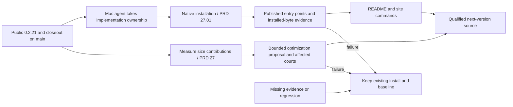

# v0.2.22 — Mac handoff after public 0.2.21

Status: `[_]` implementation not started. Owner instruction, 2026-10-24:
publish 0.2.21, then a Mac agent takes over the next version. Pull the release
closeout on `main` before starting; do not work from an earlier local binary.
The published baseline and exact evidence belong to the
[0.2.21 release history](../prd/archive/v0.2.21-release-history.md).

## Outcome tree DAG

```text
Outcome: users can install and evaluate native MiniCon from their system's command line
├── [_] Native installation — PRD 27.01
│   invariant: select and verify the matching published native artifact
│   evidence: the owner's published-script and installed-byte courts
│   safe failure: preserve the previous installation
│   dependency: public 0.2.21; non-goal: making the APE the default product
├── [_] README and site adoption — PRD 27.01
│   invariant: documented commands match the tested installation entry points
│   evidence: README index/en/zh and site locales point to working commands
│   safe failure: retain accurate manual download instructions
│   dependency: installation evidence; non-goal: a second installer implementation
└── [_] Feature-preserving size optimization — PRD 27
    invariant: measure native/helper/APE contributions before choosing a change
    evidence: before/after bytes plus the affected runtime/artifact courts
    safe failure: keep the qualified baseline if behavior regresses
    dependency: published baseline; non-goal: silently increasing the byte ceiling
```

## Memory palace



## Starting sequence and owners

1. Read `AGENTS.md`, then `PRD.md`. Product priority belongs to
   [PRD 23](../prd/PRD_02_23_minicon.md#distribution-priority): native MiniCon
   is primary, `minicon.com` is the secondary packaging example.
2. Implement the accepted [installation branch](../prd/PRD_02_27_01_install.md)
   before publishing its README/site commands. That module owns entry points,
   platform selection, trust, replacement and evidence requirements.
3. Inventory shared prerequisites and hot files before delegating. The installer
   and documentation share one interface; independent size attribution can run
   beside them. Integrate and run final gates serially.
4. Use [delivery](../prd/PRD_02_27_con_delivery.md) for budgets and the release
   chain; invoke the registered signing/release skills for operations. Do not
   copy their procedures into this handoff. No 0.2.22 publish decision is implied.
5. If the work touches browser UX or keyboard focus, start at
   [workspace](../prd/PRD_02_25_con_workspace.md); shared/native adapters belong
   to [reuse](../prd/PRD_02_28_shared_core.md) and the
   [horizon](../prd/PRD_02_31_v0_2_horizon.md). CLI/shutdown belongs to
   [control](../prd/PRD_02_26_con_control_cli.md), native evidence to
   [dev courts](../prd/PRD_02_32_dev_loop_crosscheck.md), and resource scheduling
   to [test orchestration](../prd/PRD_02_33_test_orchestration.md).

G4/G6, unobserved Mac page-focused physical shortcuts, ARM proxy/DPI and the
remaining browser horizon retain their existing owners and status. A 0.2.21
release decision is not new test evidence. The Mac agent owns the next version
bump and implementation; this handoff changes no product source or policy.
