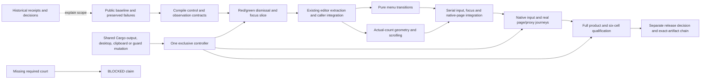

# v0.2.23 — consistent browser controls

Status: `[_]` feature implementation not started. Planning refined at the
owner's request on 2026-10-24, using exploration of public 0.2.22. This plan
does not authorize another public version. Installation remains deferred for
coordinated AgenTerm planning.

Behavior belongs to [browser controls](../prd/PRD_02_25_02_browser_controls.md)
and [preferences](../prd/PRD_02_25_01_browser_preferences.md). Public observation
belongs to [control](../prd/PRD_02_26_con_control_cli.md), reusable mechanisms to
[PRD 28](../prd/PRD_02_28_shared_core.md), qualification to
[PRD 32](../prd/PRD_02_32_dev_loop_crosscheck.md), resource scheduling to
[PRD 33](../prd/PRD_02_33_test_orchestration.md), and delivery to
[PRD 27](../prd/PRD_02_27_con_delivery.md). This file owns sequencing and gates.

## Outcome tree DAG

```text
Outcome: edit browser controls and choose actions predictably with keys or pointer
├── [v] BASELINE — public 0.2.22 and compact current context
│   invariant: released evidence and unresolved scope retain their original owners
│   evidence: 0.2.22 release history, archived implementation plan and current PRD index
│   safe failure: no older receipt qualifies changed source
│   dependency: release closeout; non-goal: repeating completed publication gates
├── [_] CONTRACT — compile the control and observation seams
│   invariant: field effects, event consumption, focus return, menu state and geometry share one contract
│   evidence: compilable caller seam and focused pure transition checks
│   safe failure: retain existing callers until the seam compiles
│   dependency: PRD 25.02 and PRD 26; non-goal: a generic UI framework
├── [_] DISMISS — first complete public regression
│   invariant: closing a proxy menu cannot activate the underlying Back action
│   evidence: B22-MENU-DISMISS becomes an assertion-bearing red/green public journey
│   safe failure: stop at the failing focus/routing boundary
│   dependency: CONTRACT and explicit gesture ownership; non-goal: native overlay redesign
├── [_] EDIT — consistent bounded editing with field-specific actions
│   invariant: PRD 25.02 draft, selection, bounds and IME rules hold for all three fields
│   evidence: field matrix below, including selected-text replacement at the bound
│   safe failure: rejected edits preserve the prior draft and cannot reach the PTY
│   dependency: CONTRACT/DISMISS; non-goal: merging composer/notes policy
├── [_] MENU / LAYOUT — complete entry, navigation and viewport handling
│   invariant: PRD 25.02 keyboard entry, distinct highlight/applied state and readable rows agree
│   evidence: keyboard-only entry; zero/one/eight candidates; shared geometry observations
│   safe failure: dismissal never commits; no usable viewport means bounded feedback
│   dependency: CONTRACT, EDIT integration seam and existing responsive toolbar
│   non-goal: extra Browser roots, another dialog or a whole-host layout rewrite
├── [_] NATIVE — actual page/control boundary
│   invariant: rendered page, state, focus and proxy effects agree within each measured scope
│   evidence: native input matrix, real service/proxy requests, restart and error recovery
│   safe failure: unavailable required evidence is BLOCKED for that claim
│   dependency: EDIT/MENU/LAYOUT, PRD 26 observations and PRD 28 adapters
│   non-goal: provider OAuth, downloads, defaults, dashboard/wasm or 1:N panels
└── [_] QUALIFY — integrate, qualify exact source, then seek a release decision
    invariant: mechanism tests, native input and signed/public artifact evidence stay distinct
    evidence: mutation results, full product gate and six-cell qualification
    safe failure: retain the public baseline when a selected gate fails
    dependency: all delivery leaves; non-goal: automatic 0.2.23 publication
```

## Memory palace



## Starting evidence and scope

- [v] Public 0.2.22, exact source/signatures/Defender/download smoke and retained
  failures are owned by its [release history](../prd/archive/v0.2.22-release-history.md).
  Its [archived plan](archive/plan-v0.2.22.md) preserves implementation and trial
  evidence. Do not schedule that closeout again.
- The new menu observations and their input-method limits belong to
  [PRD 25.02's baseline section](../prd/PRD_02_25_02_browser_controls.md#observed-0222-starting-failures--windows-x86_64-2026-10-24).
  B22-MENU-DISMISS is the first regression; B22-MENU-KEYS anchors keyboard work.
  The selected-replacement size issue is still a source-inspection hypothesis.
- Retain one Browser root, existing adapters and proxy page-recreation/refusal
  semantics. Saved candidates do not become defaults. Keep terminal connectivity,
  drafts and existing language/theme/update scope intact.
- G4/G6, modern-agent/session qualification, RSS/size work and broader browser
  features retain their existing owners. Cleanup and this plan do not close them.

## Delivery sequence and stop conditions

| Step | Deliverable / evidence | Gate before proceeding |
| --- | --- | --- |
| 0 — inventory | Name the source, native artifacts, current runner/input availability and public regression identities | Distinguish planned work from unavailable evidence; no stale-source reuse |
| 1 — CONTRACT | Compile shared event ownership/effect, focus return and menu/geometry observation seams; reconcile complete injected chords through PRD 26; keep navigation/save/application in callers | An ignored/unchanged edit cannot imply routing the key to another owner; freeze public schema and press/release lifecycle before consumers |
| 2 — DISMISS | Reproduce B22-MENU-DISMISS through the public CLI; add the failing assertion, then integrate dismissal and native focus return | Same click cannot navigate; restoring old fall-through behavior or removing the new gesture-consumption guard makes the same assertion fail again |
| 3 — EDIT | Extract existing dispatch with behavior preserved, integrate one field, then the other two; prove the field matrix | Each field still owns Submit/Cancel and native IME; reproduce boundary hypotheses before claiming fixes |
| 4 — MENU / LAYOUT | Implement pure transitions and actual-count geometry against the frozen seam | Assign independent lanes only if file ownership and evidence are independent |
| 5 — integration | Serial caller/paint/snapshot/native visibility integration; keyboard-only entry and real proxy journeys | Highlight is not application; dismissal/repeat/resize cannot leak an extra action |
| 6 — QUALIFY | Format, strict Clippy, named failing-first/mutation courts, full product gate, six-cell evidence | Record schedule, source, features, counts and unavailable courts; filtered suites do not imply ignored native tests ran |
| 7 — release consideration | Upsert observed behavior/status into owners and present remaining scope | Separate owner decision before Candidate/publication; follow PRD 27 and registered skills |

The implementation owner bumps Cargo/lock/policy and canonical Dev.app examples
together when feature work starts. Verify wrapper payload identity. This
planning change does not bump the version or generate a new product binary.
Run selected Windows (both ISAs) and Linux native browser/preference courts early,
including profile isolation, before spending time on the final pack.

## Regression and evidence matrix

| Court | Observable acceptance | Evidence method |
| --- | --- | --- |
| DISMISS | Menu -> outside Back/Reload/another trigger dismisses only; Escape restores the recorded field/selection or page | Public state and real navigation observations; native focus separately |
| FIELD | All three fields: refocus, selection/copy/cut/paste, Submit/Cancel, invalid input and independent terminal draft | Pure mechanism plus public CLI; field actions follow the PRD 25.02 table |
| BOUND | Normalized input below/at/above each field bound; whole/partial selected replacement; no destructive rejection | Public reproduction, focused guard mutation and unchanged prior state |
| IME | Preedit/commit stays at the active field; confirming composition does not also Submit; anchors survive focus/resize | Actual native input on each claimed path; CLI IME injection is separate evidence |
| MENU | Page -> keyboard-only entry -> navigation -> one commit/cancel; no mouse-assisted opening; hover/highlight does not apply | Pure action-count checks, public state and native keyboard path |
| GEOMETRY | Zero/one/eight candidates, normal/narrow/short windows, sidebar collapse and scale 1/1.5/2; readable scrolling, retained drafts | Shared geometry checks plus actual owned-window pixels and pointer hits |
| PREFERENCES | Real proxy applies/clears/refuses, saved choices restart/delete, manual non-list value and failed-save rollback retain released semantics | Public local service/proxy and isolated config/profile; no provider credentials |
| ARTIFACT | Selected control/browser behavior runs on all six exact native payloads and policy-required signed transformations | PRD 27/32 courts; development bytes do not qualify release bytes |

Unit checks count menu effects; black boxes observe real connection/page state.
Use PRD 26's complete logical chord contract for public menu keys; the old
Pressed-only injection cannot qualify release-sensitive gesture ownership.
Do not equate one application action with exactly one HTTP request: an engine
may make favicon or other subrequests. Use bounded polling within the replay
cache and retain the final failed observation.

For every native-input result, name OS/ISA, binary/source, native keyboard vs
host injection, IME method, scale and observed scope. All new-version rows start
`[_]`; mark a required unavailable court `BLOCKED`, never skipped. A neighboring
ISA, successful CLI injection or PNG cannot certify that input path. Inventory
missing access early and obtain an explicit scope decision before release
consideration; do not silently lower the selected acceptance.

## Ownership and dynamic parallel work

| Lane | Exclusive source / integration boundary | Join evidence |
| --- | --- | --- |
| Controller | `src/main.rs`, field callers (`browser_ui.rs`, `browser_proxy_ui.rs`, `web_settings_ui.rs`), `new_tab_menu.rs`, painters, snapshots and native fixtures | Compiled shared seam, first dismissal slice and final native integration |
| Editing mechanism, when independent | Proposed `src/host_editor.rs`; reuse existing composer/keymap mechanisms | Bounded effects and selection/IME behavior; no navigation, save or proxy side effects |
| Menu mechanism, when independent | Proposed `src/browser_menu.rs` | Entry/highlight/commit/dismiss transitions and consumed gestures |
| Geometry, when independent | `src/ui.rs` | Actual-count/viewport/scroll geometry consumed by paint, hits, IME and snapshot |

Start with the controller's vertical slice. Add workers only after the seam
compiles and exclusive files are agreed; combine tiny leaves when delegation
would cost more than it saves. Workers hand off source and evidence without
editing controller-owned callers to make their build pass. The controller
serializes integration, guard mutations and final gates.

Separate files do not isolate the Cargo output root, canonical executable,
desktop or clipboard. One controller schedules builds and any black box that
spawns those bytes; native UI/input and mutation courts hold that resource
exclusively. PRD 33 owns the durable scheduling rules.

## Documentation closeout

Update behavior and observed status in the owning PRD before archiving this
plan. Keep current entrypoints compact, preserve historical failures/PNG and
leave unresolved obligations with their owners. Diagnostic output belongs in
ignored build state. Do not use planning cleanup to delete inherited work,
vendor runtime bytes or caches, or to change the independent Surf/PageSession
consumer boundary in PRD 28.
