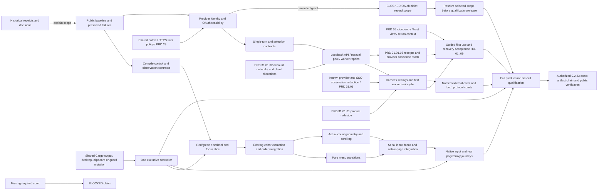

# v0.2.23 — browser controls and the first harness connection

Status: `[-]` implementation active. Planning refined at the
owner's request on 2026-10-24, using exploration of public 0.2.22 and the
subsequent Harness/provider-pool direction. Scope is the first working model
connection through a multi-account pool, per-account networks, keyed client
allocations and basic usage/balance monitoring; future llm-gate/ujs/tinyvm scheduling
is outside this version. The owner's subsequent goal explicitly authorizes
development through **public 0.2.23**, subject to the selected evidence gates;
no second publication approval is needed for that named version. Installation remains deferred for
coordinated AgenTerm planning.

Owner feedback on 2026-10-25 reopens the Harness product experience before
publication. The [redesign sequence](#harness-product-redesign-before-publication)
is the next Harness work; successful signing/Candidate/scan/dry-run preparation
does not close product acceptance or authorize publishing the rejected experience.

Behavior belongs to [browser controls](../prd/PRD_02_25_02_browser_controls.md)
and [preferences](../prd/PRD_02_25_01_browser_preferences.md). Harness settings,
provider accounts, the inference API and the future selection seam belong to
[provider gateway](../prd/PRD_02_31_01_provider_gateway.md); the existing worker
and its tool budgets belong to [horizon](../prd/PRD_02_31_v0_2_horizon.md).
Harness information architecture, first use, state and recovery belong to
[connection experience](../prd/PRD_02_31_01_01_harness_experience.md). Multi-account
networks and keyed allocations belong to [provider pool](../prd/PRD_02_31_01_02_provider_pool.md);
statistics, balances and allowance belong to [monitoring](../prd/PRD_02_31_01_03_usage_monitoring.md).
The robot entry and operational host view belong to
[PRD 36](../prd/PRD_02_36_harness_workspace.md), sequenced by
[the Harness workspace plan](plan-harness-workspace.md). This version selects
its H0 entry/overview/deep-link reservation and available H1 projections;
the later H2 task-operation UI is not silently included in this release.
The newly requested [cluster horizon](../prd/PRD_02_37_cluster_horizon.md#未来构想)
starts subsequent-version design under [its plan](plan-cluster-horizon.md),
without adding cluster implementation to 0.2.23's selected delivery.
Public observation
belongs to [control](../prd/PRD_02_26_con_control_cli.md), reusable mechanisms to
[PRD 28](../prd/PRD_02_28_shared_core.md), qualification to
[PRD 32](../prd/PRD_02_32_dev_loop_crosscheck.md), resource scheduling to
[PRD 33](../prd/PRD_02_33_test_orchestration.md), and delivery to
[PRD 27](../prd/PRD_02_27_con_delivery.md). This file owns sequencing and gates.

## Outcome tree DAG

```text
Outcome: operate browser controls predictably and connect a model account to a local harness
├── [v] BASELINE — public 0.2.22 and compact current context
│   invariant: released evidence and unresolved scope retain their original owners
│   evidence: 0.2.22 release history, archived implementation plan and current PRD index
│   safe failure: no older receipt qualifies changed source
│   dependency: release closeout; non-goal: repeating completed publication gates
├── [-] CONTRACT — compile the control and observation seams
│   invariant: field effects, event consumption, focus return, menu state and geometry share one contract
│   evidence: compilable caller seam and focused pure transition checks
│   safe failure: retain existing callers until the seam compiles
│   dependency: PRD 25.02 and PRD 26; non-goal: a generic UI framework
├── [v] DISMISS — first complete public regression
│   invariant: closing a proxy menu cannot activate the underlying Back action
│   evidence: B22-MENU-DISMISS public baseline RED, development GREEN, guard removal RED and restored GREEN (PRD 25.02)
│   safe failure: stop at the failing focus/routing boundary
│   dependency: CONTRACT and explicit gesture ownership; non-goal: native overlay redesign
├── [-] EDIT — consistent bounded editing with field-specific actions
│   invariant: PRD 25.02 draft, selection, bounds and IME rules hold for all three fields
│   evidence: field matrix below, including selected-text replacement at the bound
│   safe failure: rejected edits preserve the prior draft and cannot reach the PTY
│   dependency: CONTRACT/DISMISS; non-goal: merging composer/notes policy
├── [-] MENU / LAYOUT — complete entry, navigation and viewport handling
│   invariant: PRD 25.02 keyboard entry, distinct highlight/applied state and readable rows agree
│   evidence: keyboard-only entry; zero/one/eight candidates; shared geometry observations
│   safe failure: dismissal never commits; no usable viewport means bounded feedback
│   dependency: CONTRACT, EDIT integration seam and existing responsive toolbar
│   non-goal: extra Browser roots, another dialog or a whole-host layout rewrite
├── [-] NATIVE — actual page/control boundary
│   invariant: rendered page, state, focus and proxy effects agree within each measured scope
│   evidence: native input matrix, real service/proxy requests, restart and error recovery
│   safe failure: unavailable required evidence is BLOCKED for that claim
│   dependency: EDIT/MENU/LAYOUT, PRD 26 observations and PRD 28 adapters
│   non-goal: provider OAuth, downloads, defaults, dashboard/wasm or 1:N panels
├── [-] HARNESS-CONNECT — first shared inference path, not a scheduler
│   invariant: PRD 31.01 API serves independent client allocations over isolated account/network identities
│   evidence: verified provider login/inference; PP-01..06; both protocols; real file/exec and one named external client
│   safe failure: unverified OAuth is BLOCKED; transport-only API-key evidence is labeled separately
│   dependency: auth feasibility, single-turn/streaming seam and worker lifecycle repairs
│   non-goal: automatic pool rotation, llm-gate, ujs/tinyvm integration or all-client compatibility
├── [_] HARNESS-MONITOR — attribute usage and show account balance/allowance
│   invariant: local receipts and provider-authoritative snapshots retain their source and coverage
│   evidence: PRD 31.01.03 UM-01..06; real supported account reads and unknown/partial failures
│   safe failure: bounded monitoring with no model request, fake zero or auto-top-up
│   dependency: account/profile/network identity and provider metadata contracts
│   non-goal: invoice management, rich analytics or automatic quota scheduling
├── [_] HARNESS-EXPERIENCE — apply the owner's product feedback before release
│   invariant: PRD 31.01.01 guides account -> verified model -> local tool with truthful results
│   evidence: HU-01..09, including a continuous first-use and recovery journey
│   safe failure: preserve the applied binding and show the affected step's recovery
│   dependency: existing HARNESS-CONNECT mechanisms, shared controls and typed state
│   non-goal: another agent loop, new runtime, duplicate Settings window or new provider scope
├── [_] HARNESS-ENTRY — robot immediately left of Settings and one operational view
│   invariant: H0 navigation preserves Console/Web context and reads actual runtime state
│   evidence: PRD 36 HW-01/02/03/06/07, Settings HU-10/11 and selected PP/UM projections
│   safe failure: useful setup/unavailable states; no task/service/login side effects on entry
│   dependency: host view/header/focus seam, profile IDs and existing settings/runtime owners
│   non-goal: the later H2 task launcher, arbitrary external harness control or a new engine
└── [_] QUALIFY — integrate, qualify exact source, then publish authorized 0.2.23
    invariant: mechanism tests, native input and signed/public artifact evidence stay distinct
    evidence: mutation results, full product gate and six-cell qualification
    safe failure: retain the public baseline when a selected gate fails
    dependency: all delivery leaves; non-goal: publishing incomplete or unqualified selected scope
```

## Memory palace



## Starting evidence and scope

- [v] Public 0.2.22, exact source/signatures/Defender/download smoke and retained
  failures are owned by its [release history](../prd/archive/v0.2.22-release-history.md).
  Its [archived plan](archive/plan-v0.2.22.md) preserves implementation and trial
  evidence. Do not schedule that closeout again.
- The new menu observations and their input-method limits belong to
  [PRD 25.02's baseline section](../prd/PRD_02_25_02_browser_controls.md#observed-0222-starting-failures--windows-x86_64-2026-10-24).
  B22-MENU-DISMISS is the first regression; B22-MENU-KEYS anchors keyboard work.
  The selected-replacement size issue is now a reproduced mechanism failure with a passing shared editor and public three-field journey; scoped evidence is retained by that owner.
- Retain one Browser root, existing adapters and proxy page-recreation/refusal
  semantics. Saved candidates do not become defaults. Keep terminal connectivity,
  drafts and existing language/theme/update scope intact.
- G4/G6, modern-agent/session qualification, RSS/size work and broader browser
  features retain their existing owners. Cleanup and this plan do not close them.

## Version sequence and scope gates

| Stage | Deliverable / decision | Exit evidence |
| --- | --- | --- |
| 0 — identity and feasibility | Confirm DeepSeek API and hosted OpenCode Console/Go service identities; establish supported OAuth client/grant/refresh, or record why unavailable | A provider-specific feasibility record: official contract and real inference where available, otherwise a named BLOCKED OAuth requirement; independent mechanism work can continue |
| 1 — shared contracts | Freeze a single model-turn request/event seam, manual selector, account identity and worker/API authority separation | Compiling seams; no gateway path can invoke file/exec; future selector replacement needs no protocol rewrite |
| 2 — first vertical slice | One account/model -> local Chat Completions -> existing worker -> one file/exec task; explicit Start/Stop and local client key | Real supported provider response and tool-result round trip; refusal/cancel/output/descendant courts |
| 3 — complete the small product | Add Harness route, second provider adapter, account list/manual selection and Anthropic Messages; real SSE and connection recipe | Both protocol black boxes; account/login lifecycle; real named external client; native route/focus/state/pixels |
| 4 — integrate selected scope | Join browser control work and Harness settings serially; reconcile carried auth/client limitations | No regression in Console/Web or terminal drafts; every selected capability has named evidence |
| 5 — qualification | Format/Clippy, required product gates, six-cell and native account/settings/network courts on selected scope | Exact source, counts, native scopes, no credential leakage, bounded idle/active cost; absent court stays BLOCKED |
| 6 — publish and closeout | Update owners, run the skill-directed exact-artifact release chain for authorized 0.2.23, verify public downloads and archive evidence | All selected scope qualified; no claim that a transport demonstration completes OAuth; no rebuild during Promotion |

Stages 0 and the first browser dismissal slice may progress independently.
An unavailable grant blocks that provider's delivery claim, not synthetic
protocol work or contract compilation after service identity is established.
After Stage 1, protocol/selection work can progress without owning the desktop;
GUI settings waits for the common editor/route seam. One controller owns the
worker single-turn extraction, CLI dispatch, shared callers and final joins.
Do not create workers for tiny leaves or parallelize against the same hot files.

**Release scope rule:** the connection target includes both named providers and
their requested OAuth experience. If a grant cannot be established, record the
exact missing contract and finish independent mechanism/control work; report
the incomplete auth scope before release selection. A reduced API-key-only
demonstration or moving connection work to a later version is a scope change,
not something this plan silently decides. The user need not design endpoints,
PKCE, streaming or selection details to let feasibility work proceed.

**First-path cut:** omit automatic failover/rotation, invoice/payment administration,
cross-provider model substitution, all-client presets, Responses/Codex claims,
dynamic engine packaging and OS services. Do not omit cancellation, private
credentials, real streaming/tool linkage or worker cleanup merely to obtain a
successful hello-world response. Behavior and initial limits have one owner
in PRD 31.01 and the worker module, rather than another contract in this plan.

### Current integration checkpoint (2026-10-25)

The [provider owner](../prd/PRD_02_31_01_provider_gateway.md#real-account-checkpoint-and-worker-defects-2026-10-25)
records the actual DeepSeek grant/probe, retained worker failures and the
repaired ordinary-task checkpoint, including the named Pi client's actual
tool/SSE/cancellation journey. Completion instructions, Windows cwd adaptation,
shared native HTTPS trust policy and observed SSO redaction have joined the
development source. The six native development cells passed at `403dbf48`;
the scoped index is
`target-six/v0.2.23-provider/ci-403dbf48-six-cell-index.json`. That run does not
replace the complete product wrapper or final artifact courts. Before the next
source freeze, include the expanded artifact browser-smoke entry, then qualify
the selected payloads with it. Its existing control/Harness journeys now have a passing
Windows development run, and exposed a browser-first injected-IME defect
that the [control owner](../prd/PRD_02_26_con_control_cli.md) records with its
repair. The `403dbf48` six-cell source checkpoint precedes that repair and is
not final-source proof for it. Retain the cancelled `40126457516` unsigned-pack
attempt as history; no Candidate was sealed from it.
Root serializes Cargo, guard mutations and final integration. OpenCode account
login is waiting for the owner in the
browser; the physical keyboard court and full local workspace gate also wait
for a preservable clipboard (the current unsupported formats were not changed).
Finish those selected account/native interaction obligations and matching
exact-source delivery gates. The prior
`7694388` pack and signatures are a scoped checkpoint, not reusable proof for
changed source. No Candidate has been sealed from that checkpoint.

### Harness product redesign before publication

Behavior and acceptance IDs belong to
[experience HU-01..09](../prd/PRD_02_31_01_01_harness_experience.md),
[pool PP-01..06](../prd/PRD_02_31_01_02_provider_pool.md) and
[monitoring UM-01..06](../prd/PRD_02_31_01_03_usage_monitoring.md). This sequence
implements that design; it does not replace the two-provider, protocol, worker,
native-input or scaling obligations selected elsewhere in this plan.

The exact `10237e8e382a9c2c3d9cd3e2eaaa4e9f00e544f7` implementation reached
internal Candidate `40130115929`, measured Defender `40130309812`, reputation
`40130431408` and dry-run `40130527092`, all successful. The ignored handoff
index is `target-six/v0.2.23-provider/handoff-current.json`; independent audits
are under `ci-sign-10237e8/` and `defender-10237e8/`. These are machine release
preparation for the earlier experience, not public 0.2.23 or proof of the new
design. Retain the sealed bytes as a historical checkpoint. Product changes
require matching new-source qualification and a new Candidate; do not rebuild
or overwrite that sealed Candidate, and do not publish it to bypass feedback.

| Order / status | Delivery slice | Exit evidence / dependency |
| --- | --- | --- |
| 0 `[-]` — pool and state contracts | Account/network identity, keyed profiles, aliases, immutable attribution and operation-local observations; host destination/return and Settings deep links; migrate existing default binding/key | Partial backend migration/key/alias/session proof in PP-04..06; network/attribution/host-destination seams and HU-01/09/10/11 remain open |
| 1 `[_]` — account authorization | Isolated contexts for two DeepSeek accounts and OpenCode Go; account labels and explicit login/service proxy choices; host-owned result and retry | HU-02 and PP-01..03; real supported grants, observed proxy paths, no inherited cookie/credential crossover; Google-login visibility recorded without assuming inference proxy needs |
| 2 `[-]` — client allocation and model apply | Create independent profiles/keys, account-scoped aliases and bounded picker, explicit verification and transactional apply | Partial backend routing/shared-limit/scoped-revoke proof in PP-04..06; profile-management UI, HU-03/04 and verified transactional apply remain open |
| 3 `[_]` — usage and provider readings | Capture terminal usage before adapter normalization, bounded local history/summary, credential-compatible balance/quota reads and explicit/opt-in monitoring | UM-01..06; no double-counted stream usage, no fabricated zero balance/cost, no model-call polling; unsupported exact grants remain BLOCKED for that capability |
| 4 `[-]` — complete handoff and H0 | Explicit shared service enable, per-profile key setup and recipes; robot left of Settings, real overview/empty states, back navigation and precise configuration links | HU-05/06/10/11 and HW-01/02/03; H0 development checkpoint in PRD 36; actual tasks work through recipes; opening robot has no start side effect; H2 visual task operation stays later |
| 5 `[_]` — integrated product acceptance | Account lifecycle, selected languages, narrow/native input, account attention and stop/reopen recovery | HU-07..09 plus continuous first use and the three-account/multiple-client scenario; preserve all selected browser/native/scale obligations |
| 6 `[_]` — qualify changed source | Upsert actual implementation/evidence status, finish source, then matching final delivery gates | Product feedback resolved by observable journeys; no old-source signed bytes used to qualify the new pool/monitoring product |

Start with slices 0 and 1 under one integrator. Hot files are
`src/harness_settings_ui.rs`, `provider_runtime.rs`, `provider_accounts.rs`,
`provider_server.rs`, `provider_login.rs`, protocol usage extraction, `ui.rs`,
host control snapshots and browser/input fixtures. The shared boundaries are
private storage/native HTTP and minicon-web login-context isolation.
The [pool development join](../prd/PRD_02_31_01_02_provider_pool.md#development-join-private-account-policy-and-service-transport)
records private policy persistence, service routing and save-receipt work;
the [authorization development join](../prd/PRD_02_31_01_02_provider_pool.md#development-join-authorization-transport-and-serial-presentation)
records pinned auth transport, serial presentation, stale-event refusal and
remaining real-context/native qualification. The earlier failed macOS ARM
continuation from run `40159013816` remains retained with unknown root cause;
all six cells passed the subsequent `e6f9f38` development run. That historical
pass does not qualify the subsequent auth/XCB source. The auth/context checkpoint
and reconnect frontier retain their source-specific evidence and open work in
the pool owner. Finish actual-helper readiness/parking and native same-origin context evidence before calling slice 1
accepted; profile/catalogue/apply UI, monitoring and H0 still follow the table.
The H0 header/host-view join also owns `src/main.rs`, `host_ui.rs` and
`host_paint.rs`; agree their shared ownership before concurrent source work.
Agree ownership and freeze the state/action seam before parallelizing. Bounded metrics/presentation work and client
recipe content can proceed independently after attribution/network/profile
inputs are stable; runtime
binding transactions and GUI callers join serially. No shared Cargo, desktop,
clipboard or guard mutation runs concurrently.

For slice 2, the [connection-selection contract](../prd/PRD_02_31_01_02_01_connection_selection.md)
is the implementation join: account-resolved authority and independent catalogue
ownership first, then draft/proof identity, migration/publication and GUI actions.
The default and additional profiles join the same transaction; a default-only
repair does not close HU-03/04 or PP-06. Catalogue loading and paid verification
remain separate operations. Agree runtime/server/store APIs before assigning
their hot files to different writers.

The [mechanism checkpoint](../prd/PRD_02_31_01_02_01_connection_selection.md#catalogue-and-draft-mechanism-checkpoint)
qualifies the initial test-build catalogue/draft core. The same owner records
the production registry-metadata binding repair and the
[production catalogue join](../prd/PRD_02_31_01_02_01_connection_selection.md#production-catalogue-join-in-progress)
under qualification. Continue through the complete
runtime, migration and UI transaction; these prerequisites do not close slice 2.

Use focused assertions for each changed guard and the continuous public journey
for product acceptance. Native IME/clipboard/scale and real provider grants keep
their actual prerequisites; missing access stays BLOCKED. Reorganizing the UI
does not silently drop these obligations or turn design rows into delivered rows.

## Browser control delivery sequence and stop conditions

| Step | Deliverable / evidence | Gate before proceeding |
| --- | --- | --- |
| 0 — inventory | Name the source, native artifacts, current runner/input availability and public regression identities | Distinguish planned work from unavailable evidence; no stale-source reuse |
| 1 — CONTRACT | Compile shared event ownership/effect, focus return and menu/geometry observation seams; reconcile complete injected chords through PRD 26; keep navigation/save/application in callers | An ignored/unchanged edit cannot imply routing the key to another owner; freeze public schema and press/release lifecycle before consumers |
| 2 — DISMISS | Reproduce B22-MENU-DISMISS through the public CLI; add the failing assertion, then integrate dismissal and native focus return | Same click cannot navigate; restoring old fall-through behavior or removing the new gesture-consumption guard makes the same assertion fail again |
| 3 — EDIT | Extract existing dispatch with behavior preserved, integrate one field, then the other two; prove the field matrix | Each field still owns Submit/Cancel and native IME; reproduce boundary hypotheses before claiming fixes |
| 4 — MENU / LAYOUT | Implement pure transitions and actual-count geometry against the frozen seam | Assign independent lanes only if file ownership and evidence are independent |
| 5 — integration | Serial caller/paint/snapshot/native visibility integration; keyboard-only entry and real proxy journeys | Highlight is not application; dismissal/repeat/resize cannot leak an extra action |
| 6 — QUALIFY | Format, strict Clippy, named failing-first/mutation courts, full product gate, six-cell evidence | Record schedule, source, features, counts and unavailable courts; filtered suites do not imply ignored native tests ran |
| 7 — release integration | Upsert observed behavior/status into owners and join the Harness branch | Apply the existing 0.2.23 publication authority after all selected gates; follow PRD 27 and registered skills |

Cargo/lock/policy and canonical Dev.app examples are aligned for this development
version. Verify wrapper payload identity and finish source edits before the
exact-source release qualification.
Run selected Windows (both ISAs) and Linux native browser/preference courts early,
including profile isolation, before spending time on the final pack.

## Regression and evidence matrix

| Court | Observable acceptance | Evidence method |
| --- | --- | --- |
| DISMISS | Menu -> outside Back/Reload/another trigger dismisses only; Escape restores the recorded field/selection or page | Public state and real navigation observations; native focus separately |
| FIELD | All three fields: refocus, selection/copy/cut/paste, Submit/Cancel, invalid input and independent terminal draft | Pure mechanism plus public CLI; field actions follow the PRD 25.02 table |
| BOUND | Normalized input below/at/above each field bound; whole/partial selected replacement; no destructive rejection | Public reproduction, focused guard mutation and unchanged prior state |
| IME | Preedit/commit stays at the active field; confirming composition does not also Submit; anchors survive focus/resize | Actual native input on each claimed path; CLI IME injection is separate evidence |
| MENU | Page -> keyboard-only entry -> navigation -> one commit/cancel; no mouse-assisted opening; hover/highlight does not apply | Pure action-count checks, public state and native keyboard path |
| GEOMETRY | Zero/one/eight candidates, normal/narrow/short windows, sidebar collapse and scale 1/1.5/2; readable scrolling, retained drafts | Shared geometry checks plus actual owned-window pixels and pointer hits |
| PREFERENCES | Real proxy applies/clears/refuses, saved choices restart/delete, manual non-list value and failed-save rollback retain released semantics | Public local service/proxy and isolated config/profile; no provider credentials |
| HARNESS | Three settings routes, listener lifecycle, manual account binding, two protocols, real worker tools and one external client | PRD 31.01 mechanism/account evidence plus HU-01..09, PP-01..06 and UM-01..06 product journeys; native and synthetic scopes stay separate |
| ARTIFACT | Selected control/browser behavior runs on all six exact native payloads and policy-required signed transformations | PRD 27/32 courts; development bytes do not qualify release bytes |

Unit checks count menu effects; black boxes observe real connection/page state.
Use PRD 26's complete logical chord contract for public menu keys; the old
Pressed-only injection cannot qualify release-sensitive gesture ownership.
Do not equate one application action with exactly one HTTP request: an engine
may make favicon or other subrequests. Use bounded polling within the replay
cache and retain the final failed observation.

For every native-input result, name OS/ISA, binary/source, native keyboard vs
host injection, IME method, scale and observed scope. All new-version rows start
`[_]`; mark a required unavailable court `BLOCKED`, never skipped. A neighboring
ISA, successful CLI injection or PNG cannot certify that input path. Inventory
missing access early and obtain an explicit scope decision before release
consideration; do not silently lower the selected acceptance.

## Ownership and dynamic parallel work

| Lane | Exclusive source / integration boundary | Join evidence |
| --- | --- | --- |
| Controller | `src/main.rs`, field callers (`browser_ui.rs`, `browser_proxy_ui.rs`, `web_settings_ui.rs`), `new_tab_menu.rs`, painters, snapshots and native fixtures | Compiled shared seam, first dismissal slice and final native integration |
| Editing mechanism, when independent | `crates/minicon-core/src/field_editor.rs`; existing composer/keymap mechanisms | Bounded effects and selection/IME behavior; no navigation, save or proxy side effects |
| Menu mechanism, when independent | `src/browser_menu.rs` | Entry/highlight/commit/dismiss transitions and consumed gestures |
| Geometry, when independent | `src/ui.rs` | Actual-count/viewport/scroll geometry consumed by paint, hits, IME and snapshot |
| Provider protocol, after the seam compiles | `src/provider_protocol.rs`, `provider_auth.rs` and `provider_login.rs`; no edits to worker/GUI callers | Text/tool/SSE/error/cancel contract; no tool executor dependency |
| Account selection, when independent | `src/provider_accounts.rs`, `provider_runtime.rs` and `provider_server.rs`; product-private policy | Private storage/auth lifecycle, manual conversation binding and substitutable selector |
| Controller: Harness integration | `src/harness.rs`, `harness_wire.rs`, `harness_opencode.rs`, CLI dispatch, settings routes, snapshots and shared HTTP mechanism joins | Existing worker reused; budget/output/reaping repairs; real provider and native integration |

Start with the controller's vertical slice. Add workers only after the seam
compiles and exclusive files are agreed; combine tiny leaves when delegation
would cost more than it saves. Workers hand off source and evidence without
editing controller-owned callers to make their build pass. The controller
serializes integration, guard mutations and final gates.

Separate files do not isolate the Cargo output root, canonical executable,
desktop or clipboard. One controller schedules builds and any black box that
spawns those bytes; native UI/input and mutation courts hold that resource
exclusively. PRD 33 owns the durable scheduling rules.

## Documentation closeout

Update behavior and observed status in the owning PRD before archiving this
plan. Keep current entrypoints compact, preserve historical failures/PNG and
leave unresolved obligations with their owners. Diagnostic output belongs in
ignored build state. Do not use planning cleanup to delete inherited work,
vendor runtime bytes or caches, or to change the independent Surf/PageSession
consumer boundary in PRD 28.
