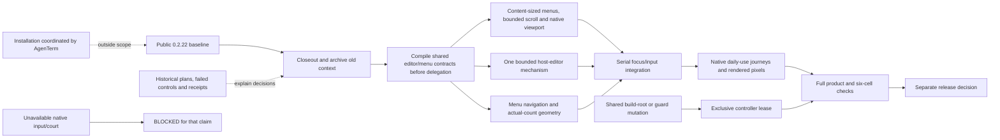

# v0.2.23 — consistent browser controls and quieter development context

Status: `[_]` proposed scope after the public 0.2.22 closeout. The owner
requested planning, documentation/code cleanup and preservation of valuable
history. This plan does not start new product features or authorize another
public version. Installation remains deferred to coordinated AgenTerm planning.

Behavior owners: [browser controls](../prd/PRD_02_25_02_browser_controls.md),
[workspace](../prd/PRD_02_25_con_workspace.md),
[browser preferences](../prd/PRD_02_25_01_browser_preferences.md),
[shared ownership](../prd/PRD_02_28_shared_core.md),
[control](../prd/PRD_02_26_con_control_cli.md), and
[test orchestration](../prd/PRD_02_33_test_orchestration.md).

## Outcome tree DAG

```text
Outcome: edit browser controls predictably, choose a proxy with mouse or keyboard, and continue work from a compact current specification
├── [_] EDIT — consistent address, active-proxy and candidate editors
│   invariant: one editing mechanism; field-specific limits and Submit/Cancel actions; selection, clipboard and IME keep the correct draft/focus and readable value/caret
│   evidence: real page input -> each host editor -> submit/cancel -> terminal/browser return, with public state and physical native input
│   safe failure: an invalid field stays editable; input never reaches a different field or the terminal PTY
│   dependency: workspace focus ownership and current composer rules; non-goal: merging notes/composer semantics or rewriting the terminal renderer
├── [_] MENU — complete keyboard and pointer operation
│   invariant: New and proxy menus expose current selection, Up/Down/Enter/Escape, outside-click dismissal and predictable focus return
│   evidence: mouse/keyboard-equivalent actions, zero/one/eight proxy candidates, narrow/collapsed/Retina windows and rendered page after dismissal
│   safe failure: dismissal cannot navigate, apply a proxy or send input behind the overlay
│   dependency: frozen control contracts and existing chrome geometry; non-goal: a menu framework outside MiniCon or extra browser roots
├── [_] LAYOUT — content-sized menus and bounded overflow
│   invariant: preserve released toolbar wrapping; menus follow actual option count, readable row targets and the available viewport
│   evidence: normal/narrow/collapsed/Retina resize, zero/one/eight candidates, preserved drafts and native page alignment
│   safe failure: below supported minimum show bounded feedback; no clipped/overlapping action or resize submitting an edit
│   dependency: shared Layout and frozen control/count contracts; non-goal: another dialog or a whole-host layout rewrite
├── [_] NATIVE — verify the actual daily-use path
│   invariant: native page pixels, state, address and active proxy agree; loaded pages survive switch/return; proxy changes retain their documented page-reset semantics
│   evidence: local service + real loopback proxy, restart/persistence/error recovery and physical key/IME observations per claimed OS/ISA
│   safe failure: missing native evidence is BLOCKED; compile or injected keys do not qualify an unobserved input path
│   dependency: EDIT/MENU, PRD 28 adapters and exact artifacts; non-goal: provider OAuth, dashboard, downloads or 1:N panels
├── [-] HYGIENE — current truth stays small and history stays reachable
│   invariant: current PRDs own behavior; plans sequence work; release histories own receipts; old plans/proposals/experiments are archived with explicit disposition
│   evidence: closed 0.2.22 archive, current 0.2.23 entry, live-link/ownership checks, ignored regenerable frame output and preserved historical PNG
│   safe failure: preserve unresolved requirements in their PRD owners before archiving; never delete inherited user work or frozen evidence
│   dependency: release closeout, PRD series and bounded build-state policy; non-goal: speculative dead-code deletion or blanket cargo clean
└── [_] QUALIFY — source and artifact evidence remain explicit
    invariant: complete local checks and policy-required exact-source/artifact gates; no inference from a passing neighboring platform
    evidence: named regression/mutation results, full product gate, six-cell receipt and separate release decision
    safe failure: failed or absent courts block their claim; retain the public 0.2.22 baseline
    dependency: all selected leaves; non-goal: automatic publication of 0.2.23
```

## Memory palace



## Product decisions and scope limits

- Keep one Browser root, the existing native adapters, saved proxy candidates
  and empty initial active override. Saved choices do not become an automatic
  default. An optional default proxy remains a later explicit product decision.
- Extract common host editing before aligning behavior. Address/active proxy/
  candidate submission, URL validation, proxy application and atomic saving
  remain product-specific actions. Do not make the shared platform depend on
  MiniCon preferences or AgenTerm product state.
- Console/Web settings routes remain. Language/theme/update controls keep their
  documented scope; this pass addresses predictable input and focus rather than
  adding another settings hierarchy.
- Preserve the 0.2.22 page-recreation contract when applying a proxy; do not
  silently promise retained login/history or direct fallback on proxy failure.
- Modern-agent compatibility, Windows G4/G6, terminal-library qualification,
  RSS and automatic test-selection coverage retain their existing PRD owners.
  Archiving old version proposals neither closes nor abandons those tracks.

## Sequence, shared prerequisites and hot files

1. Finish public 0.2.22 verification, upsert its final scope into the owners,
   preserve receipts/negative controls, then archive its implementation plan.
2. Establish one editor event result (`edited`, `submit`, `cancel`, `ignored`),
   field limits and view/IME metrics. Land a compilable contract before workers
   start targeted builds. Bump Cargo/lock/policy and canonical Dev.app README
   examples together when feature work starts; verify the wrapper payload identity.
3. Extract the existing field-editing mechanism with unchanged submission rules;
   verify current public journeys before extending selection and menu behavior.
4. Run selected native browser/preference courts early on both Windows ISAs
   and Linux, including profile isolation; reserve the release pack for final
   exact artifacts. A filtered ordinary suite does not execute ignored native tests.
5. Work independent pure editor/geometry/test leaves only after interfaces and
   exclusive file sets are frozen. Integrate focus, page visibility and settings
   persistence serially. One controller owns builds and guard mutations.
6. Capture physical/native input separately from CLI injection, then run final
   checks on the actual source. Record observed scope and unavailable cells.

| Surface / hot file | Responsibility |
| --- | --- |
| `src/browser_ui.rs`, `src/browser_proxy_ui.rs`, `src/web_settings_ui.rs` | editor callers, field-specific actions and focus boundaries |
| proposed `src/host_editor.rs` | bounded common editing/event outcome, not product navigation or persistence |
| `src/ui.rs`, `src/host_ui.rs`, `src/host_paint.rs` | geometry, presentation and explicit selection/focus feedback |
| `src/main.rs`, `src/new_tab_menu.rs`, `src/snapshot.rs`, `src/control_dispatch.rs` | shared host routing, overlays and public observation; root integration ownership |
| `tests/support/browser_windows.rs`, `scripts/browser-workspace-smoke.py` | stable public test identities, real page/proxy requests and restart evidence |

Proposed exclusive lanes after the contract compiles:

| Lane | Exclusive source | Handoff evidence |
| --- | --- | --- |
| Editor mechanism | proposed `src/host_editor.rs` | pure edit/selection/IME outcomes with deliberate guard failure |
| Menu mechanism | proposed `src/browser_menu.rs` | bounded navigation/commit/dismiss transitions without native side effects |
| Geometry | `src/ui.rs` | option-count/viewport/scroll geometry and readable target invariants |
| Root integration | existing field callers, `src/main.rs`, `src/new_tab_menu.rs`, painters, snapshots and native fixtures | real page, applied proxy, focus and rendered state agree |

A worker does not edit a root-owned hot file to unblock its build. The root
integrates caller changes and serializes builds/guard mutations; final gates
run after all source handoffs. This plan does not launch these lanes itself.

Independent source ownership does not isolate the canonical binary path,
clipboard or desktop. Serialize a build with any black box spawning that same
binary; serialize guard mutations across all consumers of the changed source.

## Hygiene acceptance

- Current entrypoints expose the latest released baseline, the next plan and
  still-open capability owners, rather than several obsolete future versions.
- Preserve the original 0.2.16/0.2.17 proposals as archived incomplete plans;
  carry their open obligations in PRD 33 and PRD 24.01/28/34/35.
- Archive the older roadmap and repo-hygiene ledger; keep current decision
  pointers and unresolved ownership questions in compact live documents.
- Preserve the released host-UI PNG as an archive artifact; regenerate new
  diagnostic frames under ignored build output so tests do not edit source.
- Keep inherited harness changes outside cleanup commits. Do not prune remote
  work, historical data, vendor runtime bytes or build caches by assumption.
