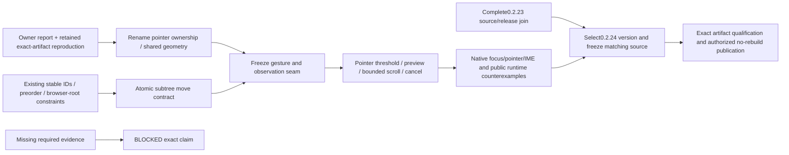

# v0.2.24 — tab-tree drag and reliable inline rename

Status: `[_]` selected next-version scope, 2026-10-25. The owner requests these
changes in the next 0.2.x version and authorizes development/publication of
0.2.23 and 0.2.24. Current release policy remains 0.2.23 until its release join;
this plan does not bump or mix the two versions' source/artifact evidence.

Behavior: [tab-tree interaction owner](../prd/PRD_02_25_03_tab_tree_interactions.md).
Existing hierarchy/naming/focus: [PRD 25](../prd/PRD_02_25_con_workspace.md).
Reuse: [PRD 28](../prd/PRD_02_28_shared_core.md). Observation: PRD 26.
Other subsequent-version Harness/cluster work keeps its own staged scope;
it is not automatically promised as complete in this tree-interaction release.

## Outcome tree DAG

```text
Outcome: publicly deliver predictable tab organization and editable names
├── [-] R0 — preserve owner rename regression and version/source baseline
│   invariant: source inspection and injected/physical evidence stay distinct
│   evidence: retained baseline receipt linked in PRD 25.03
│   safe failure: unresolved native scope remains BLOCKED
│   dependency: isolated public GUI control; non-goal: changing the user's login window/clipboard
├── [_] R1 — fix inside-editor pointer ownership first
│   invariant: inside click/selection stays editing, outside blur keeps its policy
│   evidence: TT-01/02 and actual runtime counterexample with guard removed
│   safe failure: draft/focus retained and no terminal input
│   dependency: shared editor geometry; non-goal: renaming authority/schema redesign
├── [_] T1 — atomic product Workspace subtree move
│   invariant: stable identity and complete topology/session preservation
│   evidence: TT-03/04 legal/invalid/no-op move matrix
│   safe failure: invalid move changes nothing
│   dependency: parent invariants and typed topology checks; non-goal: session restart or persistence
├── [_] T2 — pointer state, preview, scrolling and cancellation
│   invariant: one gesture owner and release-only mutation
│   evidence: TT-05/06 public press/move/release and native pointer journeys
│   safe failure: stale/cancelled proposals leave no tree mutation
│   dependency: R1/T1 and frozen observation seam; non-goal: OS file/URL/cross-window drag
└── [_] Q — integrate and release exact 0.2.24 source
    invariant: two versions' product/artifact/native receipts never substitute for each other
    evidence: TT-07, required product gates, exact six-cell/sign/scan/Promotion/public checks
    safe failure: hold publication on missing selected evidence
    dependency: R1/T1/T2 and 0.2.23 release join; non-goal: claiming future cluster or H2 delivery
```

## Memory palace



## Delivery order and shared prerequisites

1. Preserve the reproduced baseline and confirm owner behavior in a public
   regression. This preparation does not mix the repair into 0.2.23.
2. At the 0.2.24 implementation join, fix rename pointer ownership and share its
   paint/hit/IME geometry. Obtain runtime RED -> GREEN and guard-removal RED
   before layering node drag over the same text region.
3. Define product-owned move intent and atomic topology update. The shared typed
   topology algorithm validates mechanisms; node-kind/drop policy stays local.
4. Freeze source/target/phase/reason observations, then integrate pointer capture,
   preview and edge scrolling. Run capture-loss/close-race tests before final UI.
5. Qualify the selected OS/ISA/native input/scales and exact artifacts, then use
   the registered release skills and existing named-version publication authority.
   Upsert owner status/evidence before archiving this plan.

Hot files: `src/main.rs`, `rename.rs`, `workspace.rs`, `ui.rs`, `host_paint.rs`,
`snapshot.rs`, control dispatch and public/native input fixtures. R1 and T2 share
mouse/focus/geometry ownership and join serially. T1's pure move mechanism can
be independent only after its intent and file ownership are agreed. One controller
owns Cargo/GUI/capture/mutation resources and final integration.

No product-code change, version bump or publish is implied by the planning
checkpoint. The active two-version goal remains responsible for implementation,
selected real evidence and both actual public releases.
