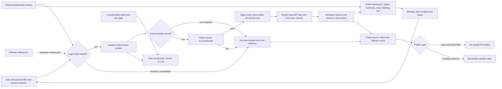

# v0.2.25 — make the local Harness connection understandable and usable

Status: `[-]` selected next development version after the [public 0.2.24
release](../prd/archive/v0.2.24-release-history.md). This is a delivery plan,
not a claim that the journeys below already pass. The product behavior belongs
to [Harness connection experience](../prd/PRD_02_31_01_01_harness_experience.md),
[provider pool](../prd/PRD_02_31_01_02_provider_pool.md),
[dashboard](../prd/PRD_02_36_harness_workspace.md), and
[Web preferences](../prd/PRD_02_25_01_browser_preferences.md).

## Product decision

The release outcome is a trustworthy local connection: a person can see which
network a provider login will use, connect an account, verify a model, assign a
client and understand whether an actual request worked. The robot workspace
answers **what is working and what needs attention**; Settings owns changes;
Console and Web remain useful independent tools. A page opened for provider
authorization is an account-scoped browser context, even when it occupies the
Web content panel. It never silently inherits an ordinary Web-tab override.

Design review comes before implementation selection. Walk the current GUI as
four users: first OpenCode/Google connection needing a login proxy; returning
DeepSeek account reconnect; local client with a stale or changed allocation;
ordinary Web user who saves a proxy candidate. For each, record the first
confusing state, intended next action, recovery path and exact owner. Use a
small wireframe or native capture only to settle a concrete interaction; the
accepted behavior lives in the owning PRD, not in a parallel design document.

## Outcome tree DAG

```text
Outcome: make the first local Harness connection legible from setup to observed use
├── [v] V0 — select the next source version
│   invariant: Cargo package/lockfile and release policy agree on 0.2.25; 0.2.24 remains frozen public history
│   evidence: cargo metadata/check and version/policy consistency check
│   safe failure: a mismatch blocks build or release selection
│   dependency: public 0.2.24 source boundary; non-goal: publishing 0.2.25 by changing a number
├── [_] D1 — inspect and simplify the product journey
│   invariant: one visible next action per state; configuration and operation have separate owners
│   evidence: four current-GUI walkthroughs, reviewed state/action map and narrow/wide mock or capture
│   safe failure: unsupported states say unavailable with a recovery link, not an enabled dead action
│   dependency: PRD 31.01.01/36 runtime states; non-goal: a second dashboard form editor
├── [_] N1 — make account network identity explicit before authorization
│   invariant: Web override, account Login proxy and Service proxy are distinguishable; Direct is explicit
│   evidence: public GUI route-choice/reconnect journeys plus native proxy/direct request traces
│   safe failure: invalid or failed proxy blocks that account request without direct fallback
│   dependency: PP-02/03 context and transport contracts; non-goal: inheriting Web proxy or proxy credentials
├── [_] C1 — complete the guided account-to-client path
│   invariant: grant, stored credential, verified model, applied profile, listener and real client use are distinct
│   evidence: HU-01..06 and PP/selection/key tests; one real OpenCode/Google proxy and one DeepSeek path where available
│   safe failure: an interrupted step preserves a prior applied connection and shows the exact retry action
│   dependency: account pool, profile verification, private key and gateway owners; non-goal: automatic rotation or client install
├── [_] O1 — make the robot workspace an honest operation surface
│   invariant: account/client/request/usage cards cite their actual source and freshness; links target exact entities
│   evidence: HW-02/03/06/07 mixed empty, stale, failed and active public journeys
│   safe failure: unknown is not zero, a draft is not applied, and external process health is not inferred
│   dependency: cached pool, applied profile and usage projections; non-goal: fabricated task queue or billing console
├── [_] F1 — preserve Console/Web and native interaction quality
│   invariant: settings/auth/page transitions preserve drafts, focus and parked ordinary page/proxy state
│   evidence: Web-to-auth-to-Web native journey, narrow layout and selected TT/CB/IME regressions
│   safe failure: canceled/expired authorization leaves the previous tab and account usable
│   dependency: PRD 25/25.02/25.03 and auth view lifetime; non-goal: redesigning terminal input or tab topology
└── [_] Q — qualify one exact source and decide publication
    invariant: only matching source, native artifacts and actual observations support a claim
    evidence: targeted smoke, fmt/clippy, build.sh test, six-cell or hosted equivalent, selected native courts and release receipts
    safe failure: unavailable real account or native court is BLOCKED for that claim; failed release gates stop Promotion
    dependency: completed selected slice and PRD 27 chain; non-goal: treating development GUI success as public release evidence
```

## Memory palace



## Sequence and decision gates

1. **Freeze the 0.2.24 boundary.** Bump the development version only. Inventory
   dirty work and existing HU/PP/HW/TT/CB receipts; never reuse a 0.2.24
   receipt for changed 0.2.25 bytes.
2. **Product review (D1).** Make a state/action map for the four journeys above.
   For every screen identify the user's question, the primary action, provenance
   of displayed data and recovery. Upsert accepted behavior into its owner
   before coding. Do not block bug repairs on speculative visual polishing.
3. **Network and authorization (N1).** Inspect `harness_settings_ui`, auth
   presentation, `provider_accounts`, `provider_login` and `minicon-web` together.
   Show the frozen Login route at the Continue/reconnect point and distinguish
   it from the Web proxy. Verify the selected account route with a rejecting
   proxy and a local request observer before a real Google attempt. Keep
   existing account/browser isolation. A changed saved Login policy requires
   an explicit new attempt; it cannot reroute an open authorization view.
4. **One complete first-use path (C1).** Prioritize a usable OpenCode and
   DeepSeek connection over more provider buttons. Expose step-specific
   pending/success/error states. A client recipe is complete only after an
   applied profile, explicit API start and actual key-backed client request.
   Real-provider proof retains its own account/region/OS scope.
5. **Operational view (O1).** Project applied account/client state and current
   request/usage evidence into the robot workspace. Show freshness and the
   exact fix link. Defer any task Start control until HW-04/05's worker-event,
   cancellation and owned-process contract can run end to end.
6. **Native integration (F1) and qualification (Q).** Shared hot files include
   `src/main.rs`, `src/harness_settings_ui.rs`, `src/harness_auth_ui.rs`,
   `src/harness_workspace_ui.rs`, `src/browser_proxy_ui.rs`,
   `crates/minicon-web/src/native_page.rs`, and host paint/geometry. Establish
   exclusive edit ownership before independent work; integrate shared files
   and run final gates serially. Use focused red/green behavior tests, then the
   documented smoke and exact-source delivery courts.

## Release cut and explicit deferrals

P0 for a 0.2.25 Candidate: N1 route clarity and no-fallback behavior, C1's
first-use states, and F1's auth/Web restoration. O1 may ship as a truthful
read-only workspace with exact links; its unimplemented observations must say
unknown/unavailable. A real Google/OpenCode grant through the selected login
proxy is required before claiming that user journey works. If access or a
native court is unavailable, record `BLOCKED` and narrow the release claim;
do not label a synthetic fixture as a real account pass.

Keep H2 built-in task operation as a design and contract checkpoint. ujs/WASM
logic delivery, dynamic llm-gate scheduling, cluster pairing/remote execution,
computer use, automatic provider rotation, proxy authentication and an
installer are separate owners and do not become 0.2.25 release dependencies.
Console/Web fixes with clear user impact may enter the cut after their owner
acceptance and exact-source gates, without reopening the Harness boundary.

Public Promotion still requires the owner's explicit version/publish authority
and the [release chain](../prd/PRD_02_27_con_delivery.md). This plan alone is
not that authority.
