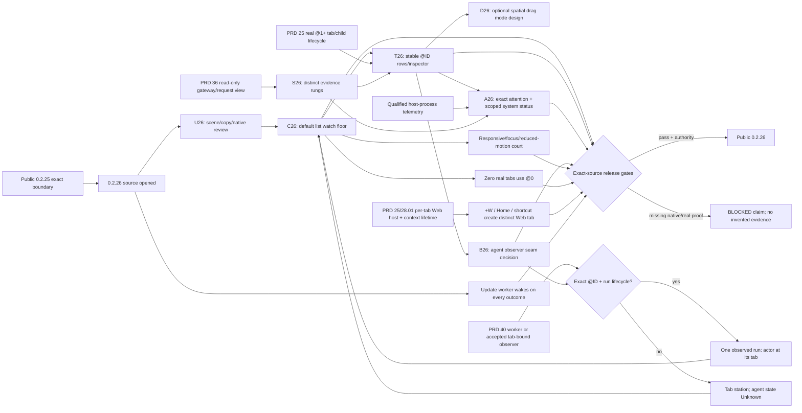

# v0.2.26 — default list watch floor and staged visual mode

Status: `[-]` active development after public 0.2.25. Zero-tab convergence
has Windows native evidence; the default list, visual mode and release remain
open. The owning behavior is in
[PRD 39.01](../prd/PRD_02_39_01_home_canvas.md), with @0 identity in
[PRD 39](../prd/PRD_02_39_home_dashboard.md) and operation facts in
[PRD 36](../prd/PRD_02_36_harness_workspace.md).

## Product decision

Make @0 the **watch floor** for agents working inside real MiniCon tabs and for
the health of this MiniCon instance. Its default mode is a sortable, scannable
list. A second spatial mode grows into user-arranged drag-and-drop management
only as its persistence, identity and conflict behavior are qualified. Both
modes read the same tab and observer projections. A person should
spot the exact @ID needing attention, inspect what the host truly observed,
and move to that tab or its owning detail view in one deliberate action.
Console tabs are the first managed agents; Harness tabs join this same model
when their ownership and event source are defined. The spatial office canvas
represents tab stations even before typed agent events
exist; characters appear only after an accepted event source binds an actual
run to an @ID. Model API traffic or a process name alone never proves an
agent's stage. The robot view owns detailed Harness operation/monitoring and
Settings owns configuration. Console/Web fundamentals remain maintained.

The owner-described AIGC dashboard reference suggested a prominent central
stage and supporting side/summary regions. The previously named local image
was not present in this workspace at design time; PRD 39.01's wireframe is
based on that description and the current @0 implementation. If the image
becomes available later, use it to review visual hierarchy, not to import
AIGC-specific workflow or fictional job cards.

## Outcome tree DAG

```text
Outcome: 0.2.26 @0 is a trustworthy default-list watch floor for tab-contained agents and local health
├── [v] V26 — open next source version only after 0.2.25 public boundary is recorded
│   invariant: released 0.2.25 artifacts remain immutable and new work has a distinct source identity
│   evidence: cargo metadata --locked reports 0.2.26, release-policy.json matches, and prd/archive/v0.2.25-release-history.md records the public boundary
│   safe failure: no version bump or publish inference from a design document
│   dependency: exact 0.2.25 public Promotion; non-goal: overlapping release Candidates
├── [_] U26 — review tab-fleet scenes and alert routes with native captures
│   invariant: first glance identifies tab, concern, measured system scope and exact inspect route
│   evidence: wide/4:3/narrow wireframes, English/Chinese copy and five-second multi-tab walkthrough notes
│   safe failure: ambiguity remains an explicit design issue before coding a target
│   dependency: PRD 39.01 states and the existing static shell; non-goal: final logo or unmeasured slogan claim
├── [_] C26 — build the default list Home composition and navigation
│   invariant: Home is read-only, scene targets carry stable @IDs, and real tab/browser drafts survive round trips
│   evidence: public GUI pointer/keyboard journey, native captures and no-side-effect traces
│   safe failure: empty office retains a working primary route and explanation
│   dependency: PRD 39 @0 host navigation; non-goal: another tab kind or Settings form on Home
├── [-] T26 — represent the tab fleet as a default list with exact drill-down
│   invariant: station/list/inspector select the same stable @ID through rename, reorder, exit and overflow
│   evidence: 0/1/many/256 mixed-tab public journeys, stale-target refusal and native click/focus receipts
│   safe failure: missing agent observer stays Unknown; closed tab never retargets another row
│   dependency: PRD 25 tab tree/session lifecycle and PRD 39.01 HC-06; non-goal: reading hidden PTY output
├── [_] D26 — design the optional spatial drag-and-drop mode in stages
│   invariant: visual positions belong to stable @IDs and never alter the real tab tree or agent state
│   evidence: V0 inspect-preview, V1 session-only card placement, V2 explicit tree-move contracts and native interaction prototype
│   safe failure: an unqualified drag mode stays unavailable while the default list remains fully usable
│   dependency: T26 identity and observer model, PRD 25.03 topology revision for V2; non-goal: cross-restart placement or a decorative fake drag target in 0.2.26
├── [_] A26 — prioritize attention and measured system health
│   invariant: every alert names exact tab/component, source, freshness, severity and one safe action
│   evidence: exited/stale/failed/host-unavailable mixed journeys, dedupe/resolve and measurement provenance
│   safe failure: collector outage becomes Unknown rather than false healthy/zero or an alarm storm
│   dependency: PRD 25 lifecycle, PRD 36 projection and qualified host telemetry; non-goal: unmeasured whole-OS health claim
├── [v] Z26 — converge zero-tab workspace on @0
│   invariant: closing the last real tab opens the same @0 Home, with New Terminal/New Web routes
│   evidence: Windows native_home_is_a_fixed_destination_and_restores_real_tabs passed last-tab close and Home actions
│   safe failure: an unavailable route leaves Home and explicit recovery visible
│   dependency: PRD 39 Home identity and C26 routes; non-goal: treating @0 as a closable tab
├── [-] W26 — make +W a real New Web action
│   invariant: +W, Home New Web and shortcut create distinct Web tab IDs and independent page state
│   evidence: two-Web-tab native navigation, independent URL/history/proxy/context, auth detour, switch/close/reopen and public snapshots
│   safe failure: allocation failure preserves existing pages and shows a notice
│   dependency: replace unique browser_tab/page/address/auth assumptions with per-tab host/context lifecycle under PRD 25/28.01
│   non-goal: a second button that merely reselects or reuses one mutable page host; split-screen browsing
├── [v] F26 — make manual update feedback settle
│   invariant: each worker outcome wakes the host and install has its own visible phase
│   evidence: loopback check wake and scoped install success/failure journeys (24 passed)
│   safe failure: worker loss becomes retryable failure with the running binary untouched
│   dependency: PRD 25 update worker; non-goal: automatic update or silent restart
├── [_] S26 — join only truthful local status
│   invariant: tab/process, model request and typed agent-run claims stay separate with source/freshness
│   evidence: request-without-tab, typed exact-tab run, partial/stale/offline public scenarios
│   safe failure: Unknown/Last known replaces inferred agent work or unmeasured system health
│   dependency: PRD 25 lifecycle, PRD 36 read-only projection and accepted observer seam; non-goal: provider polling
├── [_] B26 — decide the inside-tab agent observer seam
│   invariant: a registered agent run binds to window/session incarnation, stable @ID, source and ordered run identity
│   evidence: self @ID export contract, one real CLI/TUI adapter trace, peer-message envelope/receipt decision and stale/closed-tab controls
│   safe failure: unregistered agents remain visible as tabs with Unknown work state
│   dependency: PRD 26.01 CLI contract, PRD 25 lifecycle and PRD 36 run view; non-goal: shipping a general message broker or parsing PTY prose
├── [_] R26 — qualify visual responsiveness, accessibility and idle cost
│   invariant: essential meaning stays visible across scale/language/window states without continuous idle repaint
│   evidence: 1x/1.5x/2x native visual courts, focus order, reduced-motion and idle repaint measurements
│   safe failure: decorative detail collapses before targets or state text do
│   dependency: shared host palette/font/input; non-goal: animation used as an information source
├── [_] E26 — preserve a gated path to real office characters
│   invariant: a character requires exact @ID, run identity and ordered lifecycle events from an accepted source
│   evidence: contract review and, only if available, one real run/cancel/final native journey
│   safe failure: release still shows truthful tab stations with Unknown agent state
│   dependency: PRD 36/40 app seam or separately accepted tab-bound observer; non-goal: inferring arbitrary CLI agent state
└── [_] Q26 — qualify and decide exact-source release
    invariant: every claim matches the source, platform and observation that proved it
    evidence: selected smoke/scoped suites, fmt/clippy, six-cell, native visual/behavior courts and release receipts
    safe failure: missing evidence blocks only the corresponding claim or Promotion gate
    dependency: PRD 27/33 release chain and explicit owner authority; non-goal: treating a mock as a public artifact
```

## Memory palace



## Sequence

1. **Anchor the public 0.2.25 boundary.** Use its recorded source/artifact
   receipt and carry forward only accepted unresolved PRD requirements. Do not quietly
   move 0.2.25's connection or Web/auth P0 obligations into this visual slice.
2. **Review the product, then freeze the interaction map.** Compare the
   current @0 screenshot with PRD 39.01 at wide, 4:3 and narrow sizes. Walk
   six situations: zero tabs; one working terminal; many identically named
   CLI-agent tabs; an exited tab; a stale tab observer plus failed account;
   an active gateway request with no exact tab/run correlation. Record the
   first concern noticed, exact @ID/owner, source time, primary route and
   recovery. Keep accepted behavior in PRD 39.01.
3. **Implement the default list and tab drill-down.** Build a bounded tab list,
   summary, attention queue and scoped system card in the native host. Each
   row/inspector targets a stable @ID; rename, reorder, close
   and 256-tab overflow cannot retarget another row. Use code-native shapes
   and typography. Public CLI/snapshot tests prove exact selection and state
   preservation; captures prove hierarchy.
   Reuse the already implemented zero-tab-to-@0 transition and Home New
   Terminal/Web hit targets. Qualify them natively before treating Z26 as
   complete. W26 must first replace the current single `browser_tab` and
   `native_browser_page`/`browser_page`/address/auth assumptions with per-tab
   host and context lifetime, including isolated authorization detours. Only
   then can +W, Home New Web and the shortcut promise a new independent page;
   button copy alone is not acceptance. The native two-Web-tab navigation,
   switching, auth, close and reopen court is an explicit gate.
4. **Design the spatial mode as a distinct staged interaction.** Reuse T26's
   stable IDs, observer facts, filters and exact inspect routes. V0 is an
   inspectable preview; V1 permits only session-local card placement without
   changing tab order; V2 exposes an explicit tree-move action through PRD
   25.03's topology revision and atomic validation. Define collision,
   cancellation, closed-tab and stale-revision behavior before V1/V2 unlock.
   Keep List available on every window size; do not expose a Visual switch
   until its V0 inspection route is useful and qualified.
5. **Join facts and attention through owners.** Present PRD 25 tab/child
   lifecycle, PRD 36 model API/request projection and qualified MiniCon-host
   telemetry as separate evidence rungs. Instrument an output timestamp or
   CPU/RSS only if its source, cost and platform scope can be proven. Deduplicate
   attention by source/key; resolve it when the owner recovers. A model request
   without exact correlation cannot illuminate a specific tab's agent or
   spawn a character. Home entry adds no provider polling or process probe.
6. **Qualify native presentation.** Claim each OS/scale/language only after its
   named native court. Check short-height scroll, focus, hit targets, text
   contrast, reduced motion, browser parking and idle CPU/repaint behavior.
   Use captures to settle visual hierarchy and public journeys to settle
   behavior. Integrate shared `src/main.rs`, `src/host_paint.rs`, `src/ui.rs`,
   `src/snapshot.rs` changes serially against the public 0.2.25 baseline.
7. **Decide the inside-tab observer seam.** Assign its protocol/lifecycle owner
   outside the Home painter. A real CLI/TUI agent adapter feasibility trace
   must bind the event source to window/session incarnation and @ID and prove
   stale/closed-tab refusal. Decide how a child learns its own @ID (today it
   inherits only `MINICON_CONTROL`), how its `minicon` command resolves the
   same running build, and whether typed peer messages need a
   delivery receipt beyond `send-paste`/`capture-pane`. A generic process name
   or PTY text is not enough. [PRD 26.01](../prd/PRD_02_26_01_agent_cli_contract.md)
   owns the contract; the [agent CLI plan](plan-agent-cli-contract.md) sequences
   the compatible implementation slices.
   This decision is part of the 0.2.26 design handoff even if the adapter
   implementation lands later.
8. **Gate real actors separately.** If the independent worker or a separately
   accepted inside-tab observer publishes exact @ID/run identity, ordered
   lifecycle and source freshness in time, run PRD 39.01's event/observer-loss
   court before enabling characters. Otherwise ship still tab stations with
   Unknown agent state and keep HC-05 open.
9. **Run exact-source release gates.** Reconcile PRD status and evidence before
   archiving this plan. Promotion needs the owner-selected 0.2.26 decision and
   PRD 27 Candidate/Defender/reputation chain; this design request is not
   pre-authorization to publish the next version.

## Cut, deferrals and handoff

T26 has a first Windows native click court for three same-named Console tabs,
with exact @ID row snapshots and a test mutation that removes activation and
fails. The list now paints real tab/child facts and scrolls independently.
The Windows native wheel court also passed with 17 Console tabs and an exact
scrolled-row click; removing the Home wheel route made it fail.
W26 has its Workspace identity prerequisite: distinct browser roots can
now be allocated and closed independently in the product model. Internal
runtime parking also preserves each Web @ID's address, proxy, navigation
flags and page handles across switches and closes; focused state tests pass.
HTTP handoff and authorization close/restore now route by active or recorded
Web @ID instead of the first Browser root; two-Web model tests and old-path
mutations prove those exact decisions.
The GUI still exposes one Web tab and +W still focuses it. Per-tab native
page and auth isolation plus the two-Web-tab native court remain required
before W26 is delivered.
Search/filter/group, mixed 256-tab overflow, attention/system cards, native
wide/narrow visual captures and other OS courts remain required before T26 or
the default-list cut can be marked complete. `screenshot-pane` observes the
underlying Console pane on @0 and is not a Home capture receipt.

The intended 0.2.26 cut is the default list from HC-01 through HC-04 plus HC-06/07:
@0 tab fleet, exact drill-down, prioritized attention, scoped system status
and responsive native UX, plus the B26 observer-seam decision. HC-05 characters
and interactive spatial drag are separately gated future capabilities. D26
delivers their interaction/identity design, not a decorative shipped toggle.
Arbitrary inside-tab agent stage
observation implementation, H2 task launch/Stop,
cross-machine coordination,
computer use, dynamic ujs/WASM scheduling, plugin management, provider auto
rotation and installation remain with their existing owners and do not become
Home canvas prerequisites. A truly unavailable owner is shown as unavailable;
it is never filled with a demo-looking worker.

The handoff to implementation should include a native current-state capture,
the selected wide/narrow composition, a state/action matrix and exact public
journeys from PRD 39.01. Before making visual claims, confirm the actual
local reference image if it is reintroduced; its absence does not block the
truthfulness and navigation requirements above.
