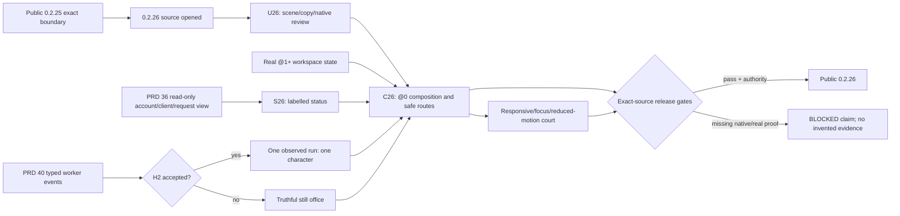

# v0.2.26 design target — make @0 a useful visual home

Status: `[_]` selected next design sequence after public 0.2.25. This file
selects a product direction for the next version; it does not claim that
0.2.26 source, native evidence or publication exists. The owning behavior is in
[PRD 39.01](../prd/PRD_02_39_01_home_canvas.md), with @0 identity in
[PRD 39](../prd/PRD_02_39_home_dashboard.md) and operation facts in
[PRD 36](../prd/PRD_02_36_harness_workspace.md).

## Product decision

Make @0 the distinctive, scene-first home screen for MiniCon. A person should
understand their local workspace, see one next action and inspect the source
of any mutable status without navigating through Settings. The large office
canvas is a useful still scene before typed task events exist; agents do not
appear merely because an account is configured or an API request is active.
The robot view continues to own detailed operation and monitoring, and
Settings continues to own configuration. Console/Web fundamentals remain
maintained product surfaces.

The owner-described AIGC dashboard reference suggested a prominent central
stage and supporting side/summary regions. The previously named local image
was not present in this workspace at design time; PRD 39.01's wireframe is
based on that description and the current @0 implementation. If the image
becomes available later, use it to review visual hierarchy, not to import
AIGC-specific workflow or fictional job cards.

## Outcome tree DAG

```text
Outcome: 0.2.26 @0 is a polished, trustworthy daily entry point
├── [_] V26 — open next source version only after 0.2.25 public boundary is recorded
│   invariant: released 0.2.25 artifacts remain immutable and new work has a distinct source identity
│   evidence: version/policy/lockfile consistency and 0.2.25 release-history receipt
│   safe failure: no version bump or publish inference from a design document
│   dependency: exact 0.2.25 public Promotion; non-goal: overlapping release Candidates
├── [_] U26 — review @0 scenes and daily routes with native captures
│   invariant: first-glance hierarchy answers location, next action, observed status and inspection route
│   evidence: wide/4:3/narrow wireframes, English/Chinese copy and five-second walkthrough notes
│   safe failure: ambiguity remains an explicit design issue before coding a target
│   dependency: PRD 39.01 states and the existing static shell; non-goal: final logo or unmeasured slogan claim
├── [_] C26 — build the scene-first Home composition and navigation
│   invariant: Home is read-only, scene targets are labelled, and real tab/browser drafts survive round trips
│   evidence: public GUI pointer/keyboard journey, native captures and no-side-effect traces
│   safe failure: empty office retains a working primary route and explanation
│   dependency: PRD 39 @0 host navigation; non-goal: another tab kind or Settings form on Home
├── [_] S26 — join only truthful local status
│   invariant: cards/signals name owner, freshness, unit and exact inspect destination
│   evidence: empty/ready/request/partial/stale/offline public scenarios and data-source assertions
│   safe failure: Unknown/Last known replaces a false zero or external-agent health claim
│   dependency: PRD 36 bounded read-only projection; non-goal: a provider refresh or background service start
├── [_] R26 — qualify visual responsiveness, accessibility and idle cost
│   invariant: essential meaning stays visible across scale/language/window states without continuous idle repaint
│   evidence: 1x/1.5x/2x native visual courts, focus order, reduced-motion and idle repaint measurements
│   safe failure: decorative detail collapses before targets or state text do
│   dependency: shared host palette/font/input; non-goal: animation used as an information source
├── [_] E26 — preserve a gated path to real office characters
│   invariant: a character requires PRD 36/40 typed run identity and ordered lifecycle events
│   evidence: contract review and, only if available, one real run/cancel/final native journey
│   safe failure: release still shows a truthful still office with no characters
│   dependency: independently accepted app event seam; non-goal: making H2 a 0.2.26 release gate
└── [_] Q26 — qualify and decide exact-source release
    invariant: every claim matches the source, platform and observation that proved it
    evidence: selected smoke/scoped suites, fmt/clippy, six-cell, native visual/behavior courts and release receipts
    safe failure: missing evidence blocks only the corresponding claim or Promotion gate
    dependency: PRD 27/33 release chain and explicit owner authority; non-goal: treating a mock as a public artifact
```

## Memory palace



## Sequence

1. **Finish 0.2.25 first.** Record its public source/artifact boundary and
   carry forward only accepted unresolved PRD requirements. Do not quietly
   move 0.2.25's connection or Web/auth P0 obligations into this visual slice.
2. **Review the product, then freeze the interaction map.** Compare the
   current @0 screenshot with the PRD 39.01 wireframe at wide, 4:3 and narrow
   sizes. Walk five users: first launch, returning terminal/Web user, configured
   but idle Harness user, one failed account/partial monitoring user, and one
   active request with no H2 task. Record first confusing state, primary
   action, owner and recovery. Keep accepted behavior in PRD 39.01.
3. **Implement composition and routes.** Build stage, hero, action row and
   bounded side/summary region in the current native host. Prefer code-native
   shapes and typography. Keep the scene itself inert; label clickable items.
   Public CLI/snapshot tests must observe destination and preservation, not
   just painted pixels.
4. **Join status through PRD 36.** Use one read-only projection with explicit
   source/freshness. Do not add provider polling to the Home render/event loop.
   A request can illuminate a labelled request signal, but cannot spawn an
   agent character or imply a completed task.
5. **Qualify native presentation.** Claim each OS/scale/language only after its
   named native court. Check short-height scroll, focus, hit targets, text
   contrast, reduced motion, browser parking and idle CPU/repaint behavior.
   Use captures to settle visual hierarchy and public journeys to settle
   behavior. Integrate shared `src/main.rs`, `src/host_paint.rs`, `src/ui.rs`,
   `src/snapshot.rs` changes serially with concurrent 0.2.25 release work.
6. **Gate real actors separately.** If the independent worker publishes and
   qualifies the typed H2 seam in time, run the PRD 39.01 event court before
   enabling characters. Otherwise ship the still office and keep HC-05 open.
7. **Run exact-source release gates.** Reconcile PRD status and evidence before
   archiving this plan. Promotion needs the owner-selected 0.2.26 decision and
   PRD 27 Candidate/Defender/reputation chain; this design request is not
   pre-authorization to publish the next version.

## Cut, deferrals and handoff

The intended 0.2.26 cut is HC-01 through HC-04: scene-first @0, real routes,
source-labelled local state and responsive native UX. HC-05 is a separately
gated future capability. H2 task launch/Stop, cross-machine coordination,
computer use, dynamic ujs/WASM scheduling, plugin management, provider auto
rotation and installation remain with their existing owners and do not become
Home canvas prerequisites. A truly unavailable owner is shown as unavailable;
it is never filled with a demo-looking worker.

The handoff to implementation should include a native current-state capture,
the selected wide/narrow composition, a state/action matrix and exact public
journeys from PRD 39.01. Before making visual claims, confirm the actual
local reference image if it is reintroduced; its absence does not block the
truthfulness and navigation requirements above.
