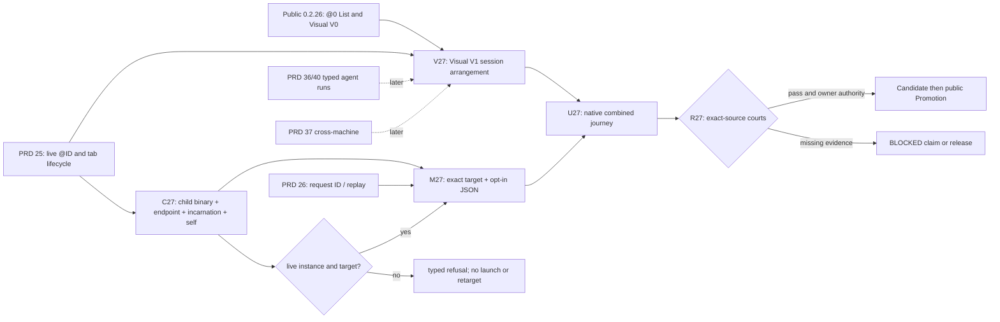

# v0.2.27 — addressable agent workspace

Status: `[_]` proposed and parked during repository documentation cleanup after
[public v0.2.26](../prd/archive/v0.2.26-release-history.md).
Planning selects a source version, not a release or an implementation claim.
The [product index](../PRD.md) owns the frontier. Behavior remains with
[agent CLI](../prd/PRD_02_26_01_agent_cli_contract.md),
[@0 canvas](../prd/PRD_02_39_01_home_canvas.md),
[workspace](../prd/PRD_02_25_con_workspace.md), and
[delivery](../prd/PRD_02_27_con_delivery.md).

## Product decision

Make a Console agent's own MiniCon instance and tab addressable without
guessing a window, title or global installation. Let the user arrange the
existing @0 Visual stations during one window session while List remains the
default. Both actions use stable live `@ID`s; neither asserts that the host
understands an arbitrary agent's task stage. This is the smallest coherent
step from a read-only watch floor toward a controllable local workspace.

Success is a real Console child invoking this build's `minicon cli` against
itself, addressing its own tab and a named peer, while another MiniCon instance
is open; the user can inspect and rearrange those same tab stations on @0.
Successful PTY delivery means bytes or keys were accepted, not that a peer
agent processed them. No model, login or worker is needed for this journey.

## Outcome tree DAG

```text
Outcome: a person and a Console agent can find and operate the correct local tab
├── [_] C27 — bind child command discovery to one live MiniCon instance
│   invariant: Console child resolves this executable, endpoint, incarnation and its own @ID
│   evidence: real-child self/peer CLI journey with two GUI instances, duplicate titles, restart and stale tab
│   safe failure: absent binary/endpoint or mismatched incarnation refuses before launch or mutation
│   dependency: PRD 25 tab lifecycle and PRD 26.01 ID/A2; non-goal: global PATH or permission policy
├── [_] M27 — make the selected CLI calls predictable to scripts
│   invariant: explicit @ID/self resolution and opt-in versioned JSON distinguish accepted input from observed output
│   evidence: native CLI/mux command matrix, stdout/stderr/exit code and wrong-kind/timeout/replay black boxes
│   safe failure: stale/wrong-kind/uncertain result has a typed error and no silent retarget or duplicate write
│   dependency: C27, existing request replay and PRD 26.01 TARGET/RESULT; non-goal: all tmux flags, typed peer receipt or full scrollback
├── [_] V27 — arrange @0 Visual stations within this window session
│   invariant: dedicated drag/keyboard move changes only Visual order/position keyed by live @ID
│   evidence: pointer and keyboard rearrangement, List↔Visual parity, close/reopen, cancel and stale-revision journeys
│   safe failure: capture loss, Escape, stale/closed target or unsupported drop leaves topology and sessions intact
│   dependency: public V0, PRD 39.01 V1 and PRD 25 identity; non-goal: tab-tree move, cross-restart layout or agent state mutation
├── [_] U27 — prove the combined experience stays usable
│   invariant: @0 List remains the default; exact targets, focus, copy and targets agree at supported sizes
│   evidence: native wide/narrow/high-scale captures and keyboard/pointer journeys on claimed platforms
│   safe failure: missing native court is BLOCKED for that platform or scale; List/CLI remain usable
│   dependency: C27/M27/V27 and PRD 33 test selection; non-goal: animated office characters or unobserved health claims
└── [_] R27 — qualify an exact-source release decision
    invariant: every shipped claim names source, platform, artifact and observed behavior
    evidence: scoped smoke/CLI/Home tests, fmt/clippy, six-cell, required signing/Defender and public-download smoke
    safe failure: failed or absent court blocks its claim or Promotion; no inferred pass from adjacent source
    dependency: PRD 27 release policy and explicit version/publish authority; non-goal: treating this plan as publication approval
```

## Memory palace



## Sequence and cut rules

1. Inventory shipped `cli`/`mux` verbs and target defaults. Freeze the public
   compatibility matrix before changing output. C27 precedes `self` in M27.
   Preserve the legacy text output; JSON is opt-in. A copied child environment
   is a hint, never authority.
2. Integrate the command discovery and GUI endpoint lifecycle serially with
   tab creation/close. Qualify two instances and a restart before any peer
   write is called safe. Document exactly which calls accept `self` and which
   require a named peer `@ID`.
3. Build V27 on the existing Visual V0 projection. Arrange uses a separate
   handle and a keyboard alternative. Do not reuse the tab-tree drag gesture
   or persist positions while tab identity is process-lifetime only.
4. Integrate CLI and @0 journeys, then run the selected native courts and
   release gates. If V27 fails native interaction review, ship only after
   explicitly reselecting a smaller release cut in this plan; do not label V0
   as draggable. If C27/M27 cannot pass the two-instance real-child journey,
   do not claim an agent-facing control release.

The shared hot files are the host tab/session lifecycle, process launch
environment, control endpoint, CLI parser/results, Home state/geometry and
pointer/focus routing. Keep one integrator for these joins. Independent docs
or isolated UI prototypes may advance in parallel only with separate file
ownership and evidence. Run Cargo, GUI and release gates serially.

## Beyond this cut

The typed run/peer receipt, causally observed waits, full I/O/path
normalization, real Harness app operation, provider authorization, cross-node
observation and computer use retain their owning PRDs and plans. A later
version may select them only after their real prerequisites and black-box
journeys are available.
