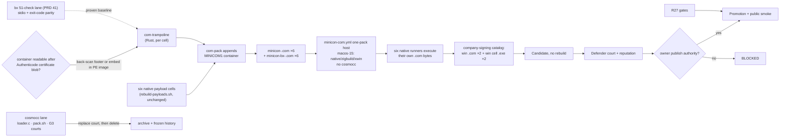

# v0.2.27 — cosmocc-free single-file delivery in Rust

Status: `[_]` selected by owner direction 2026-11-16; planning selects a
source version, not a release or an implementation claim. The
[product index](../PRD.md) owns the frontier. Delivery facts stay with
[PRD 27](../prd/PRD_02_27_con_delivery.md); bx lane facts with
[PRD 41](../prd/PRD_02_41_bx.md).

## Product decision

Retire cosmocc/cosmopolitan from the shipped artifact path. `minicon.com`
stops being a C polyglot trampoline + ZipOS overlay and becomes Rust-built
single-file artifacts: the existing `loader/com-rs` launcher
(`com-trampoline`) with a `MINICOM1` tail container, one artifact per
`{os}-{isa}` cell (`minicon-<cell>.com`), packed by `com-pack`. The owner's
bx experiment (`minicon-bx-<cell>.com`, [PRD 41](../prd/PRD_02_41_bx.md))
is the reference lane: it proved the launcher's stdio inheritance, verbatim
exit codes, `com-pack verify` and per-host packing on this Windows machine;
v0.2.27 promotes that mechanism to the product artifact and switches the
signing, Defender, reputation and promotion chain to it.

This overturns, by explicit owner decision, the note in
[PRD 27](../prd/PRD_02_27_con_delivery.md) that the Rust launcher lane
`[no]` does not replace the polyglot asset. The cost is accepted and named:
**one file no longer boots six kernels.** A compiled Rust launcher is
per-OS/ISA; the six-OS polyglot promise ends with 0.2.26 unless a future
owner decision revives it (APE! loader, qjswasm or hand-written polyglot —
all non-goals here). What is gained: no cosmocc install/pin/swaps in CI, no
C toolchain in the artifact path, exact child exit codes (the polyglot's
`(128+c)<<8` Windows defect is gone), piped stdio capture works, the shell
is ~211 KiB instead of ~714 KiB, and the whole artifact is auditable Rust.

Default asset shape (confirmed or amended under D27 before any Candidate):
publish `minicon-<cell>.com` for the two Windows cells alongside the
existing native archives; the other cells' `.com` artifacts are built and
court-executed every run and may be published by the same policy table
without further design work.

## Outcome tree DAG

```text
Outcome: the shipped single-file artifact is produced by MiniCon's own Rust tooling, with cosmocc retired
├── [_] D27 — fix the shipped asset shape and names
│   invariant: every published single-file artifact name maps to exactly one {os,isa} cell and one digest; nothing named minicon.com claims six-OS coverage after 0.2.26
│   evidence: release-policy.json assets, candidate bundle, release notes template, READMEs and docs/ download pages list one identical per-cell set
│   safe failure: an unresolved owner question blocks pack/Candidate; the chain never guesses a name
│   dependency: owner direction 2026-11-16; PRD 27 rust-lane "[no] replace" overturned and re-owned in the same PRD edit
│   non-goal: a Rust-built polyglot that boots six kernels from one file
├── [_] L27 — make the launcher a signable, tamper-evident front door
│   invariant: Authenticode-signing a packed Windows .com neither breaks container lookup nor lets payload bytes drift unnoticed
│   evidence: container-design spike decided on real bytes (footer back-scan past the certificate blob, or container embedded inside the PE image; bump to MINICOM2 if layout changes); a self-sign-rehearsal-extended packed .com verifies and executes after signing; a flipped payload byte fails com-pack verify (negative control)
│   safe failure: unreadable container after signing, missing VERSIONINFO/icon, wrong embedded product version or checksum mismatch fails signing preflight — not the user's first run
│   dependency: bx lane's proven stdio/exit parity (PRD 41 evidence) carried over; extract hygiene reaches loader.c discipline (0700 per-invocation dir, owner marker, reaper, EINTR-safe wait)
│   non-goal: compressing/encrypting cells; in-process mmap execution; codesigning the osx .com (macOS users keep the signed native archive/DMG path, same as 0.2.26)
├── [_] P27 — pack six minicon .com plus the bx set on one CI host
│   invariant: one source identity yields every launcher+cell artifact with per-file SHA-256 in one manifest
│   evidence: minicon-com.yml build job (macos-15: native osx, zigbuild lnx, xwin win) emits minicon-<cell>.com ×6 and minicon-bx-<cell>.com ×6; com-pack verify plus PE 0x8664/0xaa64 and ELF 0x3e/0xb7 machine checks green; manifest and build receipt bind source SHA and dirty=false
│   safe failure: any missing or failed cell artifact fails the job before the six-runner fan-out
│   dependency: loader/pack-rust-all.sh host matrix; payload rebuild path (rebuild-payloads.sh) unchanged
│   non-goal: compiling anything on the six execution runners
├── [_] G27 — switch the release chain to the Rust artifacts
│   invariant: signing catalog, Defender/reputation set, Candidate bundle and Promotion smoke all reference the same per-cell digests; no live path can fall back to the polyglot
│   evidence: company-signing catalog covers both win .com plus the win cell payloads (their bare .exe still ship in archives); candidate_bundle.py asserts per-file digests and the size ceiling per .com file; release-policy.json reputation assets list the new names; release.yml executes the promoted .com bytes end-to-end
│   safe failure: any stale cosmocc-era reference (name, path, receipt key) in the chain blocks Candidate fail-closed
│   dependency: L27 signable PE; release-policy.json version/assets edit under owner authority; Authenticode preflight re-expressed for an MSVC-linked launcher PE (16 data directories, valid checksum, VERSIONINFO with the exact product version, empty signable security state) instead of the cosmocc pad numbers
│   non-goal: weakening signing, scan or size gates to ease the switch
├── [_] C27 — retire the cosmocc lane without losing its courts
│   invariant: the repository has no live path that requires cosmocc to produce or qualify a shipped artifact
│   evidence: G3 courts (reaper/lifecycle/cosmocc-swap) replaced by rust-lane equivalents (extract hygiene, lifecycle, signature-readability courts) that run in CI; loader.c, loader/pack.sh and loader/install-cosmocc.sh archived with history pointers; the workflow installs no cosmocc
│   safe failure: deleting a court before its rust-lane replacement is green is forbidden — court first, delete second
│   dependency: P27; PRD 27 APE-join section re-owned as frozen history in the same edit
│   non-goal: rewriting frozen archive histories
└── [_] R27 — qualify and publish 0.2.27 exact-source
    invariant: every shipped claim names source, cell, artifact digest and observed behavior
    evidence: version bump to 0.2.27 with release-policy.json; fmt/clippy/test gates; six-runner execution of the exact .com bytes (version, unknown-flag nonzero, --status, control journey); signing + Defender + reputation receipts; public-download smoke
    safe failure: absent court or absent owner version/publish authority blocks Promotion
    dependency: D27..C27 and PRD 27 release policy
    non-goal: treating this plan as publication approval
```

## Memory palace



## Sequence and cut rules

1. **D27 first.** Owner confirms the published per-cell name set; this
   plan's acceptance is the decision record. The previously parked
   v0.2.27 "addressable agent workspace" proposal moved to
   [plan-addressable-agent-workspace.md](plan-addressable-agent-workspace.md)
   without a version; nothing in that proposal is inferred for 0.2.27.
2. **L27 spike before any release-chain edit.** Decide container-vs-signature
   coexistence on real signed bytes: extend the self-sign rehearsal to a
   packed `.com`, observe where signtool appends the certificate blob, then
   implement back-scan or in-image container. A design chosen by reading
   docs alone is not evidence. Preserve the bx-proven stdio/exit behavior
   as regression tests before touching the container layout.
3. **P27 then G27 serially** — they share `minicon-com.yml`, the signing
   workflows and `release/candidate_bundle.py`; one integrator owns those
   joins. Every renamed receipt key or artifact path must be updated in the
   same change (aggregate, candidate, reputation, release smoke).
4. **C27 only after each replaced court is green** (court first, delete
   second). Archive `loader.c`, `pack.sh`, `install-cosmocc.sh` and the G3
   receipts with pointers; re-own PRD 27's APE-join and rust-lane sections
   in the same PRD edit so no stale "[no] does not replace" note survives.
5. **R27 last**, under explicit owner version and publish authority:
   bump 0.2.27, run the six-runner court on exact bytes, then the standard
   signing/Defender/reputation/promotion chain. If any gate cannot run,
   its claim is `BLOCKED`, never silently skipped.

Hot files: `loader/com-rs/**`, `loader/pack-rust-all.sh`,
`loader/pack-rust.ps1`, `.github/workflows/minicon-com.yml`,
`company-signing.yml`, `candidate.yml`, `release.yml`, `reputation.yml`,
`release-policy.json`, `release/candidate_bundle.py`,
`release/self-sign-rehearsal.sh`, `loader/README.md`,
[PRD 27](../prd/PRD_02_27_con_delivery.md), READMEs and `docs/`. The
current uncommitted bx-lane edits in the working tree are input context:
preserve them and stage only reviewed paths.

## Beyond this cut

The six-OS single-file idea stays available to a future complete-product
decision (APE! loader, qjswasm [29](../prd/PRD_02_29_qjswasm_horizon.md),
or a hand-written polyglot); claiming none of them here. The addressable
agent workspace proposal keeps its own owners
([26.01](../prd/PRD_02_26_01_agent_cli_contract.md),
[39.01](../prd/PRD_02_39_01_home_canvas.md)) and re-enters version
selection later. Artifact-size optimization debt after 0.2.21 remains
owned by PRD 27 and is not discharged by the smaller per-file artifacts.
