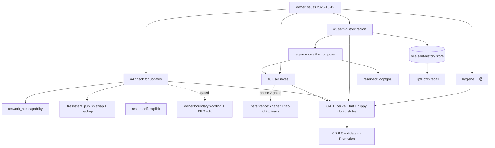

# plan-v0.2.6

## Scope decision

**PENDING — owner to confirm.** This document opens 0.2.6 as a planning home.
The set below is a *candidate* scope assembled from the owner's GitHub issues
opened 2026-10-12 and from carried debt; it is **not** yet an owner-ratified
scope. Per `AGENTS.md`, accepted scope is upserted into the owning PRD before
this plan is archived.

Candidate threads, in the order the owner raised them:

1. Three owner issues (2026-10-12):
   - **#3** sent-history region — a region above the composer showing the
     active terminal's recent sends, click-to-refill, with blank room reserved
     for future loop/goal controls.
   - **#4** settings "Check for updates" — the product's **first outbound
     network call** and **first self-modifying behaviour**; needs an owner
     boundary-wording decision before implementation (§Open decisions).
   - **#5** user notes — a per-context scratchpad (global-first), never sent to
     the PTY; phase 1 session-scoped only, persistence gated.
2. **Repo hygiene (三理)** — tracked in `plan/plan-repo-hygiene.md` (batch B,
   not yet written). Batches B–E only; no feature-level refactors.
3. Carried debt pulled in **only if the owner accepts** — see "Carried, not
   pulled in" below. One is time-sensitive:
   **{R1} the `ubuntu-latest` → Ubuntu 26 migration begins 2026-10-19**, when
   the Node-20 action shims are removed. That leaf does not need to ride a
   version at all; flag it for a bounded pass regardless of 0.2.6's final scope.

## Tree DAG

```text
0.2.6: owner-issues + hygiene; scope PENDING owner confirmation
├── {SENTHIST} sent-history region in the host UI                    [_] @host=none
│      source: GitHub #3 (owner, 2026-10-12); owns `prd/PRD_02_25_con_workspace.md`
│      invariant: the region is a VIEW over the one existing sent-history
│        store (`ComposerState.history`, 64 entries, `crates/minicon-core/src/
│        composer.rs:52`) — never a second store, or the region and Up/Down
│        recall disagree about "what I sent"; it shows the newest ~20, one row
│        per entry with the destination tab, newest first; a reserved blank
│        sub-area below it belongs to future loop/goal work (placeholder only)
│      evidence: `ui-snapshot` publishes the region (rows + hit rects +
│        reserved rect); a black-box journey clicks a row through the real
│        pointer path and reads the composer back (== clicked entry, caret at
│        end, draft preserved); the region's geometry joins LAYOUT_SWEEP;
│        screenshot pair proves the band changed, window size unchanged
│      safe failure: clicking never sends; a click during recall is just a new
│        jump; sending still ends recall
│      dependency: none
│      non-goal: pinning/search/filter/edit/delete of entries; changing the
│        64 bound or duplicate suppression; persistence across restarts
│      open: per-active-terminal view vs app-global (the composer is one
│        app-wide widget today, `src/main.rs:569`); placement; default open/closed
├── {UPDATE} settings "Check for updates" → verify → swap → restart  [_] @host=none
│      source: GitHub #4 (owner, 2026-10-12); owns `prd/PRD_02_23_minicon.md`
│        boundary + `prd/PRD_02_26_con_control_cli.md` observation
│      mechanism already present, reuse — do NOT add a stack:
│        `minicon_platform::network_http` (bounded outbound client, feature
│        already enabled) for the GitHub `releases/latest` GET + the asset
│        download; `filesystem_publish::publish_file`/`write_file_atomic`
│        (staging sibling + atomic replace, retained backup) for the swap;
│        `src/cli.rs` `current_exe` + the `install-cli` permission-hint for
│        resolving/refusing the destination
│      invariant: a manual, per-click check only — never background, never
│        silent; version compare is SEMANTIC (0.2.10 > 0.2.9), not lexical;
│        the region is a state machine (idle/checking/up-to-date/available/
│        downloading/failed/ready) that survives the panel being closed; the
│        network work and the swap run OFF the paint thread (clipboard-worker
│        pattern); a restart is always an explicit user action (it drops every
│        terminal and ends the `--control` endpoint)
│      integrity: verify the SHA-256 sidecar AND the code signature of the new
│        binary before swapping; refuse on any mismatch, old binary untouched
│      safe failure: network/DNS/proxy/rate-limit/truncation, sha or signature
│        mismatch, missing archive entry, disk full, permission denied,
│        rename-aside-succeeded-but-place-failed (roll the backup back) — each
│        leaves the running instance working with a specific message
│      #risk macOS cannot swap a single Mach-O (breaks signature/notarization):
│        a `.app`/`.dmg` path, a platform split in the flow; Windows can
│        rename a running exe but not overwrite it (hence rename-aside→restart)
│      #risk no archive decoder exists in the tree (no zip/tar/gz dep); pick
│        (a) a minimal pure-Rust decoder or (b) an extra uncompressed release
│        asset — a gating decision (§Open)
│      dependency: owner boundary-wording edit in `README*.md` + `prd/PRD_02_23`;
│        release assets/SHA sidecars per the release skill
│      non-goal: auto/background update; delta patches; rollback UI; updating
│        anything but the product binary; any telemetry
│      open: archive-decode approach; backup retention (one successful launch?);
│        remote-differs-but-older behaviour; macOS path
├── {NOTES} user notes — per-context scratchpad, never sent to PTY      [_] @host=none
│      source: GitHub #5 (owner, 2026-10-12); owns `prd/PRD_02_25_con_workspace.md`
│      phase 1 (session-scoped, no charter change): a notes section in the
│        {SENTHIST} region; context = {active tab} ∪ {Global}; global-first;
│        its own editor with focus/IME plumbing (this is the real cost — the
│        product has exactly one text input surface today and an "exactly one
│        focus owner" a11y contract); `ui-snapshot` exposes it
│      hard boundary: a note is NEVER written to the PTY; clicking a note edits
│        the note, it does not fill the composer
│      #risk phase 1 must be described as a scratchpad, not memory — it does
│        not survive a restart
│      blocked (phase 2, persistence): owner charter decision on "user data
│        file ≠ product residue"; a durable tab-id key across restarts; a
│        privacy/control-surface decision (`--control` read/write = new
│        disclosure surface). Do not start phase 2 until all three land
│      non-goal: templates/sendable snippets (a different model — separate
│        idea); per-tab persistence; search/tags/formatting
├── {HYGIENE} 三理 (repo hygiene)                                   [-] @host=none
│      owner-ordered 2026-10-12; owned in `plan/plan-repo-hygiene.md`
│      batch A DONE (commit 905bc84): archived 6 plans, repointed links,
│        normalized non-goal markers to `[no]`, fixed a `[✓]` and a home path
│      remaining: B ledger + delivery-tree + orphan/problem registration + issue
│        registration; C `.gitignore` real gaps (research outputs only — do NOT
│        ignore vendored deps); D dead-code pass (`.rs`, needs test+clippy);
│        E local/remote hygiene (cargo clean, disabled workflow, stale branches)
│      dependency: owner answers for C/E (see §Open)
│      non-goal: feature-level refactors (main.rs split, 90-feature convergence,
│        pinned-crate drift) — recorded in the ledger, not done here
└── {VERSION} 0.2.6                                                 [_] @host=none
       `Cargo.toml` version 0.2.6; `release-policy.json` is bumped by the
       release step, not here

Carried, not pulled in (unchanged unless the owner says otherwise):
- C1 `capture-pane --scrollback N` — BLOCKED on a vendored-vt100 API addition
  (cross-repo), see `plan/plan-carried-debt.md`
- C3 box-drawing glyphs — needs a real Windows display host with Consolas
- C4 idle RSS toward 10 MiB — needs a six-cell lnx-aarch64 receipt
- D2 select-cells-from-change — needs gh dispatch rights + negative-control
  evidence; a wrong guess is a silent cell skip, forbidden here
- E1/E2 AgenTerm shared seam `(OWNERS)`
- F1 composer image-paste chip UI — self-contained, could be pulled in if wanted
- F2 true headless render — not owner-scoped
- G3 Windows new-tab layout garbled — not reproduced (2026-10-10 attempt); needs
  a sharper trigger, do not claim fixed on a non-repro
- {SCRSHOT-HANG} `screenshot-pane` writes its PNG then does not return —
  `plan/problem-screenshot-pane-hang.md`, no repro yet; a candidate pull-in
  because it now blocks other verification work
- {ALTSCREEN} Windows alt-screen resize — platform limitation,
  `plan/plan-alt-screen-resize.md`
- {LOOP} harness context engineering — `plan/plan-harness-context-engineering.md`
- NewAgent dialog templates — `plan/plan-newagent-config.md`
```

## Dependencies and shared prerequisites

- `{SENTHIST}` and `{NOTES}` both live in the same host-UI region and both touch
  `src/ui.rs` layout, `src/host_paint.rs`, and `ui-snapshot`. Sequence them:
  region geometry first, then the notes section — and keep `{NOTES}`'s reserved
  area distinct from the loop/goal placeholder.
- `{UPDATE}` alone introduces the product's first network + self-modify paths;
  it should not be bundled with a region/layout change.
- `{HYGIENE}`'s batch D is the only code-touching hygiene batch; it needs
  `cargo fmt` + `clippy -D warnings` + `./scripts/build.sh test`.

## GATE status

Not started. Version-gate (six-cell, exact-source Candidate, no-rebuild
Promotion, dual signing) is run per the `run-reputation-and-release` skill when
a Candidate is cut; not pre-claimed here. If `{UPDATE}` ships, its whole state
machine must be provable against a loopback server, with real-GitHub as a
separate opt-in (`--ignored`) test — not part of the default gate.

## Memory palace



## Open decisions (owner)

0.2.6 scope itself: which of the candidate threads are in, and is the version
cut for all of them or a subset?
1. `{UPDATE}` boundary wording (`README*.md`, `prd/PRD_02_23`) and the
   archive-decode approach; backup retention policy; older-remote behaviour;
   macOS path.
2. `{SENTHIST}` per-terminal vs app-global; placement; default open/closed.
3. `{NOTES}` confirm notes (never sent) vs templates/sendable snippets (a
   different model); whether to expose it on `--control` at all.
4. `{HYGIENE}` C/E confirms: `external-results.json` (864K) keep? remote stale
   branches delete? `cargo clean` now? `research/` ignore granularity?
5. Pull-ins: `{F1}` chip UI and/or `{SCRSHOT-HANG}` into 0.2.6?
6. `{R1}` (Ubuntu 26 migration, starts 2026-10-19): fix now in a bounded pass,
   independent of the version?
