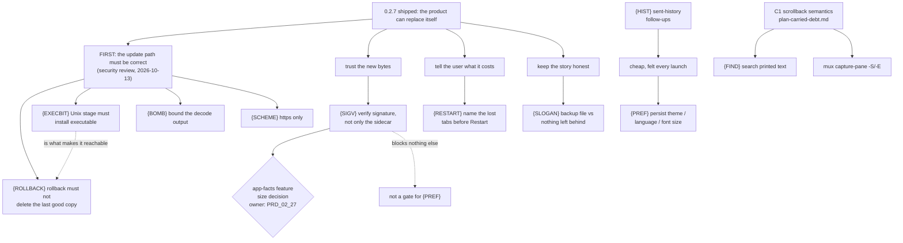

# plan-v0.2.8

## Scope decision

Opened 2026-10-13, while 0.2.7 (`{UPDATE}` check-for-updates + `{ICON}`
window-icon parity) was being closed by another session. This file exists so
the observations below have **one owner** instead of living in a chat log.

Its trigger is a single fact: **0.2.7 moved MiniCon's identity, not just its
feature list.** It is the first outbound network call and the first time the
product replaces its own bytes. The boundary amendment that admits it is
written, but three consequences were not carried into the product story, and
they are what this version is for. Alongside them sit the user-visible gaps
that are cheap to close and expensive to keep explaining.

Nothing here touches 0.2.7's *release chain* (which is finished). But the
security review below found four defects **inside** `src/update.rs` and the
platform primitives it calls, so the earlier claim that every leaf is
independent of `src/update.rs` is withdrawn: three of these leaves edit it, and
they take priority over everything else in this file. A product that can
replace itself must be correct before it gains features.

## Handoff: read this first

**Status: not started, and this file is the entrypoint.** v0.2.7 is published;
`main` is clean at `3570d77` (product code == `f52662a`). Nothing here is
in flight. Read `AGENTS.md` first for the dev loop, `cargo fmt`/`clippy` gate,
six-cell rule and the release boundary — this section does **not** repeat those;
it adds only what is specific to this version.

Read next, in order: `PRD.md` (frontier), `prd/PRD_02_25_con_workspace.md`
"Host UI" (the owner of every leaf below), `prd/PRD_02_32_dev_loop_crosscheck.md`
"Local per-host gates" (which local command actually compiles what),
`prd/PRD_02_27_con_delivery.md` (the delivery boundary `{SIGV}` depends on).

### Order, and why

1. `{ROLLBACK}` **and** `{EXECBIT}` together, in one change. They are a chain:
   `{EXECBIT}` is what makes the `{ROLLBACK}` path reachable on Linux. Fixing
   either alone leaves the Linux install still destroyable.
2. `{BOMB}`, then `{SCHEME}` — independent, small, both provable offline.
3. Then the planned leaves, `{PREF}` first (cheapest, felt every launch).

Do not start `{FIND}` (blocked on C1) or `{SIGV}` (a PRD_02_27 size decision)
until their gates clear. Do not add a new capability before step 1 is done.

### Where each leaf can be verified — the handoff risk

`{EXECBIT}` is **Unix-only** and the extraction/staging path it lives in cannot
be *executed* on a Windows host. A Windows-only developer will otherwise "verify"
it by a green local test that never touches the defect. Plan the verification
per leaf before writing code:

| Leaf | Runs on Windows? | How to prove it |
|---|---|---|
| `{ROLLBACK}` | yes | unit test: stage a deliberately non-launchable file, swap, assert the destination still holds the old bytes and the rollback error is surfaced |
| `{EXECBIT}` | **no** | unit test asserting the staged file's mode is 0755 (a `cfg(unix)` test or a pure function returning the mode); then `cargo zigbuild --target x86_64-unknown-linux-gnu` per PRD_02_32, and the CI Linux cells |
| `{BOMB}` | yes | unit test with a crafted archive (tiny compressed / huge declared output) asserting a typed refusal, not an abort |
| `{SCHEME}` | yes | unit test: an `http://` URL is refused with no request sent (the loopback server can assert it saw nothing) |
| `{SIGV}` | yes (Windows PE) | needs a real signed/unsigned fixture; the macOS bundle case cannot be proven here — PRD_02_32's macOS gate compiles it only |

### Testing notes specific to this version

- The update tests already live in `src/update.rs`'s `mod tests` and prove the
  state machine against a **loopback HTTP server** (`a_check_against_loopback…`,
  `an_install_from_loopback…`, `a_truncated_answer_is_a_failure`,
  `a_rate_limited_answer…`, `the_swap_keeps_the_old_executable_and_rolls_back_on_failure`).
  Follow that pattern; do not introduce a live network dependency into the
  default gate.
- `src/update.rs`'s `Target::in_place` is `true` for Windows and Linux, `false`
  for macOS (`.dmg`). Linux is the only `in_place` host whose archive is a
  `.tar.gz`, which is why `{EXECBIT}` is Linux-only — the `.zip` path is
  Windows-only, where a file mode is meaningless.
- **The real-GitHub smoke is `#[ignore]`d and nothing runs it for us.** Run it by
  hand before any release, because it is the only test that exercises the TLS
  layer and it is what caught 0.2.7's shipped TLS panic:
  `cargo test --bin minicon -- --ignored update::tests::the_real_release_api_still_parses`

### Design notes that save a round

- `{EXECBIT}`: the tar header's mode is 8 octal bytes at offset 100; a zip entry's
  Unix mode is the high 16 bits of the "external file attributes" at offset 38 of
  the central-directory record. `read_tar_gz` currently returns `Vec<u8>` and
  drops it. Either return the mode alongside the bytes, or (simpler, and it also
  covers a container that records nothing) copy the running executable's own mode
  onto the staged file before the rename. Prefer copying the destination's mode —
  the product's binary is always executable, so this cannot install a non-runnable
  file, and it preserves whatever the user had.
- `{BOMB}`: derive the output ceiling from `ARCHIVE_BODY_LIMIT`
  (`src/update.rs:48`), which is already the download bound, so there is one
  number rather than two that can drift. Refuse as a typed error, never a panic.

### Releasing 0.2.8

Any product change here needs a new version and the CI chain — a public Release
is immutable (that is why these defects could not be patched into 0.2.7). Bump
`Cargo.toml`/`release-policy.json` and drive `scripts/release.sh <version>`; if
the version is already bumped it exits before its first dispatch, and the
dispatches must then be driven by hand — see
`prd/archive/v0.2.7-release-history.md` "Notes for the next chain" for the
`source_sha`/`--ref` trap it cost a round to learn.

## Verified against the landed 0.2.7 code (commit `417f595`)

Checked on 2026-10-13 against the committed 0.2.7 feature, so this version is
not planned on stale assumptions. The shipped commit is `f52662a` (the only
change after `417f595` was the TLS-provider pin in `network_http.rs`); the line
numbers below were re-checked against `f52662a` and still hold.

| Leaf | What the shipped code does | Line |
|---|---|---|
| `{SIGV}` | verifies only the release's own `.sha256` sidecar; no signature call anywhere in the update path | `src/update.rs:52` `SIDECAR_SUFFIX`, `:345` `verify_and_stage` |
| `{RESTART}` | spawns the new executable and sets `self.exit`; no session count, no confirmation | `src/main.rs:2157` `restart_into_staged` |
| `{SLOGAN}` | renames the replaced executable to `<name>.backup` and keeps it | `src/update.rs:377` `backup_path`, `:389` `commit_swap` |
| `{PREF}` | decodes only `font_size`, `cols`, `rows` | `src/main.rs:316` `struct ConConfig` |

Two findings from that read that change the leaves:

- **`{SIGV}` is not one shape on all three hosts.** `src/update.rs:66` records
  that swapping only the inner Mach-O breaks the signature and Gatekeeper, so
  macOS replaces the whole bundle. The verification target therefore differs per
  host, and the leaf's evidence has to cover the macOS bundle case, not only a
  bare Windows PE.
- **`{SIGV}` gained a neighbour, not a dependency:** 0.2.7 added
  `crates/minicon-core/src/version.rs` (semantic version comparison). Whether
  a *downgrade* is refused is now decidable and is not covered by any leaf
  here. Filed below as open decision 4.

## Security review of the shipped update path (2026-10-13)

An independent adversarial read of the 0.2.7 update path (network fetch →
checksum → archive decode → swap) found two things sound and four defects. I
re-read each against the shipped `f52662a` and confirmed all four before filing
them; the line numbers are verified, not reported.

**Sound, so it is not re-litigated:** the verification order (the sidecar is
parsed and the SHA-256 compared *before* the archive is read or any byte is
written — `src/update.rs:345`), and every network bound (size ceiling, timeouts,
redirect limit, truncation surfaced as an error). No path traversal, panic or
integer overflow in the archive reader: the extraction path comes from
`current_exe`, never from the entry name, so matching by base name is sufficient
for this trust boundary.

**Four defects, in priority order.** The first two chain: on Linux the second
is *caused* by the first, so `{EXECBIT}` is not exotic.

1. **`{EXECBIT}` — a Unix in-place update installs a non-executable binary.**
   The staged file is written by `filesystem_publish::write_file_atomic`, which
   sets no mode (`crates/minicon-platform/src/filesystem_publish.rs`; the Unix
   replace is a bare rename), and `read_tar_gz` reads only the member *bytes*,
   discarding the tar header's mode field (`src/update_archive.rs:94-105`).
   `inflate`/`write_all` therefore produce a 0644 `minicon`, `spawn` fails
   EACCES, and the only `in_place: true` targets are Windows (no such concept)
   and Linux — so the Unix path is broken end to end.
2. **`{ROLLBACK}` — the failed-launch rollback deletes the last good copy.**
   `src/main.rs:2166` calls `commit_swap(&backup, &destination)` to put the old
   executable back. `commit_swap` starts by computing `backup_path(destination)`
   (`src/update.rs:390`) — the *same* path `backup` points at — and
   `remove_if_present` deletes it (`:391`), then renames the new file onto it and
   renames the now-deleted `staged` into place, which fails. The `let _ =`
   swallows that error. Net effect: destination empty, old binary gone, new
   binary at `.backup`. The code comment says "so the product is still
   launchable"; it does the opposite. Fix: roll back with a plain
   `fs::rename(backup, destination)`, not by re-entering `commit_swap`.
3. **`{BOMB}` — archive decode has no output ceiling.** `read_tar_gz`
   `read_to_end`s the whole inflated stream (`src/update_archive.rs:83-86`) with
   no bound: the 8 MiB download ceiling bounds the *compressed* input, not the
   output, and gzip reaches ~1000:1, so a crafted archive yields gigabytes and
   the process aborts. `inflate` also pre-allocates the *declared* uncompressed
   size (`:112`), so a tiny zip entry declaring ~4 GiB aborts on `with_capacity`
   even though only 8 MiB of compressed data exists. Both are reachable from a
   release whose archive and sidecar were published together (the checksum
   passes) as well as from a hostile server.
4. **`{SCHEME}` — `http://` is accepted and the asset URL is unpinned.**
   `validate_url` admits both schemes (`crates/minicon-platform/src/network_http.rs:123`),
   and the download URL is taken verbatim from the release JSON. Low severity (a
   release document arrives over TLS first), but it is a plaintext-downgrade
   door and one line to close: require `https` for the update path.

The pre-existing gaps this review confirms rather than widens — no signature
check (`{SIGV}`) and the "sidecar travels with the archive" weakness — are
already leaves above; nothing here duplicates them.

## Collision boundary while 0.2.7 closes

**Resolved 2026-10-13: v0.2.7 is published and `src/ui.rs`, `src/host_ui.rs`
and `plan/archive/plan-v0.2.7.md` are committed and free.** The paragraph below
is kept only as the record of why this file waited.

`src/ui.rs`, `src/host_ui.rs` and `plan/archive/plan-v0.2.7.md` were still being edited
by the other session when this file was written. `{PREF}`, `{RESTART}` and
`{HIST}` all land in those two source files; do not start them until that
session's work is committed and the 0.2.7 release object exists. `{SIGV}`
(`src/update.rs` + a platform feature) and `{FIND}` (terminal/mux) are clear.

## Ordering principle

**Cheap, high-perception fixes first, and no new capability until the update
path is trustworthy.** A product that can replace itself must be more careful
than one that cannot, not less.

## Tree DAG

```text
0.2.8: make the self-updating product trustworthy, then close cheap gaps
├── FIRST: make the shipped update path correct (see the security review above)
│   ├── {ROLLBACK} the failed-launch rollback must not delete the last good copy
│   │      owner: `prd/PRD_02_25_con_workspace.md` "Host UI" (the update bullets)
│   │      defect: `src/main.rs:2166` re-enters `commit_swap`, which computes the
│   │        same `.backup` path and `remove_if_present`s it (`src/update.rs:390-391`)
│   │        — old binary deleted, destination emptied, error swallowed
│   │      invariant: after a swap whose new binary will not launch, exactly one
│   │        launchable `minicon` exists at the destination, or the previous one
│   │        is restored; never neither
│   │      evidence: a loopback test that swaps in a deliberately non-launchable
│   │        staged file and asserts the destination still exists and is the old
│   │        bytes; and an assertion that the rollback's own failure is surfaced
│   │      fix shape: roll back with `fs::rename(backup, destination)`, not by
│   │        re-entering `commit_swap`
│   ├── {EXECBIT} a Unix in-place update must install an executable
│   │      owner: `prd/PRD_02_25_con_workspace.md` "Host UI"
│   │      defect: staging sets no mode and `read_tar_gz` drops the tar header's
│   │        mode field, so Linux gets a 0644 `minicon` and `spawn` fails EACCES
│   │        — which is what makes `{ROLLBACK}` reachable in normal use
│   │      invariant: the staged file is executable before it is renamed into
│   │        place; the mode comes from the archive's declared mode, or a sane
│   │        default when the container records none
│   │      evidence: a Unix-target test whose staged artifact has mode 0755 and,
│   │        separately, an archive that declares 0644 and must be refused or
│   │        corrected rather than installed non-executable
│   │      non-goal: preserving setuid/setgid bits or any mode wider than the user
│   ├── {BOMB} archive decode must be bounded on its output
│   │      owner: `prd/PRD_02_25_con_workspace.md` "Host UI"
│   │      defect: `read_tar_gz` inflates with `read_to_end` and no ceiling, and
│   │        `inflate` pre-allocates the declared uncompressed size (both
│   │        `src/update_archive.rs`) — a crafted or tampered release aborts the
│   │        process by exhausting memory
│   │      invariant: decoding refuses once the output passes a ceiling derived
│   │        from the download bound, as a bounded panel error and never an abort
│   │      evidence: a loopback-served bomb (tiny compressed, huge declared or
│   │        actual output) is refused with an error naming the ceiling; and a
│   │        zip entry declaring ~4 GiB does not allocate on the declaration
│   └── {SCHEME} the update path speaks https only
│          owner: `prd/PRD_02_25_con_workspace.md` "Host UI"
│          defect: `validate_url` admits both schemes and the asset URL is taken
│            verbatim from the release JSON (`network_http.rs:123`)
│          invariant: the release fetch and the asset download refuse any scheme
│            other than https
│          evidence: a loopback `http://` URL is refused with a typed error, with
│            no request sent
├── {SIGV} verify the code signature of the new binary, not only its checksum
│      owner: `prd/PRD_02_25_con_workspace.md` "Host UI" (already carries the
│        `[-]` line this closes)
│      invariant: the archive is refused unless the release's published
│        SHA-256 sidecar matches AND the extracted executable carries a
│        signature this build trusts; a failure leaves the running executable
│        untouched and reports which of the two checks refused
│      evidence: a loopback-served release whose sidecar matches but whose
│        "executable" is unsigned, plus one that is signed with an untrusted
│        root — both must be refused, and the refusal text must name the check
│        that failed; no live GitHub call is needed for either
│      safe failure: a refused signature is a bounded panel error, never a
│        staged file and never a swap; the platform refuses rather than
│        downgrading to checksum-only when the inspector is unavailable
│      dependency: `crates/minicon-platform`'s `app-facts` feature
│        (`adapters/windows/app_facts.rs` `WinVerifyTrust`,
│        `adapters/macos/app_facts.rs` `SecStaticCodeCheckValidity`). **The
│        open decision is size, not mechanism** — that feature's app inventory
│        is otherwise unused by the product, and enabling it for one boolean is
│        a budget question owned by `prd/PRD_02_27_con_delivery.md`. Carry that
│        measurement here before choosing: enable the feature, or expose one
│        narrow verify-only entry point behind the existing `network-http`
│        feature instead.
│      non-goal: a general trust store, a user-managed key ring, pinning a
│        specific certificate, or verifying anything other than the one
│        executable this build is about to swap in
│      why now: the checksum and its sidecar come from the same release, so
│        today the check proves "these are the bytes the release published",
│        not "a publisher vouches for them". For a product that rewrites
│        itself, that is the weaker half of the guarantee.
├── {RESTART} say what a restart costs before it happens
│      owner: `prd/PRD_02_25_con_workspace.md` "Host UI"
│      invariant: pressing Restart is never the first moment a user learns
│        that every terminal, tab and the `--control` endpoint end
│      evidence: a `ui-snapshot` read plus a panel string asserting the open
│        tab count is named in the confirmation; a zero-tab session confirms
│        without a count
│      safe failure: an unknown tab count states the loss without a number
│        rather than refusing the restart
│      dependency: the tab count `list-tabs` already reports
│      non-goal: preserving sessions across the restart. MiniCon has no
│        persistent workspace and is not getting one; this leaf is about
│        telling the truth, not about making the loss disappear.
├── {SLOGAN} reconcile "nothing left behind" with the retained backup
│      owner: `prd/PRD_02_23_minicon.md` "Product boundary", plus the three
│        READMEs
│      invariant: the sentence a user reads and the files an update leaves are
│        the same claim. `update::commit_swap` renames the replaced executable
│        to `<name>.backup` and **keeps it** (deliberate, so a failed launch
│        can be rolled back by hand — `plan/archive/plan-v0.2.7.md` records the choice)
│      evidence: the shipped sentence and the on-disk result after one update
│        agree; whichever side changes, the other is changed with it
│      safe failure: none — a stale sentence is the defect this leaf removes
│      dependency: `prd/PRD_02_27_con_delivery.md` owns download/release copy
│      non-goal: deleting the backup automatically. Keeping it is the safer
│        default and is not reopened here.
├── {PREF} persist the preferences a user actually set
│      owner: `prd/PRD_02_25_con_workspace.md` "Configuration"
│      invariant: a choice made in the settings panel survives a restart.
│        Today `ConConfig` decodes only `font_size`, `cols` and `rows`
│        (`src/main.rs`), so **theme, interface language and font-size changes
│        are lost on exit** while the user's own layout preferences are the
│        ones with a documented reason not to persist
│      evidence: set each of theme/language/font size, restart, and read them
│        back through `ui-snapshot` (`ui_theme`, the language tag) rather than
│        by eye; assert an unknown or malformed stored value falls back to the
│        default instead of failing to start
│      safe failure: a missing, unknown or malformed `minicon.json` key starts
│        with the default for that key only, never refusing to launch
│      dependency: the single-pass config scanner in
│        `prd/PRD_02_26_con_control_cli.md` "JSON contract" — the same bounded
│        decoder extends to the new keys; no second parser
│      non-goal: persisting view state. `sidebar_collapsed` and
│        `history_panel_open` stay session-scoped on purpose (a restart must
│        not strand a user in a layout they do not remember choosing), and this
│        leaf does not reconsider that. It also does not persist the update
│        phase, which is a fact about this process, not a preference.
│      why first: it is the cheapest leaf here and the only one a user hits on
│        every single launch.
├── {FIND} find text in what the terminal has already printed            [_]
│      owner: `prd/PRD_02_25_con_workspace.md` "Selection and clipboard"
│      invariant: a user can search the visible grid plus retained scrollback
│        without a second program, and a hit scrolls the match into view
│      evidence: a black-box journey that prints a marker below the fold,
│        searches for it, and asserts the match is visible in `capture-pane`
│        afterwards
│      safe failure: no match reports "not found" and leaves the viewport and
│        selection exactly as they were — a failed search never scrolls
│      dependency: **C1 in `plan/plan-carried-debt.md`.** MiniCon's scrollback
│        semantics are still undecided, and a search that cannot say how far
│        back it reaches cannot state what it searched. Do not start this leaf
│        until C1 has an answer.
│      non-goal: regular expressions, replace, cross-tab search, or a search
│        UI in the host chrome. One query, one direction, one viewport.
├── {HIST} finish the sent-history panel's two named follow-ups           [_]
│      owner: `prd/PRD_02_25_con_workspace.md` "Host UI"
│      invariant: a row says which tab it went to, and the list behaves when
│        it holds more rows than fit
│      evidence: with two tabs and one line sent to each, every row names a
        different destination; with more entries than the panel's height, the
        newest remain reachable and clicking one still refills the composer
        with the half-typed draft intact
│      safe failure: an unknown destination omits the label rather than
        inventing one
│      dependency: `{PREF}` is not required; the panel is already shipped
│      non-goal: editing history, deleting entries, or persistence across
│        restarts (the store lives with the composer)
└── Carried, not re-planned here
       ├── C1 scrollback semantics — `plan/plan-carried-debt.md`; it blocks
       │     `{FIND}` above and `mux capture-pane -S/-E`, the tmux verb a
       │     script reaching for history actually calls. Still the highest-
       │     leverage open question in the repo.
       ├── `{SCRSHOT-HANG}` — `prd/PRD_02_26_con_control_cli.md`; not
       │     reproduced since 2026-10-10, needs a real GUI host
       └── `plan/plan-carried-debt.md`'s C3 (Consolas seam), C4 (idle RSS),
             F1 (image-paste chip), F2 (true headless render) — each keeps its
             own owner and is not absorbed into this version by listing it
```

## Memory palace



## GATE status

Not started. Every leaf above is `[_]`, with one ordering change since this file
was opened: the four `FIRST` leaves from the security review
(`{ROLLBACK}`, `{EXECBIT}`, `{BOMB}`, `{SCHEME}`) are defects in code that
**already shipped in 0.2.7**, so they go before the planned work and before
anything new. `{EXECBIT}` and `{ROLLBACK}` are a chain — fixing one without the
other leaves Linux still able to destroy a user's install. None of the four
needs a live GitHub call or a size decision; all four are provable against a
loopback server and a temporary directory.

The two leaves that must be measured before any code moves are `{SIGV}` (a size
decision owned by PRD_02_27, not a mechanism problem) and `{FIND}` (blocked on
C1, which is somebody else's answer). `{PREF}` is ready to start the moment the
0.2.7 files above are free — they are free now (v0.2.7 is published).

## Open decisions (owner)

1. **{SIGV} size** — enable `app-facts`, or add a verify-only entry point
   behind `network-http`? This is a budget call and belongs to
   `prd/PRD_02_27_con_delivery.md`, not to whoever writes the code.
2. **{SLOGAN} direction** — change the sentence, or change the behaviour and
   clean up the backup? The current keep-the-backup choice is the safe one and
   is recorded; this asks only whether the copy follows it.
3. **{FIND} shape** — one query and one direction, or a scroll-to-match model
   closer to `less`? Deferred until C1 settles what "scrollback" means here.
4. **Downgrade** — now that `crates/minicon-core/src/version.rs` can compare
   versions, what does the product do when `releases/latest` is *older* than
   the running build (a rollback release, or a `latest` that was unpublished)?
   This was one of 0.2.7's six open owner gates; if it is still open when 0.2.8
   starts, it lands here rather than staying in `plan/archive/plan-v0.2.7.md`.
