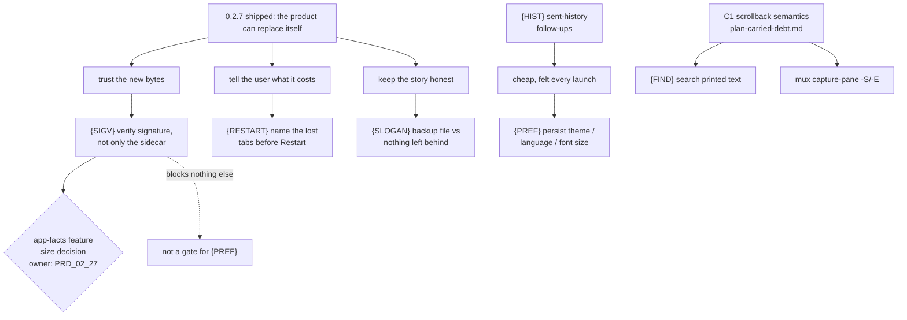

# plan-v0.2.8

## Scope decision

Opened 2026-10-13, while 0.2.7 (`{UPDATE}` check-for-updates + `{ICON}`
window-icon parity) was being closed by another session. This file exists so
the observations below have **one owner** instead of living in a chat log.

Its trigger is a single fact: **0.2.7 moved MiniCon's identity, not just its
feature list.** It is the first outbound network call and the first time the
product replaces its own bytes. The boundary amendment that admits it is
written, but three consequences were not carried into the product story, and
they are what this version is for. Alongside them sit the user-visible gaps
that are cheap to close and expensive to keep explaining.

Nothing here touches 0.2.7's release path. Every leaf is independent of
`src/update.rs`'s state machine and of the release chain's gates.

## Verified against the landed 0.2.7 code (commit `417f595`)

Checked on 2026-10-13 against the committed 0.2.7 feature, so this version is
not planned on stale assumptions:

| Leaf | What the shipped code does | Line |
|---|---|---|
| `{SIGV}` | verifies only the release's own `.sha256` sidecar; no signature call anywhere in the update path | `src/update.rs:52` `SIDECAR_SUFFIX`, `:345` `verify_and_stage` |
| `{RESTART}` | spawns the new executable and sets `self.exit`; no session count, no confirmation | `src/main.rs:2157` `restart_into_staged` |
| `{SLOGAN}` | renames the replaced executable to `<name>.backup` and keeps it | `src/update.rs:377` `backup_path`, `:390` `commit_swap` |
| `{PREF}` | decodes only `font_size`, `cols`, `rows` | `src/main.rs:316` `struct ConConfig` |

Two findings from that read that change the leaves:

- **`{SIGV}` is not one shape on all three hosts.** `src/update.rs:66` records
  that swapping only the inner Mach-O breaks the signature and Gatekeeper, so
  macOS replaces the whole bundle. The verification target therefore differs per
  host, and the leaf's evidence has to cover the macOS bundle case, not only a
  bare Windows PE.
- **`{SIGV}` gained a neighbour, not a dependency:** 0.2.7 added
  `crates/minicon-core/src/version.rs` (semantic version comparison). Whether
  a *downgrade* is refused is now decidable and is not covered by any leaf
  here. Filed below as open decision 4.

## Collision boundary while 0.2.7 closes

`src/ui.rs`, `src/host_ui.rs` and `plan/plan-v0.2.7.md` were still being edited
by the other session when this file was written. `{PREF}`, `{RESTART}` and
`{HIST}` all land in those two source files; do not start them until that
session's work is committed and the 0.2.7 release object exists. `{SIGV}`
(`src/update.rs` + a platform feature) and `{FIND}` (terminal/mux) are clear.

## GATE status

Ordering principle for this version: **cheap, high-perception fixes first, and
no new capability until the update path is trustworthy.** A product that can
replace itself must be more careful than one that cannot, not less.

## Tree DAG

```text
0.2.8: make the self-updating product trustworthy, then close cheap gaps
├── {SIGV} verify the code signature of the new binary, not only its checksum
│      owner: `prd/PRD_02_25_con_workspace.md` "Host UI" (already carries the
│        `[-]` line this closes)
│      invariant: the archive is refused unless the release's published
│        SHA-256 sidecar matches AND the extracted executable carries a
│        signature this build trusts; a failure leaves the running executable
│        untouched and reports which of the two checks refused
│      evidence: a loopback-served release whose sidecar matches but whose
│        "executable" is unsigned, plus one that is signed with an untrusted
│        root — both must be refused, and the refusal text must name the check
│        that failed; no live GitHub call is needed for either
│      safe failure: a refused signature is a bounded panel error, never a
│        staged file and never a swap; the platform refuses rather than
│        downgrading to checksum-only when the inspector is unavailable
│      dependency: `crates/minicon-platform`'s `app-facts` feature
│        (`adapters/windows/app_facts.rs` `WinVerifyTrust`,
│        `adapters/macos/app_facts.rs` `SecStaticCodeCheckValidity`). **The
│        open decision is size, not mechanism** — that feature's app inventory
│        is otherwise unused by the product, and enabling it for one boolean is
│        a budget question owned by `prd/PRD_02_27_con_delivery.md`. Carry that
│        measurement here before choosing: enable the feature, or expose one
│        narrow verify-only entry point behind the existing `network-http`
│        feature instead.
│      non-goal: a general trust store, a user-managed key ring, pinning a
│        specific certificate, or verifying anything other than the one
│        executable this build is about to swap in
│      why now: the checksum and its sidecar come from the same release, so
│        today the check proves "these are the bytes the release published",
│        not "a publisher vouches for them". For a product that rewrites
│        itself, that is the weaker half of the guarantee.
├── {RESTART} say what a restart costs before it happens
│      owner: `prd/PRD_02_25_con_workspace.md` "Host UI"
│      invariant: pressing Restart is never the first moment a user learns
│        that every terminal, tab and the `--control` endpoint end
│      evidence: a `ui-snapshot` read plus a panel string asserting the open
│        tab count is named in the confirmation; a zero-tab session confirms
│        without a count
│      safe failure: an unknown tab count states the loss without a number
│        rather than refusing the restart
│      dependency: the tab count `list-tabs` already reports
│      non-goal: preserving sessions across the restart. MiniCon has no
│        persistent workspace and is not getting one; this leaf is about
│        telling the truth, not about making the loss disappear.
├── {SLOGAN} reconcile "nothing left behind" with the retained backup
│      owner: `prd/PRD_02_23_minicon.md` "Product boundary", plus the three
│        READMEs
│      invariant: the sentence a user reads and the files an update leaves are
│        the same claim. `update::commit_swap` renames the replaced executable
│        to `<name>.backup` and **keeps it** (deliberate, so a failed launch
│        can be rolled back by hand — `plan/plan-v0.2.7.md` records the choice)
│      evidence: the shipped sentence and the on-disk result after one update
│        agree; whichever side changes, the other is changed with it
│      safe failure: none — a stale sentence is the defect this leaf removes
│      dependency: `prd/PRD_02_27_con_delivery.md` owns download/release copy
│      non-goal: deleting the backup automatically. Keeping it is the safer
│        default and is not reopened here.
├── {PREF} persist the preferences a user actually set
│      owner: `prd/PRD_02_25_con_workspace.md` "Configuration"
│      invariant: a choice made in the settings panel survives a restart.
│        Today `ConConfig` decodes only `font_size`, `cols` and `rows`
│        (`src/main.rs`), so **theme, interface language and font-size changes
│        are lost on exit** while the user's own layout preferences are the
│        ones with a documented reason not to persist
│      evidence: set each of theme/language/font size, restart, and read them
│        back through `ui-snapshot` (`ui_theme`, the language tag) rather than
│        by eye; assert an unknown or malformed stored value falls back to the
│        default instead of failing to start
│      safe failure: a missing, unknown or malformed `minicon.json` key starts
│        with the default for that key only, never refusing to launch
│      dependency: the single-pass config scanner in
│        `prd/PRD_02_26_con_control_cli.md` "JSON contract" — the same bounded
│        decoder extends to the new keys; no second parser
│      non-goal: persisting view state. `sidebar_collapsed` and
│        `history_panel_open` stay session-scoped on purpose (a restart must
│        not strand a user in a layout they do not remember choosing), and this
│        leaf does not reconsider that. It also does not persist the update
│        phase, which is a fact about this process, not a preference.
│      why first: it is the cheapest leaf here and the only one a user hits on
│        every single launch.
├── {FIND} find text in what the terminal has already printed            [_]
│      owner: `prd/PRD_02_25_con_workspace.md` "Selection and clipboard"
│      invariant: a user can search the visible grid plus retained scrollback
│        without a second program, and a hit scrolls the match into view
│      evidence: a black-box journey that prints a marker below the fold,
│        searches for it, and asserts the match is visible in `capture-pane`
│        afterwards
│      safe failure: no match reports "not found" and leaves the viewport and
│        selection exactly as they were — a failed search never scrolls
│      dependency: **C1 in `plan/plan-carried-debt.md`.** MiniCon's scrollback
│        semantics are still undecided, and a search that cannot say how far
│        back it reaches cannot state what it searched. Do not start this leaf
│        until C1 has an answer.
│      non-goal: regular expressions, replace, cross-tab search, or a search
│        UI in the host chrome. One query, one direction, one viewport.
├── {HIST} finish the sent-history panel's two named follow-ups           [_]
│      owner: `prd/PRD_02_25_con_workspace.md` "Host UI"
│      invariant: a row says which tab it went to, and the list behaves when
│        it holds more rows than fit
│      evidence: with two tabs and one line sent to each, every row names a
        different destination; with more entries than the panel's height, the
        newest remain reachable and clicking one still refills the composer
        with the half-typed draft intact
│      safe failure: an unknown destination omits the label rather than
        inventing one
│      dependency: `{PREF}` is not required; the panel is already shipped
│      non-goal: editing history, deleting entries, or persistence across
│        restarts (the store lives with the composer)
└── Carried, not re-planned here
       ├── C1 scrollback semantics — `plan/plan-carried-debt.md`; it blocks
       │     `{FIND}` above and `mux capture-pane -S/-E`, the tmux verb a
       │     script reaching for history actually calls. Still the highest-
       │     leverage open question in the repo.
       ├── `{SCRSHOT-HANG}` — `prd/PRD_02_26_con_control_cli.md`; not
       │     reproduced since 2026-10-10, needs a real GUI host
       └── `plan/plan-carried-debt.md`'s C3 (Consolas seam), C4 (idle RSS),
             F1 (image-paste chip), F2 (true headless render) — each keeps its
             own owner and is not absorbed into this version by listing it
```

## Memory palace



## GATE status

Not started. Every leaf above is `[_]`. The two leaves that must be measured
before any code moves are `{SIGV}` (a size decision owned by PRD_02_27, not a
mechanism problem) and `{FIND}` (blocked on C1, which is somebody else's
answer). `{PREF}` is ready to start the moment the 0.2.7 files above are free.

## Open decisions (owner)

1. **{SIGV} size** — enable `app-facts`, or add a verify-only entry point
   behind `network-http`? This is a budget call and belongs to
   `prd/PRD_02_27_con_delivery.md`, not to whoever writes the code.
2. **{SLOGAN} direction** — change the sentence, or change the behaviour and
   clean up the backup? The current keep-the-backup choice is the safe one and
   is recorded; this asks only whether the copy follows it.
3. **{FIND} shape** — one query and one direction, or a scroll-to-match model
   closer to `less`? Deferred until C1 settles what "scrollback" means here.
4. **Downgrade** — now that `crates/minicon-core/src/version.rs` can compare
   versions, what does the product do when `releases/latest` is *older* than
   the running build (a rollback release, or a `latest` that was unpublished)?
   This was one of 0.2.7's six open owner gates; if it is still open when 0.2.8
   starts, it lands here rather than staying in `plan/plan-v0.2.7.md`.
