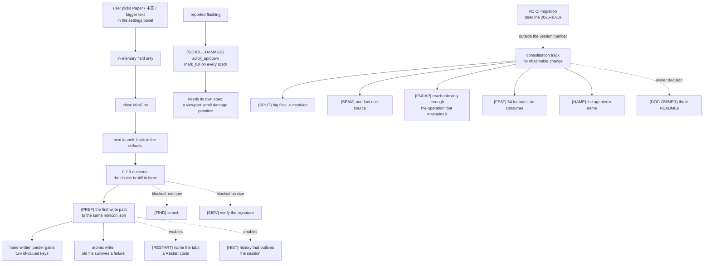

# plan-v0.2.9

## The product outcome this version exists for

**MiniCon invites you to choose — theme, language, text size — and forgets every
one of them the moment you close it.** The settings panel is real: it changes
the theme, it switches the UI language, it resizes text. Nothing it does
survives the process. A user who switches to `Paper` because the room is bright
gets `Neutral` back at the next launch, and the panel that offered the choice
says nothing about it being temporary.

That is the same class of defect 0.2.8 was about — the product asks the user to
do a thing and then drops it — and it is the one leaf 0.2.8's own deferred list
already named as *"the cheapest and most-felt leaf in the repo, and the first
thing 0.2.9 should do."*

Everything below is in service of one outcome:

> **A choice made in the settings panel is still in force at the next launch —
> and it is kept in the same hand-editable `minicon.json` the product already
> reads.**

That outcome is what bounds 0.2.9's *product* track. It is also why `{PREF}`
comes first and alone: MiniCon has never had a configuration layer it **writes**
(today the file is yours to edit; the product only reads three numeric keys and
never writes the file back), and `{RESTART}` and `{HIST}` both want to hang
something on that layer. Build it once, prove it, then extend it.

This version carries a **second, deliberately separate track**: the engineering
consolidation this repository's own hygiene ledger has been deferring
(`plan/plan-repo-hygiene.md`, "Recorded, deliberately NOT done"). It is listed
here so it has a home with evidence and an order, **not** as a reason for the
version to exist. Every leaf on that track is required to change **no
observable behaviour**; a consolidation leaf that changes behaviour has stopped
being consolidation and must be re-filed as a product leaf.

Read `AGENTS.md` first for the dev loop, the `cargo fmt`/`clippy` gate, the
six-cell rule and the release boundary — this section does not repeat them.

Read next, in order: `PRD.md` (frontier), `plan/archive/plan-v0.2.8.md`
("Deferred to 0.2.9" — where every product leaf here came from),
`prd/PRD_02_25_con_workspace.md` "Configuration" and "Host UI" (the owner of
every product leaf), `prd/PRD_02_27_con_delivery.md` "Artifact budget" (the
owner of the `{SIGV}` size decision), and `prd/PRD_02_28_shared_core.md` (the
owner of the platform-crate boundary the consolidation track touches).

## Handoff: read this first

**Status: `[-]` the product track is landed except `{SCROLL-DAMAGE}`, which is
blocked on its spec's own findings; the consolidation track has not started.**

Landed 2026-10-14 (see "Landed" below): `{PREF}`, `{RESTART}`, `{HIST}`.
`{SCROLL-DAMAGE}`'s spec is written — `plan/plan-scroll-damage.md` — and it found
that the leaf cannot deliver its own outcome as scoped; what it changes and what
blocks it is recorded there and in "GATE status". Nothing on the consolidation
track has been started.

### Order, and why

1. `{PREF}` — the version's outcome, and the precondition for the two leaves
   that follow it. Do not start anything else on the product track first.
2. `{RESTART}` and `{HIST}` — both cheap, both want the configuration layer
   `{PREF}` establishes (a preference about restart behaviour; a history that
   can outlive the session). Pull either in only if it does not slow `{PREF}`.
3. `{SCROLL-DAMAGE}` — **blocked on its own spec.** It is the reported
   "flashing": ordinary output re-rasterising the whole window because the
   vendored `vt100` marks the entire grid damaged on every scroll (root cause
   below, verified). The fix is a viewport-scroll *damage primitive* — a change
   to the parser's damage contract — and it cannot be written responsibly
   without a spec that first decides the primitive's shape. Write the spec
   before the code; do not free-hand it.
4. The **consolidation track** is order-free **against** the product track: each
   leaf is independently reviewable and provably behaviour-preserving, so it can
   go before, between or after the product leaves. It must never gate them.

Do not start `{FIND}` (blocked on C1) or `{SIGV}` (blocked on an owner size
decision). Do not sweep the platform crate's unused features as part of `{PREF}`
— that is `{FEAT}`, and it is a different change with a different failure mode.

### Where each leaf can be verified — the handoff risk

The same trap 0.2.8 documented applies: a leaf whose test is `#[cfg(unix)]`
compiles out on this Windows host, and a green local `cargo test` says nothing
about it. Plan the verification per leaf before writing code.

| Leaf | Runs on Windows? | How to prove it |
|---|---|---|
| `{PREF}` | yes | round-trip a real file: `ui-snapshot` reports the id → set it through the panel → the process writes `minicon.json` → a **fresh process** reads it back and `ui-snapshot` reports the same id. Also: a corrupt/unknown/absent key falls back to the default and never panics, and a write that fails leaves the old file intact. |
| `{RESTART}` | yes | the panel string names the tabs and children that a Restart loses, read out of `ui-snapshot`, in all three languages; one tab and N tabs read differently (no invented "0 tabs closed"). |
| `{HIST}` | yes | per the owner's own acceptance once the scope is fixed — at minimum, history survives the thing it is claimed to survive. |
| `{SCROLL-DAMAGE}` | **partly** | the damage decision is a pure function of parser events → a `cfg`-free unit test on the damage it returns; the on-screen effect needs a host with a real display, so the Linux `xvfb-run` journey is the one that shows it. State which cells ran. |
| `{SPLIT}`/`{SEAM}`/`{ENCAP}` | yes | the full local gate (`./scripts/build.sh test`) plus `cargo test --test minicon_alignment`; a pure move must change **no** test outcome and **no** snapshot bytes. |
| `{FEAT}` | yes | a build of each target MiniCon already ships, before and after, with the six-cell CI as the authority; removing a feature MiniCon never enabled cannot change a shipped artifact, and that is the claim to check. |
| `{NAME}` | yes | comment-only changes compile identically; identifier changes must be proven against the OS/D-Bus binding they name, one at a time. |

### Testing notes specific to this version

- **The config reader is a hand-written JSON parser, not `serde`.** It lives in
  `crates/minicon-core/src/json.rs` (`parse_config`, and `ConfigValues` is
  exactly three optional fields: `font_size`, `cols`, `rows`). Adding two keys
  means touching the parser's own dispatch and its malformed-input tests, not a
  derive — see "Verified against the landed 0.2.8 code" below.
- **The product has never written `minicon.json`.** There is no writer today;
  `load_config` is read-only. `{PREF}` therefore adds the first write path, and
  it must be atomic (`minicon-platform::filesystem_publish::write_file_atomic`
  is the existing primitive, used by the 0.2.8 update path) and must never
  destroy a file it cannot fully replace.
- **The two ids already exist and are stable** — `ThemeChoice` and `UiLanguage`
  each carry a "stable identifier used by the control surface" (`src/theme.rs`,
  `src/ui.rs`), so `ui-snapshot` can assert on an id rather than a display
  label. Persist the id, not the label.
- The real-GitHub smoke is still `#[ignore]`d and nothing runs it for us; run it
  by hand before any release (`cargo test --bin minicon -- --ignored
  update::tests::the_real_release_api_still_parses`).

## Landed (2026-10-14)

What is actually in the tree, and what proves it. Line numbers are the landed
code, not the plan's earlier read of it.

| Leaf | What landed | Evidence |
|---|---|---|
| `{PREF}` | the product's **first write path** to `minicon.json`: `ConfigValues` gains two string-valued keys (`crates/minicon-core/src/json.rs`), `ConConfig` gains typed `theme`/`language` (`src/main.rs`), `write_config_to` publishes through `minicon-platform::filesystem_publish::write_file_atomic`, and the panel's language / theme / font gestures call `persist_config`. The document is built from the values in memory, so the keys the panel does not set (`cols`/`rows`) are carried over rather than dropped | 5 tests in `src/main.rs`: the round trip through write-then-read by id, a hand-edited key surviving a change, an unknown id falling back per-key, a malformed file falling back entirely, and a write that cannot be published leaving the previous file alone; plus the codec tests in `json.rs` (unknown id parses, wrong type is reported, `decimal` round-trips through the reader) and the `from_tag`/`tag` inverse test in `theme.rs` and `ui.rs` |
| `{PREF}` (non-goal honoured) | no general preferences framework: only the three keys the panel sets, plus the two geometry keys it already read | the leaf's `non-goal` line above |
| `{RESTART}` | `UiLanguage::restart_cost(tabs)` states the count and that running commands stop, in all three languages; the panel paints it under the Updates status line exactly while a Restart is possible; `ui-snapshot` publishes `update.restart_cost` unconditionally so it can be asserted without staging a release | `ui.rs`: `the_restart_sentence_states_the_real_count_and_never_zero_tabs` (three languages, zero/one/N all differ, no "0 tabs"); `ui.rs`: `the_settings_panel_contains_every_section` extended for the new line's position |
| `{HIST}` | the owner's own follow-up list, both items: each sent line now carries the **destination label** it was sent to (captured from the tab tree at send time), and the panel **scrolls past its capacity** by wheel, clamped at both ends | `crates/minicon-core/src/composer.rs`: `HistoryEntry`, and `a_stored_line_keeps_the_destination_it_was_sent_to`; `ui.rs`: `the_history_scroll_stops_at_the_ends_and_never_lists_past_the_start`; `ui-snapshot`'s `history_panel.scroll` |
| `{SCROLL-DAMAGE}` | **spec only** — `plan/plan-scroll-damage.md` | the spec's own two blockers |

### What `{PREF}` deliberately does not do

The panel's font controls persist; **Ctrl+wheel zoom is gone** (0.2.8 removed the
Ctrl+wheel branch), so there is no high-frequency path that would write the file
on every wheel notch. A press at either font clamp writes nothing: `persist_config`
is called from `with_font_gesture`, which compares the size before and after.

## Verified against the landed 0.2.8 code

Read against the tree at `3f81f92` (the state 0.2.9 starts from), so this
version is not planned on stale assumptions.

| Leaf | What the shipped code does | Where |
|---|---|---|
| `{PREF}` | `ConConfig` decodes exactly `font_size`, `cols`, `rows`; the startup theme and language are hard-coded to their defaults, not read from config; the panel's changes are written to the in-memory field only | `src/main.rs:317` `struct ConConfig`, `:330` `load_config`, `:1013-1014` (`ui_language`/`ui_theme` default-constructed), `:3368` / `:3397` (panel writes the field) |
| `{PREF}` (schema) | the parser and its value struct are exactly three optional numeric fields; no string-valued key exists yet | `crates/minicon-core/src/json.rs:98` `parse_config`, `:108-112` `ConfigValues` |
| `{RESTART}` | spawns the new executable and sets `self.exit`; no session count, no confirmation, no statement of what is lost | `src/main.rs:2152` `restart_into_staged` |
| `{HIST}` | the collapsible right-side panel ships (0.2.6) as a view over the composer's one sent-history store; the panel is session-scoped (`history_panel_open`), and the notes scratchpad (GitHub #5) 0.2.6 deferred is still open | `src/main.rs:630` / `:1723`; `prd/PRD_02_25_con_workspace.md:182`; `PRD.md` v0.2.6 entry |
| `{SIGV}` | verifies only the release's own `.sha256` sidecar; no signature call anywhere in the update path | `src/update.rs:61` `SIDECAR_SUFFIX`, `:509` `verify_and_stage` |
| `{SCROLL-DAMAGE}` | `Grid::scroll_up` and `Grid::scroll_down` call `self.mark_full()` unconditionally, so any scroll damages the whole grid and the host repaints the whole window | `third_party/vt100/src/grid.rs:658` (`scroll_up`), `:683` (`scroll_down`); consumed by `src/terminal.rs:421` `mark_vt_damage` → `needs_full_raster()` |

One thing this read **confirms rather than re-opens**: the `{PREF}` gap is not a
missing key, it is a missing *write path*. Adding `theme`/`language` to
`ConfigValues` is necessary but not sufficient — nothing writes the file today.

## Tree DAG

```text
0.2.9: a choice made in the settings panel is still in force at the next launch
├── Product track — the version's outcome and what hangs off it
│   ├── {PREF} persist theme, language and text size                      [v]
│   │      owner: `prd/PRD_02_25_con_workspace.md` "Configuration"
│   │      problem: the panel changes theme, language and text size; none
│   │        survives the process, and the panel does not say so
│   │      invariant: a value set through the panel is in force at the next
│   │        launch; it is stored in the same hand-editable `minicon.json` the
│   │        product already reads; an absent, unknown or malformed value falls
│   │        back to the default and never panics; a failed write leaves the
│   │        previous file intact
│   │      evidence: set-through-panel → file-on-disk → fresh-process-reads-it
│   │        back, asserted on the stable id from `ui-snapshot`; plus the
│   │        fallback and failed-write cases
│   │      safe failure: an unreadable or unwritable config degrades to the
│   │        built-in defaults; the product still starts
│   │      dependency: none — it is the precondition for the two below
│   │      non-goal: a general preferences framework, per-tab settings, a
│   │        settings UI redesign, or writing any key the panel does not set
│   ├── {RESTART} say what a Restart costs before it is pressed            [v]
│   │      owner: `prd/PRD_02_25_con_workspace.md` "Host UI"
│   │      problem: Restart spawns the new binary and exits; it never says
│   │        that the open tabs and their children go with it
│   │      invariant: the press states how many tabs, and that running
│   │        children are terminated; the number is the host's real count
│   │      evidence: the string read out of `ui-snapshot`, in the panel's
│   │        language, differing for one tab and for N
│   │      safe failure: none — a wrong count is the defect
│   │      dependency: none, but it lands after `{PREF}` so the two do not
│   │        fight over the panel's string tables in the same change
│   │      non-goal: making Restart preserve sessions, a grace period, or a
│   │        "save your work" dialog
│   ├── {HIST} sent-history follow-ups                                    [v]
│   │      owner: `prd/PRD_02_25_con_workspace.md` "Host UI"
│   │      problem: the 0.2.6 panel is a session-scoped view; 0.2.8's deferred
│   │        list names "sent-history follow-ups" without fixing the scope,
│   │        and GitHub #5 (the notes scratchpad) has now been deferred twice
│   │      invariant: **to be fixed by the owner before code** — the first
│   │        task of this leaf is to write the list, then implement it
│   │      evidence: per the scope the owner fixes; at minimum, whatever the
│   │        panel claims to survive, it survives
│   │      safe failure: a history that is empty is honest; one that silently
│   │        drops entries is not
│   │      dependency: `{PREF}` if any part of the history is to persist
│   │      non-goal: a cross-tab scriptable history, or a search over it —
│   │        that is `{FIND}`
│   ├── {SCROLL-DAMAGE} a scroll damages a viewport, not the whole grid    [-]
│   │      owner: `prd/PRD_02_24_con_terminal.md`
│   │      problem: the reported "flashing" — ordinary output re-rasterises
│   │        the whole window, because the vendored parser marks the entire
│   │        grid damaged on every scroll
│   │      invariant: a scroll that moves the viewport by k rows damages the
│   │        rows it actually changed plus the exposed band; it does not
│   │        demand a full raster
│   │      evidence: a unit test on the damage the parser returns for a scroll
│   │        (rows, not `full`), and a rendered frame under a real display
│   │        showing a partial repaint
│   │      safe failure: unknown damage stays full rather than guessed —
│   │        today's behaviour is the safe fallback, so the change can only
│   │        narrow what is repainted
│   │      dependency: **its own spec first** — it changes the vendored
│   │        `vt100` damage contract (`take_damage`/`GridDamage`), and that
│   │        contract is consumed by `src/terminal.rs`. **Spec written:
│   │        `plan/plan-scroll-damage.md`.** It found that the leaf cannot
│   │        deliver its own outcome as scoped: the vendored crate's damage
│   │        oracle is not run by any gate, and two host-side decisions upgrade
│   │        every frame to full regardless. Code blocked on both; see the spec
│   │      non-goal: rewriting the parser's damage model wholesale, touching
│   │        the alternate screen, or changing `mark_full` callers other than
│   │        the two scroll functions
│   └── Deferred, blocked — named here, not started
│       ├── {FIND} search what a terminal already printed    [no] this version
│       │      blocked on C1 (`plan/plan-carried-debt.md`), which decides what
│       │      "scrollback" means before a search can be designed on it
│       └── {SIGV} verify the signature, not only the sidecar [no] this version
│              blocked on a size decision owned by
│              `prd/PRD_02_27_con_delivery.md` (`app-facts` vs a verify-only
│              entry point); per-host shape differs (macOS is a bundle,
│              Windows a PE)
└── Consolidation track — behaviour-preserving, order-free, never gates the above
    ├── {SPLIT} a big file becomes modules that name their concerns        [_]
    │      owner: `prd/PRD_02_28_shared_core.md` (MiniCon-owned source) ·
    │        `prd/PRD_02_24_con_terminal.md` for `terminal.rs`
    │      invariant: no observable behaviour change — every existing test,
    │        snapshot and black-box journey keeps its exact outcome
    │      evidence: the full local gate plus `minicon_alignment` before and
    │        after; a move that changes a test outcome is a bug in the move
    │      order: one module at a time, gate after each
    │      non-goal: changing a signature, a field's visibility, or a line the
    │        split did not have to touch
    ├── {SEAM} one fact, one source                                       [_]
    │      owner: `prd/PRD_02_28_shared_core.md` (the shared-rule boundary)
    │      invariant: the shortcut list, the CLI command catalogue and a cell's
    │        own painting each have a single definition the others read
    │      evidence: the existing `usage()`↔dispatch and catalogue↔dispatch
    │        alignment tests, extended to cover the copies that lack one
    │      non-goal: changing what `--help` prints
    ├── {ENCAP} a field that must not be written is not writable           [_]
    │      owner: `prd/PRD_02_28_shared_core.md`
    │      invariant: state with an invariant is reachable only through an
    │        operation that maintains it; `pub` means "used outside this file"
    │      evidence: the compiler, plus a test per newly-guarded transition
    │      non-goal: a workspace-wide visibility sweep done blind — each site
    │        is judged, and a `pub` that is genuinely cross-file stays
    ├── {FEAT} the platform crate stops shipping what no product uses       [_]
    │      owner: `prd/PRD_02_28_shared_core.md`
    │      problem: of 90 declared features, the product enables 19 directly
    │        and reaches 36 transitively — 54 have no consumer in this tree
    │      invariant: a feature removed is one no shipped target enables, and
    │        each removal is proven by building every target before and after
    │      evidence: the six cells, plus a build of each target MiniCon ships
    │      dependency: `{SPLIT}` need not precede it; it does not depend on the
    │        product track
    │      safe failure: a feature with a future owner (a11y, app-facts,
    │        desktop-host, network-dns) is **kept and marked**, not deleted —
    │        deleting a route some other product will want is not consolidation
    │      non-goal: renaming the crate, or moving code between the crates
    ├── {NAME} the `agenterm` name stops describing this repository          [_]
    │      owner: `prd/PRD_02_28_shared_core.md`
    │      problem: ~200 `agenterm` occurrences remain after the platform
    │        crates moved into MiniCon; some are comments, some are load-bearing
    │        (env vars, a D-Bus name, a diagnostics filename)
    │      invariant: an identifier that another process or the OS depends on
    │        keeps its value; a comment that names the wrong repository is a
    │        defect
    │      evidence: one identifier at a time, with the binding it names
    │        checked, and a comment-only change proven to compile identically
    │      safe failure: leave a load-bearing name alone and say why, rather
    │        than rename it and break a runtime lookup
    │      non-goal: a single mechanical rename across the tree
    └── {DOC-OWNER} three READMEs still hold a second copy of a PRD fact      [_]
           owner: `prd/PRD_02_28_shared_core.md` (platform README),
             `prd/PRD_02_27_con_delivery.md` (loader README, signing policy),
             `prd/PRD_02_25_con_workspace.md` (icon README)
           question: `crates/minicon-platform/README.md` (its technical body is
             published via `Cargo.toml`'s `readme = "README.md"` and is the
             crate's public face), `loader/README.md`, `CODE_SIGNING_POLICY.md`
             (its path is pinned by `tests/authenticode_inspector_policy.rs` and
             five public links, so it cannot move) and `assets/icon/README.md`
             each restate mechanism their PRD owner already holds
           why it is an owner decision, not a hygiene edit: each has a reason to
             keep its copy (a public surface, a test input, a doc.rs target), and
             the choice is "who owns the sentence", not "which file is tidy"
```

## Explicitly not in 0.2.9

- **`{FIND}` and `{SIGV}`** — both blocked on a decision, not on effort. A leaf
  that cannot yet state its invariant is not ready to be a version's scope.
- **A general preferences or settings framework.** `{PREF}` persists what the
  panel already sets and nothing else. New settings are their own leaves later.
- **The memory target (idle one-tab RSS toward 10 MiB).** Carried in
  `plan/plan-carried-debt.md` C4; unchanged by this version.
- **Anything that changes observable behaviour under the consolidation track.**
  If a consolidation leaf turns out to need a behaviour change, it is
  re-filed as a product leaf and the version's outcome decides whether it is in.

## Carried, untouched by this plan

`plan/plan-carried-debt.md`'s C1 (scrollback semantics — blocks `{FIND}` and
`mux capture-pane -S/-E`), C3, C4, F1, F2, G1, G3, R1; `{SCRSHOT-HANG}` in
`prd/PRD_02_26_con_control_cli.md`; and the v0.2.1-public-Release and
v0.2.2-history questions recorded in `plan/plan-repo-hygiene.md`'s
"Pending owner answers".

**One carried item has a date and should be handled outside the version number:
R1** — several actions still target Node 20 and `ubuntu-latest` migrates to
Ubuntu 26 **beginning 2026-10-19**. The fix is a bounded workflow-hygiene pass
(re-pin SHAs, prefer an explicit `ubuntu-24.04`/`windows-2025` tag over
`-latest`), and it must be validated by re-running the chain. It is a
workflow-only change, so `scripts/product-source-hash.sh` means it should not
force a version bump — do it on its own, before or alongside 0.2.9, not behind
it.

## Memory palace



## GATE status

**Nothing has been implemented; no gate has been run for this version.** The
local gate this host can run, and the command for each, is unchanged from
`plan/archive/plan-v0.2.8.md` and `prd/PRD_02_32_dev_loop_crosscheck.md`:

- `cargo fmt --check`, `cargo clippy --locked --all-targets -- -D warnings`,
  `cargo test --locked --bin minicon`, `cargo test --locked --test
  minicon_alignment` — run in a `CARGO_TARGET_DIR` outside the clone, because
  Windows will not delete a running `minicon.exe` and `tests/minicon_alignment.rs`
  reads `option_env!("CARGO_BIN_EXE_minicon")`.
- `{PREF}` and the consolidation track are Linux/Windows-neutral except where
  noted; `{SCROLL-DAMAGE}`'s on-screen proof needs a display.

### Run for the landed leaves (2026-10-14, this Windows host)

| Command | Result |
|---|---|
| `cargo fmt --check` | clean |
| `cargo test --locked -p minicon-core` | 105 passed / 0 failed |
| `cargo test --locked --bin minicon` | 450 passed / 0 failed / 1 ignored |
| `cargo test --locked --test minicon_alignment` | 15 passed / 0 failed |
| `cargo clippy --locked --all-targets -- -D warnings` | clean |

Not run, and therefore not claimed: any display-gated journey, and the vendored
`vt100` crate's own suite — which `cargo test --workspace` does not reach, a fact
`plan/plan-scroll-damage.md` records as a blocker rather than a footnote.

The one gate outside this file is `{SIGV}`'s size decision, owned by
`prd/PRD_02_27_con_delivery.md`; it is not part of this version's scope.

## Open decisions (owner)

1. **`{PREF}` scope — RESOLVED, implemented as recommended:** exactly the three
   values the panel sets (theme, language, text size), by stable id, with
   `cols`/`rows` left to their existing keys and carried through a rewrite rather
   than dropped. Nothing wider was built.
2. **`{HIST}` scope — RESOLVED from the owner's own text.** The scope did exist:
   `prd/PRD_02_25_con_workspace.md` "Host UI" states the panel's follow-ups as "a
   per-row destination label, and scrolling past capacity". Both are implemented.
   GitHub #5 (the notes scratchpad) is **not** in this leaf and remains its own
   open item — it is a notes surface, not a sent-history follow-up.
3. **`{FEAT}` — which of the 54 unconsumed features are "future route" and which
   are residue?** Deleting a route another product will want is not
   consolidation. Recommendation: mark the route candidates (`a11y-*`,
   `app-facts`, `desktop-host`, `network-dns`, `virtualization-probe`) as kept
   with a named future owner in `prd/PRD_02_28_shared_core.md`, and remove only
   the ones with none. Owner call before any removal.
4. **`{DOC-OWNER}` — who owns the sentence?** For each of the four files, keep
   the copy (and register it as an owner) or fold it into the PRD and leave a
   pointer. The platform README is the hardest: its body is published as the
   crate's `readme`, so "delete it" is not an option and "move it" needs the
   content to live somewhere a `cargo doc` reader still finds it.
5. **`{SCROLL-DAMAGE}` — SPEC WRITTEN, code blocked.**
   `plan/plan-scroll-damage.md` decides the primitive (a scroll damages
   `[scroll_top, scroll_bottom]` plus a new `scrollback_changed` flag for the
   scrollbar) and then records two findings that stop the code: (a) the vendored
   crate's damage oracle is not executed by any gate, so the one test that would
   catch an under-reporting range does not run, and (b) the Windows host and the
   Unix transient host each upgrade **every** frame to full, so the leaf as
   scoped cannot change what a user sees. Two questions are back with the owner:
   which leaf owns the amplifiers, and whether the fork becomes a workspace
   member or gains a gate script.

