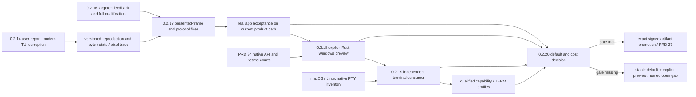

# MiniCon 0.2.x product roadmap

Status: product proposal, 2026-10-20. v0.2.15 is published; v0.2.16 has an
accepted design but no implementation or version bump. The later version
assignments below are proposed release gates, not dates or shipped claims.
If a gate is missed, carry its named gap forward or split a patch release;
do not turn a version number into evidence.

MiniCon's product promise remains one small local terminal executable with
independent tabs, a dedicated composer and bounded local control. The next
0.2.x outcome is a terminal that users can trust with a modern interactive
CLI, while another product can reuse the terminal mechanism without taking
MiniCon's GUI or policy. The reported 0.2.14 Claude Code screen corruption is
the highest-priority user symptom. A current-source Claude Code 2.1.304
comparison now reproduces a scoped Unicode loss in the default Windows path:
its input low surrogate is fixed, while screen-buffer output still loses the
character. The full reported redraw failure and broad application acceptance
remain open in [the compatibility owner](../prd/PRD_02_24_01_tui_compatibility.md#report-and-current-evidence).
The owned Rust Windows console service preserves this fixture, but a scoped
comparison does not make it a default replacement for every console program.

Behavior owners: [modern TUI compatibility](../prd/PRD_02_24_01_tui_compatibility.md),
[Windows backend](../prd/PRD_02_34_windows_console_backend.md),
[terminal library](../prd/PRD_02_35_terminal_library.md),
[workspace settings](../prd/PRD_02_25_con_workspace.md),
[reuse map](../prd/PRD_02_28_shared_core.md),
[test orchestration](../prd/PRD_02_33_test_orchestration.md), and
[delivery](../prd/PRD_02_27_con_delivery.md). This plan owns sequencing and
release decisions; each owner retains its behavior and evidence record.

## Users and priority

| User/job | Current friction | 0.2.x product priority |
| --- | --- | --- |
| Interactive CLI and harness user | A dense redraw can make the screen hard to read or trust. | P0: reproduce and correct the visible defect, then keep input, resize and exit usable through the same journey. |
| Ordinary shell user | Native console compatibility and orphaned helpers can turn one failed tab into a product reliability problem. | P0: keep the stable default, qualify an owned Windows preview with real programs and bounded teardown. |
| Developer/integrator | Terminal pieces exist in several crates and a full test run costs too much during a narrow edit. | P1: make focused feedback reliable, then prove a small independent consumer of the terminal library. |

The product order follows the user's visible failure first, then provider
independence and reusable contracts. A new setting earns a place only after
its behavior can be explained and tested: `TERM`, protocol capabilities and
native backend selection are separate controls.
Triage the TUI report immediately, in parallel with 0.2.16 tooling. A confirmed
P0 fix may ship as an earlier patch with the current full release gates; the
test-runner redesign must not delay a user-visible repair.

## Product outcome tree

```text
Outcome: a dependable, portable MiniCon terminal with a reusable engine
├── [v] 0.2.15 — explicit crate/reuse boundaries and published baseline
│   evidence: 0.2.15 release history; non-goal: claiming modern TUI acceptance
├── [_] 0.2.16 — fast, trustworthy development feedback
│   invariant: targeted suites save time while full release obligations remain visible
│   evidence: planned/observed test identities, mutation catches, cost comparison
│   safe failure: unknown dependency selects full; missing court is BLOCKED
│   dependency: PRD 33 and existing 0.2.16 plan; non-goal: feature expansion
├── [_] 0.2.17 — readable modern TUI on the existing product path
│   invariant: original bytes, parsed state and presented pixels stay consistent
│   evidence: versioned Claude Code or equivalent real app plus independent replay
│   safe failure: local session recovery; unknown cause remains an open defect
│   dependency: PRD 24.01; use 0.2.16 profiles when ready, current full gate meanwhile
│   non-goal: declaring every TUI fixed
├── [_] 0.2.18 — useful explicit preview of the owned Windows backend
│   invariant: selected sessions use the actual Rust provider and clean up their own tree
│   evidence: real shell/harness journeys, API/wire/frame/lifetime comparison and cost
│   safe failure: reject unavailable selection; preserve stable product default
│   dependency: PRD 34 and 0.2.17 observable TUI court; non-goal: global conhost removal
├── [_] 0.2.19 — reusable terminal contract across OS and ISA
│   invariant: one common state/stream contract with explicit native capabilities
│   evidence: independent consumer and MiniCon on supported native runtime cells
│   safe failure: typed unsupported capabilities; no false cross-ISA claim
│   dependency: PRD 35 and reuse map; non-goal: automatic platform-crate merger
│   └── qualified identity profiles and new-session TERM choice
└── [_] 0.2.20 — evidence-based Windows default and product-cost decision
    invariant: any default change improves user journeys without hidden regression
    evidence: exact-artifact real apps, reliability, latency/RSS and rollback courts
    safe failure: retain explicit preview if a gate is missing
    dependency: all preceding gates and PRD 27; non-goal: a date-driven switch
```



## Version decisions and acceptance

| Version | User-facing result | Release acceptance and decision |
| --- | --- | --- |
| 0.2.16 — developer feedback | Changes to one module get relevant tests promptly; integration and release still show every required court. | Implement the existing [0.2.16 plan](plan-v0.2.16.md): inventory, bounded fixture lifetime, explained selection, deduplicated composition and measured cold/warm cost. A mutation of an impacted dependency must fail its selected profile. `l3`/`all` still reaches the canonical full local gate; signing and artifact courts remain separate. Ship this before adding a larger compatibility matrix. |
| 0.2.17 — modern TUI quality | Claude Code style redraws, scrolling and resize remain readable; a session still accepts input after heavy output. | Extend the scoped real Claude Code 2.1.304 comparison to the owner's exact 0.2.14 reproduction, then separate child bytes, PTY wire, parser state, damage and native pixels. Cover alternate screen, Unicode width, dense redraw, synchronized updates, paste, cancel and resize with both final state and visible-frame checks. Resolve the diagnosed defect class before a compatibility claim. Keep capability replies truthful; advertise mode 2026 only after complete presentation qualification. |
| 0.2.18 — owned Windows backend preview | An advanced user can select a session using our Rust Windows backend and see its actual provider identity and errors. | Retain explicit selection. Compare installed ConPTY and Rust sessions with real PowerShell/cmd/Node and an available modern harness, including startup, key/input, Ctrl+C/Break, resize, exit tail, child-tree cleanup and close. Report original API input, emitted wire, visible frame, latency and total host/helper RSS. Each unsupported API fails locally with a useful result. Windows x64 and ARM64 runtime claims require separate runs; a cross-compile is only build evidence. A missing real harness or ISA court blocks that claim, not the entire stable product. |
| 0.2.19 — integrated terminal library | MiniCon and an independent small consumer use `minicon-console` for the same common terminal state, while native providers stay explicit. | Define the smallest input/session/flow-control/capability contract from actual Windows and POSIX consumers. Preserve `minicon-platform::pty` compatibility during migration; move one proven mechanism at a time and check public type identity, features and OS/ISA runtime. Provide a truthful modern VT/xterm-style default profile; expose only qualified compatibility profiles and an advanced TERM override for **new sessions**. Changing TERM describes capabilities to applications and does not switch parser or native backend. If the contract is not proved on supported runtime cells, keep the existing platform adapter and narrow the release claim. |
| 0.2.20 — default decision and product cost | Users receive the best evidenced Windows backend choice with a known path to recover from failures. | Decide whether to make the owned backend the Windows default using exact packaged artifacts and versioned real-app journeys, comparison of failure/cleanup, input latency, sustained redraw and total process RSS. Include product GUI pixel/snapshot consistency and rollback/selection evidence. A failed or unavailable criterion keeps the stable default and explicit preview. Track the 10 MiB idle-host intent, build/pack latency and artifact size separately; do not exchange correctness or signed-artifact requirements for a speed claim. |

These version numbers express priority and dependencies. 0.2.17 may ship a
well-bounded rendering fix without the real Claude Code acceptance claim if the
application remains unavailable; that cell stays explicitly open. 0.2.18 may
ship an experimental backend with a narrow, visible supported-program set.
0.2.19 may ship the common contract before every adapter is consolidated.
0.2.20 is a decision point, not a promise that the default will switch.

## Cross-version product rules

1. Treat terminal identity, native backend and UI rendering as separate choices.
   The current code starts child sessions with `TERM=xterm-256color` and
   `COLORTERM=truecolor`; the `vt100` crate name is an implementation detail.
   Until the capability contract is qualified, retain this default and do not
   offer a misleading menu of VT100/VT220/kitty emulation claims.
2. Diagnose a visible defect at four observable boundaries: original child
   bytes/native API calls, PTY wire, parsed/presented terminal state and actual
   GUI pixels. One passing SDK test does not close a user-visible TUI report.
3. Keep reuse inside the terminal domain: `minicon-console` owns common
   stream/screen mechanisms and its Windows service; `minicon-platform` owns
   capability adaptation; MiniCon owns tabs, settings, backend choice and UX.
   AgenTerm adopts an immutable revision only after its own consumer evidence.
4. Run focused developer profiles while editing, integration profiles before a
   candidate and the complete exact-source/artifact release chain before
   publication. Every released OS/ISA/provider claim names the runtime cell;
   unavailable evidence stays BLOCKED.
5. Keep MiniCon's authority local. Agent management, Fleet, persistent service,
   plugin marketplace and MiniCon-driven update orchestration belong outside
   this roadmap. The Win+R administrator checkbox belongs to WinMgr, not a new
   MiniCon launcher.

## Review cadence and evidence

At each version candidate, review one product scorecard: reproducible TUI
defects, session failures and orphaned processes, input-to-frame latency under
declared load, total host/helper RSS, package size, cold/warm test feedback
cost, and matrix coverage by OS × ISA × backend × application. Record baseline,
target and observed value in the owning PRD or release receipt; do not invent a
cross-machine threshold from one developer host. The release decision includes
the named unresolved cells and an explicit keep/change backend choice.
