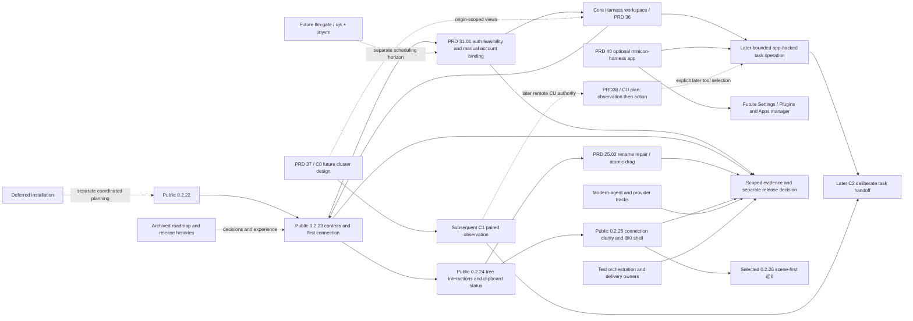

# Current MiniCon product roadmap

Current baseline and next sequence are indexed by [PRD](../PRD.md).
This is an index of owning leaves; the selected version plan sequences delivery.
Each owner carries its invariant, evidence, safe failure, dependencies and non-goals.
Historical ordering, rejected priorities and earlier evidence remain in the
[2026-10-24 snapshot](archive/plan-v0.2.x-product-roadmap-2026-10-24.md).

## Outcome tree DAG

```text
Outcome: improve daily use without losing open product obligations
├── [_] Core product track: visual Harness operation / monitoring → PRD 36
│   ├── H0 robot entry + real overview + Settings deep links → 0.2.23 reservation
│   ├── H1 account/client/request/usage observation → pool and monitoring owners
│   └── H2 optional minicon-harness app operation, then H3 future engine decisions → own staged plan / PRD 40
├── [-] Plugins and Apps layer / independent minicon-harness → PRD 40 / extraction plan
│   ├── X0 released-worker parity and exact two-repo source inventory → 0.2.25 preparation
│   ├── X1 app contract, then X2 future Settings manager and X3 robot event join → later selected version
│   └── X4 one-implementation cutover only after exact native artifact pair qualifies
├── [_] Important future track: cluster / cross-machine coordination → PRD 37
│   ├── C0 identity, trust and observation contract → next design milestone
│   ├── C1 explicit pairing and read-only two-node dashboard → subsequent selected version
│   └── C2 task handoff/cancel, then C3 model/capacity coordination → gated stages
├── [_] Future selected-window computer use → PRD 38 / plan-minicon-cu.md
│   └── observation, single action, Harness and paired-node gates → owning CU plan
├── [v] Public 0.2.22 → release history; exact artifact evidence only
├── [v] Public 0.2.23 browser controls and first harness connection → release history
│   ├── browser control consistency → PRD 25.02
│   └── Harness settings / manual pool / local model API → PRD 31.01
├── [v] Public 0.2.24 tab-tree interactions and clipboard status → release history
│   ├── shipped inline edit and atomic subtree move; open native gesture scope → PRD 25.03
│   └── shipped clipboard type/size core; open public-pixel and IME scope → PRD 25
├── [v] Public 0.2.25 connection clarity and fixed @0 shell → archive/plan-v0.2.25.md
│   ├── route clarity shipped; full real account-to-client path remains open → PRD 31.01.01/02
│   └── cached read-only operation shipped; live request/task acceptance remains open → PRD 36
├── [_] Selected 0.2.26 @0 visual canvas → plan-v0.2.26.md / PRD 39.01
├── [-] Modern-agent / Windows provider / terminal-library qualification → PRD 24.01/34/35
├── [-] Test inventory, selection, composition and measured feedback → PRD 33
├── [-] RSS, artifact size and exact-source delivery costs → PRD 27
└── [_] Installation → PRD 27.01; deferred to coordinated AgenTerm planning
```



Public 0.2.23 and 0.2.24 outcomes are recorded in their
[release histories](../prd/archive/README.md), not inferred from an old
version number. Predictable editing/menu/focus behavior is owned in
[PRD 25.02](../prd/PRD_02_25_02_browser_controls.md); the first shared inference
path, auth feasibility, manual pool and later selection seam are owned in
[PRD 31.01](../prd/PRD_02_31_01_provider_gateway.md). First connection does not
implement the later dynamic scheduler.
The [archived 0.2.24 plan](archive/plan-v0.2.24.md) records the shipped
tab-tree and clipboard sequence, with remaining acceptance in
[PRD 25.03](../prd/PRD_02_25_03_tab_tree_interactions.md) and
[PRD 25](../prd/PRD_02_25_con_workspace.md). Qualification is source-specific.
The [archived 0.2.25 plan](archive/plan-v0.2.25.md) records the public release
cut and its retained acceptance. The [selected 0.2.26 plan](plan-v0.2.26.md)
sequences the @0 visual canvas; behavior belongs to the linked PRD modules.
The owner's 2026-10-25 direction makes the
[visual Harness workspace](../prd/PRD_02_36_harness_workspace.md) a continuing
core product track; [its plan](plan-harness-workspace.md) stages the robot
reservation, real monitoring and later task operation. Console/Web improvements,
input correctness and bug fixes remain maintained foundation work throughout.
The 2026-10-27 [Plugins and Apps decision](../prd/PRD_02_40_plugins_apps.md)
moves future file/exec worker delivery into `partnernetsoftware/minicon-harness`.
[Its extraction plan](plan-minicon-harness-extraction.md) records the parity,
contract, Settings-management and cutover gates; no implementation or release
version is inferred from a new-repo source copy.
Independent tracks retain their existing requirements and gates in
[TUI compatibility](../prd/PRD_02_24_01_tui_compatibility.md),
[Windows backend](../prd/PRD_02_34_windows_console_backend.md),
[terminal library](../prd/PRD_02_35_terminal_library.md),
[test orchestration](../prd/PRD_02_33_test_orchestration.md), and
[delivery](../prd/PRD_02_27_con_delivery.md).
Missing native evidence is BLOCKED; no neighboring release closes these gates.
Installation remains [deferred](../prd/PRD_02_27_01_install.md).

## 未来构想

The owner requests early staged design of MiniCon cluster/cross-machine
coordination. [PRD 37](../prd/PRD_02_37_cluster_horizon.md#未来构想) owns behavior;
[the cluster plan](plan-cluster-horizon.md) starts C0 with the local Harness
foundation, then selects subsequent implementation versions from actual
prerequisites. This is a first-class future track, not a current cluster claim.

The owner's computer-use planning request is recorded in
[PRD 38](../prd/PRD_02_38_computer_use.md). [The CU plan](plan-minicon-cu.md)
is the sole owner of its candidate release placement and dependency gates;
this roadmap does not select those future versions or expand today's worker.
