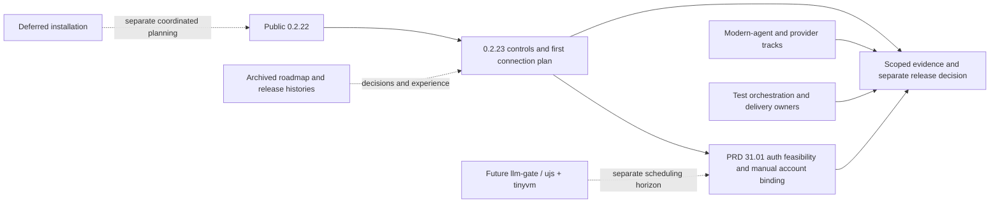

# Current MiniCon product roadmap

Current baseline and next sequence are indexed by [PRD](../PRD.md).
This is an index of owning leaves; the selected version plan sequences delivery.
Each owner carries its invariant, evidence, safe failure, dependencies and non-goals.
Historical ordering, rejected priorities and earlier evidence remain in the
[2026-10-24 snapshot](archive/plan-v0.2.x-product-roadmap-2026-10-24.md).

## Outcome tree DAG

```text
Outcome: improve daily use without losing open product obligations
├── [v] Public 0.2.22 → release history; exact artifact evidence only
├── [_] 0.2.23 browser controls and first harness connection → current version plan
│   ├── browser control consistency → PRD 25.02
│   └── Harness settings / manual pool / local model API → PRD 31.01
├── [-] Modern-agent / Windows provider / terminal-library qualification → PRD 24.01/34/35
├── [-] Test inventory, selection, composition and measured feedback → PRD 33
├── [-] RSS, artifact size and exact-source delivery costs → PRD 27
└── [_] Installation → PRD 27.01; deferred to coordinated AgenTerm planning
```



Next work is sequenced in [0.2.23](plan-v0.2.23.md), not inferred from an old
version number. Predictable editing/menu/focus behavior is owned in
[PRD 25.02](../prd/PRD_02_25_02_browser_controls.md); the first shared inference
path, auth feasibility, manual pool and later selection seam are owned in
[PRD 31.01](../prd/PRD_02_31_01_provider_gateway.md). First connection does not
implement the later dynamic scheduler.
Independent tracks retain their existing requirements and gates in
[TUI compatibility](../prd/PRD_02_24_01_tui_compatibility.md),
[Windows backend](../prd/PRD_02_34_windows_console_backend.md),
[terminal library](../prd/PRD_02_35_terminal_library.md),
[test orchestration](../prd/PRD_02_33_test_orchestration.md), and
[delivery](../prd/PRD_02_27_con_delivery.md).
Missing native evidence is BLOCKED; no neighboring release closes these gates.
Installation remains [deferred](../prd/PRD_02_27_01_install.md).
