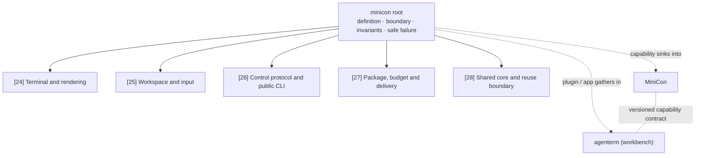

# Lightweight terminal host (`minicon`)

Parent and product index: [`PRD.md`](../PRD.md)

本仓 PRD 根。源于 agenterm 的 `agenterm-con` 子树，2026-08-23 随代码迁出独立仓。
迁出后的交付差异（体积门与 CI 未随行）记在 [交付子模块](PRD_02_27_con_delivery.md)。

This module is the root of the `minicon` product subtree. It owns the
product definition, boundary, invariants, cross-cutting evidence, and the safe
failure result. Its child modules own third-level requirements, status, and
measured evidence; a requirement stated in a child is not restated here.

Legend: `[v]` shipped, `[-]` partial, `[_]` planned.

## Subtree index

| # | 子模块 | 一句话 |
|---|--------|--------|
| 24 | [Terminal and rendering](PRD_02_24_con_terminal.md) | PTY、VT、行级 damage、present、字形、ISA、渲染性能 |
| 25 | [Workspace and input](PRD_02_25_con_workspace.md) | Tab 树、宿主界面、composer、滚动条、选择、剪贴板、焦点 |
| 26 | [Control protocol and public CLI](PRD_02_26_con_control_cli.md) | `minicon cli`、`ATC1` 帧、JSON 契约、快照/截图证据 |
| 27 | [Package, budget and delivery](PRD_02_27_con_delivery.md) | 独立 package、unwind profile、APE join、按平台/目标陈述体积与宿主 RSS、独立 CI、加载期可移植性 |
| 28 | [Shared core and reuse boundary](PRD_02_28_shared_core.md) | `minicon-core`、跨产品复用的可测边界、与 agenterm 的依赖方向分期 |

## Map

```text
minicon — one-file local terminal (product root)
├── Product outcome — independent local terminals, dedicated input, bounded CLI
├── Product boundary
│   ├── Shipped and owned here
│   ├── Distribution priority — native product; APE packaging demonstration
│   └── Explicit non-goals (no server, persistence, Fleet, mux, MCP, scripts, Agent policy)
├── Governing invariants
├── Observable success evidence
├── Safe failure result
├── Delivery ownership → prd/PRD_02_27_con_delivery.md
├── Shared improvement boundary → prd/PRD_02_28_shared_core.md
└── Capability and plugin boundary, with agenterm
    ├── The placement test
    └── Guardrails
```



## Product outcome

- [v] `minicon` is the lightweight, green, GUI replacement for a system
  console host. AgenTerm is the Agent-era workbench on the same platform
  layer (rendering + dedicated input): it keeps a real terminal at the core
  and adds a longer-lived server identity, Fleet, mux, persistence, and Agent
  policy. MiniCon provides several independently owned local terminals without
  that workbench authority. Its sustained-throughput qualification is shipped in
  [24](PRD_02_24_con_terminal.md), platform-qualified artifact measurements in
  [27](PRD_02_27_con_delivery.md) are explicit, and the native Chinese-IME
  keyboard acceptance in [25](PRD_02_25_con_workspace.md) is shipped.

The product succeeds when a user can launch one small executable, organize
terminals in a left-side tree, interact through a dedicated external input
area, and automate observation/input through a bounded public CLI while every
tab and the whole GUI remain stable under malformed output, native callback
failure, resize storms, process exit, and interaction races.

## Product boundary

### Distribution priority

Owner decision, 2026-10-24: native MiniCon deliverables for each operating
system are the primary product. `minicon.com` is a secondary demonstration of
cross-platform binary packaging. Its illustrative role does not weaken the
qualification or signatures required for any version that includes it.
Optional command-line installation convenience does not introduce a required
installer, bundled runtime, daemon or automatic start. Delivery and the
post-0.2.21 installation work are owned by
[PRD 27](PRD_02_27_con_delivery.md#native-command-line-installation-after-0221).

### Shipped and owned here

- One GUI process containing multiple independent PTY sessions.
- Left tree tabs with stable IDs, parent-cycle rejection, active-tab selection,
  and child promotion when a parent closes.
- A terminal viewport with CJK double-cell layout, selection, clipboard,
  scrollbar, font zoom, IME, keyboard, mouse, wheel, resize, and DPI behavior.
- A persistent external input area whose editing keys remain local while it is
  focused and whose explicit send action writes to the active terminal.
- On Linux, a real AT-SPI child tree for that host UI (not only the X11
  window-title frame) so `agenterm-cu` can address inner controls by name.
- `minicon cli` for tab listing/lifecycle, content capture, screenshots,
  text/paste/key/mouse/wheel input, deterministic waits, resize, performance
  evidence, and bounded shutdown.
- Process-lifetime local control only. The endpoint is bound before any window
  and dies with the process — never a server, daemon, listening network
  interface, persistent workspace, shared session or background auto-start.

### Explicit non-goals

- [v] no background server, Fleet authority, persistent workspace, remote mux,
  MCP, script runtime, task engine, or general plugin host. The no-script
  boundary is enforced in the binary rather than by convention: `--script`,
  its JSON command decoder, command queue, wait scheduler, and script-only
  screenshot state are absent from the product graph, and automation uses the
  public control protocol exclusively.
- [v] **no unsolicited background network, and no auto-update.** The manual
  update path starts only when the user presses the settings panel's update
  check: a `GET` of the GitHub `releases/latest` document over the same
  bounded `minicon_platform::network_http` client the harness uses, and — on a
  Windows or Linux host — the matching archive plus its published SHA-256
  sidecar. Nothing runs at startup, on a timer, or in the background, and
  nothing about the running product changes without the user asking; the
  README's "no auto-update" line stays true under that qualification. Explicit
  browser navigation and OAuth are additional user-initiated network paths;
  opening their panel is not permission for a separate background service.
  Owner: `prd/PRD_02_25_con_workspace.md`, browser requirements and "Host UI".
  **One consequence that qualification does not absorb (registered
  2026-10-13, resolved 2026-10-14):** an update leaves a **second file behind** —
  the replaced executable is renamed to `<name>.backup` and kept, deliberately,
  so a failed launch can be rolled back (see `plan/archive/plan-v0.2.7.md`).
  That is the right default, and `one file · no install · nothing left behind`
  is a claim about *installing*, not about what an update keeps: the shipped
  sentence now says which file it keeps and what the file is for, in both
  READMEs, rather than being quietly contradicted by the directory listing.
  The other half of the same claim was a real defect and is fixed: a download
  that was staged and never swapped (press Update, then close the window) used
  to leave `<name>.update` beside the executable forever, because `Ready` is a
  session-scoped phase; `update::clear_stale_staged` now removes it at startup.
  Closed as leaf `{SLOGAN}` in [`plan/archive/plan-v0.2.8.md`](../plan/archive/plan-v0.2.8.md),
  whose non-goal was that deleting the backup automatically is **not** what this
  asks for.
- No claim of tmux/RMUX compatibility beyond the narrowed exception below.
- No product navigation or workbench policy shared with `agenterm` merely to
  reduce code size.
- **Amendment (2026-09-24, owner decision):** the prior blanket exclusion of
  "mux" and of a script runtime/plugin host/Agent permission policy is
  narrowed, not removed, to admit exactly two 0.2.x subcommands: `mux`
  (tmux-shaped control over MiniCon's own existing tabs, over this same
  process-lifetime `--control` endpoint) and `harness` (a two-tool-only agent:
  `file` and `exec`, no plugin interface, no separate permission-policy
  layer). Every other exclusion above still holds, and anything broader than
  these two subcommands needs its own owner decision. Full scope, non-goals
  and open design questions: [`PRD_02_31_v0_2_horizon.md`](PRD_02_31_v0_2_horizon.md).

## Governing invariants

- A child process exit retains its tab, final screen, and exit status until an
  explicit close.
- Closing a parent promotes direct children; it does not terminate them.
- One tab's PTY, parser, screenshot, malformed escape sequence, control request,
  panic, or resource exhaustion cannot corrupt another tab or abort the host.
  A tab that cannot open (for example a shell that no longer resolves) is
  rolled back and reported as a host notice; it ends no other tab.
- A spawned shell and its descendants are reclaimed when the host exits, via a
  kill-on-close job. Because a process cannot leave a job it is already in, a
  session the user wants to outlive the terminal opts in at spawn
  (`AGENTERM_PTY_BREAKAWAY=1`); the job then allows the breakaway and the child
  is created detached, so an agent session started inside the terminal survives
  a terminal crash. The default stays attached: a terminal reclaiming its shell
  is the expected behaviour.
- Native callbacks never unwind across FFI. Official artifacts use the `con-*`
  unwind profiles and contain callback panics as typed failures.
- Input focus has one owner. Composer editing never leaks Space, selection,
  copy, cut, paste, or navigation keys into the PTY.
- Human terminal clipboard paste is editable and cancellable before delivery;
  confirmation revalidates the stable tab and focus after the modal closes.
  Control CLI paste paths remain deterministic and never open interactive UI.
- Pointer selection, dirty rasterization, native present, structured snapshot,
  and PNG evidence describe the same frame. A click cannot erase or scramble
  pixels outside its local feedback region.
- PTY output, control frames, waits, queues, dimensions, screenshots, and
  allocations are bounded and fail without blocking the GUI indefinitely.
- MiniCon host process RSS is scarce. Idle one-tab intent is 10 MiB; child
  shells are outside that budget. Numeric ceilings and the idle-GUI court live
  in [27](PRD_02_27_con_delivery.md).
- Product code consumes platform/UI-core contracts; raw OS APIs and ISA kernels
  remain in their owning shared mechanism layers.

## Observable success evidence

- Pure tests own tree safety, geometry, VT damage, Unicode width, selection,
  control parsing/wire limits, and safe failure states.
- A real one-shot child black-box journey proves `child_alive` transitions to
  false, its numeric exit code and final screen remain observable, and the GUI
  stays alive until an explicit close rather than treating child exit as a host
  exit.
- No single tab can monopolize the host. Concurrent-flood, oversized-CSI,
  select/capture-race and four-tab teardown journeys each prove an unaffected
  sibling stays interactive and controllable while one tab is saturated,
  closing, or being captured. The owning contracts are session teardown and
  scheduling in [24](PRD_02_24_con_terminal.md), and endpoint queues, pending-wait
  cancellation and screenshot ownership in
  [26](PRD_02_26_con_control_cli.md).
- A tab that cannot open ends no other tab. A black-box journey deletes the
  shell after the first tab is running, opens another through the user gesture,
  and proves the host still answers control, reports a `host_notice` naming the
  failure, paints that notice on the status strip (window screenshots before
  and after), and leaves the first tab alive.
- An exited shell is visible. A child exit keeps its tab (remain-on-exit) and
  dims that tab's label; a pixel journey screenshots the window before and
  after the shell exits and asserts the tab column repainted.
- Recoverable refusals share one status line: a host notice outranks a terminal
  clipboard refusal, and both appear where the routing label would, so neither
  is visible only to a control client.
- The code-signing inspector and the signing workflow have policy suites that
  read the shipped scripts and workflow and refuse a contract the bytes do not
  meet; they are registered so cargo builds and runs them.
- Public black-box tests launch the real executable with isolated endpoints,
  use `minicon cli`, wait on state rather than fixed sleeps, and clean all
  owned processes and files.
- Rendering journeys drive real window pixel coordinates, capture the native
  client area before and after input, and assert preservation of visible
  content as well as structured selection state.
- Composer focus isolation has its own physical journey, owned by
  [25](PRD_02_25_con_workspace.md).
- Windows x86_64 runs the matching custom-std `con-release-fast` Clippy, unit,
  public GUI black-box, panic-containment, and artifact build path.
- `{x86_64,aarch64} x {win,lnx,osx}` compile cells prove the product and selected
  platform adapters remain portable. Candidate remains the final sealed-byte
  qualification authority. Workflow ownership, the exact-SHA rule and the
  artifact budget belong to [27](PRD_02_27_con_delivery.md).

## Safe failure result

An invalid command receives a bounded error response; an unavailable tab or
native operation remains local; an allocation/present/PTY failure retains the
last valid state where possible and closes only the affected owner when
continuation is unsafe. No failure silently falls back to a server, script, mux,
or reduced permission model.

## Delivery ownership

Package identity, unwind profiles, platform-qualified artifact measurements, the parked
`.github/workflows/ci-minicon.yml.disabled` workflow, and any future exact-SHA
Candidate precondition after that workflow is enabled and qualified are owned by
[27](PRD_02_27_con_delivery.md). Historical agenterm delivery requirements are
context only; this repository's delivery PRD and workflows are authoritative.

## Shared improvement boundary

Stable, product-neutral lessons should move into the shared crates MiniCon
**owns** — `minicon-core`, `crates/minicon-platform`, `crates/minicon-ui-core`,
and the forked `third_party/{vt100,softbuffer}` — only after both consumers and
their evidence agree. UI composition may differ. PTY lifecycle, VT/CJK rules,
font rasterization, retained frame mechanics, input normalization, clipboard,
IME, native window contracts, and bounded failure types should converge rather
than fork.

The platform and UI crates were `agenterm`'s until 2026-10-10, when the owner
moved them here and inverted the arrow (`agenterm` now depends on MiniCon); see
[shared core](PRD_02_28_shared_core.md) "Stage 3" and
[`plan/archive/plan-v0.2.5.md`](../plan/archive/plan-v0.2.5.md). Shared kernels consumed by both
products keep their requirement in their owning source repository — which is now
this one. Within MiniCon, [shared core](PRD_02_28_shared_core.md) owns the
dependency direction and extraction stages; historical agenterm PRD numbers are
not local authorities.

## Capability and plugin boundary, with agenterm (2026-10-11)

Owner's framing, adopted as the standing rule: **capabilities sink into MiniCon;
plugins and applications gather in agenterm.** MiniCon owns the *capabilities*
(the host mechanisms) **and the contract that exposes them**; agenterm owns the
*plugins, applications, orchestration, identity, permissions, workflow and
market* built on them. The only seam between the two layers is the **capability
contract** — names, versions and compatibility rules — not a binary and not a
source dependency. This is the product-level statement of the mechanism/policy
split, and the rule every later "where does this live?" question is decided
against.

### The placement test

Something is a **capability → MiniCon** when either holds:

- it holds a host/OS authority (a window, a PTY, a handle, the accessibility
  tree, input injection, the clipboard, a permission); or
- it must keep working with no plugin or application installed.

Something is a **plugin/application → agenterm** when either holds:

- it is dead code unless someone installs or uses it; or
- its value is composing other capabilities into a user-visible outcome.

Applied to the cases that actually come up:

| Item | Layer | Why |
|---|---|---|
| terminal, PTY, rendering, IME, selection, scale | MiniCon | authority test; already here |
| computer-use **mechanisms** (a11y read, input injection, screenshot, process, clipboard) | MiniCon | authority test; already vendored in `crates/minicon-platform` |
| computer-use **policy** (grants, receipts, audit, destructive-action safety, browser *flows*, targets) | agenterm | composition test |
| a wasm/script **execution kernel** | MiniCon, once the engine is stable | authority test |
| a **plugin or app written in wasm** | agenterm | dead-code test |
| the plugin/app **discovery index** | the family's `unisa` release/index repo; agenterm consumes it | an index is not a product |
| the agent-use **browser** | `minicon-surf`, its own product | it is a base, not a plugin |

### Guardrails

1. **Sinking a capability is not growing the base binary.** MiniCon's identity
   is one file. A capability MiniCon owns but that is too large for the base
   (for example a computer-use mechanism set) is a **capability provider**
   loaded on demand; MiniCon owns the *contract* and the loading, not
   necessarily the bytes. Numeric ceilings stay in
   [27](PRD_02_27_con_delivery.md).
2. **The contract is the seam, and it is not optional.** A plugin must be able
   to depend on MiniCon's capabilities without being pinned to a MiniCon build;
   that requires the versioned capability contract, whose current narrow form is
   the `--hostif-handshake` capability list
   ([`plan/archive/plan-hostif-v1.md`](../plan/archive/plan-hostif-v1.md)). Without it the
   boundary collapses back into a version pin.

Non-goal: this principle does not give MiniCon a plugin host, a market,
orchestration or agent permission policy; those are agenterm's and stay there,
consistent with "Explicit non-goals" above.
