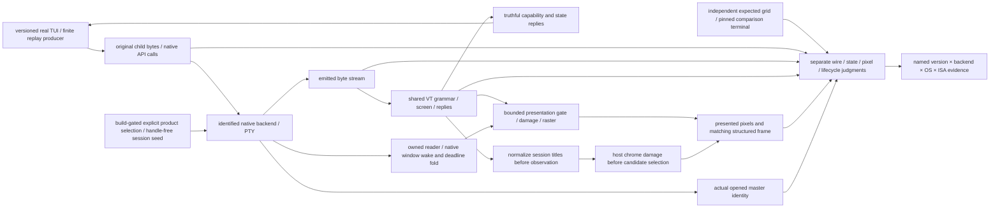

# Modern TUI compatibility and qualification

Parent: [terminal and rendering](PRD_02_24_con_terminal.md). This module owns
the end-to-end compatibility requirements for Claude Code and comparable
interactive terminal applications. Native Windows API/lifetime implementation
remains in [the backend owner](PRD_02_34_windows_console_backend.md); reusable
contracts remain in [the library owner](PRD_02_35_terminal_library.md).

## Outcome and delivery tree

```text
Outcome: modern interactive TUIs remain readable and usable through sustained updates
├── [-] Attribute the reported display corruption to an observed boundary
│   invariant: preserve application bytes, backend identity and presented-frame identity
│   evidence: exact app/MiniCon/OS/ISA versions, finite reproduction and boundary captures
│   safe failure: unknown cause stays unproven; retain each distinct failure class
│   dependency: isolated terminal fixtures; non-goal: attributing every symptom to conhost
├── [-] Truthful protocol capability negotiation
│   invariant: replies advertise only implemented behavior and actual mode state
│   evidence: application probes, independent reply oracle and bounded startup completion
│   safe failure: report unsupported capabilities; no false positive or indefinite wait
│   dependency: shared VT semantics and native transport; non-goal: renaming a parser as compatibility
│   └── [v] shared bounded CSI query replies and actual native round trip
│       invariant: exact query grammar; current mode state; unknown mode reports zero
│       evidence: literal replies, split/malformed probes, native child readback and exit/EOF
│       safe failure: no reply to malformed/non-query commands; 2026 remains unrecognized
│       dependency: minicon-console common helper + parser validity; non-goal: positive sync support
├── [-] Complete-frame presentation, including synchronized updates
│   invariant: active parser state and externally presented frame have explicit ownership
│   evidence: split-stream begin/end, bounded timeout/byte recovery, blink/resize/query interleaving
│   safe failure: a missing end marker cannot freeze the UI or stop input/control servicing
│   dependency: parser, damage and presentation contracts; non-goal: recognizing 2026 without gating presentation
│   └── [-] shared active/presented state boundary; remaining native-window interleavings/compositor qualification open
│       ├── [v] reusable mechanism and six public-consumer courts → PRD 35 bounded synchronized presentation
│       ├── [v] scoped native SDK producer → opened Rust PTY → common presented frame; native owner PRD 34
│       ├── [v] scoped ordinary incremental damage / shared row snapshot cost → PRD 35 borrowed frames
│       ├── [-] GUI consumption, timed recovery and native producer-to-pixel journey
│           invariant: paint/copy/snapshots read presented state; query/input modes read active state
│           evidence: frame identity/pixels plus held-frame blink, resize, input, timeout and exit journeys
│           safe failure: schedule idle deadlines; recover locally without blocking PTY/control servicing
│           dependency: shared gate, bounded snapshot cost and GUI timer; non-goal: a parser-bit-only capability claim
│           ├── [v] scoped GUI clock adapter / active input versus presented raster and snapshots
│           │   invariant: hold the old cells/cursor/selection; queries and key/paste/mouse modes stay live
│           │   evidence: production offscreen raster plus literal snapshots/input/selection and fault probes; court below
│           │   failure: bounded 250 ms / 1 MiB recovery; geometry/viewport edits recover explicitly
│           │   dependency: TerminalPresentation; non-goal: native window/compositor or real harness acceptance
│           └── [v] scoped active/inactive idle deadline and drained-EOF recovery
│               invariant: child exit cannot discard queued tail or suppress an outstanding deadline
│               evidence: closed/backlogged pipe, exited child and inactive-session timer courts below
│               failure: keep PTY/control servicing live; finish only when closed and drained
│               dependency: bounded output ring and GUI wake/timer fold; non-goal: changing backend selection
│       └── [v] scoped retained host chrome follows nonvisual title updates
│           invariant: tree subtitle, composer target and status label describe the same current title
│           evidence: title model/retained-pixel/control guards and native title-band repaint comparison below
│           failure: unknown geometry keeps full-damage fallback; desktop compositor evidence remains separate
│           dependency: title consumption before dirty-candidate selection; non-goal: blaming the native backend
│           ├── [v] normalize/consume all session titles before control observation and dirty-candidate selection
│           │   evidence: gui_title_updates_precede_candidates_and_keep_retained_chrome_consistent
│           │   failure: unchanged titles create no damage; known-geometry inactive updates invalidate only tree chrome
│           ├── [v] scoped native title-band repaint idempotence after the final SDK title
│               evidence: extra native-window screenshot after an otherwise neutral composer-band repaint
│               failure: compare label pixels plus actual list-tabs title; non-goal: desktop compositor proof
│           └── [v] scoped independent native client-DC readback of the owned product window
│               invariant: match current native HWND/title and full terminal/title-band pixels to the submitted frame
│               evidence: GetDC/BitBlt captures through the existing screenshot facade and missing-present fault below
│               failure: finite mismatch/capture/identity error is not a pass; no desktop or unrelated-window capture
│               dependency: owned Child handle, process_window identity and screenshot capability; non-goal: full DWM composition proof
├── [-] Dense redraw, scroll, Unicode and alternate-screen resize journeys
│   invariant: byte splitting and redraw rate do not change final rows, cursor or cell geometry
│   evidence: finite safe traces, independent expected grids, native readback and presented pixels
│   safe failure: bounded session-local errors; keep prior committed frame on publication failure
│   dependency: backend byte integrity, shared screen, viewport and raster; non-goal: echo-only acceptance
├── [v] scoped explicit owned-backend GUI launch and native-window SDK journey
│   invariant: selected backend survives tab seeding; live identity comes from the opened master
│   evidence: build-gated feature/status guards and native window capture/query/exit journey below
│   failure: unavailable selection rejects before launch; owned fixture cleanup stays bounded
│   dependency: platform rust_console opt-in and GUI presentation; non-goal: real Claude Code acceptance
└── [-] Real application and cross-platform qualification
    invariant: a passing SDK scenario is not a passing Claude Code session or another OS/ISA
    evidence: versioned real TUI startup, streaming, scrolling, resize, paste, cancel and teardown
    safe failure: unavailable application/runtime cells remain BLOCKED
    dependency: preceding leaves and independent courts; non-goal: automatic backend default promotion
    └── [v] scoped Windows x64 Claude Code 2.1.304 Unicode prompt/reply and resize comparison
        invariant: identify the opened backend and compare actual text and pixels with a native Unicode oracle
        evidence: two owned GUI sessions, 12-line reply, screenshots, pane Unicode and WriteConsoleW/ReadConsoleW fixtures
        safe failure: default output corruption remains open; no full TUI or other OS/ISA pass
        dependency: console-agent input fix and experimental Rust PTY; non-goal: default backend promotion
    └── [v] scoped Grok Build 1.0.62 and Codex CLI 0.162.1 live GUI comparison
        invariant: an alive agent can answer and reflow after settled 800×500 / 1180×740 resizes
        evidence: four independent sessions, actual backend/child identity, pane text and product-frame screenshots
        safe failure: record default-path character and layout defects without attributing every lost byte
        dependency: visible owned windows and isolated scratch directories; non-goal: hue or full harness acceptance
    └── [v] scoped 0.2.18 current-source three-agent Rust-provider interaction
        invariant: opened rust-console sessions retain Unicode/spacing and accept a follow-up after resize
        evidence: versioned independent sessions, pane/PNG pairs and hashed local receipt below
        safe failure: first Grok screenshot pending remains unexplained; no candidate-quality pass
        dependency: feature-enabled retail-profile build; non-goal: desktop compositor or full TUI acceptance
    └── [-] candidate-quality three-agent matrix → plan/plan-v0.2.17.md
        invariant: every claimed backend preserves valid text, style and settled layout through repeated interaction
        evidence: bounded source/wire/state/pixel traces, deterministic fixtures and versioned real sessions
        safe failure: leave a failed backend explicitly limited; never infer a broad pass from another provider
        dependency: exact selected build and native lifecycle courts; non-goal: automatic default promotion
```



## Report and current evidence

Owner report, 2026-10-20: MiniCon 0.2.14 displays substantial screen corruption
when hosting Claude Code and similar harness TUIs. The owner's original 0.2.14
sequence remains unrecorded. The current-source comparison below reproduces a
narrow Unicode failure, not the complete reported screen corruption.

Before the input fix, on Windows x64 build 20348, two owned MiniCon GUI sessions ran the user's
Claude Code 2.1.304 wrapper from an isolated scratch directory. Structured
snapshots identified the opened backends as `console-agent` and `rust-console`.
Both accepted a no-tool prompt and a 12-line Unicode prompt while the window
was resized. In the default session, the prompt's `🙂` became three U+FFFD
characters; its answer also contained replacement characters and one damaged
word boundary. The Rust session retained `汉字 Ω 🙂` in all 12 answer rows and
in its presented screenshot. The default child later exited with code 251;
the cause was not established, and no lifecycle diagnosis follows from it.

An independent `WriteConsoleW` fixture wrote `ASCII:🙂:END` through the same
two backends. The default `capture-pane` contained `ASCII:�:END`; the Rust
capture retained the scalar. This isolates an output-path difference without
relying on Claude's generated text. An independent `ReadConsoleW` fixture
showed the default agent originally delivered only UTF-16 `D83D` for the
four-byte UTF-8 input `🙂`; Rust delivered `D83D DE42`. The console-agent
input fix in `console_input.rs`/`console_agent.rs` now emits separate key
records for both UTF-16 units, and a fresh native default session read exactly
`D83D DE42 000D 000A` after `send-text` plus Enter. A compiling runtime fault
that changes the second key unit to `?` fails the named regression
`astral_text_emits_both_utf16_key_units_without_consuming_a_partial_scalar`;
all 30 selected console-agent unit tests pass after byte-for-byte restoration.
The remaining output loss is consistent with the default adapter's
`ReadConsoleOutputW` screen-buffer mirror and Microsoft's
[recorded surrogate readback limitation](https://github.com/microsoft/terminal/issues/10810);
the exact loss point inside this machine's host is not yet
instrumented. Local ignored receipts under
`target/conhost-research/claude-tui-20261020/` include
`default-unicode.txt`, `default-resize-live.png`, `rust-unicode.txt`,
`rust-unicode.png`, `unicode-base2.txt`, `unicode-rust.txt`,
`input-native-base.hex`, `input-native-rust.hex`, `input-fixed2.hex`,
`negative-surrogate.log` and `console-agent-tests.log`. Dense redraw, paste, cancel,
synchronized frames, lifecycle and other OS/ISA cells remain open.

### Grok and Codex live-window comparison

At source `58f914d` with local executable SHA-256
`013BE6CB3F816525BE2F25A3230C7641E66DBAF7085262890794FBA8970AEE30`,
independent MiniCon GUI processes ran the owner's `mygrok.bat` (Grok Build
1.0.62) and `mycodex.bat` (Codex CLI 0.162.1). Each application used an
isolated scratch directory outside this repository. `ui-snapshot` identified
the actual `console-agent` or opt-in `rust-console` backend; `list-tabs`
confirmed the child lifetime during the settled 800×500 and 1180×740
comparisons. Both applications received no-tool/no-file Markdown and Unicode
prompts and a follow-up after resize. `capture-pane` text and `screenshot-pane`
pixels were saved at each boundary in
`target/conhost-research/claude-live-20261020/`.

The default Codex path lost `🙂` in both the visible prompt and answer. Its
eight-line follow-up joined `red green` into `redgreen` on two rows, removed
other spaces next to `Ω`, and left two `Ask Codex to do anything` prompts in
the settled pane. The Rust Codex path retained `汉字 Ω 🙂` and `red green blue`
on all eight rows. Both children were alive. The exact response bytes were
not captured before the native backend, so those spacing artifacts are an
observed default-path failure, not a proven location of byte loss. The
independent `WriteConsoleW` fixture above separately establishes the default
emoji output loss.

The first default Grok process exited with code 1 after a reply; its later
frozen frame cannot prove live resize behavior, and the cause of that exit
was not established. A fresh visible default Grok process remained alive:
its startup screen reflowed at both dimensions, but after a reply the narrow
frame's text/input placement persisted when enlarged, along with stray
characters in the duration row and fragmented scrollbar blocks. The Rust
Grok session remained alive, reflowed its table and input box after resize,
and retained `🙂` through a twelve-line follow-up. This narrows the resize
failure to the active default backend/application journey; it does not prove
whether the missed redraw originates in native event delivery, scraping or
application behavior.

The current agent themes provided grayscale screenshots: each of the four
settled follow-up PNGs has zero pixels with RGB-channel spread above 10.
The Rust Codex/Grok captures visibly retain dim secondary text that is flat
white in the default captures. These runs test grayscale style fidelity and
layout; they do not establish red/green/blue hue fidelity. Early screenshot
requests made while the test windows were minimized remained pending and
resizes did not reach the window; those frames were excluded. Restoring the
owned windows cleared the requests, and the accepted resize captures used
visible, non-minimized windows with observed grid dimensions. Named evidence
includes `grok-retry-after-wide.png`, `grok-rust-wide-settled2.png`,
`grok-retry-followup.txt`, `grok-rust-followup.txt`,
`codex-default-followup.png`, `codex-rust-followup.png`, and their paired pane
files. `session-receipt.json` binds selected captures to the executable and
source identities. Full TUI compatibility and backend promotion remain open.

### 0.2.18 current-source three-agent Rust-provider interaction

At source `7a06266`, a local `windows-release` MiniCon 0.2.18 executable
(SHA-256 `8a4e3956e091a4323ea4820560201b0c1386f1b09160139b6812823b8e785d6a`)
ran independent Claude Code 2.1.304, Grok Build 1.0.62 and Codex CLI 0.162.1
sessions on Windows x64 build 20348. Each session used the owner's wrapper in
an isolated scratch directory. `ui-snapshot` reported MiniCon `0.2.18` and the
actually opened `rust-console` backend. Pane captures and native product-window
PNGs retained `汉字 Ω 🙂` and `red green blue` in the tested replies. Claude
answered a twelve-line prompt, while Grok and Codex answered eight-row/line
prompts. Each fresh session accepted a further prompt after an 800×500 →
1180×740 → 800×500 resize sequence. The owned MiniCon processes exited after
`close-window`.

The first Grok run left a `screenshot-pane` request pending after a resize;
subsequent screenshot requests reported one already pending. Its cause is
unknown. A fresh Grok process completed the same interaction and screenshot
sequence, but does not close the pending-request defect. The control owner now
bounds queued and in-flight screenshots to 30 seconds with a typed error and
frees the slot for a retry; the observed missed frame remains unexplained.
These processes were started hidden. Their screenshots are MiniCon's native
window readback, not an
independent desktop-compositor capture or the visible-window Candidate court.
Original child output/API calls, deterministic color, sustained streaming,
paste, cancel, broader native lifecycle and the exact signed Candidate are
still unverified. The ignored local receipt and selected synthetic pane/PNG
evidence are under `target/conhost-research/agent-live-v0218-20261021/`.

### Open compatibility contracts

The three-agent comparison creates distinct obligations. A valid Unicode
scalar must survive native output and input without U+FFFD, deletion or a
neighboring-space shift. During and after a resize, an alive child's reported
grid, the backend's native geometry, parsed/presented cells and product frame
must converge within a bounded interval; a frozen exited-child frame is a
different lifecycle case. Repeated prompts must not leave duplicate status or
composer rows. The same presented-frame identity must back `capture-pane` and
`screenshot-pane`. Each failure is classified at the original API/child-byte,
backend-emitted wire, shared parser/presentation or product-pixel boundary
before claiming a fix.

Color needs an independent producer: these agent themes exercised only gray
levels. A finite native/VT fixture must specify indexed, 256-color and RGB
foreground/background samples, then compare the expected cell attributes and
captured pixels. Real-agent screenshots separately judge readable emphasis,
dim secondary text and layout. A grayscale session cannot certify hue support.
The default screen-buffer mirror's observed astral loss and the system-host
alternate-screen resize limitation remain backend-specific obligations owned
by [terminal selection](PRD_02_24_con_terminal.md#pty-backend-selection).
Where that path cannot preserve an application behavior, a qualified explicit
provider may carry the modern-TUI use case; its success does not silently
change the default or certify unsupported native APIs.

The candidate court uses independent visible MiniCon processes and isolated
scratch directories for Claude Code, Grok Build and Codex CLI. It records the
actual opened backend, app/MiniCon/OS/ISA versions, alive/exited state,
initial/settled dimensions and paired pane/PNG observations. It repeats
interaction after resize, includes paste, cancel and teardown, and uses a
deterministic producer for exact rows and colors because model replies vary.
Minimized or occluded windows cannot stand in for an observed resize or native
presentation. Missing application/runtime cells remain BLOCKED; an unexplained
exit code is an open lifecycle observation, not a backend diagnosis.

Owner report 2026-10-21, open, targeted at the 0.2.20 gate: in Claude Code
sessions (owner's `myclaude` wrapper) the file tool's output renders
misaligned. An owner screenshot of a live MiniCon 0.2.18 GUI session
(ephemeral, not archived per the private-conversation rule) showed three
symptom classes in the agent's output region: (a) orphan single characters
surviving at a right-hand column after their line shortened (a stray `r`
and `)` at roughly the same column), (b) dropped or merged glyphs mid-line
("in the" rendered as "inethe"; a URL and a word truncated), and (c) one
file-list row losing its indent and gaining a stray leading character.
Together these point at missed cell updates in an incremental
damage/redraw path (stale cells and lost spans), not a Unicode-width
computation error; the suspected owner is the Rust-console provider
(`minicon-console`) but the opened backend identity was not captured. Per
the classification rule above this stays UNKNOWN until reproduced with
app/version, `ui-snapshot` backend identity and source/wire/state/pixel
capture — do not assign it to `minicon-console` from the symptom alone; the
classic ConPTY path must be compared in the same court, and `capture-pane`
versus `screenshot-pane` must be compared to split parser-state loss from
paint-path loss. Reproduction belongs to the 0.2.20 default-decision
evidence in [the roadmap](../plan/plan-v0.2.x-product-roadmap.md).

**Attributed 2026-10-22 (classic-path wire, not `minicon-console` and not
this product's parser).** A distilled same-court fixture
(`tests/support/wide-overwrite-court/`) that overwrites the lead cell of a
wide character with ASCII — the shape every CJK/box-drawing status-line
rewrite hits — ran under all three backends on Windows x64 build 20348:

- `rust-console`: parser state `######### 取rest` with the orphaned
  continuation blanked — columns stay where the application put them.
  Correct.
- classic ConPTY and the console agent (same console-buffer semantics):
  parser state shifted — the agent cell `#########取rest`, the ConPTY cell
  (re-measured with the court no longer inheriting a host tab's
  `AGENTERM_FORCE_CONSOLE_AGENT=1`, which had silently turned the first
  ConPTY run into a second agent run) `#########读取rest`, matching the wire.
- the raw ConPTY wire, captured through `minicon-platform::pty` directly
  (`wide-overwrite-court/wire-probe`), contains
  `\r\n#########读取rest\x1b[K`: the repaint **resurrects the overwritten
  wide character** from its orphaned trailing cell, so the stream disagrees
  with what the application drew. Fed byte-for-byte to the owned parser, that
  wire renders exactly as sent (pinned by
  `overwriting_a_wide_lead_blanks_the_orphan_and_keeps_columns` in
  `third_party/vt100/src/row.rs`, which fails under a wide-detection
  mutation), and the application's own bytes render correctly — the parser is
  faithful at both boundaries; the corruption enters on the classic path's
  wire.

Repeated partial wide-cell overwrites therefore accumulate column drift on
the classic path, which reproduces all three symptom classes (stale
right-column chars, merged/dropped glyphs, shifted indents) in an
application that constantly rewrites CJK/box-drawing lines — the owner's
Claude Code workload. Scope honesty: the fixture is a distilled proxy, not
the owner's exact session, and the exact conhost repaint framing varies
run to run; the defect class and its boundary are established, the specific
upstream conhost mechanism is not ours to fix. Consequence: no MiniCon
parser or paint fix applies; the repair path is backend selection — this
record is direct evidence for the 0.2.20 default decision, and the
`rust-console` preview is the workaround today (`--feature rust-console`).

Source audit at 56b3b67: MiniCon uses the owned `vt100` screen/parser and `vte`
grammar. The name does not restrict the implementation to the original VT100:
the screen includes alternate buffers, cursor addressing, scrolling, bracketed
paste, mouse modes and indexed/RGB attributes. This is an implementation
inventory, not complete xterm conformance.

The actual parser in `third_party/vt100/src/parser.rs` uses `vte::Parser`.
`Screen::decset/decrst` in `screen.rs` do not handle private mode 2026, and the
GUI's `ConCallbacks::unhandled_csi` in `src/main.rs` returned immediately for
private/intermediate sequences. The synchronized-update implementation present
in `third_party/vte/src/ansi.rs` belongs to a different processor path and does
not establish GUI support. Current GUI state/presentation must not advertise
synchronized-output support on that basis.
The existing OutputFramer preserves VT/UTF-8 grammar boundaries; that alone
does not make a multi-command TUI redraw one atomic presented frame.

The subsequent shared-query slice routes the GUI callback through
[the common query helper](PRD_02_35_terminal_library.md#shared-terminal-query-replies).
It replies negatively to mode 2026 and reports current state for its qualified
private-mode subset. Native report delivery is separately exercised in
[the Windows return-transport court](PRD_02_34_windows_console_backend.md#private-mode-query-return-transport).
This advances negotiation and reply transport; synchronized presentation and
real application acceptance remain open.
The following [shared presentation mechanism](PRD_02_35_terminal_library.md#bounded-synchronized-presentation)
separates active parsing from a bounded presented frame and adds ordered parser
events. Its standalone consumer court does not prove GUI adoption, native wire
integration or pixels. The later GUI consumer court below qualifies scoped
offscreen presentation. Mode 2026 remains negatively advertised pending native
window/compositor and broader presentation qualification.
The next response slice adds [finite CPR/key routing](PRD_02_34_windows_console_backend.md#status-response-routing-and-cpr-key-boundary)
and native DA/DSR/CPR journeys. Identical bytes inside an active query window
remain an explicit ambiguity; it does not certify general application input
ownership or real Claude Code behavior.

Claude Code's [official fullscreen documentation](https://code.claude.com/docs/en/fullscreen#use-with-tmux)
states that it probes synchronized-output support at startup and uses it when
reported. Its [terminal configuration documentation](https://code.claude.com/docs/en/terminal-config#switch-to-fullscreen-rendering)
distinguishes fullscreen rendering and synchronized-output support. Neither
document identifies the cause of this user's MiniCon 0.2.14 corruption.

Existing Windows mirror-stream corruption under bursty redraw and old-system
alternate-screen resize findings remain owned by the parent's
[PTY backend selection](PRD_02_24_con_terminal.md#pty-backend-selection).
They are independent candidates, not a newly established diagnosis. Loss of
synchronized presentation can expose intermediate frames; corrupted escape
bytes, stale geometry and incorrect damage/cell width need separate judgments.

## GUI presentation consumer

`src/terminal/presentation.rs` is a product-private clock adapter around
`minicon_console::terminal::TerminalPresentation`, not another VT grammar or
protocol implementation. The common mechanism remains OS/ISA-neutral. The
product chooses a monotonic 250 ms / 1 MiB hold limit. Paint, copy, selection,
structured snapshots, cursor and IME positioning read the presented screen;
queries and keyboard/paste/mouse modes read active state. Explicit geometry
and viewport edits recover before borrowing mutable active state and preserve
unfinished VT/UTF-8 decoding. This does not add a terminal-profile setting.

New output defers automatic viewport-follow and stale-selection clearing until
publication. Damage is consumed from the presented frame. The host services
deadlines for every tab, including inactive and exited-child sessions, before
control reads and when folding its next wake. EOF recovery requires a closed
**and drained** output ring; immediate-child exit alone cannot discard a queued
tail or stand in for pipe EOF. Ordinary output retains incremental damage.

The scoped courts use production GUI methods:

- `gui_synchronized_pixels_snapshot_selection_and_live_input_keep_their_owners`:
  literal RGB pixels from the production cells/cursor/IME raster, paired rows
  and cursor, held selection/copy, live application-cursor and mouse modes,
  live CPR/negative-2026 replies, and full publication after END.
- `gui_synchronized_idle_deadline_recovers_after_child_exit_without_consuming_tail_early`:
  exact pre-deadline/deadline state after child exit, followed by a separately
  closed ring with a backlogged partial CSI tail. Finishing early changes the
  observable held frame and fails the court.
- `gui_synchronized_explicit_resize_keeps_decoder_and_published_cursor_consistent`:
  recover a held frame on a screen-size edit, then complete the partial CSI and
  check literal geometry, rows and cursor.
- `gui_synchronized_deadlines_service_inactive_and_exited_sessions`:
  fold the earliest deadline across active/inactive exited-child tabs; publish
  both locally while requesting redraw only for the active tab.
- `gui_synchronized_native_sdk_queries_pixels_and_eof_share_the_real_session_path`:
  four opened Rust PTY sessions, native `WriteFile` / `WriteConsoleW` producers
  and their matching native reads, explicit END / missing-END EOF variants.
  The real GUI drain sends CPR and negative-2026 replies through the actual
  master. Before/held/after PNGs and JSON snapshots share one UI-thread state;
  native source/readback/reply checkpoints, child exit 35, drained EOF and an
  empty owned job accompany each archive. This fixture attaches its PTY with
  an open bounded ring, as production spawn does; the constructor's idle ring
  intentionally starts closed.

These are offscreen production-raster and session-integration courts on Windows
x64 build 20348. The manual fixture reader does not certify the native window
waker, OS event dispatch, compositor, host overlays, or actual window screenshot
delivery. Native window resizing/blink/paste interleavings and real Claude Code
acceptance remain open. Default GUI provider selection is unchanged; the native
fixture explicitly selects `rust_console()`. Mode 2026 remains negatively
advertised. Other OS/ISA runtime qualification is separate from cross-compilation.

`gui-presentation-negative-audit.json` records eleven compiling runtime faults:
painting active state, snapshotting active state, freezing key mode, freezing
mouse mode, clearing selection early, skipping idle expiry, finishing a
backlogged EOF early, failing to recover on an explicit edit, discarding the
partial decoder on an edit, skipping inactive tabs and dropping actual native
query replies. Each fault fails its assigned court; each source is restored
byte-for-byte in `finally` and checked by SHA. `gui-presentation-restored-gui.log`
then passes all five courts. An initial native-fixture setup failure and a
fault variant rejected by the dead-code compile gate are retained as diagnostic
logs; neither is counted as a successful runtime fault.

Static qualification has eight passes: workspace format, default/enabled
workspace Clippy, common-library all-target checks for Linux x64/ARM64,
Windows ARM64 and macOS x64, and the enabled GUI's Windows ARM64 all-target
check. Whole-GUI Linux x64/ARM64 and macOS x64 checks are BLOCKED on this
Windows host: `ring` cannot find the required cross C compiler
(`x86_64-linux-gnu-gcc`, `aarch64-linux-gnu-gcc`, or `cc`). Their failed commands
and logs remain in `gui-presentation-checks.json`; no whole-GUI POSIX pass is
inferred from the common library's successful compilation.

`gui-presentation-composed.log` passes 382 selected regressions; the two
separate system-host queued-read/mode-reference logs pass one each. Their
384 distinct names retain the preceding 379-test selection and add the five
GUI courts. Default-feature terminal selection passes 66 tests; the separate
default-feature main composition selection passes 60, including composer,
tab/control targeting, status, geometry and existing raster stress courts.
This is targeted composition, not a full-workspace or all-runtime claim.
The CLI help/version test writes directly to stdout, so its intact libtest
successes inventory/result count supplies its name rather than the interrupted
one-line status. `gui-presentation-final-receipt.json` binds the source/staged
tree, named selections, faults, checks, exercised GUI/SDK images and the four
native archives. Those archives retain 14 native phase checkpoints and 56
source/native/reply/PNG/JSON files; the artifact audit checks literal source
commands and native rows/cursor, matching before/held frames, published Unicode
rows, colored raster output and final child status. They do not contain a GUI
reader wire capture; the earlier native wire court remains separate evidence.

## Native-window owned-backend consumer

The explicit product selection is owned by
[terminal backend selection](PRD_02_24_con_terminal.md#pty-backend-selection).
`gui_owned_console_feature_selection_is_build_gated_and_exclusive` exercises
final feature resolution, mutual exclusion, disabling, status identity and
seed creation without a live handle. Build support is checked after resolving
all flags, including the `-e` passthrough path. An unavailable intermediate
selection may be disabled/replaced; a final unavailable selection is an error.
`gui_owned_console_offline_selection_reports_or_rejects` runs the actual
product executable for status and missing-build refusal.

`gui_owned_console_native_window_queries_frames_seed_and_cleanup` launches
four actual product windows with the owned backend, through normal argument
parsing, session creation, PTY spawn, reader/waker, event loop and rendering.
Two native APIs (`WriteFile` / `WriteConsoleW`) each exercise END and missing-END
EOF. The SDK's `window-` variants query native viewport geometry at each
checkpoint, instead of imposing the earlier offscreen fixture's 40 x 8 grid.
The UI geometry and actual opened master's `rust-console` identity are checked
separately. The native producer remains independent of frontend presentation.

The product control endpoint sends the native release characters and receives
finite screenshot replies. Before/held/after PNGs come from the real window's
render path. The test compares terminal **first-row** pixels using the observed
viewport/grid; it excludes host chrome and the blinking cursor on the next row.
Held `capture-pane` text must still start with `MAIN-BASE`; actual native reads
must receive literal CPR and negative-2026 replies. After release/EOF the GUI
must find the literal Unicode frame and report child exit 35. This qualifies
the native event/render and screenshot-publication path; the PNG is the host
framebuffer before presentation, not a desktop/compositor readback.

Each case then closes the last tab, reopens from the empty-workspace seed,
checks the new opened master's identity, and closes its SDK while that client
is blocked waiting for native input. Read-only process references are retained
from the fixture's own published PIDs before close; finite waits prove those
exact process objects exited. The GUI itself must then exit normally after
`close-window`. This does not enumerate another user's processes, infer
termination from a missing window, or claim an arbitrary application's private
job is empty. The earlier opened-PTY job-empty court remains separate evidence.

Runtime scope is Windows x64 build 20348. Actual compositor pixels, held-frame
native resize/blink/paste interleavings, sustained application workloads, full
Claude Code acceptance, other OS/ISA runtime and default promotion remain open. Mode 2026
is still negatively advertised.

Artifact inspection at 440d7c6 found a separate retained-chrome mismatch in the final
file/END window capture: the tree subtitle shows `native-sync-3`, while the
composer target/status bands still show `native-sync-1`. Source inspection
placed OSC title consumption inside session render, after the host selected
its clipped dirty candidate. The following fix and fault courts establish that
frontend boundary; the first-row terminal comparison above did not certify
those bands or establish an output corruption in the native backend.

`owned-window-regression.log` passes 152 targeted tests: the terminal and main
composition courts, CLI host-interface/feature guards, 17 alignment guards,
the new product-window journeys and the existing opened-PTY synchronized SDK
consumers. This requalifies relevant consumers rather than rerunning every
unmodified native API court. `owned-window-default-owned.log` passes the two
applicable default-build guards; the final enabled product run passes all
three new courts after rebuilding the actual executable.

`owned-window-negative-audit.json` records nine compiling runtime faults:
non-exclusive selection, lost seed selection, lost new-session selection,
accepted unavailable selection, `-e` bypassing the build gate, incorrect
offline status, ignored GUI provider selection, fabricated GUI backend metadata
and fixed SDK geometry in the native-window variant. Every fault fails its
assigned court, followed by byte-for-byte source restoration and SHA checks.
The compile-rejected unused-seed fault variant and the first fixture's
text/JSON parsing mistake remain separate diagnostics, not runtime evidence.

Eight static checks pass: workspace format, default/enabled workspace Clippy,
the PTY adapter's Linux x64/ARM64, macOS x64 and Windows ARM64 all-target
compilation, and enabled whole-GUI Windows ARM64 all-target compilation. The
required cross C compilers remain unavailable for whole-GUI Linux/macOS
qualification on this Windows host; the preceding BLOCKED records are not
converted into passes. No runtime evidence is inferred from cross-compilation.
`owned-window-final-receipt.json` binds the staged tree, current source, image
identities, test inventories, fault/check logs and reread native/window artifacts.

### Retained title metadata and paint candidate ordering

`ConTerminal::apply_title_update` normalizes each completed callback using the
existing session-label policy. It consumes repeated equivalent titles without
new damage and does not edit cells, reset decoding or release a held frame.
`ConApp::apply_session_titles` services active/inactive metadata, marks the tree
and accessibility state, and marks the active composer's complete lower band,
including status. Known-geometry inactive changes do not dirty the active band;
before frame dimensions exist, the established full-damage fallback remains.

Control observation consumes pending titles without requiring a render. Wake
drains schedule the resulting host damage. The final candidate boundary also
consumes pending titles, covering output accepted by the render's own drain.
That boundary returns a title-change marker so retained hosts invalidate added
chrome regions even after a native paint began. The application updates the
native window title from the same metadata. Session raster no longer consumes
the callback or requires a native window handle. This is product composition;
the shared parser/native console contracts are unchanged.

`gui_title_updates_precede_candidates_and_keep_retained_chrome_consistent`
compares clipped repaint over retained pixels with a fresh full paint of the
updated model. It checks held-cell ownership, both titles, repeat suppression,
inactive-only tree damage and the late-title invalidation marker.
`gui_title_control_observation_normalizes_without_a_render` checks actual
list-tabs JSON and safe damage before geometry exists. The native-window court
now checks final title `native-sync-3`, then compares left composer/status title
pixels before and after an otherwise neutral terminal click that repaints the
band. The comparison excludes cursor/IME/clipboard fields. The deliberately
missing-band fault fails that actual product journey; it is not an OCR test.

Seven compiling runtime faults cover missing pre-candidate consumption, losing
the late-native-invalidation marker, ignoring inactive titles, repainting repeat
titles, dirtying the active band for inactive changes, delaying control metadata
until paint, and omitting the active band. Sources are restored byte-for-byte
with SHA checks. Default/enabled workspace Clippy, format and enabled GUI
Windows ARM64 all-target compilation pass. Windows x64 remains the runtime
scope; native compositor readback and adversarial WM_PAINT timing qualification
remain open. The invalidation marker is unit/plan evidence, not compositor proof.

`title-chrome-final-receipt.json` binds this fix's staged tree, exact source,
test inventories, fault/check logs and reread window/native artifacts. Historical
diagnostics retain a fixture without real content insets, test-module relocation
for Clippy, and an overlong selector invocation whose zero exit did not cover
the requested set. Compact selectors and exact name/count checks qualify the
final run; the incomplete invocation is not a pass for that scope.

## Owned native client readback

The native-window court now independently captures the client DC through
`minicon_platform::screenshot::capture_native_window_png`. It locates only the
fixture's still-owned host PID via `process_window::facts`, checks the native
HWND/title and checks the same identity again after capture. The fixture keeps
that window open until these observations finish. No monitor, desktop, foreign
PID or foreground-window image is requested. `native-client.json` records only
the owned identity, native title, capture method, attempts and match results.

The readback uses `GetDC` for that HWND followed by `BitBlt`/`GetDIBits`; it does
not use `PrintWindow`, a control screenshot, forced repaint, or a fallback to
the application's pixel buffer. The court compares the entire terminal grid
and left composer/status title bands with the submitted `after.png`, before
the neutral-click repaint from the preceding court. The final SDK frame hides
the terminal cursor; input focus stays outside the composer. Capture failures,
identity changes, or failure to reach pixel agreement by the finite polling
deadline fail the court. A successful zero/black capture is not a substitute
for the expected nonempty frame.

The compiling missing-present fault preserves the real `StretchDIBits` call in
an untaken branch and returns the expected scanline count without submitting
pixels. Internal PNG/model/native SDK assertions still reach the new check,
but `native-client.png` is blank and the OS readback comparison fails. Sources
are restored byte-for-byte with SHA checks and the actual product is rebuilt
before the positive run. The initial pointer-inference compile rejection is
retained as a diagnostic, not counted as runtime fault evidence.

This qualifies the current Window DC path on Windows x64 build 20348, not
complete desktop composition, occlusion/HDR/color-management behavior or
arbitrary WM_PAINT timing. Microsoft's [GetDC contract](https://learn.microsoft.com/en-us/windows/win32/api/winuser/nf-winuser-getdc)
distinguishes the specified window's client DC from a null-HWND desktop DC.
[DwmFlush](https://learn.microsoft.com/en-us/windows/win32/api/dwmapi/nf-dwmapi-dwmflush)
fences the calling application's queued changes, not an entire session;
calling it in this observer would not prove the separate host had presented.
The acceptance remains literal native client pixel agreement with no inferred
DWM pass. `native-client-final-receipt.json` binds current source, actual
product/test images, fault/check logs and reread SDK/frame/DC artifacts.
`native-client-regression.log` retains the complete 154-test targeted set from
the title fix. Four static checks cover format, default/enabled workspace
Clippy and enabled whole-GUI Windows ARM64 compilation. The final focused run
includes the 17 alignment guards, two title guards and the strengthened native
window journey. Each of its four window cases retains both native PNG/identity
JSON and the existing source/native/reply/frame/lifecycle evidence. Other
OS/ISA runtime cells and full Claude Code compatibility remain unqualified.

## Delivery order and acceptance

The first native replay slice and its source/wire/readback evidence are owned
by [dense native TUI replay](PRD_02_34_windows_console_backend.md#dense-native-tui-replay).
That slice does not establish GUI pixels, synchronized presentation or a real
Claude Code pass. Terminal identity/profile configuration remains owned by
[the library contract](PRD_02_35_terminal_library.md#dependency-and-public-api-boundary).

1. Inventory exact application/backend identities and reproduce with a finite
   isolated producer. Preserve raw child bytes separately from backend-emitted
   bytes. Start with dense cursor-addressed redraw and alternate-screen resize;
   these exercise the Windows backend's stated replacement boundary directly.
2. Add independent grid/cursor expectations and split/burst/resize variants.
   Replaying through the same parser used by the implementation is useful
   diagnosis but cannot be its sole correctness oracle. Keep stock-host
   differences scoped to the actual binary/build; do not adopt corrupt output
   as the reference contract.
3. Define shared query and presentation semantics before introducing a positive
   2026 capability reply. Shared code owns protocol state and bounded gating;
   native adapters own transport and lifecycle; the GUI owns raster/presentation.
   Queries, input, shutdown and timeout recovery stay live during a held frame.
4. Qualify real Claude Code journeys and presented-frame consistency. Use
   isolated generated data; do not record the user's active conversation or
   consume model requests as an incidental test. A startup/version query,
   synthetic trace, headless screen or neighboring ISA pass proves only its
   named scope. No real Claude Code compatibility pass is claimed yet.

The protocol family is ANSI/DEC VT with selected xterm-style extensions. A
backend replacement, shared parser facade or parser name alone cannot establish
modern TUI compatibility. The acceptance result must name which wire, screen,
presentation and lifecycle requirements actually passed.
