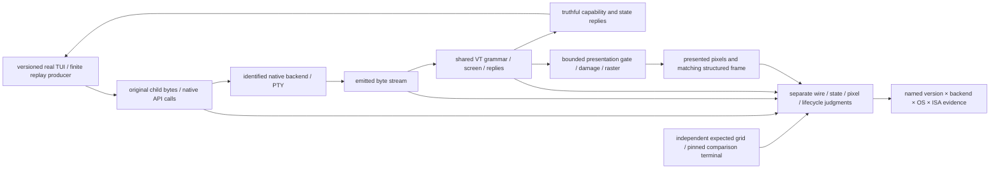

# Modern TUI compatibility and qualification

Parent: [terminal and rendering](PRD_02_24_con_terminal.md). This module owns
the end-to-end compatibility requirements for Claude Code and comparable
interactive terminal applications. Native Windows API/lifetime implementation
remains in [the backend owner](PRD_02_34_windows_console_backend.md); reusable
contracts remain in [the library owner](PRD_02_35_terminal_library.md).

## Outcome and delivery tree

```text
Outcome: modern interactive TUIs remain readable and usable through sustained updates
├── [-] Attribute the reported display corruption to an observed boundary
│   invariant: preserve application bytes, backend identity and presented-frame identity
│   evidence: exact app/MiniCon/OS/ISA versions, finite reproduction and boundary captures
│   safe failure: unknown cause stays unproven; retain each distinct failure class
│   dependency: isolated terminal fixtures; non-goal: attributing every symptom to conhost
├── [-] Truthful protocol capability negotiation
│   invariant: replies advertise only implemented behavior and actual mode state
│   evidence: application probes, independent reply oracle and bounded startup completion
│   safe failure: report unsupported capabilities; no false positive or indefinite wait
│   dependency: shared VT semantics and native transport; non-goal: renaming a parser as compatibility
│   └── [v] shared bounded CSI query replies and actual native round trip
│       invariant: exact query grammar; current mode state; unknown mode reports zero
│       evidence: literal replies, split/malformed probes, native child readback and exit/EOF
│       safe failure: no reply to malformed/non-query commands; 2026 remains unrecognized
│       dependency: minicon-console common helper + parser validity; non-goal: positive sync support
├── [_] Complete-frame presentation, including synchronized updates
│   invariant: active parser state and externally presented frame have explicit ownership
│   evidence: split-stream begin/end, bounded timeout/byte recovery, blink/resize/query interleaving
│   safe failure: a missing end marker cannot freeze the UI or stop input/control servicing
│   dependency: parser, damage and presentation contracts; non-goal: recognizing 2026 without gating presentation
├── [-] Dense redraw, scroll, Unicode and alternate-screen resize journeys
│   invariant: byte splitting and redraw rate do not change final rows, cursor or cell geometry
│   evidence: finite safe traces, independent expected grids, native readback and presented pixels
│   safe failure: bounded session-local errors; keep prior committed frame on publication failure
│   dependency: backend byte integrity, shared screen, viewport and raster; non-goal: echo-only acceptance
└── [_] Real application and cross-platform qualification
    invariant: a passing SDK scenario is not a passing Claude Code session or another OS/ISA
    evidence: versioned real TUI startup, streaming, scrolling, resize, paste, cancel and teardown
    safe failure: unavailable application/runtime cells remain BLOCKED
    dependency: preceding leaves and independent courts; non-goal: automatic backend default promotion
```



## Report and current evidence

Owner report, 2026-10-20: MiniCon 0.2.14 displays substantial screen corruption
when hosting Claude Code and similar harness TUIs. The reported Claude Code
version, selected backend, exact OS build and triggering sequence have not yet
been established. This is a registered real-user symptom, not a reproduced
root cause or evidence that the current experimental backend fixes it.

Source audit at 56b3b67: MiniCon uses the owned `vt100` screen/parser and `vte`
grammar. The name does not restrict the implementation to the original VT100:
the screen includes alternate buffers, cursor addressing, scrolling, bracketed
paste, mouse modes and indexed/RGB attributes. This is an implementation
inventory, not complete xterm conformance.

The actual parser in `third_party/vt100/src/parser.rs` uses `vte::Parser`.
`Screen::decset/decrst` in `screen.rs` do not handle private mode 2026, and the
GUI's `ConCallbacks::unhandled_csi` in `src/main.rs` returned immediately for
private/intermediate sequences. The synchronized-update implementation present
in `third_party/vte/src/ansi.rs` belongs to a different processor path and does
not establish GUI support. Current GUI state/presentation must not advertise
synchronized-output support on that basis.
The existing OutputFramer preserves VT/UTF-8 grammar boundaries; that alone
does not make a multi-command TUI redraw one atomic presented frame.

The subsequent shared-query slice routes the GUI callback through
[the common query helper](PRD_02_35_terminal_library.md#shared-terminal-query-replies).
It replies negatively to mode 2026 and reports current state for its qualified
private-mode subset. Native report delivery is separately exercised in
[the Windows return-transport court](PRD_02_34_windows_console_backend.md#private-mode-query-return-transport).
This advances negotiation and reply transport; synchronized presentation and
real application acceptance remain open.
The next response slice adds [finite CPR/key routing](PRD_02_34_windows_console_backend.md#status-response-routing-and-cpr-key-boundary)
and native DA/DSR/CPR journeys. Identical bytes inside an active query window
remain an explicit ambiguity; it does not certify general application input
ownership or real Claude Code behavior.

Claude Code's [official fullscreen documentation](https://code.claude.com/docs/en/fullscreen#use-with-tmux)
states that it probes synchronized-output support at startup and uses it when
reported. Its [terminal configuration documentation](https://code.claude.com/docs/en/terminal-config#switch-to-fullscreen-rendering)
distinguishes fullscreen rendering and synchronized-output support. Neither
document identifies the cause of this user's MiniCon 0.2.14 corruption.

Existing Windows mirror-stream corruption under bursty redraw and old-system
alternate-screen resize findings remain owned by the parent's
[PTY backend selection](PRD_02_24_con_terminal.md#pty-backend-selection).
They are independent candidates, not a newly established diagnosis. Loss of
synchronized presentation can expose intermediate frames; corrupted escape
bytes, stale geometry and incorrect damage/cell width need separate judgments.

## Delivery order and acceptance

The first native replay slice and its source/wire/readback evidence are owned
by [dense native TUI replay](PRD_02_34_windows_console_backend.md#dense-native-tui-replay).
That slice does not establish GUI pixels, synchronized presentation or a real
Claude Code pass. Terminal identity/profile configuration remains owned by
[the library contract](PRD_02_35_terminal_library.md#dependency-and-public-api-boundary).

1. Inventory exact application/backend identities and reproduce with a finite
   isolated producer. Preserve raw child bytes separately from backend-emitted
   bytes. Start with dense cursor-addressed redraw and alternate-screen resize;
   these exercise the Windows backend's stated replacement boundary directly.
2. Add independent grid/cursor expectations and split/burst/resize variants.
   Replaying through the same parser used by the implementation is useful
   diagnosis but cannot be its sole correctness oracle. Keep stock-host
   differences scoped to the actual binary/build; do not adopt corrupt output
   as the reference contract.
3. Define shared query and presentation semantics before introducing a positive
   2026 capability reply. Shared code owns protocol state and bounded gating;
   native adapters own transport and lifecycle; the GUI owns raster/presentation.
   Queries, input, shutdown and timeout recovery stay live during a held frame.
4. Qualify real Claude Code journeys and presented-frame consistency. Use
   isolated generated data; do not record the user's active conversation or
   consume model requests as an incidental test. A startup/version query,
   synthetic trace, headless screen or neighboring ISA pass proves only its
   named scope. No real Claude Code compatibility pass is claimed yet.

The protocol family is ANSI/DEC VT with selected xterm-style extensions. A
backend replacement, shared parser facade or parser name alone cannot establish
modern TUI compatibility. The acceptance result must name which wire, screen,
presentation and lifecycle requirements actually passed.
