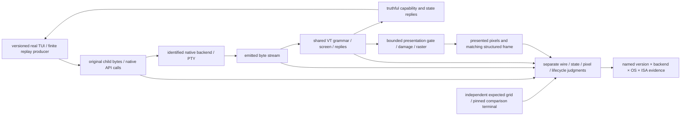

# Modern TUI compatibility and qualification

Parent: [terminal and rendering](PRD_02_24_con_terminal.md). This module owns
the end-to-end compatibility requirements for Claude Code and comparable
interactive terminal applications. Native Windows API/lifetime implementation
remains in [the backend owner](PRD_02_34_windows_console_backend.md); reusable
contracts remain in [the library owner](PRD_02_35_terminal_library.md).

## Outcome and delivery tree

```text
Outcome: modern interactive TUIs remain readable and usable through sustained updates
├── [-] Attribute the reported display corruption to an observed boundary
│   invariant: preserve application bytes, backend identity and presented-frame identity
│   evidence: exact app/MiniCon/OS/ISA versions, finite reproduction and boundary captures
│   safe failure: unknown cause stays unproven; retain each distinct failure class
│   dependency: isolated terminal fixtures; non-goal: attributing every symptom to conhost
├── [-] Truthful protocol capability negotiation
│   invariant: replies advertise only implemented behavior and actual mode state
│   evidence: application probes, independent reply oracle and bounded startup completion
│   safe failure: report unsupported capabilities; no false positive or indefinite wait
│   dependency: shared VT semantics and native transport; non-goal: renaming a parser as compatibility
│   └── [v] shared bounded CSI query replies and actual native round trip
│       invariant: exact query grammar; current mode state; unknown mode reports zero
│       evidence: literal replies, split/malformed probes, native child readback and exit/EOF
│       safe failure: no reply to malformed/non-query commands; 2026 remains unrecognized
│       dependency: minicon-console common helper + parser validity; non-goal: positive sync support
├── [-] Complete-frame presentation, including synchronized updates
│   invariant: active parser state and externally presented frame have explicit ownership
│   evidence: split-stream begin/end, bounded timeout/byte recovery, blink/resize/query interleaving
│   safe failure: a missing end marker cannot freeze the UI or stop input/control servicing
│   dependency: parser, damage and presentation contracts; non-goal: recognizing 2026 without gating presentation
│   └── [-] shared active/presented state boundary; native window/compositor qualification remains open
│       ├── [v] reusable mechanism and six public-consumer courts → PRD 35 bounded synchronized presentation
│       ├── [v] scoped native SDK producer → opened Rust PTY → common presented frame; native owner PRD 34
│       ├── [v] scoped ordinary incremental damage / shared row snapshot cost → PRD 35 borrowed frames
│       └── [-] GUI consumption, timed recovery and native producer-to-pixel journey
│           invariant: paint/copy/snapshots read presented state; query/input modes read active state
│           evidence: frame identity/pixels plus held-frame blink, resize, input, timeout and exit journeys
│           safe failure: schedule idle deadlines; recover locally without blocking PTY/control servicing
│           dependency: shared gate, bounded snapshot cost and GUI timer; non-goal: a parser-bit-only capability claim
│           ├── [v] scoped GUI clock adapter / active input versus presented raster and snapshots
│           │   invariant: hold the old cells/cursor/selection; queries and key/paste/mouse modes stay live
│           │   evidence: production offscreen raster plus literal snapshots/input/selection and fault probes; court below
│           │   failure: bounded 250 ms / 1 MiB recovery; geometry/viewport edits recover explicitly
│           │   dependency: TerminalPresentation; non-goal: native window/compositor or real harness acceptance
│           └── [v] scoped active/inactive idle deadline and drained-EOF recovery
│               invariant: child exit cannot discard queued tail or suppress an outstanding deadline
│               evidence: closed/backlogged pipe, exited child and inactive-session timer courts below
│               failure: keep PTY/control servicing live; finish only when closed and drained
│               dependency: bounded output ring and GUI wake/timer fold; non-goal: changing backend selection
├── [-] Dense redraw, scroll, Unicode and alternate-screen resize journeys
│   invariant: byte splitting and redraw rate do not change final rows, cursor or cell geometry
│   evidence: finite safe traces, independent expected grids, native readback and presented pixels
│   safe failure: bounded session-local errors; keep prior committed frame on publication failure
│   dependency: backend byte integrity, shared screen, viewport and raster; non-goal: echo-only acceptance
└── [_] Real application and cross-platform qualification
    invariant: a passing SDK scenario is not a passing Claude Code session or another OS/ISA
    evidence: versioned real TUI startup, streaming, scrolling, resize, paste, cancel and teardown
    safe failure: unavailable application/runtime cells remain BLOCKED
    dependency: preceding leaves and independent courts; non-goal: automatic backend default promotion
```



## Report and current evidence

Owner report, 2026-10-20: MiniCon 0.2.14 displays substantial screen corruption
when hosting Claude Code and similar harness TUIs. The reported Claude Code
version, selected backend, exact OS build and triggering sequence have not yet
been established. This is a registered real-user symptom, not a reproduced
root cause or evidence that the current experimental backend fixes it.

Source audit at 56b3b67: MiniCon uses the owned `vt100` screen/parser and `vte`
grammar. The name does not restrict the implementation to the original VT100:
the screen includes alternate buffers, cursor addressing, scrolling, bracketed
paste, mouse modes and indexed/RGB attributes. This is an implementation
inventory, not complete xterm conformance.

The actual parser in `third_party/vt100/src/parser.rs` uses `vte::Parser`.
`Screen::decset/decrst` in `screen.rs` do not handle private mode 2026, and the
GUI's `ConCallbacks::unhandled_csi` in `src/main.rs` returned immediately for
private/intermediate sequences. The synchronized-update implementation present
in `third_party/vte/src/ansi.rs` belongs to a different processor path and does
not establish GUI support. Current GUI state/presentation must not advertise
synchronized-output support on that basis.
The existing OutputFramer preserves VT/UTF-8 grammar boundaries; that alone
does not make a multi-command TUI redraw one atomic presented frame.

The subsequent shared-query slice routes the GUI callback through
[the common query helper](PRD_02_35_terminal_library.md#shared-terminal-query-replies).
It replies negatively to mode 2026 and reports current state for its qualified
private-mode subset. Native report delivery is separately exercised in
[the Windows return-transport court](PRD_02_34_windows_console_backend.md#private-mode-query-return-transport).
This advances negotiation and reply transport; synchronized presentation and
real application acceptance remain open.
The following [shared presentation mechanism](PRD_02_35_terminal_library.md#bounded-synchronized-presentation)
separates active parsing from a bounded presented frame and adds ordered parser
events. Its standalone consumer court does not prove GUI adoption, native wire
integration or pixels. The later GUI consumer court below qualifies scoped
offscreen presentation. Mode 2026 remains negatively advertised pending native
window/compositor and broader presentation qualification.
The next response slice adds [finite CPR/key routing](PRD_02_34_windows_console_backend.md#status-response-routing-and-cpr-key-boundary)
and native DA/DSR/CPR journeys. Identical bytes inside an active query window
remain an explicit ambiguity; it does not certify general application input
ownership or real Claude Code behavior.

Claude Code's [official fullscreen documentation](https://code.claude.com/docs/en/fullscreen#use-with-tmux)
states that it probes synchronized-output support at startup and uses it when
reported. Its [terminal configuration documentation](https://code.claude.com/docs/en/terminal-config#switch-to-fullscreen-rendering)
distinguishes fullscreen rendering and synchronized-output support. Neither
document identifies the cause of this user's MiniCon 0.2.14 corruption.

Existing Windows mirror-stream corruption under bursty redraw and old-system
alternate-screen resize findings remain owned by the parent's
[PTY backend selection](PRD_02_24_con_terminal.md#pty-backend-selection).
They are independent candidates, not a newly established diagnosis. Loss of
synchronized presentation can expose intermediate frames; corrupted escape
bytes, stale geometry and incorrect damage/cell width need separate judgments.

## GUI presentation consumer

`src/terminal/presentation.rs` is a product-private clock adapter around
`minicon_console::terminal::TerminalPresentation`, not another VT grammar or
protocol implementation. The common mechanism remains OS/ISA-neutral. The
product chooses a monotonic 250 ms / 1 MiB hold limit. Paint, copy, selection,
structured snapshots, cursor and IME positioning read the presented screen;
queries and keyboard/paste/mouse modes read active state. Explicit geometry
and viewport edits recover before borrowing mutable active state and preserve
unfinished VT/UTF-8 decoding. This does not add a terminal-profile setting.

New output defers automatic viewport-follow and stale-selection clearing until
publication. Damage is consumed from the presented frame. The host services
deadlines for every tab, including inactive and exited-child sessions, before
control reads and when folding its next wake. EOF recovery requires a closed
**and drained** output ring; immediate-child exit alone cannot discard a queued
tail or stand in for pipe EOF. Ordinary output retains incremental damage.

The scoped courts use production GUI methods:

- `gui_synchronized_pixels_snapshot_selection_and_live_input_keep_their_owners`:
  literal RGB pixels from the production cells/cursor/IME raster, paired rows
  and cursor, held selection/copy, live application-cursor and mouse modes,
  live CPR/negative-2026 replies, and full publication after END.
- `gui_synchronized_idle_deadline_recovers_after_child_exit_without_consuming_tail_early`:
  exact pre-deadline/deadline state after child exit, followed by a separately
  closed ring with a backlogged partial CSI tail. Finishing early changes the
  observable held frame and fails the court.
- `gui_synchronized_explicit_resize_keeps_decoder_and_published_cursor_consistent`:
  recover a held frame on a screen-size edit, then complete the partial CSI and
  check literal geometry, rows and cursor.
- `gui_synchronized_deadlines_service_inactive_and_exited_sessions`:
  fold the earliest deadline across active/inactive exited-child tabs; publish
  both locally while requesting redraw only for the active tab.
- `gui_synchronized_native_sdk_queries_pixels_and_eof_share_the_real_session_path`:
  four opened Rust PTY sessions, native `WriteFile` / `WriteConsoleW` producers
  and their matching native reads, explicit END / missing-END EOF variants.
  The real GUI drain sends CPR and negative-2026 replies through the actual
  master. Before/held/after PNGs and JSON snapshots share one UI-thread state;
  native source/readback/reply checkpoints, child exit 35, drained EOF and an
  empty owned job accompany each archive. This fixture attaches its PTY with
  an open bounded ring, as production spawn does; the constructor's idle ring
  intentionally starts closed.

These are offscreen production-raster and session-integration courts on Windows
x64 build 20348. The manual fixture reader does not certify the native window
waker, OS event dispatch, compositor, host overlays, or actual window screenshot
delivery. Native window resizing/blink/paste interleavings and real Claude Code
acceptance remain open. Default GUI provider selection is unchanged; the native
fixture explicitly selects `rust_console()`. Mode 2026 remains negatively
advertised. Other OS/ISA runtime qualification is separate from cross-compilation.

`gui-presentation-negative-audit.json` records eleven compiling runtime faults:
painting active state, snapshotting active state, freezing key mode, freezing
mouse mode, clearing selection early, skipping idle expiry, finishing a
backlogged EOF early, failing to recover on an explicit edit, discarding the
partial decoder on an edit, skipping inactive tabs and dropping actual native
query replies. Each fault fails its assigned court; each source is restored
byte-for-byte in `finally` and checked by SHA. `gui-presentation-restored-gui.log`
then passes all five courts. An initial native-fixture setup failure and a
fault variant rejected by the dead-code compile gate are retained as diagnostic
logs; neither is counted as a successful runtime fault.

Static qualification has eight passes: workspace format, default/enabled
workspace Clippy, common-library all-target checks for Linux x64/ARM64,
Windows ARM64 and macOS x64, and the enabled GUI's Windows ARM64 all-target
check. Whole-GUI Linux x64/ARM64 and macOS x64 checks are BLOCKED on this
Windows host: `ring` cannot find the required cross C compiler
(`x86_64-linux-gnu-gcc`, `aarch64-linux-gnu-gcc`, or `cc`). Their failed commands
and logs remain in `gui-presentation-checks.json`; no whole-GUI POSIX pass is
inferred from the common library's successful compilation.

`gui-presentation-composed.log` passes 382 selected regressions; the two
separate system-host queued-read/mode-reference logs pass one each. Their
384 distinct names retain the preceding 379-test selection and add the five
GUI courts. Default-feature terminal selection passes 66 tests; the separate
default-feature main composition selection passes 60, including composer,
tab/control targeting, status, geometry and existing raster stress courts.
This is targeted composition, not a full-workspace or all-runtime claim.
The CLI help/version test writes directly to stdout, so its intact libtest
successes inventory/result count supplies its name rather than the interrupted
one-line status. `gui-presentation-final-receipt.json` binds the source/staged
tree, named selections, faults, checks, exercised GUI/SDK images and the four
native archives. Those archives retain 14 native phase checkpoints and 56
source/native/reply/PNG/JSON files; the artifact audit checks literal source
commands and native rows/cursor, matching before/held frames, published Unicode
rows, colored raster output and final child status. They do not contain a GUI
reader wire capture; the earlier native wire court remains separate evidence.

## Delivery order and acceptance

The first native replay slice and its source/wire/readback evidence are owned
by [dense native TUI replay](PRD_02_34_windows_console_backend.md#dense-native-tui-replay).
That slice does not establish GUI pixels, synchronized presentation or a real
Claude Code pass. Terminal identity/profile configuration remains owned by
[the library contract](PRD_02_35_terminal_library.md#dependency-and-public-api-boundary).

1. Inventory exact application/backend identities and reproduce with a finite
   isolated producer. Preserve raw child bytes separately from backend-emitted
   bytes. Start with dense cursor-addressed redraw and alternate-screen resize;
   these exercise the Windows backend's stated replacement boundary directly.
2. Add independent grid/cursor expectations and split/burst/resize variants.
   Replaying through the same parser used by the implementation is useful
   diagnosis but cannot be its sole correctness oracle. Keep stock-host
   differences scoped to the actual binary/build; do not adopt corrupt output
   as the reference contract.
3. Define shared query and presentation semantics before introducing a positive
   2026 capability reply. Shared code owns protocol state and bounded gating;
   native adapters own transport and lifecycle; the GUI owns raster/presentation.
   Queries, input, shutdown and timeout recovery stay live during a held frame.
4. Qualify real Claude Code journeys and presented-frame consistency. Use
   isolated generated data; do not record the user's active conversation or
   consume model requests as an incidental test. A startup/version query,
   synthetic trace, headless screen or neighboring ISA pass proves only its
   named scope. No real Claude Code compatibility pass is claimed yet.

The protocol family is ANSI/DEC VT with selected xterm-style extensions. A
backend replacement, shared parser facade or parser name alone cannot establish
modern TUI compatibility. The acceptance result must name which wire, screen,
presentation and lifecycle requirements actually passed.
