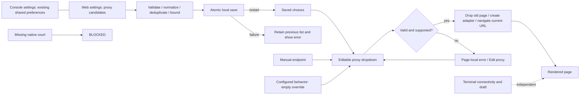

# Browser proxy preferences and settings routes

Owner of Browser proxy editing, saved candidate behavior and Console/Web
settings navigation. Parent: [workspace](PRD_02_25_con_workspace.md).
Native adapter policy and config-codec mechanisms belong to
[shared ownership](PRD_02_28_shared_core.md); public geometry belongs to
[control](PRD_02_26_con_control_cli.md). Sequencing and the parallel trial are
in the [0.2.22 plan](../plan/plan-v0.2.22.md).

## Outcome tree DAG

```text
Outcome: choose an optional Browser proxy and reuse saved choices without changing terminal connectivity
├── [v] Current-Mac active override
│   invariant: manual HTTP endpoint or configured behavior; validate before connection; apply recreates the page and preserves the attempted URL
│   evidence: native_browser_visible_proxy_apply_clear_and_invalid_block; physical invalid/Edit proxy/clear recovery
│   safe failure: invalid or unsupported proxy blocks the page without direct fallback
│   dependency: minicon-web adapter contract (PRD 28); non-goal: proxy authentication or TLS exceptions
├── [v] Current-Mac saved candidates
│   invariant: up to eight normalized unique endpoints; atomic Add/remove; restart retains the list; current connection is process-local
│   evidence: native_browser_settings_proxy_candidates_persist_select_and_delete, including failed-save rollback
│   safe failure: malformed/duplicate/full input and failed save retain the previous list with feedback
│   dependency: shared bounded config codec (PRD 28); non-goal: default proxy or list import
├── [v] Current-Mac settings and combobox
│   invariant: stable Console/Web route targets; Web list supports short-window paging; dropdown/manual input share the same apply path
│   evidence: web_proxy_settings_page_keeps_controls_and_pagination_inside_panel; browser_proxy_choices_have_distinct_dropdown_and_nine_actions; Computer Use captures
│   safe failure: overlays preserve terminal access and return native page visibility on dismissal
│   dependency: workspace geometry/input (PRD 25), public observation (PRD 26); non-goal: another settings window
└── [-] Other native cells
    invariant: compile evidence cannot substitute for real proxy requests or native input
    evidence: current qualification receipt and the plan's platform limits
    safe failure: unrun native courts are BLOCKED
    dependency: per-platform runtime court; non-goal: inferred cross-platform acceptance
```

## Memory palace



## Product requirements

- [v] **Current-Mac browser proxy editor (0.2.22, owner 2026-10-24).** An optional
  single-line field sits to the right of the address, wrapping beneath it in
  narrow windows. It starts empty and uses the existing configuration hooks
  until explicitly overridden. Enter accepts a validated HTTP endpoint such
  as `http://127.0.0.1:8890`, recreates the page adapter with that endpoint for
  HTTP and HTTPS, and reloads the current URL. Applying changes resets page
  history and the proxied page session; ordinary tab switching does not.
  Explicit input clears inherited
  bypass rules; clearing the field restores the existing hooks. Escape reverts
  an unsubmitted edit. Invalid input preserves the URL, blocks navigation with
  `browser-proxy-invalid`, and never silently connects directly. Proxy errors
  offer Edit proxy; other page errors offer Edit address. Terminal tabs
  remain usable. This process-local value is not persisted. Proxy defaults and
  proxy authentication are deferred. Candidate lists are owned by the next
  requirement. Shared validation and
  adapter capabilities belong to [PRD 28](PRD_02_28_shared_core.md); actual
  platform evidence and remaining BLOCKED courts are in the
  [0.2.22 plan](../plan/plan-v0.2.22.md).
- [v] **Current-Mac Console/Web settings and saved proxy choices (0.2.22, owner
  2026-10-24).** Settings has Console and Web routes. Existing Console
  controls keep their global language/theme/update semantics. Web adds or
  removes up to eight normalized HTTP proxy candidates, with invalid,
  duplicate and capacity feedback. Add/Enter and removal save atomically;
  failed writes retain the previous list and show an error. Candidate choices
  persist in `browser.proxy_options` as a string array; they never become an
  automatic proxy default. The Browser proxy field remains editable and
  adds a dropdown: row zero restores configured behavior, followed by saved
  candidates. Selection applies the proxy using the preceding requirement's
  page-recreation contract. Removing a candidate does not change the current
  connection. Overlays hide a native page only while they cover it; dismissal
  restores page visibility. Settings defaults, proxy authentication and list
  import are deferred. Codec structure belongs to PRD 28, public observation
  to PRD 26, sequencing/evidence to the 0.2.22 plan.

## Evidence scope

Current macOS arm64 evidence is named in the tree and the 0.2.22 plan.
`target/parallel-final-native.log` records the public native journeys;
`target/web-settings-native-green.log` covers the final candidate persistence
and rollback path. `target/parallel-final-app-smoke/receipt.json` binds the
canonical development app bytes to real proxy requests and restart behavior.
Computer Use captures under `target/parallel-preview-ui/` cover normal/narrow
presentation and physical editing/selection. Guard-removal failures and final
full/six-cell results are owned by the plan. Intel macOS, Windows and Linux
native evidence for this new preference flow remains BLOCKED until run.

### 0.2.22 release qualification frontier

- [-] Exact-source six-platform CI run `40073750173` at `73b98f7`:
  both macOS native journeys passed; Windows redirected-page title and Linux
  active-proxy journeys failed. Publication remains blocked until replacement
  exact-source evidence passes; current-Mac receipts above retain their scope.
- Windows completion reads the committed native document title as well as title
  notifications. The public smoke court observes one snapshot per proxy poll
  and preserves its final failure state without exhausting the bounded control
  replay cache. Local follow-up: `target-six/release-0.2.22/fix-test.log`
  records 1,313 passing tests, six ignored across 37 suites; Clippy passes in
  `target-six/release-0.2.22/fix-clippy.log`. The inherited uncommitted harness
  work remains outside the release source; fresh exact-source CI is required.
  `target-six/release-0.2.22/fix-mac-smoke/receipt.json` passes the unchanged
  request, clear/invalid and persisted-candidate assertions on this Mac, with
  seven captured native windows; it does not certify physical key interception.

- [-] Follow-up CI `40075261513` at `6ccaf56` passes both macOS and Linux
  native preference journeys. Windows redirected titles now pass; both Windows
  cells reach the active-proxy test and fail `browser-native-create-failed`.
  The environment-isolation repair and its fresh qualification are owned by
  [PRD 28](PRD_02_28_shared_core.md#native-browser-proxy-environment-isolation).
