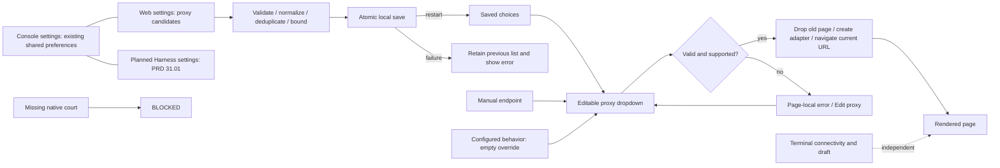

# Browser proxy preferences and settings routes

Owner of Browser proxy editing, saved candidate behavior and settings
navigation. Parent: [workspace](PRD_02_25_con_workspace.md).
Native adapter policy and config-codec mechanisms belong to
[shared ownership](PRD_02_28_shared_core.md); public geometry belongs to
[control](PRD_02_26_con_control_cli.md). Sequencing and the parallel trial are
in the [0.2.22 plan](../plan/archive/plan-v0.2.22.md).

## Outcome tree DAG

```text
Outcome: choose an optional Browser proxy and reuse saved choices without changing terminal connectivity
├── [v] Released active override
│   invariant: manual HTTP endpoint or configured behavior; validate before connection; apply recreates the page and preserves the attempted URL
│   evidence: native_browser_visible_proxy_apply_clear_and_invalid_block; physical invalid/Edit proxy/clear recovery
│   safe failure: invalid or unsupported proxy blocks the page without direct fallback
│   dependency: minicon-web adapter contract (PRD 28); non-goal: proxy authentication or TLS exceptions
├── [v] Released saved candidates
│   invariant: up to eight normalized unique endpoints; atomic Add/remove; restart retains the list; current connection is process-local
│   evidence: native_browser_settings_proxy_candidates_persist_select_and_delete, including failed-save rollback
│   safe failure: malformed/duplicate/full input and failed save retain the previous list with feedback
│   dependency: shared bounded config codec (PRD 28); non-goal: default proxy or list import
├── [v] Released settings and combobox
│   invariant: stable Console/Web route targets; Web list supports short-window paging; dropdown/manual input share the same apply path
│   evidence: web_proxy_settings_page_keeps_controls_and_pagination_inside_panel; browser_proxy_choices_have_distinct_dropdown_and_nine_actions; Computer Use captures
│   safe failure: overlays preserve terminal access and return native page visibility on dismissal
│   dependency: workspace geometry/input (PRD 25), public observation (PRD 26); non-goal: another settings window
├── [_] Three settings routes
│   invariant: stable Console / Web / Harness destinations in the same panel; terminal and browser drafts survive route changes
│   evidence: public route/focus/short-window journey and native page visibility restoration
│   safe failure: unavailable Harness actions explain their state without interrupting another route
│   dependency: shared control seam and PRD 31.01; non-goal: duplicating provider/account rules here
├── [v] Six released artifact courts
│   invariant: source, native bytes and real page/proxy/persistence observations agree
│   evidence: final signed/Candidate/public runs in the 0.2.22 release history
│   safe failure: failed or missing artifact courts block their claim
│   dependency: PRD 27 exact artifacts; non-goal: inferring physical input from CLI injection
└── [-] Native input and DPI breadth
    invariant: physical key/IME/DPI observations keep their actual OS/ISA scope
    evidence: workspace physical Mac observations; future control work in PRD 25.02
    safe failure: unrun native courts remain BLOCKED
    dependency: per-platform input court; non-goal: inherited acceptance from a neighboring ISA
```

## Memory palace



## Product requirements

- [v] **Browser proxy editor (0.2.22, owner 2026-10-24).** An optional
  single-line field sits to the right of the address, wrapping beneath it in
  narrow windows. It starts empty and uses the existing configuration hooks
  until explicitly overridden. Enter accepts a validated HTTP endpoint such
  as `http://127.0.0.1:8890`, recreates the page adapter with that endpoint for
  HTTP and HTTPS, and reloads the current URL. Applying changes resets page
  history and the proxied page session; ordinary tab switching does not.
  Explicit input clears inherited
  bypass rules; clearing the field restores the existing hooks. Escape reverts
  an unsubmitted edit. Invalid input preserves the URL, blocks navigation with
  `browser-proxy-invalid`, and never silently connects directly. Proxy errors
  offer Edit proxy; other page errors offer Edit address. Terminal tabs
  remain usable. This process-local value is not persisted. Proxy defaults and
  proxy authentication are deferred. Candidate lists are owned by the next
  requirement. Shared validation and
  adapter capabilities belong to [PRD 28](PRD_02_28_shared_core.md); released
  artifact evidence belongs to the [release history](archive/v0.2.22-release-history.md).
  Physical input retains its separately named scope.
- [v] **Console/Web settings and saved proxy choices (0.2.22, owner
  2026-10-24).** Settings has Console and Web routes. Existing Console
  controls keep their global language/theme/update semantics. Web adds or
  removes up to eight normalized HTTP proxy candidates, with invalid,
  duplicate and capacity feedback. Add/Enter and removal save atomically;
  failed writes retain the previous list and show an error. Candidate choices
  persist in `browser.proxy_options` as a string array; they never become an
  automatic proxy default. The Browser proxy field remains editable and
  adds a dropdown: row zero restores configured behavior, followed by saved
  candidates. Selection applies the proxy using the preceding requirement's
  page-recreation contract. Removing a candidate does not change the current
  connection. Overlays hide a native page only while they cover it; dismissal
  restores page visibility. Settings defaults, proxy authentication and list
  import are deferred. Codec structure belongs to PRD 28, public observation
  to PRD 26, released evidence to the release history, and the development
  sequence to the archived 0.2.22 plan.

## Planned settings navigation (0.2.23)

`[_]` Extend the current panel to **Console / Web / Harness**, with stable
route IDs and keyboard/pointer entry, no second window and no hidden first-use
listener start. Preserve each route's unsubmitted draft when switching routes;
Escape closes the panel through the shared focus-return contract. Global
language/theme/update controls retain their current Console placement in this
first delivery. Harness fields, authentication, account readiness and API
lifecycle are owned only by [PRD 31.01](PRD_02_31_01_provider_gateway.md).
Public observation belongs to PRD 26. The dated Console/Web requirements above
describe released 0.2.22 rather than the planned three-route state.

## Released evidence scope

[v] Public 0.2.22 signed, packaged and downloaded-artifact evidence is owned by
[its release history](archive/v0.2.22-release-history.md). Six OS/ISA artifact
courts exercise actual HTTP proxy requests, clear/invalid refusal, saved choices
and process restarts. Host-injected events and native page pixels retain their
own scope; they do not qualify every physical keyboard/IME or DPI path.

The [archived development plan](../plan/archive/plan-v0.2.22.md) preserves
current-Mac physical observations, guard-removal controls, local app identities,
parallel-trial timing and earlier scoped receipts. The workspace owns physical
input acceptance; [PRD 25.02](PRD_02_25_02_browser_controls.md) owns planned
consistent control operation. Defaults, authentication and other deferred
preferences retain the non-goals above.
