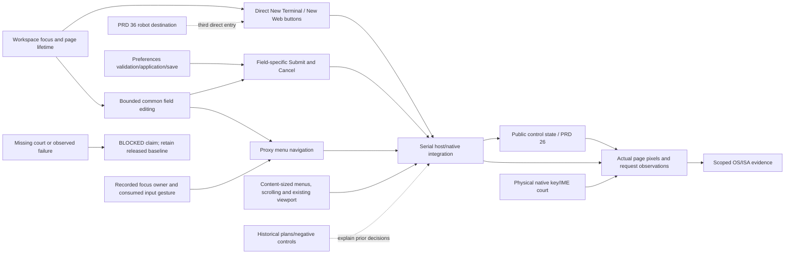

# Browser control editing and menu operation

Parent: [workspace](PRD_02_25_con_workspace.md). Status: `[-]` implementing
0.2.23; owner goal authorizes development through public release. Current
mechanism/native development observations below do not qualify release bytes.
The workspace owns tab/page lifetime and existing address semantics;
[browser preferences](PRD_02_25_01_browser_preferences.md) owns proxy validation,
application and saved choices. This child owns consistent control operation,
not another preferences model. Sequencing: [0.2.23](../plan/plan-v0.2.23.md).

## Outcome tree DAG

```text
Outcome: edit browser controls predictably and choose an action using mouse or keyboard
├── [-] EDIT — one bounded host editing mechanism
│   invariant: address, active proxy and candidate fields share caret, selection, clipboard and IME rules; each keeps its own draft, limits and Submit/Cancel action
│   evidence: real page input -> each editor -> submit/cancel -> terminal/browser return; guard removal must break the selected public regression
│   safe failure: invalid input stays editable; no key reaches an unrelated field or PTY
│   dependency: existing core composer/click rules and workspace focus ownership
│   non-goal: merging multiline composer/notes semantics or rewriting the terminal renderer
├── [-] MENU — complete proxy menu operation; the released New menu is superseded by DIRECT
│   invariant: keyboard entry, distinct highlight/applied state, single activation, dismissal and focus return follow the menu contract below
│   evidence: mouse and keyboard choose equivalent actions with zero/one/eight saved proxies at normal/narrow/collapsed/Retina geometry
│   safe failure: dismissal cannot navigate, apply a proxy or send input behind the overlay
│   dependency: EDIT event ownership, existing shared Layout and native page visibility
│   non-goal: a general external menu framework or extra Browser roots
├── [-] DIRECT — two one-click creation buttons in 0.2.25
│   invariant: New Terminal creates a terminal, New Web opens/reuses the single Browser root, and robot enters separate Harness
│   evidence: public pointer/keyboard direct actions in expanded/collapsed/narrow layouts with no menu opening
│   safe failure: missing room hides neither action behind a zero-width target; creation failure keeps the current surface
│   dependency: workspace tab limits, current New action routes and PRD 36 robot entry
│   non-goal: turning Harness into a tab or changing existing shortcuts
├── [-] LAYOUT — size menus to their content and available viewport
│   invariant: preserve the existing responsive toolbar; menu height follows actual option count, rows retain readable targets and overflow uses bounded scrolling
│   evidence: normal/narrow/collapsed/Retina resize with zero/one/eight candidates, preserved drafts and a correctly aligned native page
│   safe failure: below supported minimum geometry show resize feedback; do not offer overlapping/zero-width hit targets or route input behind clipped chrome
│   dependency: shared Layout, preference candidate count and workspace native-page viewport contract
│   non-goal: a new dialog or a whole-host theme/layout rewrite
└── [-] NATIVE — observe the actual control/page boundary
    invariant: visible page pixels, state, edited address and active proxy agree; switch/return preserves the documented draft and page state
    evidence: local service and loopback proxy, restart/error recovery, native physical key/IME observations per claimed OS/ISA
    safe failure: unavailable input or native court is BLOCKED; injected CLI keys do not certify native interception
    dependency: EDIT/MENU/LAYOUT, public observation and the PRD 28 browser adapters
    non-goal: provider OAuth/dashboard/downloads, default proxy, new page-persistence promises or 1:N panels
```

## Memory palace



### 0.2.25 direct creation entry

The owner replaces the visible `New` dropdown with two independent header
buttons: **New Terminal** and **New Web**. Each click performs its named action
once, without opening a menu. A focused Terminal button also opens a terminal
on Enter/Space. The robot
remains the third direct entry to the separate Harness destination; it does not
create a Harness tab. Existing creation shortcuts retain their meanings.
Compact layouts keep both targets reachable and distinguishable rather than
folding them back into a dropdown. The old New-menu contract below is retained
as released 0.2.23 history and is superseded for the current header; the proxy
choice menu remains active.

Development evidence: `native_header_buttons_create_terminal_web_and_open_harness_directly`
passed on Windows in expanded and collapsed sidebars. With the Web hit route
temporarily removed, the same public test failed at the Browser count, then
passed after restoring the route. `host_browser_menus_keyboard_entry_traversal_and_single_activation`
passed with direct Terminal Enter activation and unchanged proxy-menu focus
behavior. Narrow/Retina presentation and final release bytes remain open.

## Editing and focus acceptance

An unsubmitted draft survives refocus. Clipboard actions and IME preedit/commit
update only the focused field and its own caret anchor. Submit and Cancel remain
field-specific: shared editing cannot navigate, apply a proxy or save settings.
Editing outcome and event ownership are separate: an unchanged or unsupported
editor action does not authorize forwarding that key to the PTY or native page.
A retained draft does not itself mark a field as focused. Exactly one input
owner receives a gesture, independently of how many field drafts are retained.

### Field actions and bounds

| Field | Committed-text bound | Submit | Cancel |
| --- | --- | --- | --- |
| Address | Existing 8,192 UTF-8 bytes | Delegate normalization/navigation to workspace | Discard this draft and return to the current page; the loaded URL is unchanged |
| Active proxy | Existing 2,048 UTF-8 bytes | Delegate application and page recreation to PRD 25.01, including its invalid-proxy refusal | Restore the applied value and return to the page |
| Saved candidate | Existing 2,048 UTF-8 bytes | Delegate validation and atomic Add to PRD 25.01 | Dismiss Web settings without Add, retaining the unsubmitted candidate draft |

Ordinary refocus preserves each unsubmitted draft. Explicit Cancel is different
from refocus; reopening a cancelled field starts from its field-specific baseline.
Candidate Cancel keeps the released Escape-to-dismiss and draft behavior. It
never removes an already saved choice. The existing bounded preedit policy is retained.

Compute the prospective size after single-line normalization and replacement of
the selected range. At the bound, replacing selected text with a shorter value
must work. An over-limit edit preserves the original text, selection and caret;
it cannot partially cut the selection. Caret/selection offsets remain valid
UTF-8 boundaries. Clipboard and IME commits use this same rule.

IME candidate confirmation does not also Submit the field. Once composition
finishes, a separate Submit gesture may navigate/apply/Add. A blur or menu
transition ends or cancels preedit through the native input contract before
another field receives input. Invalid *edits* and invalid *submitted proxies*
are distinct: PRD 25.01 still drops the previous page and blocks direct access
when a submitted proxy is invalid. Editing reuse must not retain that old route.

Apply the workspace's existing address/composer selection rules consistently
across the three fields; the workspace retains the current address baseline.
At normal default geometry, a common loopback HTTP proxy with a five-digit
port remains readable. Longer values expose truncation clearly and provide
full-value access while focused; the caret/preedit stays within the text area
and the dropdown never covers the value. The
[public 0.2.22 captures](../archive/research/browser-v0.2.22/README.md) provide
the visual baseline.

The mechanism should return bounded editing outcomes to product callers.
Common rules belong at the existing reusable core/UI seam when an actual
consumer and contract justify them; MiniCon navigation, preferences and
submission policy remain in MiniCon. No platform crate depends on product
settings or AgenTerm product state.

## Menu and native acceptance

New and proxy menus visibly indicate the selected row, support directional
movement, activate once on Enter and dismiss on Escape/outside click. Dismissal
returns focus predictably and restores the native page after the overlay.
Selected rows and hit regions must match the actual list, including an empty
saved list's configured-behavior row. A missing page never disables Terminal.

### Keyboard entry and focus return

The minimum Browser chrome traversal is New trigger -> address -> active proxy
-> proxy-menu trigger, cycling with Tab and reversing with Shift+Tab while the
host chrome owns focus. The existing page-to-address shortcut provides entry
from a focused native page. Page and terminal Tab behavior remains with their
own input owners. This is not a new global shortcut or whole-host focus rewrite.
The later robot/Settings header group joins the traversal at the proxy/New
boundary under [PRD 36](PRD_02_36_harness_workspace.md); both directions must
reach New as well as that group. Returning from the group to the same proxy
on forward Tab creates a focus loop and is not an acceptable integration.

Enter or Space on a focused trigger opens its menu. Opening does not activate
the highlighted action: consume the opening gesture through its release.
New initially highlights Terminal. Proxy initially highlights the matching
applied row, or row zero when the applied manual endpoint has no list entry.
The latter is a navigation starting point, not an applied marker. Up/Down clamp
to the first/last row; pointer hover and keys update the same highlight. A
separate Enter/Space or pointer selection activates once, including under key
repeat. Keyboard navigation keeps the highlighted row visible.

| Closing cause | Connection/action | Focus and draft |
| --- | --- | --- |
| Escape or trigger toggle | No activation | Restore the recorded pre-menu trigger, field/selection or page focus |
| Outside pointer click, including Back/Reload/another trigger | Dismiss only; consume press/release so the same gesture cannot reach underlying UI | Restore the pre-menu owner; a subsequent gesture may use the other control |
| Explicit choice | Commit one selected action | New selects the resulting work surface; proxy application follows PRD 25.01 |
| App deactivation | Dismiss without activation | Retain drafts and a logical return target; never steal foreground focus |
| Resize | No activation | Keep draft/highlight and reveal it; if no row fits, dismiss with bounded feedback |

The menu owns routing until dismissal is complete. Hiding or restoring the native
child, clearing an open flag, or returning from a handler must not re-dispatch
the same gesture to a page, toolbar action or PTY.

Retain the responsive toolbar wrapping already owned by PRD 25.01; it is a
released baseline, not a new 0.2.23 feature. Size the proxy menu to one configured
row plus the actual saved choices, avoiding unused blank rows. When all choices
do not fit, retain readable row targets and scroll within the available frame;
keyboard movement keeps the highlighted row visible. Resizing preserves drafts
and the native page alignment. Painting, hit testing, IME anchors and public
snapshots consume the same geometry.

Retain full-size targets: proxy rows are 32 DIP and New actions 40 DIP. Fit the
actual row count to the available viewport; use bounded scrolling rather than
shrinking rows to fit a fixed nine-row budget. If even one row cannot fit, do
not open an unusable menu. Keep the existing overlay/native-child visibility
model; this pass does not add an overlay window or a new native composition path.

Distinguish the applied proxy from keyboard highlight: opening or moving in a
menu does not apply a choice. A manually entered endpoint absent from the list
does not mark the configured-behavior row as active. Enter or a pointer choice
commits once; dismissal retains the existing connection.

Keep the existing one-Browser-root and creation-time proxy reset contracts.
Saved candidates do not imply an automatic default. Installation remains
deferred for coordinated AgenTerm planning. The next plan selects work and
exclusive hot-file ownership; PRD 33 owns build/fixture serialization rules.

## Evidence frontier

### Observed 0.2.22 starting failures — Windows x86_64, 2026-10-24

Exploration used the checksum-verified public native ZIP referenced by the
[0.2.22 release history](archive/v0.2.22-release-history.md). Its complete
browser journey passed, including native page-focused address/tab shortcuts,
real loopback proxy requests, refusal and saved-choice restart/delete behavior.
These observations do not qualify another OS/ISA or the new controls.

| Observation | Reproduction and result | Required new regression |
| --- | --- | --- |
| B22-MENU-KEYS | With zero saved candidates, open the proxy menu and inject ArrowDown/Enter through the public CLI: it stays open | Enter from the defined keyboard entry path and commit once |
| B22-MENU-DISMISS | Load two pages; open the proxy menu, then click the outside Back button: the menu closes and the URL also moves to the previous page | Dismissal consumes the gesture; URL, applied proxy and terminal draft stay unchanged |

Local observations: `target-six/explore-v0.2.22/menu-observations/menu-observations.json`;
full native journey: `target-six/explore-v0.2.22/physical/receipt.json`.
These are exploratory records, not assertion-bearing regression tests. Capture
the failures in named public black boxes before implementing their fixes.
The menu keys above were host-injected; native menu input remains unqualified.
The empty menu paints one actual row; do not describe the nine-row geometry
budget as nine visibly painted blank rows.

The original three editors checked old length plus insertion without subtracting selected content. The selected-replacement assertion reproduced that defect before the shared reducer replaced those checks.

Current development evidence (Windows x86_64, 2026-10-24):

- `field_editor::tests` has five passing mechanism oracles, including bounded
  selected replacement, atomic rejection, UTF-8 pointer selection, composition
  and collapsed-anchor typing. The prior old-length guard was run first and
  failed the selected-replacement assertion. Removing the preedit guard caused Submit during composition; removing collapsed-anchor cleanup reselected inserted text. Both negative controls failed their real assertions, and all five tests passed after exact source restoration.
- `host_browser_editors_replace_selected_text_with_bounded_atomic_edits`
  passes through public CLI against a missing-runtime fixture, covering all
  three fields; this is host-input evidence, not physical IME qualification.
- `native_browser_proxy_menu_outside_click_dismisses_without_navigation`
  fails against checksum-verified public 0.2.22, passes against development
  bytes, fails again when dismissal consumption is removed, then passes after
  exact source restoration. This is real WebView2 navigation plus host-injected
  input, not a physical pointer interception claim. Local mutation records:
  `target-six/v0.2.23-controls/dismiss-mutation.json` and `.log`.

The three public journeys for keyboard entry/traversal/single activation,
original UTF-8 editor selection on dismissal, and zero/one/eight proxy choices
with readable rows/scrolling pass on development bytes. Native WebView2
composition, outside-click navigation, address/history/error, proxy persistence
and terminal-draft journeys also pass. The native two-window reactivation
court first reached actual page/menu focus, then failed Windows foreground
eligibility while activating its second owned window; the corrected fixture subsequently passed actual foreground, child-page focus, background non-activation and reactivation assertions. Physical input and final artifact qualification
remain open. Retain
0.2.22 receipts in its release history and archived plan as the starting scope.
A new source must qualify independently; physical keyboard, IME, injected CLI
and rendered-state observations remain separate claims.

### Shared exact-artifact smoke coverage

`scripts/browser-workspace-smoke.py` now includes the existing public control
journeys after its native navigation/proxy checks, in another private profile.
It checks keyboard menu entry and single activation, retained UTF-8 selection
on dismissal, bounded replacement/rejection in all three editors, and readable
0/1/8-choice menus across narrow/wide windows and resize. Harness route/draft,
failed-save recovery and readable scrolling remain owned by
[PRD 31.01](PRD_02_31_01_provider_gateway.md); their injected IME routing repair
is recorded by [PRD 26](PRD_02_26_con_control_cli.md).

The complete Windows x86_64 development run passed all 15 named host checks:
`target-six/v0.2.23-provider/artifact-smoke-host-controls-green-2/receipt.json`,
binary SHA-256
`e8c3ee526156aa17b42d6b078c17eb383477b53c1e41f56f7b0572a26df406e9`.
Its six menu-geometry rows measured 1000 permille. Input provenance is public
CLI injection, with no physical keyboard, native IME or clipboard claim. The
same entry is already used by unsigned, signing and public artifact courts;
their matching-source results remain open. Canonicalizing the temporary root
keeps macOS `/var` aliases outside the private-store no-link ancestry rule;
the production rule is unchanged. Missing native scales/pixel/input courts
retain their own scope below and in the release plan.

### Exact unsigned Windows native-input checkpoint

The Win32 SendInput/native Microsoft Pinyin court used the receipt-verified
Windows x86_64 payload from pack `40113102017`, source
`d40c4fd45543ea7e4e055d963d62bc2684a943ce`, SHA-256
`47ab668bb6e3f7ffca104b2b4297dec7bf0cc1c0d00defcde399ffd91c8d283a`.
At scale 1000 permille it observed actual page-key echo, page-to-address Ctrl+L,
Tab/menu entry and focus return, and all three editors' native selection,
copy/cut/paste, Pinyin preedit and Space commit without submitting the field.
The local records are
`target-six/v0.2.23-controls/native-pack-d40c4fd-2/receipt.json` and its named
preedit/committed/menu PNGs. Owned-client-DC images expose the host controls;
they do not certify GPU browser-page or IME-popup pixels.

The overall court remains **BLOCKED**: its clipboard restoration returned
`0x800401D4` after the functional assertions. Keep that failed fixture receipt;
a corrected cleanup mechanism and a fresh complete run are required. These
observations do not qualify another OS/ISA, another scale or final signed bytes.

### Isolated hosted physical-input checkpoint with exact clipboard cleanup

At exact `a3925e394d1f15db748d602d5701ea3b3813b7d9`,
[run40240295246](https://github.com/partnernetsoftware/minicon/actions/runs/40240295246)
uses default Windows x86_64 developer image SHA-256
`3715218ec4655f0a5840dc953007385e499f1a21a38ef4e742234c8aa5bb698a`.
Its four passed rows cover actual page-key echo/Ctrl+L/full forward-reverse
header traversal, then each of the address, active proxy and saved-candidate
editors: native select/copy/cut/paste, complete Pinyin preedit and Space commit
without navigation/proxy application/Add. Actual scale is1000 permille.
The owned GUI exits normally with0, its page thread joins, synthetic roots are
removed, the original empty clipboard is verified exactly restored, and the
court restores original language profiles. Receipts and named PNGs are under
`target-six/v0.2.23-provider/native-controls-ci-a3925e3/`.

Root visually reviewed the three committed-editor PNGs: the Chinese text and
caret are readable inside their actual fields. Owned-client-DC images do not
qualify GPU page or IME candidate-popup pixels. The overall job remains BLOCKED
when foreground is lost later in the independent Harness phase; that phase is
not passed by these four rows. ARM64 sends no input because its activation point
is obscured. Other scales, complete remaining native scope and signed-artifact
qualification stay open under PRD32/31.01.
Harness observations from the same run belong to PRD 31.01.

The later exact `d2a67eb` x86_64 replay passes the complete physical court,
including those browser rows and cleanup. [PRD32](PRD_02_32_dev_loop_crosscheck.md#hosted-native-input-completion-and-remaining-desktop-allocation)
owns its actual work-area geometry, source/image receipt, remaining ARM64
desktop blocker and allocation sequence. This is a development1000-permille
result, not other-scale/OS or signed-artifact qualification.
