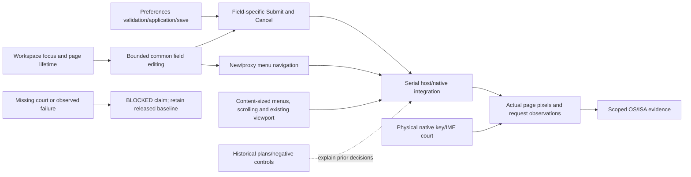

# Browser control editing and menu operation

Parent: [workspace](PRD_02_25_con_workspace.md). Status: `[_]` planned for
0.2.23; the owner requested planning after the public 0.2.22 closeout.
The workspace owns tab/page lifetime and existing address semantics;
[browser preferences](PRD_02_25_01_browser_preferences.md) owns proxy validation,
application and saved choices. This child owns consistent control operation,
not another preferences model. Sequencing: [0.2.23](../plan/plan-v0.2.23.md).

## Outcome tree DAG

```text
Outcome: edit browser controls predictably and choose an action using mouse or keyboard
├── [_] EDIT — one bounded host editing mechanism
│   invariant: address, active proxy and candidate fields share caret, selection, clipboard and IME rules; each keeps its own draft, limits and Submit/Cancel action
│   evidence: real page input -> each editor -> submit/cancel -> terminal/browser return; guard removal must break the selected public regression
│   safe failure: invalid input stays editable; no key reaches an unrelated field or PTY
│   dependency: existing core composer/click rules and workspace focus ownership
│   non-goal: merging multiline composer/notes semantics or rewriting the terminal renderer
├── [_] MENU — complete New/proxy menu operation
│   invariant: current selection, Up/Down/Enter/Escape, outside-click dismissal and focus return work consistently
│   evidence: mouse and keyboard choose equivalent actions with zero/one/eight saved proxies at normal/narrow/collapsed/Retina geometry
│   safe failure: dismissal cannot navigate, apply a proxy or send input behind the overlay
│   dependency: EDIT event ownership, existing shared Layout and native page visibility
│   non-goal: a general external menu framework or extra Browser roots
├── [_] LAYOUT — size menus to their content and available viewport
│   invariant: preserve the existing responsive toolbar; menu height follows actual option count, rows retain readable targets and overflow uses bounded scrolling
│   evidence: normal/narrow/collapsed/Retina resize with zero/one/eight candidates, preserved drafts and a correctly aligned native page
│   safe failure: below supported minimum geometry show resize feedback; do not offer overlapping/zero-width hit targets or route input behind clipped chrome
│   dependency: shared Layout, preference candidate count and workspace native-page viewport contract
│   non-goal: a new dialog or a whole-host theme/layout rewrite
└── [_] NATIVE — observe the actual control/page boundary
    invariant: visible page pixels, state, edited address and active proxy agree; switch/return preserves the documented draft and page state
    evidence: local service and loopback proxy, restart/error recovery, native physical key/IME observations per claimed OS/ISA
    safe failure: unavailable input or native court is BLOCKED; injected CLI keys do not certify native interception
    dependency: EDIT/MENU and the PRD 28 browser adapters
    non-goal: provider OAuth/dashboard/downloads, default proxy, new page-persistence promises or 1:N panels
```

## Memory palace



## Editing and focus acceptance

An unsubmitted draft survives refocus. Clipboard actions and IME preedit/commit
update only the focused field and its own caret anchor. Submit and Cancel remain
field-specific: shared editing cannot navigate, apply a proxy or save settings.

Apply the workspace's existing address/composer selection rules consistently
across the three fields; the workspace retains the current address baseline.
At normal default geometry, a common loopback HTTP proxy with a five-digit
port remains readable. Longer values expose truncation clearly and provide
full-value access while focused; the caret/preedit stays within the text area
and the dropdown never covers the value. The
[public 0.2.22 captures](../archive/research/browser-v0.2.22/README.md) provide
the visual baseline.

The mechanism should return bounded editing outcomes to product callers.
Common rules belong at the existing reusable core/UI seam when an actual
consumer and contract justify them; MiniCon navigation, preferences and
submission policy remain in MiniCon. No platform crate depends on product
settings or AgenTerm product state.

## Menu and native acceptance

New and proxy menus visibly indicate the selected row, support directional
movement, activate once on Enter and dismiss on Escape/outside click. Dismissal
returns focus predictably and restores the native page after the overlay.
Selected rows and hit regions must match the actual list, including an empty
saved list's configured-behavior row. A missing page never disables Terminal.

Retain the responsive toolbar wrapping already owned by PRD 25.01; it is a
released baseline, not a new 0.2.23 feature. Size the proxy menu to one configured
row plus the actual saved choices, avoiding unused blank rows. When all choices
do not fit, retain readable row targets and scroll within the available frame;
keyboard movement keeps the highlighted row visible. Resizing preserves drafts
and the native page alignment. Painting, hit testing, IME anchors and public
snapshots consume the same geometry.

Distinguish the applied proxy from keyboard highlight: opening or moving in a
menu does not apply a choice. A manually entered endpoint absent from the list
does not mark the configured-behavior row as active. Enter or a pointer choice
commits once; dismissal retains the existing connection.

Keep the existing one-Browser-root and creation-time proxy reset contracts.
Saved candidates do not imply an automatic default. Installation remains
deferred for coordinated AgenTerm planning. The next plan selects work and
exclusive hot-file ownership; PRD 33 owns build/fixture serialization rules.

## Evidence frontier

No new 0.2.23 implementation or native input qualification is claimed. Retain
0.2.22 receipts in its release history and archived plan as the starting scope.
A new source must qualify independently; physical keyboard, IME, injected CLI
and rendered-state observations remain separate claims.
